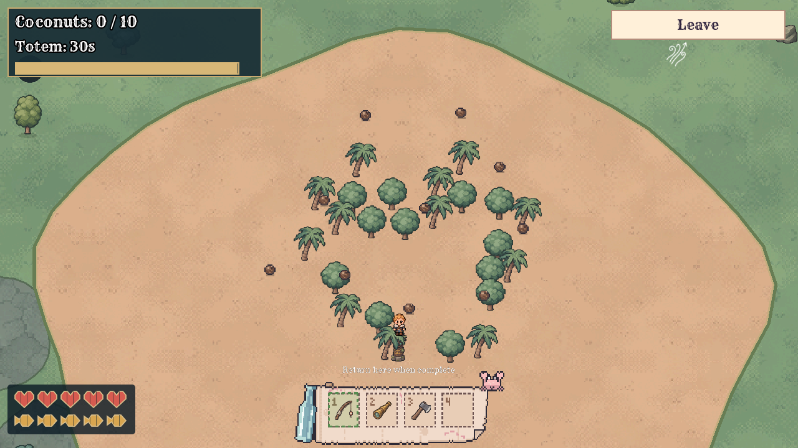

# Clearing challenges and interaction polish

Merged from `codex/procedural-islands` into `systems-revamp` on November 27, 2026 (`86b243f`). See [release and rollback](networking-release-rollback.md).

- Totem puzzles now render in world space over the generated island's actual dirt clearing. The old painted island, ocean and cliff collisions are removed for embedded play. The camera frames the clearing; objective HUD and Leave button stay screen sized. The finish area is an exit totem.
- A single transparent, fixed-resolution viewport preserves the 19 puzzles' coordinates and isolated physics. It exists only during a challenge. Coconut Island uses a smaller viewport and matching foliage. Bee Hive Hill's formerly painted hiding trees are now visible props.
- Puzzle simulation remains private to its participant. Other players see the occupied totem, not the puzzle actors. Host-owned reservations, cooldowns and supply drops remain shared. Completion still uses the existing cooperative trust model.
- Nearby stations, storage, food preparation, totems and sanctuary interactions show small white `Space - interact` text above the object, without a panel. The text follows moving/rotating deck objects every frame; proximity checks stay at 10 Hz and send no network traffic. E remains an alternate binding. Prompts are suppressed while operating a station, during maps, menus and challenges.
- Axe and pickaxe swings work on deck, including their existing replicated animation serial. Deck swings cannot harvest shoreline resources. Ordinary trees and rocks yield 2–3 wood/stone, rolled by the host; palms still yield one wood and two coconuts.
- Pickaxe atlas cropping excludes the neighboring axe sliver. New carved totem and square medpack artwork use cached alpha-trimmed atlas regions.
- The real catalog has 17 items: fishing rod, axe, pickaxe, spyglass, wood, stone, coal, rope, string, leather, medpack, three keys, coconut, fish and cooked fish. Retired puzzle supplies are private objective tokens, not registered voyage loot. Retired entries are cleared when restoring inventories without private definitions.

## Playtest

Start a new generated voyage, approach each kind of station and check Space prompts. Swing both tools on deck; verify another player sees the swing and no shoreline resource is harvested. Harvest several trees/rocks and check 2–3 yields.

At an island totem, press Space. Check movement and interaction within the clearing, objective completion, return to the exit totem, Leave, pause/resume and phone controls. A win should produce two distinct shared supply stacks and a five-minute cooldown. Failure should permit immediate retry. Check a guest entering/leaving while the host continues sailing.

## Future day/night and weather design (not implemented)

Use one host-owned voyage clock and a seeded weather schedule, replicated only on state changes. Clients derive sun tint, clouds, rain and occasional lightning locally. Keep rain particles bounded to the camera, offer reduced effects on phones, and avoid full-screen blur or dynamic shadows. Start with visual weather; introduce wind/gameplay effects separately so visibility and ship balance can be tested independently. No extra service is required.

## Validation

Godot 4.7.2: import/parser check, 3,320 foliage/catalog checks, 332 clearing/totem checks, all 19 standalone puzzle regressions, 89 item-system checks, 31 stack-splitting checks, 86 responsiveness checks, 32 world-interaction checks, 12 saved-world checks, 84 survival checks and the movement-smoothing suite passed. Native visual capture confirmed transparent world placement and screen-sized HUD.

Three local ENet processes (host and two guests) passed 20 mining/foliage checks, including host-owned 2–3 stone drops and shared resource state. This is not a fresh WebRTC or cellular-network measurement.

The Web Multiplayer release export builds successfully. The merged build is pushed to GitHub and deployed to the existing website; deployment IDs are recorded in the release notes.

The standalone regression harness previously replaced a scene directly during the preceding `scene_changed` emission, producing a native crash reproducible with unchanged HEAD scripts too. Waiting one process frame before the next scene replacement fixes the harness; the full suite then passes. The first stack-splitting invocation used the wrong script entry point; its correct `.tscn` scene passes.

Phone-browser performance and a live cross-network playtest still need verification. No new transport, relay service or dependency is introduced by this update.

## Artwork provenance

`assets/items/totem_medpack.png` was generated with the built-in image-generation tool using `assets/terrain/foliage.png` as the style reference. Transparent alpha is preserved. No new runtime dependency.

Exact prompt:

> Create a production pixel-art two-sprite atlas for Holy Ship, matching the provided reference's muted sage/olive, warm brown, dark pixel outlines, crisp chunky clusters and restrained dithering. Transparent background. EXACTLY two equal square cells side by side, generous empty transparent gap, no labels or grid. LEFT: a polished carved island challenge totem, full standing silhouette with a squat stone base, weathered dark brown wooden body, two subtle turquoise glowing carved eyes, ochre carved bands, small worn leaf detail, friendly mysterious nautical island aesthetic, top-down slightly elevated RPG view matching the trees. No scenery. RIGHT: a compact SQUARE cream canvas medical kit with a brown leather carry handle and a clear red plus/cross patch; boxy square case, not a sack, not round, readable at 32 pixels. Both assets isolated, all silhouettes inside their own cells with 15 percent margins. Logical 48-pixel sprite detail enlarged with nearest neighbor. No gradients, blur, 3D realism, shadows on background, text, UI frames or extra objects. Genuine transparent alpha. The totem is a world prop and the medical kit is an inventory icon.
