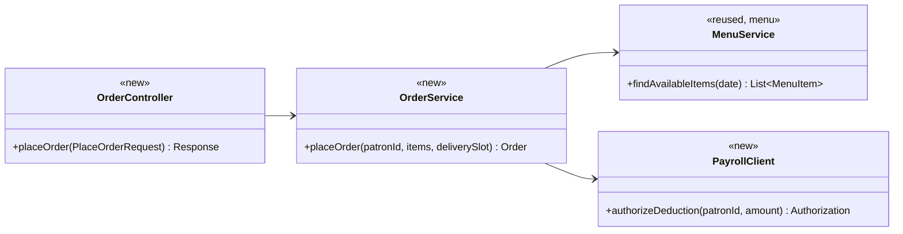
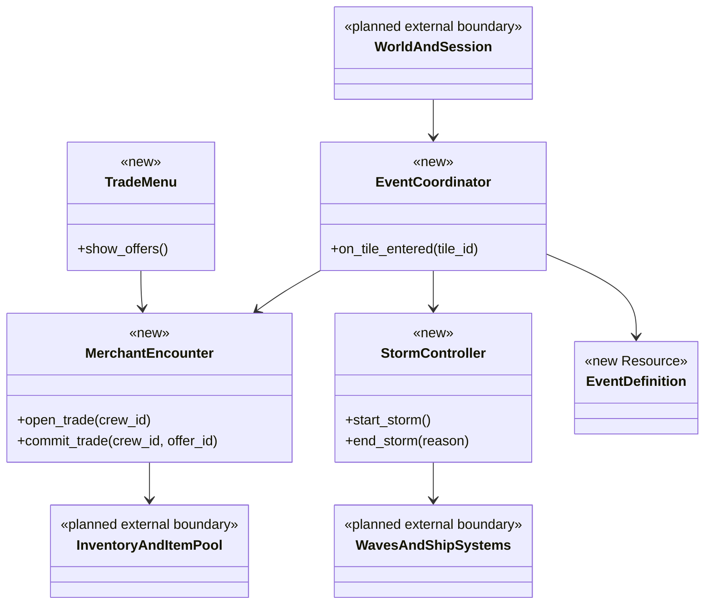
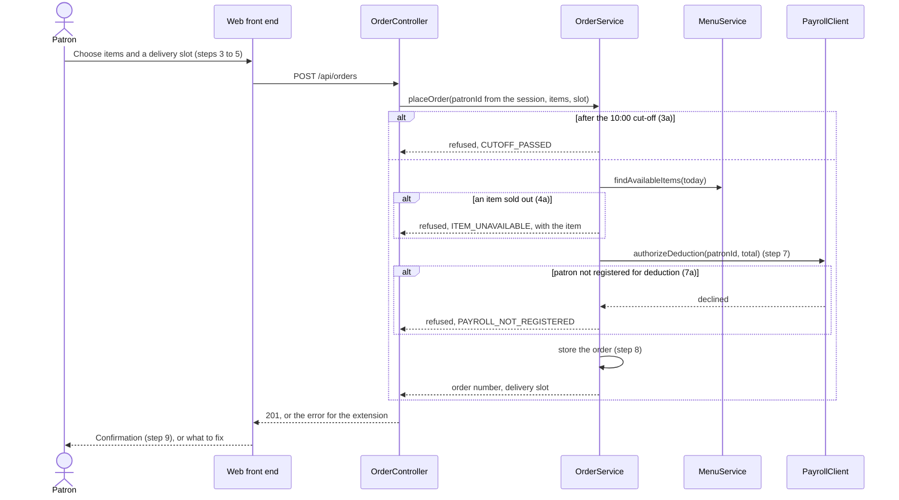
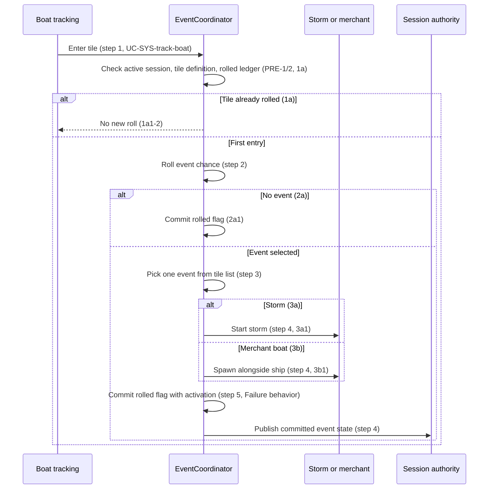
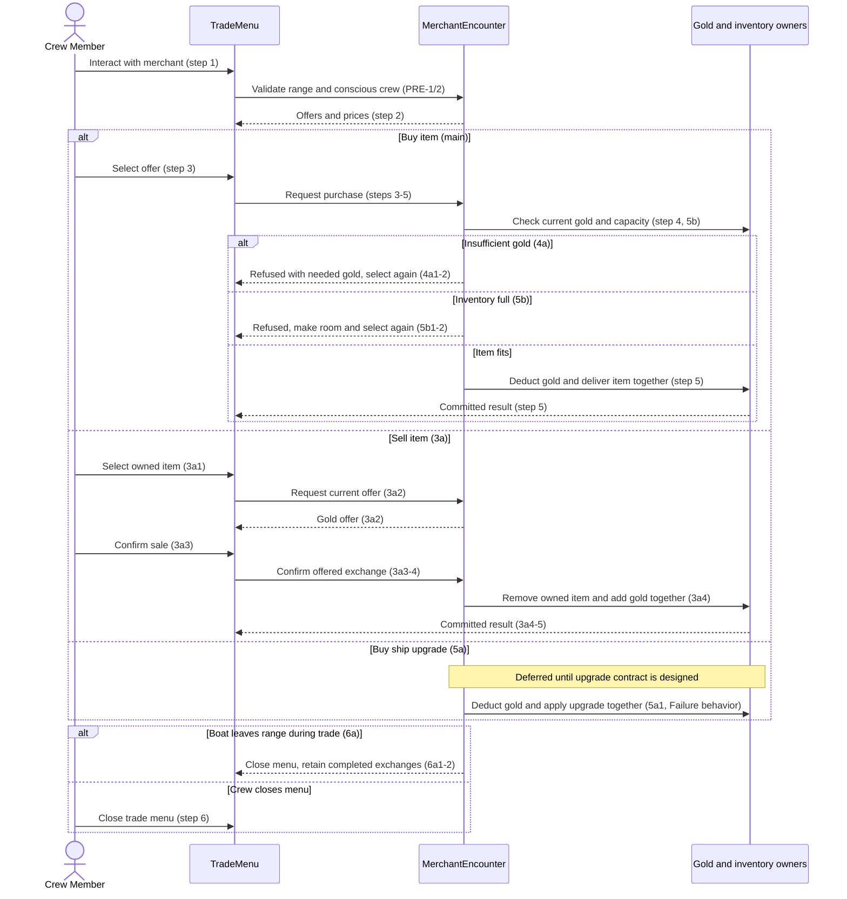
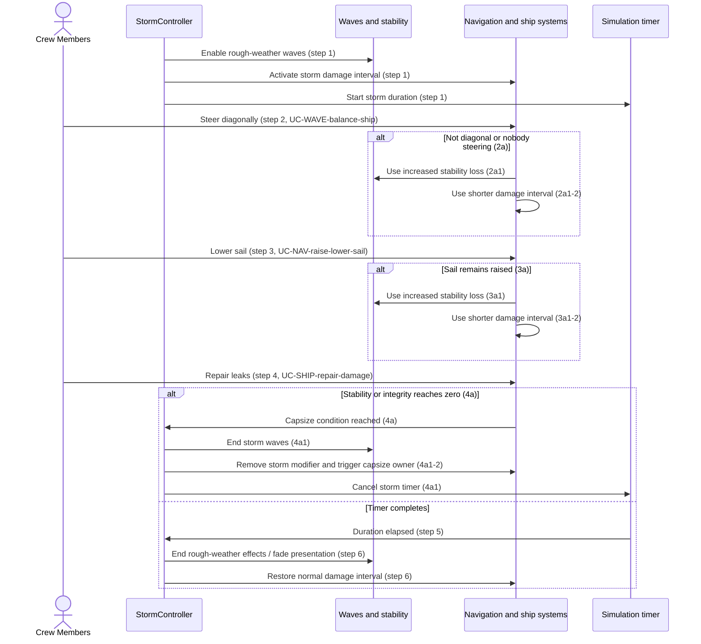

# Events & Encounters Design

**Project:** Holy Ship!
**Team:** Team 13 (Gaming)
**Area:** `UC-EVT` (Events & Encounters)
**Status:** Proposed design for future implementation; no EVT code exists.
**Draft date:** 2026-10-14

> **Realizes:** `UC-EVT-generate-event`, `UC-EVT-trade-with-merchant`, `UC-EVT-weather-storm`. No supplied `FR-EVT-*` identifiers.
> **Depends on:** `BR-event-roll-once-per-tile`, `BR-merchant-pricing`, `BR-capsize-conditions`, `BR-damage-interval`; supporting `BR-inventory-slots`, `BR-waves-rough-weather-only`, `BR-capsize-reset`, `BR-host-controls-session`, `BR-host-ends-session`; architecture `KD-deployment-shape`, `KD-local-first`, `KD-station-components`, `KD-world-chunks`.
> **See:** [use cases](../requirements/use-cases.md), [business rules](../requirements/business-rules.md), [specification](../requirements/software-requirements-specification.md), [architecture-of-record](../architectural-design.md#8-crosscutting-concepts). These are intended repository links for `docs/design/evt.md`; supplied attachment names differ, and the specification was not supplied.
> **Designed against:** Supplied architectural-design(1).md v0.2, October 2, 2026; use-cases-draft(1).docx v0.2; business-rules (2).md v0.2, October 14, 2026. No code checkout or main commit supplied; no implementation commit is claimed.

---

_**How to use this template.** Copy it to `docs/design/<area>.md`, named for the lowercase area code (`ord.md` for `UC-ORD-*`). Instructions appear in italic square brackets; leave them in place until the document is stable, because the agent reads them on every later pass. The full worked example is Project Pulse's [`not.md`](https://github.com/Washingtonwei/project-pulse/blob/main/docs/design/not.md); read it for the shape, not for the answers._

_**What this document is.** The **design-of-record** for one use case area: how the code will realize its use cases, written **before** the code and approved before anyone builds from it. It is the last document your agent reads before it writes code, so anything it leaves out, the agent invents. Your [architecture-of-record](architectural-design.md) is the map of the whole system and stops at each component's responsibility; this document goes one level down, inside one area, against real code._

_**What it is not.** A copy of your use cases. It **cites** `UC-*`, `FR-*`, and `BR-*` by identifier and never restates what the system shall do; it says only how. It is also not a transcript of the code. Once code exists, link to the files rather than describing every class, column, or getter._

_**One document per area, not per use case.** Your area gains use cases over the term. The overview, the class diagram, and the data model are **revised in place** when it does. The sequence diagrams, the API contract rows, and the test rows are **appended**, one set per use case. Never add a `## UC-…` section that repeats the whole skeleton._

_**How much to write.** Pin down what a wrong guess would break: a requirement, a business rule, a quality attribute, or the contract between two parts of your team. Leave the rest for the agent to derive while it builds: variable names, field types, exact JSON, column lengths. When you are unsure, ask which side of that line a detail falls on, not whether it is interesting._

_**Write it in this order.** Each step is one person's or one pair's work, and the order is the point:_

1. _**Sketch it yourselves first.** Before you open the agent, draw the main success scenario's sequence diagram and write the API contract rows by hand, from the use case and your architecture-of-record. Twenty minutes, on paper or in this file._
2. _**Have the agent draft it.** Give the agent this template, the use case, the business rules it cites, your architecture-of-record's section 8 (Crosscutting Concepts), and the relevant existing code, and ask for a draft of this document. Use plan mode, so it proposes before it writes._
3. _**Compare the two.** Where the agent's draft differs from your sketch, decide which is right and why. What it found that you missed goes in; what you knew that it could not have known is the context your specification is missing, so fix the specification too._
4. _**Run the questions test** (the last section) and fix what it finds._
5. _**Open a pull request.** A teammate who did not write it reviews and approves it. Nobody starts an implementation branch from this design until it is merged._

---

## Overview

_[One paragraph: what this area does, which components of your [architecture-of-record](architectural-design.md) it lives in, and what it reads from or calls in other areas. Link the container diagram rather than redrawing it. If this design changes the architecture-of-record, say so here and list the change under "Changes to the architecture-of-record" below._

_Example, from the Cafeteria Ordering System:_

_Ordering takes a patron's meal order from menu selection to a confirmed, payroll-charged order. It is the `ORD` area of the API ([containers](architectural-design.md#51-containers), [use case areas](architectural-design.md#52-use-case-areas-and-components)), reads the day's menu from `menu`, and asks the Payroll System to authorize the deduction before an order is stored (`DE-payroll-integration`).]_

Events & Encounters coordinates tile-triggered events, merchant exchanges, and temporary storm effects inside the local Godot Game Application ([containers](../architectural-design.md#51-containers)). It receives tile-entry information from World and Ocean/boat tracking, obtains merchant items from the item-pool owner and Item Catalog, and calls inventory, ship, wave, and navigation owners rather than duplicating their state. Architecture section 5.2 currently places encounters in TRADE and weather responsibilities in NAV/World and Ocean; the newer use-case draft defines EVT as its own area. The reconciliation is listed below. All EVT classes, methods, signals, and paths in this draft are proposed; no EVT code or repository checkout was supplied. This is a design for future implementation, not evidence that those interfaces already exist.

The supplied use cases v0.2 (September 30, 2026) govern behavior; the supplied business rules v0.2 define the cited rules. The October 2 architecture supplies implementation conventions, but its statements that only steering is fully specified and pause/authority rules are unspecified are superseded by the supplied use cases. No FR identifiers were supplied, so none are invented.

## Components & classes

_[One class diagram for the whole area, and one line per class or file saying what it does and whether it is **new** or **reused**. Show only what a reader needs to see how the parts relate: classes, their key methods, their dependencies. Fields and getters belong to the code._

_**If your repository has no code for this area yet**, which is the normal case for your proving slice, list the files you expect the agent to create, with the paths your architecture-of-record's conventions give them, and mark them all new. The agent then builds into the structure you chose rather than one it improvised._

_Example:_]

- _`ordering/OrderController` (new): the HTTP entry point; validates the request shape and nothing else._
- _`ordering/OrderService` (new): checks the cut-off, availability, and payroll authorization, then stores the order._
- _`ordering/PayrollClient` (new): the only class that talks to the Payroll System._
- _`menu/MenuService` (reused): called through its service, never its repository._

Proposed paths use the architecture's existing `scenes/` and `scripts/` roots; EVT subfolders and filenames are design proposals, not an established area-folder convention.

- `scripts/events/event_coordinator.gd` (new): consumes tile-entry notifications; owns the voyage-scoped roll ledger and dispatches a selected event.
- `scripts/events/event_definition.gd` (new Resource): bundled event configuration and references to storm/merchant content; values remain TBD.
- `scripts/events/merchant_encounter.gd` and `scenes/events/merchant_encounter.tscn` (new): island/boat merchant interaction, offers, range validation, and coordinated gold/item exchange.
- `scripts/events/trade_menu.gd` and `scenes/events/trade_menu.tscn` (new): local presentation and buy/sell intent; no direct gold or inventory mutation.
- `scripts/events/storm_controller.gd` (new): pause-aware storm lifetime and calls to wave/damage owners; no separate integrity or stability copy.
- World/boat tracking, session authority, inventory/item-pool, navigation, wave, repair, and capsize interfaces are **planned dependencies**, not reused existing implementations. Their filenames/contracts must be agreed with their owners.
- `scripts/item-system/item_database.gd` and `item_data.gd` are **reuse candidates documented by architecture section 5.3**, not inspected code. The catalog supplies definitions only; weighted draws, prices, inventory, and shared gold need future owners/extensions. Existing player/ship scenes remain integration targets, not implemented event components.

## Sequence

_[One sequence diagram per use case for its main success scenario, plus one for each extension that does not just return an error. **Label each interaction with the use case step it implements**, so a reviewer can check that every step is realized and nothing extra was invented. Use `alt` blocks for extensions that branch off the main flow. Give each use case its own `###` heading; that heading is the anchor your traceability matrix cites._

_Example:]_

### _UC-ORD-place-order: placing an order_

All messages below are proposed in-process calls/signals. Step numbers refer to the supplied use cases; remote synchronization is a future adapter responsibility.

### UC-EVT-generate-event: Generate a random ocean event

Steps 4–5 are one authority-owned operation: do not yield between activation and ledger commit; publish only after commit. Repeated entry callbacks cannot cause another roll. Preparing content may precede the commit without changing gameplay. Initialization failure policy is unresolved below.

### UC-EVT-trade-with-merchant: Trade with a traveling merchant

Range and conscious-state checks also occur when committing an exchange. The upgrade branch documents the required integration point, not an implementable upgrade design. No network operation or asynchronous callback may split a committed exchange.

### UC-EVT-weather-storm: Weather a storm

Storm cleanup runs once on expiry or capsize; an old timeout must not reapply effects after capsize. The capsize owner handles inventory loss, relocation, repairs, and sail reset. Pausing freezes the storm timer through `UC-PROG-pause-game`.

## API contract

_[One row per endpoint, scheduled job, or message this area adds or changes, appended per use case. **This section is never dropped**: before the code exists it is the only thing the person (or agent session) building the front end and the one building the back end both read. Name the caller and who may call it, the request fields, the success response, and the error each extension returns. Leave field types and exact JSON to the agent unless a wrong guess would break something, such as a format another system depends on. Use the error shape your architecture-of-record's section 8.2 fixes; do not invent one here._

_Example:]_

| Endpoint or job | Caller (who may) | Request | Success | Errors, by extension |
|---|---|---|---|---|
| _`POST /api/orders`_ | _A signed-in patron, for herself only; the patron comes from the session, never the body_ | _Menu item ids and quantities, delivery slot id_ | _`201`: order number, total, delivery slot_ | _3a: `409 CUTOFF_PASSED`. 4a: `409 ITEM_UNAVAILABLE` naming the item. 7a: `402 PAYROLL_NOT_REGISTERED`. Not signed in: `401`._ |
| _`GET /api/orders/{orderId}`_ | _The patron who placed it, or cafeteria staff_ | _None_ | _`200`: items, total, slot, status_ | _Another patron's order: `404`, so the response does not reveal that the order exists (`QS-cross-employee-order-denied`)._ |

These are proposed typed Godot methods/signals, following architecture section 8.2.3, not HTTP endpoints or chosen RPCs. Error handling follows section 8.2.1: an explainable result with no partial mutation. It does **not** prescribe an error schema; the result labels below are proposed semantic outcomes, not existing codes. Session authority means the local simulation today and the Host instance when multiplayer is implemented; clients submit intent and never roll events or mutate shared balances independently.

| Method, signal, or job | Caller (who may) | Request | Success | Errors/extensions |
|---|---|---|---|---|
| `on_tile_entered` — UC-EVT-generate-event | Authoritative boat tracker only | Current voyage and stable tile ID; configured tile list/chance | Record rolled flag; optionally activate one event and publish committed state | 1a: already rolled, no-op. 2a: no event, still record rolled flag. 3a: storm dispatch. 3b: merchant spawn. Paused/undefined tile: no mutation, reject/defer per agreed tracking contract. |
| `event_committed` signal — generation step 4 | EventCoordinator to local consumers and future session adapter | Voyage, tile ID, selected event or no-event outcome, event instance reference/state | Consumers observe the authority's committed result | No independent reroll on clients; transport, late joining, and recovery remain unselected. |
| `open_trade` — merchant steps 1–2 | Conscious crew in merchant range | Crew identity and merchant identity | Current authoritative offers/prices for local menu | Outside range or passed out: refuse without mutation (PRE-1/2). |
| `purchase` — merchant steps 3–5 | Same eligible crew through trade UI | Merchant and offer identity; buyer identity bound to caller | Shared gold debit plus inventory delivery committed together | 4a: insufficient gold, show needed amount. 5b: no capacity, ask to make room. 5a: upgrade route deferred pending design. 6a: lost range closes menu. Unknown/stale offer: reject with no mutation (section 8.2.5). |
| `sale_offer` / `confirm_sale` — 3a | Same eligible crew, selling their owned item | Merchant, owned item/stack reference; quoted offer reference on confirmation | Show gold offer; after confirmation remove item and credit gold together | Missing/unowned item or invalid offer: no mutation; current offer validation semantics need team agreement. 6a: close on lost range. |
| `close_trade` / range exit — step 6, 6a | Crew UI or authoritative range monitor | Crew/merchant identity | Close menu; completed exchanges remain | Closing performs no rollback of completed trades. |
| `start_storm` — storm step 1 | EventCoordinator in an active session | Selected storm definition | Activate waves/damage modifier; start pause-aware timer | Invalid configuration: no partial activation; recovery policy TBD. Concurrent storms: policy TBD, do not silently stack. |
| Storm update/expiry — steps 2–6, 2a/3a | Simulation timer and wave/ship state owners | Elapsed simulation time, heading/wave relation, sail and steering state | Existing owners apply configured modifiers; expiry restores normal effects | 2a/3a use increased risk; actual rates/tolerance and combined formula TBD. |
| Capsize notification — 4a | Authoritative stability/integrity owner | Current storm identity and capsize condition | End storm, cancel timer, delegate capsize once | Duplicate expiry/capsize notification: cleanup no-op after end. |

Inventory and shared-gold owners must expose a coordinated check-and-commit boundary. The implementation must not debit gold before discovering that delivery cannot complete. This is in-memory atomicity, not a database transaction or promise of saved progress.

## Key decisions

_[Only the decisions a reader could not recover from the code: an invariant, who may do this and how it is enforced, a trade-off you chose, a reason you reused something rather than writing it. **Each one names what you chose, what you rejected, and why.** If you cannot name an alternative you considered, it probably was not a decision; leave it out._

_A decision that affects the whole system rather than this area is an architecture decision. It belongs in your architecture-of-record as a `KD-*` entry, not here._

_Example:]_

**_When the payroll deduction is authorized._** _Before the order is stored, in the same request. Rejected: storing the order first and charging later in a batch, because a declined deduction would then cancel an order the kitchen has already started (`ROB-order-persisted` promises the patron that a confirmed order stands)._

**_How the cut-off is checked._** _On the server, against the injected clock, in the cafeteria's time zone (architecture-of-record 8.2, time). Rejected: hiding the order button after 10:00 in the browser, because the browser's clock is the patron's and the check would be advisory._

All choices here are **draft proposals for Team 13 review**, unless identified as required by a supplied use case.

**One authoritative tile ledger and activation boundary.** Choose one voyage-scoped coordinator, committing the roll result and event activation together as required by UC-EVT-generate-event Failure behavior and `BR-event-roll-once-per-tile`. Rejected: client rolls or roll flags stored only on chunk nodes; duplicate callbacks or recycled chunks would produce repeat events. Deterministic generation input does not replace the mutable ledger.

**Validate and exchange together.** Choose authority-side revalidation and one in-process commit across shared gold and owned inventory (`BR-merchant-pricing`, merchant Failure behavior). Rejected: UI-only checks or separate debit/delivery messages, because another trade or a full inventory could leave a partial exchange. Serialize shared mutations; do not yield during the commit. Future transport retries need a separately agreed deduplication contract.

**Delegate storm effects to their state owners.** Choose a temporary modifier controlled by StormController and interpreted by wave/ship owners. Rejected: a second storm-owned stability/integrity value or a second leak scheduler, because repair and capsize would disagree with EVT. Cleanup removes the modifier without erasing damage already owned by SHIP.

**Use paused simulation time.** Choose a simulation timer governed by session pause (`BR-host-controls-session`, architecture 8.2.2). Rejected: a wall-clock countdown, because storms would expire while the whole voyage is frozen. Sailing away does not cancel the timer (storm Assumptions).

**Keep upgrades explicitly deferred.** Choose a named integration boundary with an unresolved contract for merchant 5a. Rejected: inventing upgrade types, costs, or capacity effects, because the source explicitly leaves the upgrade system undesigned. This branch cannot be declared implementation-ready until resolved.

**Keep state within a voyage.** Choose in-memory runtime records, distinct from immutable bundled definitions (architecture 8.2.8). Rejected: adding saves or a database, because no saving requirement/design is supplied. Use-case durability means retained during this voyage; process restart is outside that promise.

## Data model

_[The **change** this area makes to the data: new tables or entities, new columns, the migration that adds them. Draw an ER diagram when there is more than one new table. Do not redraw the domain model; your [specification](../requirements/software-requirements-specification.md) owns it, so link it and show only the change. If the area changes nothing, say "No change" and give the reason in one line; that is a design decision too.]_

New **in-memory** entities and bundled Resources only; no database tables or migration. The supplied specification/domain model was not provided, so this section defines only EVT's proposed additions and references external owners rather than recreating their models.

| Addition | Contents/relationship | Invariant and lifetime |
|---|---|---|
| Tile event definition | Stable tile ID, event list, event chance; references bundled EventDefinition resources | Chance in [0,1]; list composition and selection weights TBD. Configuration must be validated before generation. |
| Voyage tile-roll ledger | Voyage identity + tile ID + committed outcome | One entry per tile per voyage, including no-event outcomes; retained independently of recycled chunk nodes, cleared on new voyage, not on capsize. |
| Merchant encounter | Merchant identity/location and offers from UC-SYS-item-pool; offer links to catalog item and price | Price/sell value nonnegative, values TBD; inventory quantities remain with inventory owner, shared gold with one shared state owner. Stock refresh/depletion policy TBD. |
| Active storm | Event identity, elapsed/remaining simulation duration, active modifier reference | Timer advances only during active unpaused simulation; remove storm effects once on expiry/capsize. Duration/rates TBD. |

`BR-inventory-slots` governs delivery checks; EVT does not add another inventory or redefine stack limits. The roll ledger's growth during long travel must be profiled separately from the bounded active chunk set (`RISK-world-growth`). No numeric memory target or retention eviction is invented; evicting rolled entries would violate the once-per-voyage rule.

## Reuse & cross-cutting

_[Which existing services, components, and conventions this area uses rather than rebuilding: authentication, the error handler, email, the clock, another area's service. Cite your architecture-of-record's section 8.2 for each convention by name rather than restating it.]_

| Convention/dependency | Application in EVT |
|---|---|
| Architecture 8.1, Security; 8.2.5, Validation | Bind future network requests to crew identity through the session adapter; state owners validate range, conscious state, offers, ownership, gold, and capacity. No accounts or sign-in service added. |
| 8.2.1, Error handling | Return an explainable refusal without partial effects; exact result representation is not specified by the architecture. |
| 8.2.2, Time and time zones | Pause-aware simulation time for storms and hazard scheduling; use cases now establish Host pause behavior. |
| 8.2.3, API conventions; 8.2.4, Code conventions | Typed GDScript methods, Resources, reusable scenes, and decoupled signals; networking remains behind a future adapter. |
| 8.2.6, Configuration | Exported tuning/Resources for chance, prices, ranges, durations, and rates; keep unresolved values explicit. |
| 8.2.7, Logging | Log invalid definitions and meaningful activation/trade/cleanup failures; avoid per-frame logs. |
| 8.2.8, Persistence and concurrency | Authority owns mutations; retain roll ledger and completed exchanges for the voyage. No saves, remote database, or host migration added. |
| 8.2.10, Testing | Future parser/import/startup checks plus focused component and gameplay checks; exported-build checks after targets are configured. |
| Item Catalog / UC-SYS-item-pool | Reuse catalog definitions; item-pool selection remains a planned dependency. Catalog registration alone is not merchant-stock support. |
| UC-SYS-track-boat, UC-SYS-player-inventory, UC-SYS-shared-inventory | Reuse tile tracking and inventory ownership boundaries; chest upgrades remain unresolved. |
| UC-WAVE-generate-waves, UC-WAVE-balance-ship, UC-WAVE-capsize-ship; UC-SHIP-take-damage, UC-SHIP-repair-damage; UC-NAV-raise-lower-sail | Wave, ship, repair, and navigation owners implement their effects; EVT coordinates storm start/end only. |

## Tests

_[One row per flow: the main success scenario and **every** extension of every use case this document realizes, appended per use case. Name the level (unit or integration) and what the test asserts. No code. This list is the definition of done that the reviewer approves; the agent writes these tests when it builds, and a reviewer can see at a glance whether an extension has no test._

_Example:]_

| Use case, flow | Level | Asserts |
|---|---|---|
| _UC-ORD-place-order main_ | _integration_ | _A registered patron's order before 10:00 is stored, charged once, and returned with an order number_ |
| _UC-ORD-place-order 3a_ | _unit_ | _At 10:00:01 by the injected clock the order is refused with `CUTOFF_PASSED` and nothing is stored or charged_ |
| _UC-ORD-place-order 4a_ | _unit_ | _A sold-out item refuses the whole order and names the item_ |
| _UC-ORD-place-order 7a_ | _integration_ | _A declined deduction stores no order_ |
| _Authorization_ | _integration_ | _A patron requesting another patron's order gets `404`_ |

Planned definition of done; no implementation or automated test results are claimed. Unit tests exercise deterministic injected outcomes/time; integration tests assemble the planned Godot components. Multiplayer assertions wait for the selected adapter.

| Use case, flow | Level | Asserts |
|---|---|---|
| UC-EVT-generate-event main | Integration | First eligible entry selects at most one configured event, commits activation/rolled state together, and publishes authoritative state. |
| Generation 1a | Unit | A previously rolled tile does not roll again, including after chunk recycling and capsize. |
| Generation 2a | Unit | No-event outcome records the rolled flag and spawns nothing. |
| Generation 3a | Integration | Storm outcome dispatches storm startup and retains the tile flag. |
| Generation 3b | Integration | Merchant outcome spawns one boat near the ship and retains the tile flag. Placement acceptance waits for agreed range. |
| UC-EVT-trade-with-merchant main | Integration | Eligible buyer sees current prices; sufficient shared gold and capacity produce one debit and delivery; closing retains purchase. |
| Merchant 3a | Integration | Offer precedes confirmation; confirmed sale removes the owned item and credits shared gold together; no confirmation changes neither. |
| Merchant 4a | Unit | Insufficient gold blocks purchase, shows needed amount, preserves gold/items, and allows another selection. |
| Merchant 5a | Integration, blocked | Purchased upgrade is applied instead of inventory delivery, atomically with payment; concrete assertions await upgrade design. |
| Merchant 5b | Unit | Full inventory rejects delivery with make-room feedback; no debit. Use actual matching-stack capacity under BR-inventory-slots. |
| Merchant 6a | Integration | Boat range exit closes menu and preserves completed exchanges; pending exchange revalidates range before commit. |
| UC-EVT-weather-storm main | Integration | Startup enables waves, storm damage interval and timer; diagonal heading/lowered sail permit lower risk; repair delegates to SHIP; expiry removes storm effects and restores normal interval. |
| Storm 2a | Unit | Nondiagonal heading or absent steering uses greater stability loss/more frequent leaks than safe configured conditions. Numeric acceptance blocked by tuning contract. |
| Storm 3a | Unit | Raised sail uses greater stability loss/more frequent leaks than lowered sail; combined penalties follow the agreed formula. |
| Storm 4a | Integration | Stability zero or integrity zero ends storm before delegating capsize; cleanup happens once and old timeout cannot reactivate effects. Capsize reset belongs to its owner. |
| Preconditions and state-owner validation | Unit | Paused generation/storm startup and invalid tile definitions cause no partial activation; passed-out/out-of-range merchant callers cannot commit exchanges. |
| Shared gold contention | Integration | Two buyers competing for the same balance are checked serially; gold never goes negative and refused exchange changes no inventory. |
| Session pause | Integration | Pause freezes storm/hazard simulation; resume continues remaining time rather than restarting or expiring it by wall clock. |
| Voyage lifecycle | Integration | New voyage resets ledger/state; capsize retains rolled flags; quit discards unsaved state under session-owner rules. |
| Future synchronization | Integration, deferred | Clients observe committed events/trades; unauthorized peers cannot mutate them. Late join/retry assertions await networking contract. |

## Changes to the architecture-of-record

_[Designing an area against real code is when the architecture's guesses meet reality. If this design needs a component the map does not have, moves a responsibility, or adds a dependency, **change [the architecture-of-record](architectural-design.md) in the same pull request** and list each change here in one line. If nothing changed, write "None". A design that silently disagrees with the architecture leaves two maps, and the agent will follow whichever it reads last.]_

**Required companion edits, proposed only; architectural-design.md is not modified by this deliverable.** Apply/review these in the same design pull request before treating EVT as the approved design-of-record.

- Section 5.2: reconcile the older six-area map with Use Cases v0.2's eleven areas; add EVT, assign event generation, merchant exchanges, and storm orchestration to it, and remove overlapping encounter ownership from TRADE. Confirm that no retained TRADE scope duplicates EVT.
- Section 5.2: record EVT dependencies on boat/world tracking, session authority, item pool/catalog, inventory/shared gold, navigation, waves, and ship damage/capsize. Cross-area state remains with its owner.
- Sections Identifiers, 5.2, and 11.2: replace the outdated statement that only steering is specified with the supplied use-case baseline; cite current business-rule identifiers, including BR-single-station-occupant in place of BR-single-helmsman.
- Sections 8.1 and 8.2.2/8.2.8: record use-case requirements for Host-owned shared mutations, whole-session pause, voyage-only durability, and host termination; retain transport/identity/recovery decisions as unresolved.

No new deployment container, HTTP service, database, or runtime external service is proposed.

## Open questions & risks

_[What this design could not settle and who can, and what could go wrong that you are accepting. A question for the client also goes in [`OPEN-ISSUES.md`](../requirements/OPEN-ISSUES.md).]_

---

Team 13 is the client and decision owner. Log client-facing unresolved items in `docs/requirements/OPEN-ISSUES.md` when integrating this file; that document was not supplied or edited. Entries below have no fabricated issue IDs.

| Question/risk | Owner and needed resolution | Implementation impact |
|---|---|---|
| Tile event lists, chance, selection weighting; may regions differ? | EVT + world owners / Team 13; generation Open Issues | Define validated Resources and selection algorithm before event generation. Seeded selection is a proposal consistent with KD-world-chunks, not a settled event-weight rule. |
| Empty/invalid event list or failed spawn | EVT + world owners; agree no-event vs invalid configuration and retry/ledger behavior | Supplied preconditions do not define recovery. Do not silently consume or reroll a failed tile until policy is agreed. |
| Overlapping storm selections | EVT + wave/ship owners; agree replace, extend, or another policy | Once per tile does not imply one global event. Do not invent stacking/cooldown or suppress events without approval. |
| Storm duration, diagonal tolerance, penalty formulas and damage scheduler transition | EVT + WAVE/SHIP/NAV owners | Specify normal/storm/unsafe rates, combined penalties, and handling of an already-running leak interval. These values must preserve BR-damage-interval and BR-capsize-conditions. |
| Storm wind and visibility/lookout effects | Team 13 + NAV owner; storm Open Issues | No additional wind/visibility effect is assumed in this draft; resolve before adding one. |
| Merchant range/boat placement, offer prices, stock quantities/depletion/refresh, sale offer validity | EVT + SYS/world owners / Team 13 | Needed for acceptance tests and stale-offer validation; no exclusive merchant lock or stock policy is invented. |
| What upgrades do and how they apply | Team 13 + SHIP/SYS owners; merchant Open Issues | Blocks merchant 5a and upgrade definition of done; chest capacity is an example, not an approved implementation. |
| Personal inventory and shared gold commit interface | SYS + EVT owners | Agree one serial authoritative check-and-commit operation before coding trades. No inventory implementation was provided. |
| Networking/session identity, replication, duplicate requests, reconnect/late joining | PROG/session owner + Team 13 | Local-first design remains viable; do not claim synchronized multiplayer until adapter and contracts exist. |
| Ledger memory growth over indefinite travel | World + EVT owners; RISK-world-growth | Profile voyage-scale metadata; recycled scenes must not erase rolled history. Numeric budgets remain unspecified. |
| No source checkout or main commit supplied | Team 13 implementer | Confirm actual integration paths, ItemDatabase API, and current main commit before implementation; architecture references are evidence of the recorded baseline only. |

This draft is reviewable but **not implementation-ready for unresolved branches**. No team sketch, independent questions-test session, teammate approval, merge, code inspection, or runtime verification is claimed.

## Working this document with your agent

_[Delegate: drafting the diagrams from your sketch and the use case; listing the existing files a class should extend; filling the contract rows' request and response fields; proposing the test row for each extension; drafting the rejected alternative for a decision you have already made; checking that every identifier this document cites exists in the document that owns it._

_Keep human: which side of the "would a wrong guess break something" line each detail falls on; every key decision; and the approval, which is a teammate's review of the pull request, not the drafter's own reading._

_**The specific failure to watch for: scope that nobody asked for.** An agent drafting a design adds what designs it has read usually have: an admin override, a retry queue, a status field, a notification "while we are here". Each looks reasonable and none is in your use case, and once it is in the design the agent will build it, test it, and you will maintain it. Read the sequence labels: every interaction should name the use case step it implements. An interaction with no step is either a missing requirement, which goes to your specification and your client, or scope creep, which comes out.]_

---

The EVT-specific material above is the proposed draft. Template guidance and ordering examples below each section are retained for later passes and are not Holy Ship requirements or interfaces. Team 13 still owns final decisions and review.

## The questions test (before you open the pull request)

_[Start a **fresh** agent session in plan mode, so it carries nothing from the session that drafted this document. Give it only the use case, the business rules it cites, your architecture-of-record's section 8, and this document, and ask:_

> _List every point you would still have to guess to implement `<UC-ID>`. For each, say what you would guess and whether a wrong guess could violate a requirement. Do not write code._

_For each item on its list, either fix this document or keep the guess and write one line saying why a wrong guess breaks no requirement. Paste the list, with your answer to each item, into the pull request description under How it was verified, inside a collapsed `

Questions test
 … 
` block so the description stays short. The design is ready when nothing on the list could break a requirement.]_

Draft traceability check: all three supplied EVT use cases have sequence headings, contract rows, and main/extension test rows (generation 1a, 2a, 3a, 3b; merchant 3a, 4a, 5a, 5b, 6a; storm 2a, 3a, 4a). All BR and KD identifiers in EVT-specific content are present in the supplied references. A fresh independent questions test has not been run; use the unresolved list above as input, not a claim of readiness.

