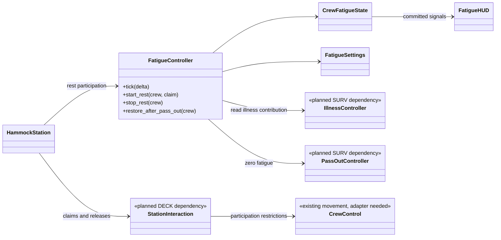
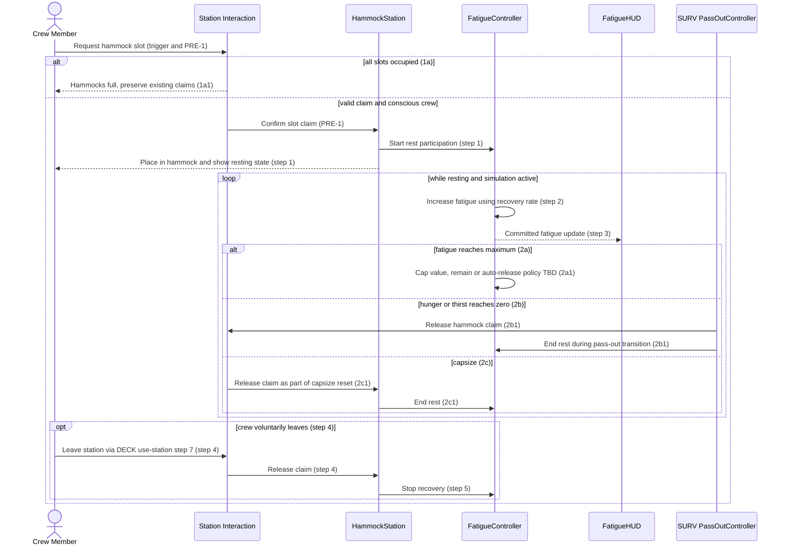
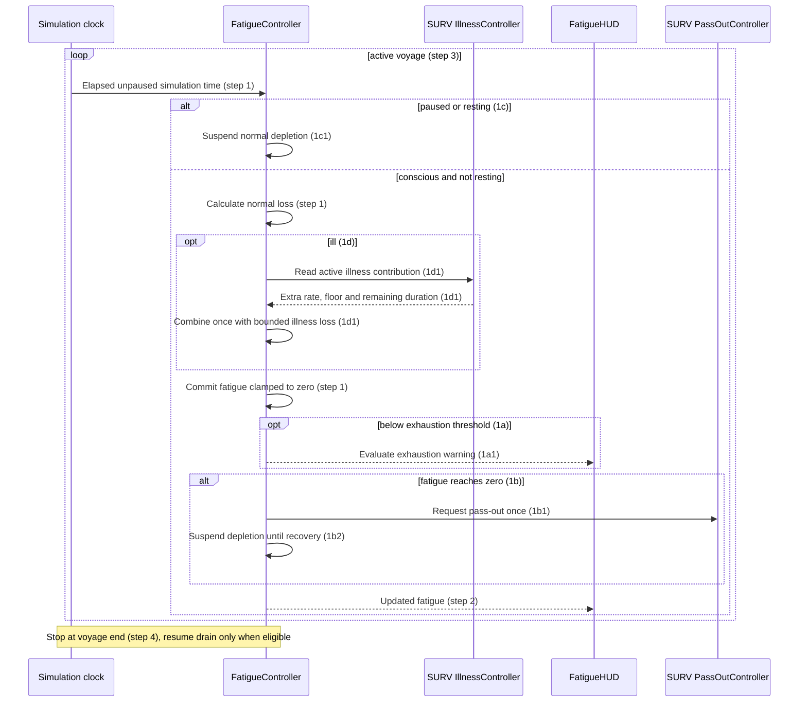
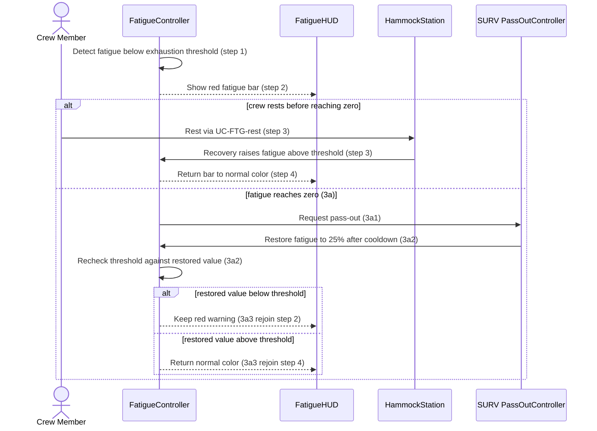
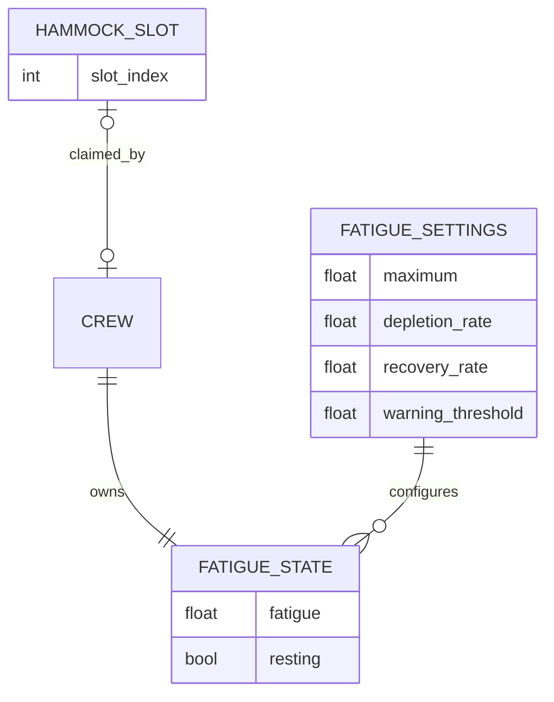

# Fatigue Design

**Project:** Man the Ship (architectural document title: Holy Ship!)  
**Team:** Team 13  
**Area:** `FTG` — Fatigue  
**Status:** Draft for team review. Tuning, rest policies, and the proposed slowdown/wobble require decisions before implementation.

> **Realizes:** `UC-FTG-rest`, `UC-FTG-deplete-fatigue`, `UC-FTG-warn-exhaustion`. No project-specific `FR-FTG-*` identifiers were supplied.
> **Depends on:** `BR-stat-max`, `BR-stat-depletion-rate`, `BR-station-slots`, `BR-single-station-occupant`, `BR-pass-out-recovery`, `BR-illness-fatigue-floor`, `BR-host-controls-session`, `BR-capsize-reset`.
> **See:** [supplied use cases](<C:/Users/Gusy/Downloads/use-cases-draft.md>), [supplied architecture](<C:/Users/Gusy/Downloads/architectural-design.md>), [replacement business rules v0.2](<C:/Users/Gusy/Downloads/business-rules (2).md>), [Survival Design](SURV.md), [repository specification](../requirements/software-requirements-specification.md).
> **Designed against:** local checkout `bf4428af2f05e238dfca15df0983fde987b4de72`, not independently verified as current `main`. Architecture version 0.2, October 2, 2026; supplied use cases version 0.2; replacement business rules version 0.2, October 14, 2026.

Downloads links identify the actual drafting sources and must be replaced with version-controlled references before merge. Repository copies have not been assumed equivalent. The rules cite a newer DOCX that was not supplied; traceability here was checked against the supplied Markdown use cases. Template instructions and examples are guidance, not extra gameplay requirements.

## Overview

The Fatigue (`FTG`) area belongs to the planned **Crew Survival** component in the Game Application ([architecture section 5.2](<C:/Users/Gusy/Downloads/architectural-design.md#52-use-case-areas-and-components>); [container view](<C:/Users/Gusy/Downloads/architectural-design.md#51-containers>)). It owns each crew member's fatigue value, applies normal depletion or hammock recovery, and notifies the HUD when fatigue or the exhaustion warning changes. **Station Interaction** owns the Hammock's two claims and supplies rest participation, while **Crew Control** prevents a resting crew member from working another station. FTG accepts illness-related drain from SURV and requests SURV's shared pass-out transition at zero. State stays in memory for the current voyage, with local ownership established before networking. The owner's October 14 direction proposes Minecraft-inspired readable survival feedback with slower movement and seasick screen wobble; these effects are explicitly tracked below because the supplied exhaustion use case currently specifies a red bar with no gameplay penalty.

## Components & classes

The proposed paths follow the existing `scripts/` and `scenes/` layout. The architecture does not prescribe these exact subdirectories. A class marked new is planned rather than implemented.

| File or boundary | Status and responsibility |
|---|---|
| `scripts/fatigue/fatigue_controller.gd` | New: sole writer of fatigue. Coordinates depletion, rest, illness contribution, and recovery requests without duplicate updates. |
| `scripts/fatigue/crew_fatigue_state.gd` | New: per-crew fatigue and rest state, plus committed-state notifications. Exhaustion is derived from fatigue and threshold. |
| `scripts/fatigue/fatigue_settings.gd` | New Resource: Inspector-configurable maximum, depletion rate, recovery rate, and exhaustion threshold. Exact values remain TBD. |
| `scenes/stations/hammock.tscn`, `scripts/stations/hammock.gd` | New: reusable Hammock with two slots, forwarding claim/release events to FTG. Occupancy remains owned by Station Interaction. |
| `scenes/ui/fatigue_hud.tscn`, `scripts/ui/fatigue_hud.gd` | New: local crew's fatigue bar and exhaustion color. Reads state without changing gameplay values. |
| `scripts/player.gd` | Reused, adapter needed: `using_station` currently stops movement. General participation/consciousness gating must coordinate with DECK/SURV instead of adding unrelated survival logic to movement. |
| SURV illness/pass-out components | Planned reuse from [SURV.md](SURV.md): FTG does not create a second illness timer or recovery cooldown. |
| Station Interaction and session simulation clock | Planned dependencies owned by DECK/session designs. Exact class paths and interfaces require cross-area agreement. |
| Proposed movement and camera feedback | No implemented component claimed. After requirements are settled, Crew Control should apply slowdown and a local presentation component should apply visual wobble. |

## Sequence

Each label identifies the supplied use-case step. Precondition checks do not imply that station claiming is implemented. Proposed slowdown and wobble are not inserted into baseline sequences without corresponding requirements steps.

### UC-FTG-rest: Rest to recover fatigue

Release, pass-out, or capsize ends the rest loop immediately. A full-fatigue auto-release, if selected, follows the same release path. Hunger and thirst continue to drain during rest through SURV. The full-slot extension is handled at claim time even though PRE-1 describes the accepted-claim path.

### UC-FTG-deplete-fatigue: Deplete fatigue over time

The resting branch suspends normal depletion, not SURV's illness timer. How illness loss combines with rest recovery is unresolved and must be decided jointly with SURV before implementation.

### UC-FTG-warn-exhaustion: Warn of exhaustion

Equality at the threshold is not specified consistently by “below” and “rises above” in the source. Select and document the equality rule before implementation. The HUD must re-evaluate after any fatigue change, including illness or pass-out recovery, rather than only after a normal depletion tick.

## API contract

No API contract.

## Key decisions

**One fatigue writer.** FTG computes and commits the fatigue result once per simulation update using rest state and SURV's illness contribution. Rejected: separate systems directly subtracting fatigue in independent callbacks, because duplicate or reordered loss can break the illness floor and pass-out transitions.

**Station-owned occupancy.** Station Interaction owns the two hammock claims, while FTG owns recovery. Rejected: a separate FTG occupancy list, because capsize and pass-out could free one list while leaving the other occupied. Release notifications stop recovery immediately and repeated release is harmless.

**Shared pass-out recovery.** FTG requests the SURV transition at zero and accepts the resulting 25% restoration. Rejected: a fatigue-only cooldown, because `BR-pass-out-recovery` requires the same action restrictions, station release, and three-stat restoration for every cause.

**Simulation-time progression.** Depletion and recovery use elapsed unpaused simulation time under architecture 8.2.2 and `BR-host-controls-session`. Rejected: wall-clock timestamps or a fixed amount per rendered frame, because pause or frame rate would change outcomes.

**Derived exhaustion display.** Compute the warning from current fatigue and the configured threshold, then update the HUD after committed changes. Rejected: maintaining an independent gameplay exhaustion flag, because it can remain stale after recovery. Equality at the threshold remains a requirement question rather than a silent implementation choice.

**Proposed sensory feedback stays traceable.** The owner requested slower movement and shaking/wobbly seasick feedback on October 14. Record it as a proposed replacement for the display-only exhaustion behavior. Rejected: treating Minecraft as a complete specification or silently adding penalties to `UC-FTG-warn-exhaustion`. Exact triggers, strength, and clearing conditions still need agreement. Do not infer sprinting, health regeneration, saturation, permanent death, or wave-induced illness from that reference.

## Data model

No database, disk save, or migration is introduced. Per-crew runtime state and a tuning Resource are added. Voyage termination discards mutable fatigue state, following architecture 8.2.8 and the supplied session use cases.

This diagram shows only relevant additions and relationships, not a replacement domain model. Station Interaction owns slot claims and permits at most one claim per slot, with two hammock slots in total. FTG derives resting participation from a valid claim and must clear it when that claim ends. Exhaustion is derived, not separately persisted. Hunger, thirst, illness timers, and pass-out cooldowns remain in SURV. Initial fatigue and all numeric tuning except the two-slot count and 25% pass-out restore remain TBD. Fatigue is bounded from zero to its maximum under `BR-stat-max`.

## Reuse & cross-cutting

- **State-owner errors and validation (architecture 8.2.1 and 8.2.5):** Station Interaction checks range, capacity, and claims. FTG checks eligibility and configured values. A rejected rest request grants neither a slot nor recovery.
- **Time (8.2.2):** simulation delta and the common pause gate control depletion, recovery, and SURV timers. No catch-up for time spent paused.
- **Interfaces and code (8.2.3–8.2.4):** typed GDScript, reusable scenes, Resources, and signals. HUD observes state while mutation remains with owners.
- **Configuration (8.2.6):** exported tuning settings retain Compatibility renderer and Web compatibility. No shader or camera effect is required by the baseline design.
- **Logging (8.2.7):** actionable invalid-state or lifecycle diagnostics without per-frame fatigue logs.
- **Persistence/concurrency (8.2.8):** local in-memory state, a single fatigue writer, and atomic slot claims. Future host authority and synchronization belong to the deferred networking design.
- **Testing (8.2.10):** Godot parser/startup and focused gameplay validation when implementing. Visual feedback and usable station controls also need manual checks.
- **SURV reuse:** illness floor and duration come from SURV's illness owner. SURV's pass-out transition gates actions and restores all three stats. FTG does not duplicate either lifecycle.

## Tests

These are planned acceptance tests, not executed tests. Each main flow and extension in the supplied FTG use cases has a row.

| Use case, flow | Level | Asserts |
|---|---|---|
| rest main | Integration | A conscious crew member with a valid hammock claim gains fatigue proportional to rest time, updates HUD, cannot work another station, and stops recovery on leave. |
| rest 1a | Integration | With both slots claimed, a third request is denied with full feedback and does not displace either occupant or start recovery. |
| rest 2a | Unit/integration | Recovery caps at maximum and follows the chosen remain/auto-release policy. Policy selection pending. |
| rest 2b | Integration | Hunger or thirst reaching zero releases the slot once, stops recovery, and enters SURV pass-out. |
| rest 2c | Integration | Capsize releases both hammock claims and ends recovery, with remaining reset behavior delegated to WAVE. |
| deplete-fatigue main | Unit | Conscious, non-resting crew lose fatigue at the configured steady rate independent of activity and frame step, with values clamped and HUD updated. |
| deplete-fatigue 1a | Integration | Crossing below the selected threshold activates the exhaustion warning. Boundary equality policy pending. |
| deplete-fatigue 1b | Integration | Zero fatigue causes one SURV pass-out transition and no further normal loss until recovery. |
| deplete-fatigue 1c | Unit/integration | Normal drain stops while resting or paused and resumes only when conscious, unpaused, and no longer resting. |
| deplete-fatigue 1d | Integration | Illness adds its configured contribution exactly once, bounded by its active duration and floor, while normal loss can continue below the floor. |
| warn-exhaustion main | Integration/manual | Below threshold the bar is red, and recovery above threshold restores normal color. Baseline warning alone applies no gameplay penalty. |
| warn-exhaustion 3a | Integration | Zero triggers SURV pass-out, then warning is recalculated from the 25% restoration and configured threshold. |
| Rest with hunger/thirst depletion | Integration | SURV continues hunger/thirst drain while FTG recovers fatigue. |
| Illness while resting | Integration | Recovery and illness loss follow the jointly selected calculation, including reaching/crossing the floor. Blocked on policy. |
| Pause during rest/illness/pass-out | Integration | All relevant progression freezes without later catch-up, including SURV illness/recovery timers. |
| Two simultaneous hammock claims | Integration | Two free slots admit at most two distinct crew, and a single slot cannot be double-claimed. |
| Release lifecycle | Integration | Voluntary leave, pass-out, and capsize stop recovery immediately, and duplicate release does not corrupt occupancy. |
| Multi-crew state isolation | Unit | Resting or changing fatigue for one crew member does not change another's value or warning. |
| Invalid state/configuration | Unit | Invalid maximum, negative rates, out-of-range threshold, passed-out rest, and stale claims cannot cause invalid recovery or partial occupancy changes. |
| Recovery and illness boundary | Integration | One coordinated update avoids duplicated drain/pass-out and restores all three stats before control. Exact rest/floor ordering pending. |
| Future authoritative display sync | Integration, deferred networking | A missed update is corrected from authority state and does not create a second fatigue writer. |
| Proposed slowdown/wobble | Acceptance, pending requirements | Once requirements are revised, test triggers, speed multiplier, visual intensity, and clearing behavior. No numeric assertions invented before agreement. |

## Changes to the architecture-of-record

The supplied architecture is not edited by this draft. Required reconciliations before merge are:

1. Revise section 5.2 to recognize FTG as its own use-case design within Crew Survival, alongside SURV. Separate documents do not require separate deployed services.
2. Clarify that FTG owns fatigue mutation, Station Interaction owns hammock occupancy, and SURV owns illness/pass-out lifecycles. Replace the older generic “stamina” wording where it refers to these fatigue requirements.
3. Update section 8.2.2 with `BR-host-controls-session` pause semantics and section 8.2.8 with the supplied unsaved-voyage/future host-authority rules, retaining `KD-local-first`.
4. Reconcile stale statements that only steering is fully specified with the newer supplied FTG/SURV use cases. Slowdown and wobble remain proposed until their requirements are updated.

## Open questions & risks

The team acts as client and owns gameplay choices. Mirror requirement-affecting questions into the requirements issue tracker when the source documents are reconciled. No new issue IDs or approved rules are implied by this table.

| Question or risk | Owner / impact |
|---|---|
| Exact maximum, initial fatigue, depletion rate, rest recovery rate, and exhaustion threshold? | Team/session owner. New voyage initialization must not be guessed from the pass-out recovery percentage. |
| Does reaching full fatigue keep the crew member resting or release the slot automatically? | Team/DECK. Rest 2a and its test remain unresolved. |
| Is warning active at exact threshold equality? | Team. Source uses both “below” and “above,” leaving equality unclear. |
| How does illness loss combine with hammock recovery? | Team/SURV/FTG. Agree one calculation and boundary order rather than two competing writers. |
| After reaching the illness floor, does extra drain resume if rest raises fatigue again? | Team/SURV. Reconcile the rule's above-floor condition with the use-case wording about stopping extra drain. |
| Which condition causes slowdown and seasick screen wobble? | Team. Low fatigue, low hunger/thirst, raw-food illness, and rough seas are different possible triggers. Owner direction has not selected among them. |
| What speed multiplier, effect strength, onset, and recovery behavior apply? | Team. Revise `UC-FTG-warn-exhaustion` and any affected SURV use cases before implementing penalties. |
| Should wobble be reducible/disabled independently of gameplay slowdown? | Team. Recommended presentation option for review, not an existing requirement. |
| How does proposed feedback combine with pass-out, resting, and other camera/movement effects? | Crew Control/UI owners. Disable stale effects on state change, voyage end, and view recreation once behavior is specified. |
| Architecture and current repository represent different snapshots. | Document owner. Recheck implementation and source links at the implementation baseline. |
| DECK/session dependencies remain planned. | Area owners. Agree claim/release and clock responsibilities before building the integrated slice. |

## Working this document with your agent

The agent may refine diagrams, identify reusable files, check identifier/extension coverage, and draft tests. The team retains gameplay decisions and independent approval. Every new interaction must cite a use-case step or be explicitly recorded as a proposed requirements change. Do not add sprinting, cures, a skill tree, inventory expansion, networking, or difficulty modes through implementation guesses.

The template's manual sketch/comparison and independent teammate review were not performed in this drafting session. No PR or implementation branch was created. Keep the original template available for its later review instructions. This document describes a planned design, not implemented code or team approval.

## The questions test (before you open the pull request)

This is a drafting self-check, not the fresh independent review requested by the template. Give a fresh reviewer only the FTG use cases, their business rules, architecture section 8, the relevant SURV boundary, and this design. Ask what they would still have to guess to implement each use case and whether a wrong guess could violate a requirement.

| Remaining guess | Could a wrong guess violate requirements? | Disposition |
|---|---|---|
| Numeric tuning and initial fatigue | Yes | Team must select values before implementation acceptance. |
| Full-fatigue hammock policy | Yes | Resolve rest 2a and update design/tests together. |
| Threshold equality | Yes | Record a precise comparison rule. |
| Rest/illness calculation and floor reactivation | Yes | Resolve jointly with SURV and define boundary tests. |
| Slowdown and wobble triggers/strength | Yes | Revise the display-only exhaustion requirement and record owner decisions first. |
| Final method names, signal representation, and Resource field details | No, if state ownership and observable behavior are preserved | Implementer may choose typed GDScript details under architecture conventions. |
| Placeholder hammock art and HUD placement | No, if two-slot interaction and required feedback stay clear | Implementer may choose replaceable assets and verify visually. |
| Future transport and reconnect details | Yes for cooperative behavior | Defer to the networking design without adding transport now. |

Before opening a PR, place the independent questions test and resolutions in a collapsed `Questions test` block in its description. This draft is not implementation-ready while requirement-affecting questions remain unresolved.
