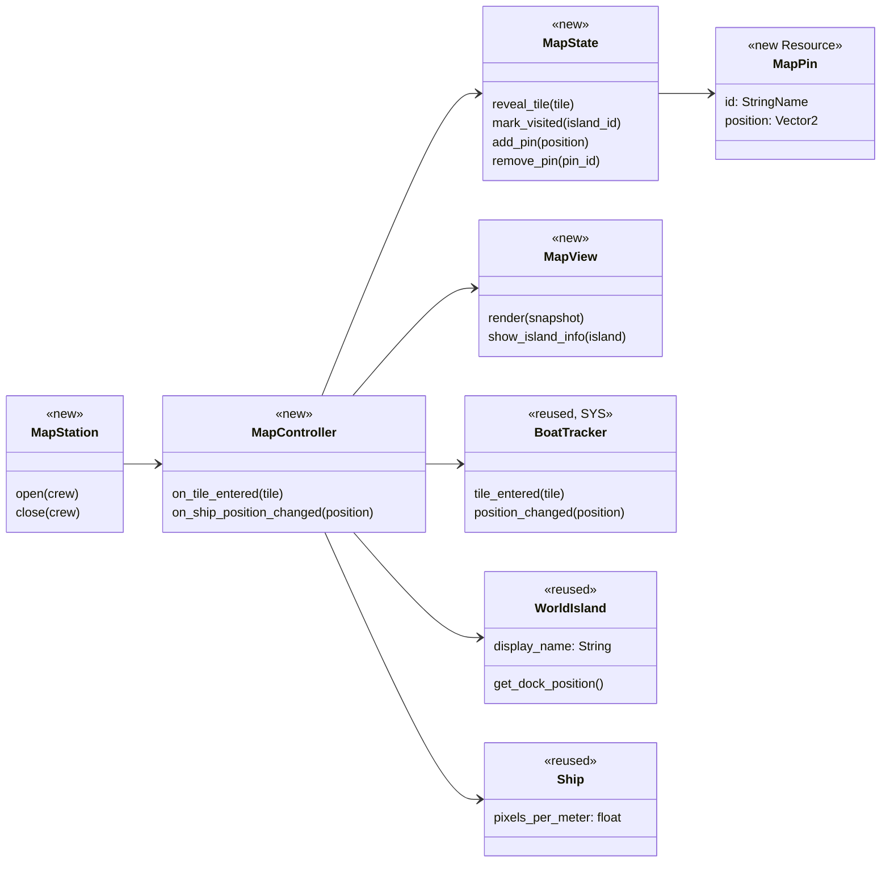
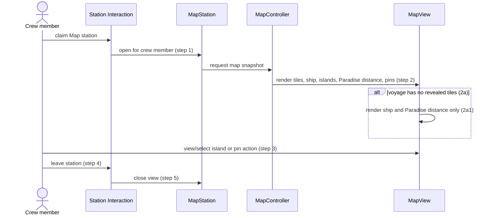
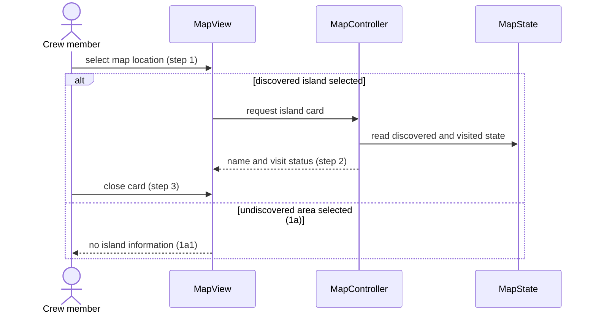
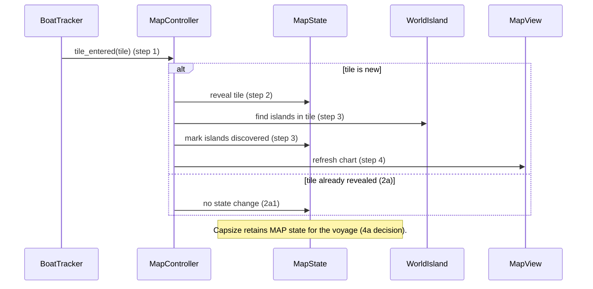
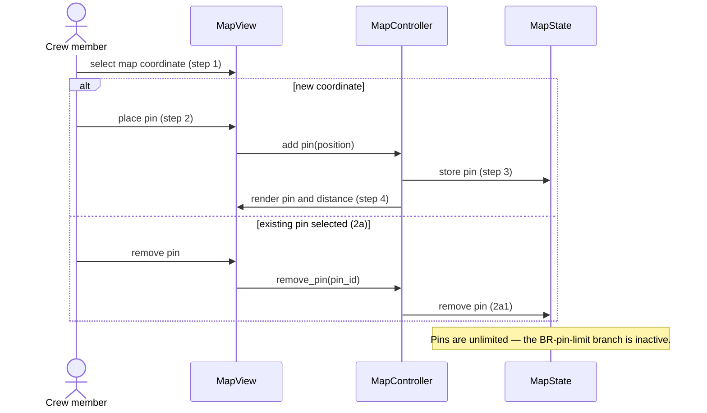
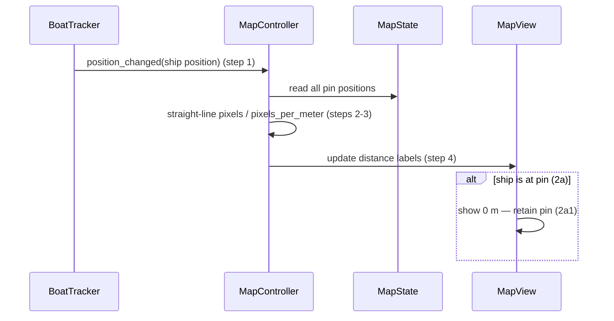

# Map Interaction & Discovery (MAP) Design

**Project:** Man the Ship
**Team:** Whitney Akred, Leiton Peterson, Ivan Lopez, Liliana Matte, Gustavo Castillo, Shana Billiot
**Area:** `MAP`

> **Realizes:** `UC-MAP-open-map`, `UC-MAP-view-island-info`, `UC-MAP-discover-map`, `UC-MAP-place-pin`, and `UC-MAP-pin-distance`.
> **Depends on:** `BR-single-station-occupant`. `BR-pin-limit` is conditional; this design does not adopt a pin limit.
> **See:** [use cases](../requirements/use-cases.md#area-map-interaction--discovery-map), [business rules](../requirements/business-rules.md#27-inventory-map-and-island-travel), and the [architecture of record](architectural-design.md).
> **Designed against:** `a0a358a` on `design-of-record`.

---

## Overview

MAP owns the voyage-only chart state and its station-driven presentation: revealed tiles, discovered and visited islands, pins, and distance labels. It consumes tile-entry and position updates from SYS, island identity/location from Island Exploration, progress distance to Paradise, and exclusive use from Station Interaction. MAP does not move the ship, generate islands, select events, or store item-level island contents.

Existing sailing code supplies world-space `WorldIsland` nodes, ship position, and an Inspector-configurable `pixels_per_meter` conversion. It does not implement a map station, chart UI, reveal model, pins, or discovery state; those components are new.

## Components & classes

- `MapStation` (new reusable station scene/component): claims the exclusive map station through Station Interaction and opens or closes one map view.
- `MapController` (new): translates SYS signals and MapView requests into changes to `MapState`; it owns no ship movement or station claim state.
- `MapState` (new voyage-local Resource or Node): owns all chart state and produces a read-only snapshot for the view.
- `MapView` (new UI scene): renders a `MapState` snapshot and sends selection/pin requests; it does not retain a second copy of map state.
- `MapPin` (new Resource): identifies one player marker and its map coordinate.
- `scripts/islands/world_island.gd` (reused): provides island ID, display name, and world/dock position. MAP adds its own discovered/visited state rather than changing island placement.
- `scripts/ship.gd` (reused): supplies ship position and the existing exported `pixels_per_meter`, whose default is `10`.
- `BoatTracker` (reused from SYS design): emits the tile and position inputs; MAP never derives tiles independently.

## Sequence

### UC-MAP-open-map: viewing the map

### UC-MAP-view-island-info: viewing a discovered island

### UC-MAP-discover-map: revealing a tile

### UC-MAP-place-pin: placing or removing a pin

### UC-MAP-pin-distance: updating pin distance

## Local API contract

| Operation | Caller | Success | Refusal / no-change result |
|---|---|---|---|
| `MapStation.open/close(crew)` | Station Interaction | View opens for the claimant or closes/releases it | Occupied or out-of-range station leaves view closed |
| `MapController.on_tile_entered(tile)` | `BoatTracker` | Newly visited tile and contained islands become visible | Revealed tile makes no state change |
| `MapController.get_island_info(island_id)` | MapView | Discovered island name and visit status | Unknown/undiscovered location returns no card |
| `MapState.add_pin/remove_pin(...)` | MapView through MapController | Pin is created or removed for the voyage | Invalid pin ID/coordinate leaves state unchanged; no capacity refusal exists |
| `MapController.on_ship_position_changed(position)` | `BoatTracker` | Every pin label refreshes using 10 pixels per meter | No pins means no label work |

## Key decisions

**The map is an exclusive deck station.** `UC-MAP-open-map` and `BR-single-station-occupant` govern access. A personal or globally available pause-menu map is rejected because it would bypass station claim/release behavior already specified for this use case.

**Discovery survives capsize for the voyage.** `MapState` retains revealed and discovered sets during a capsize reset. Clearing the map is rejected because a capsize already resets the ship and inventory, and the chosen exploration result should not erase the crew's chart knowledge.

**Pins have no capacity limit.** `BR-pin-limit` applies only if a limit is adopted; this milestone does not adopt one. Rejecting or evicting a pin would add an unrequested policy and make the use-case extension reachable without a chosen threshold.

**Island cards show name and visit status only.** A discovered island card shows its display name and whether a crew member has reached shore there. Merchant, shipwreck, challenge, and item information are rejected for this slice because they require cross-area facts that MAP does not own.

**Distance uses the existing common scale.** All map pin distances use `Ship.pixels_per_meter`, defaulting to 10 pixels per meter. A second map conversion is rejected because different HUD and map distances would disagree.

**Pins remain at their destination.** A zero-distance pin shows `0 m` until removed by a crew member. Automatic deletion is rejected because pins are player route markers, not one-time objectives.

## Data model

| State | Owner | Lifecycle and constraints |
|---|---|---|
| Revealed tiles | MapState | Set of tile IDs received from `BoatTracker`; starts empty and survives capsize until voyage end. |
| Discovered islands | MapState | Set of island IDs contained by revealed tiles. |
| Visited islands | MapState | Set of island IDs whose shore has been reached by a crew member; distinct from discovery. |
| Map pins | MapState | Zero or more `MapPin` records with unique IDs and map coordinates; no capacity limit. |
| Distance labels | MapView | Derived display state only; never persisted separately. |

Map state lasts for one voyage and is never saved. `pixels_per_meter` remains exported on `Ship` and is shared by the existing sailing HUD and MAP.

## Reuse & cross-cutting

- Station Interaction validates range, claim, and release; MAP only opens after a successful claim.
- SYS `BoatTracker` owns tile boundaries and ship-position notifications; MAP consumes its signals.
- Island Exploration owns island placement and landing; MAP consumes `WorldIsland` identity/location and receives a visit notification when a crew member arrives ashore.
- Progress owns Paradise location/distance; MAP renders that supplied value without recalculating completion rules.
- UI reads `MapState` snapshots and never edits its collections directly.

## Tests

| Use case, flow | Level | Asserts |
|---|---|---|
| `UC-MAP-open-map` main | Integration | Successful station claim opens one chart containing current ship, revealed tiles, discovered islands, Paradise distance, and pins. |
| `UC-MAP-open-map` 2a | Integration | A fresh voyage renders only ship position and Paradise distance. |
| `UC-MAP-open-map` access | Integration | An occupied Map station refuses another crew member until released. |
| `UC-MAP-view-island-info` main | Unit | A discovered island returns only name and visit status. |
| `UC-MAP-view-island-info` 1a | Unit | An undiscovered coordinate returns no island card. |
| `UC-MAP-discover-map` main | Unit | A new tile is stored and its contained islands become discovered. |
| `UC-MAP-discover-map` 2a | Unit | An already revealed tile makes no duplicate change. |
| `UC-MAP-discover-map` 4a | Integration | A capsize preserves reveal/discovery state for the active voyage. |
| `UC-MAP-place-pin` main / 2a | Unit | A pin can be placed on any map coordinate and later removed. |
| `UC-MAP-place-pin` limit | Unit | Any number of valid pins is accepted; no capacity branch runs. |
| `UC-MAP-pin-distance` main | Unit | Distance equals straight-line pixel distance divided by `pixels_per_meter` (10 by default). |
| `UC-MAP-pin-distance` 2a | Unit | Reaching a pin renders `0 m` and retains the pin. |

## Changes to the architecture of record

Add MAP to the area/component map as a provisional area owning voyage chart state and map presentation. It depends on SYS for tile/position notifications, Station Interaction for exclusive access, Island Exploration for island metadata/arrival, and Progress for Paradise distance.

## Open questions & risks

- Tile size remains a SYS/World decision; MAP accepts tile IDs and must not introduce its own grid calculation.
- The current sailing HUD's nearest-island indicator is not a map UI. Keep it separate until a deliberate UI consolidation is designed.
- Current requirements use Host/client wording while project instructions require a single-player-first implementation. MAP state ownership and synchronization must be reconciled before cooperative transport is added.

## Implementation assumptions awaiting decisions

The following details are not resolved by this design. The tentative guesses document the assumptions an implementation would otherwise need to make; the final column is intentionally left open for approved decisions.

| Decision point | Tentative implementation guess | Wrong guess could violate a requirement? | Proposed solution |
|---|---|---|---|
| Tile size, origin, boundary rule, and tile-ID format | SYS/World uses fixed-size square tiles with floor division, including negative coordinates. | Yes — MAP must consume SYS tile IDs and must not calculate its own grid. | When map creation is finalized it will have a set coordinate grid that requires and generates only positive locations for useage  |
| Finding islands contained by an entered tile | Query registered `WorldIsland` nodes using their authoritative world positions and the SYS/World tile contract. | Yes — an incorrect lookup could reveal the wrong islands. | Island system containing specified quieries for each individal island will be added upon completelion of multiple island implementation |
| Stable island identity | Each `WorldIsland` exposes one unique, voyage-stable island ID. | Yes — discovery and visit sets depend on stable unique IDs. | during map generation each island will be given a unqiue instance ID |
| Shore-arrival notification | Island Exploration emits one visit notification with `island_id` after a crew member successfully reaches shore. | Yes — visited status must remain distinct from discovery. | map system will track updating and doocumentation of visted islands. This will be done through an aspect of the islands instance |
| MapState voyage lifecycle | Create state when a voyage begins; preserve it through capsize; discard it only when that voyage ends. | Yes — the stated lifecycle requires capsize retention and no persistence beyond the voyage. | Game automatically ends if ship capsizes and returns players to start menu. All progress is lost and new map is generated when new game starts. |
| Paradise distance input and display contract | Progress supplies a display-ready Paradise distance for MAP to render. | Potentially — MAP must not recalculate Progress completion rules. | progress completion rules are determine at the start of each voyage. Though ultimate goal will always be to reach a certain location on the other side of the game map. |
| Pin ID generation | Generate unique local `StringName` IDs for each pin. | No, provided IDs remain unique and removal targets the correct pin. | when pen system is created each will be stored as a unique instance of pin objects that each have unique IDs|
| Chart projection and pointer conversion | Use one world-to-chart transform for rendering and translating selected map coordinates back to world coordinates. | Potentially — mismatched transforms would place pins at incorrect destinations. | translation and scaling will be set during map generation and will stay consistent from here on out. |
| Distance-label precision | Calculate the required exact straight-line distance, then display rounded whole metres. | Potentially — the calculation is specified but label precision is not. | label precision will be stored within a double and focus on pixel verse map coordinate distance |
| Physical map-station scene and controls | Place a reusable deck station using existing Station Interaction claim, range, release, and input conventions. | No, provided Station Interaction remains authoritative for access. | |
