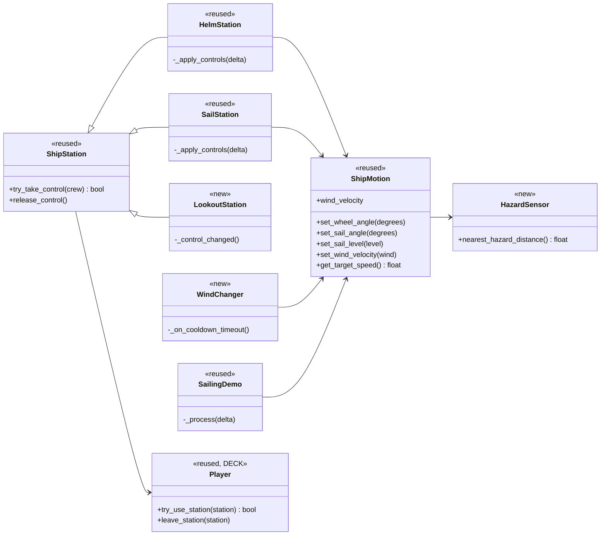
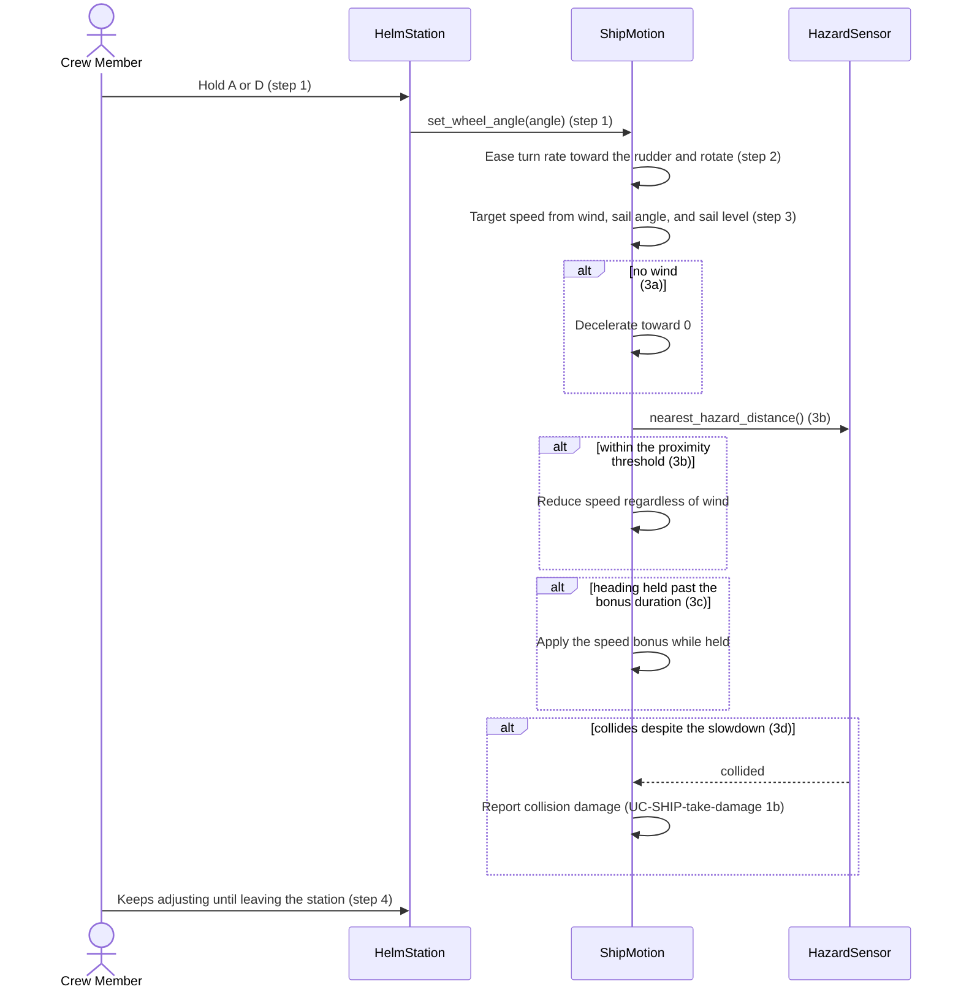
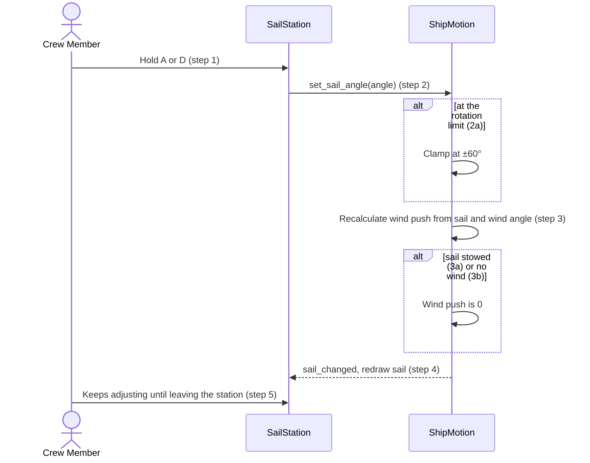
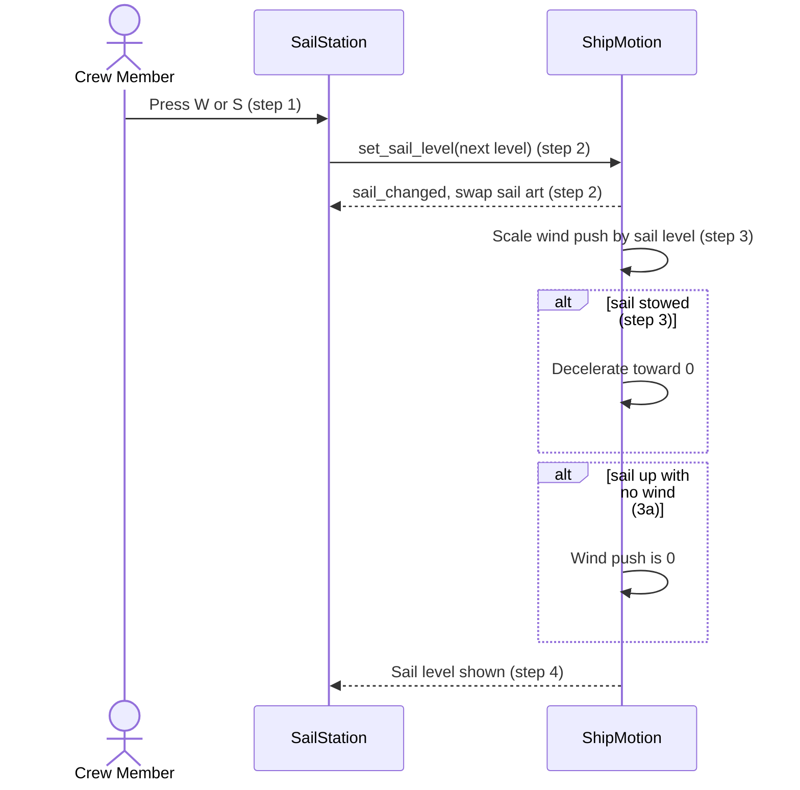
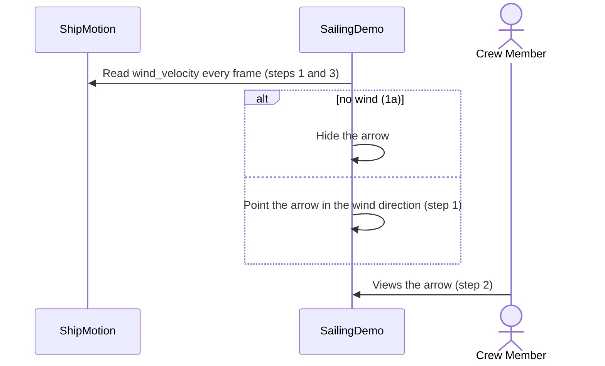
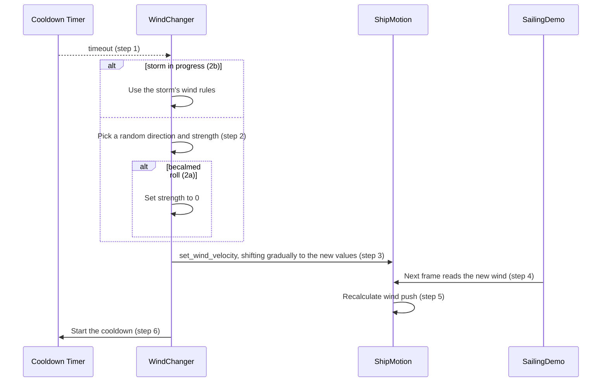
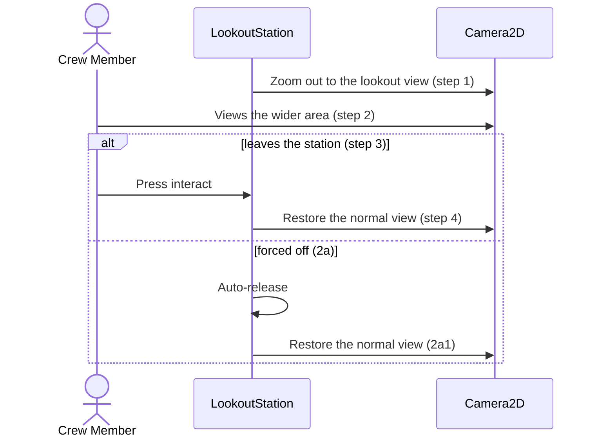

# Navigation & Sailing Design

**Project:** Holy Ship!
**Team:** Team 13
**Area:** `NAV`

> **Realizes:** `UC-NAV-steer-ship`, `UC-NAV-rotate-sail`, `UC-NAV-raise-lower-sail`, `UC-NAV-check-wind`, `UC-NAV-change-wind`, `UC-NAV-use-lookout`
> **Depends on:** `BR-single-station-occupant`, `BR-sail-rotation-limit`, `BR-wind-change-cooldown`
> **See:** [use cases](../requirements/use-cases.md), [specification](../requirements/software-requirements-specification.md), [architecture-of-record](architectural-design.md)
> **Designed against:** `2bb509c`

---

_**How to use this template.** Copy it to `docs/design/<area>.md`, named for the lowercase area code (`ord.md` for `UC-ORD-*`). Instructions appear in italic square brackets; leave them in place until the document is stable, because the agent reads them on every later pass. The full worked example is Project Pulse's [`not.md`](https://github.com/Washingtonwei/project-pulse/blob/main/docs/design/not.md); read it for the shape, not for the answers._

_**What this document is.** The **design-of-record** for one use case area: how the code will realize its use cases, written **before** the code and approved before anyone builds from it. It is the last document your agent reads before it writes code, so anything it leaves out, the agent invents. Your [architecture-of-record](architectural-design.md) is the map of the whole system and stops at each component's responsibility; this document goes one level down, inside one area, against real code._

_**What it is not.** A copy of your use cases. It **cites** `UC-*`, `FR-*`, and `BR-*` by identifier and never restates what the system shall do; it says only how. It is also not a transcript of the code. Once code exists, link to the files rather than describing every class, column, or getter._

_**One document per area, not per use case.** Your area gains use cases over the term. The overview, the class diagram, and the data model are **revised in place** when it does. The sequence diagrams, the API contract rows, and the test rows are **appended**, one set per use case. Never add a `## UC-…` section that repeats the whole skeleton._

_**How much to write.** Pin down what a wrong guess would break: a requirement, a business rule, a quality attribute, or the contract between two parts of your team. Leave the rest for the agent to derive while it builds: variable names, field types, exact JSON, column lengths. When you are unsure, ask which side of that line a detail falls on, not whether it is interesting._

_**Write it in this order.** Each step is one person's or one pair's work, and the order is the point:_

1. _**Sketch it yourselves first.** Before you open the agent, draw the main success scenario's sequence diagram and write the API contract rows by hand, from the use case and your architecture-of-record. Twenty minutes, on paper or in this file._
2. _**Have the agent draft it.** Give the agent this template, the use case, the business rules it cites, your architecture-of-record's section 8 (Crosscutting Concepts), and the relevant existing code, and ask for a draft of this document. Use plan mode, so it proposes before it writes._
3. _**Compare the two.** Where the agent's draft differs from your sketch, decide which is right and why. What it found that you missed goes in; what you knew that it could not have known is the context your specification is missing, so fix the specification too._
4. _**Run the questions test** (the last section) and fix what it finds._
5. _**Open a pull request.** A teammate who did not write it reviews and approves it. Nobody starts an implementation branch from this design until it is merged._

---

## Overview

_[One paragraph: what this area does, which components of your [architecture-of-record](architectural-design.md) it lives in, and what it reads from or calls in other areas. Link the container diagram rather than redrawing it. If this design changes the architecture-of-record, say so here and list the change under "Changes to the architecture-of-record" below.]_

Navigation turns crew input at the Helm and Sail stations into the ship's heading and speed, and owns the voyage's wind. It is the Navigation and Sailing component of the Game Application ([containers](architectural-design.md#51-containers), [use case areas](architectural-design.md#52-use-case-areas-and-components)). Stations are `ShipStation` subclasses that claim the player and forward intent to `ShipMotion`, the single owner of heading, speed, sail, rudder, and wind state (`KD-station-components`). It reports collisions to SHIP (`UC-SHIP-take-damage`). It is local and single-player (`KD-local-first`), so steps that sync to all clients are out of scope until networking exists. This design changes the architecture-of-record; see "Changes to the architecture-of-record" below.

## Components & classes

_[One class diagram for the whole area, and one line per class or file saying what it does and whether it is **new** or **reused**. Show only what a reader needs to see how the parts relate: classes, their key methods, their dependencies. Fields and getters belong to the code._

_**If your repository has no code for this area yet**, which is the normal case for your proving slice, list the files you expect the agent to create, with the paths your architecture-of-record's conventions give them, and mark them all new. The agent then builds into the structure you chose rather than one it improvised.]_

- [`scripts/sailing/ship_station.gd`](../../scripts/sailing/ship_station.gd) (reused): claims and releases a station, including auto-release past `release_distance`.
- [`scripts/sailing/helm_station.gd`](../../scripts/sailing/helm_station.gd) (reused): A/D turns the wheel; the wheel holds its angle when released.
- [`scripts/sailing/sail_station.gd`](../../scripts/sailing/sail_station.gd) (reused): A/D trims by trim speed × delta; W and S each advance one sail level, wrapping from full back to stowed.
- `scripts/sailing/lookout_station.gd` (new): zooms the ship's `Camera2D` out while claimed and restores the zoom saved at claim time, through `ShipStation._control_changed()`, which runs on claim, release, and auto-release.
- [`scripts/sailing/ship_motion.gd`](../../scripts/sailing/ship_motion.gd) (reused): owns heading, speed, and wind; wind push is calculated in `get_target_speed()`. Gains `set_wind_velocity`, the hazard slowdown, and the sustained-heading bonus.
- `scripts/sailing/wind_changer.gd` (new): starts its cooldown when ready; on each cooldown, picks a new wind and shifts `ShipMotion` to it gradually. The starting wind is `ShipMotion`'s default.
- `scripts/sailing/hazard_sensor.gd` (new): reports the distance to the nearest rock or other ship.
- [`scripts/sailing/sailing_demo.gd`](../../scripts/sailing/sailing_demo.gd) (reused): reads `ShipMotion.wind_velocity` every frame and draws the arrow on a `CanvasLayer`, pointing where the wind blows in world space; hides it when there is no wind.
- [`scripts/player.gd`](../../scripts/player.gd) (reused, DECK): keeps a crew member to one station at a time.

## Sequence

_[One sequence diagram per use case for its main success scenario, plus one for each extension that does not just return an error. **Label each interaction with the use case step it implements**, so a reviewer can check that every step is realized and nothing extra was invented. Use `alt` blocks for extensions that branch off the main flow. Give each use case its own `###` heading; that heading is the anchor your traceability matrix cites.]_

### UC-NAV-steer-ship: steering the ship

### UC-NAV-rotate-sail: rotating the sail

### UC-NAV-raise-lower-sail: raising or lowering the sail

### UC-NAV-check-wind: checking wind direction

### UC-NAV-change-wind: changing wind direction

### UC-NAV-use-lookout: using the mast lookout

## API contract

_[One row per endpoint, scheduled job, or message this area adds or changes, appended per use case. **This section is never dropped**: before the code exists it is the only thing the person (or agent session) building the front end and the one building the back end both read. Name the caller and who may call it, the request fields, the success response, and the error each extension returns. Leave field types and exact JSON to the agent unless a wrong guess would break something, such as a format another system depends on. Use the error shape your architecture-of-record's section 8.2 fixes; do not invent one here.]_

| Endpoint or job | Caller (who may) | Request | Success | Errors, by extension |
|---|---|---|---|---|
| `ShipMotion.set_wheel_angle` | `HelmStation`, while it holds the station | Wheel angle | Ship turns gradually; wheel holds when released | Clamped to ±1.5 wheel turns |
| `ShipMotion.set_sail_angle` | `SailStation`, while it holds the station | Absolute sail angle, stepped by trim speed × delta | `sail_changed`; speed recalculated | `UC-NAV-rotate-sail` 2a: clamped at ±60° |
| `ShipMotion.set_sail_level` | `SailStation`, while it holds the station; `Ship` when docking, which stows the sail and disables stations until the crew rows back | Next sail level | `sail_changed`; speed scales with level / 3 | Wraps from full back to stowed |
| `ShipMotion.set_wind_velocity` | `WindChanger` only | Wind direction and strength | New wind used by speed and the HUD | `UC-NAV-change-wind` 2a: strength 0 |
| `WindChanger` cooldown | `WindChanger` only | None | Wind shifts to a new random value; cooldown restarts | `UC-NAV-change-wind` 2b: storm rules |
| `LookoutStation` claim | A crew member in range, through `ShipStation.try_take_control` | Crew member | Camera zooms out | Station in use: refused (`UC-DECK-claim-station` 2a) |

## Key decisions

_[Only the decisions a reader could not recover from the code: an invariant, who may do this and how it is enforced, a trade-off you chose, a reason you reused something rather than writing it. **Each one names what you chose, what you rejected, and why.** If you cannot name an alternative you considered, it probably was not a decision; leave it out._

_A decision that affects the whole system rather than this area is an architecture decision. It belongs in your architecture-of-record as a `KD-*` entry, not here.]_

**Sail states.** Four levels (stowed, one-third, two-thirds, full). W and S each advance one level, wrapping from full back to stowed, with no transition delay. Rejected: two states with a transition (`UC-NAV-raise-lower-sail` steps 1–2 and extension 1a), because the four levels are built and tested in `tests/sailing_integration.gd`.

**Steering model.** A/D turns a wheel that holds its angle when released, and the rudder sets the turn rate. Rejected: pressing a direction to choose a heading the ship turns toward (`UC-NAV-steer-ship` steps 1–2), because the wheel is built and tested.

**Sail rotation limit.** ±60°. Rejected: about ±135° (`UC-NAV-rotate-sail`), because ±60° is what `ShipMotion` enforces today.

**Becalmed and stowed sail.** With no wind or a stowed sail, the ship decelerates to 0. Rejected: a reduced speed cap (`UC-NAV-steer-ship` 3a) and a drift speed (`UC-NAV-raise-lower-sail` step 3), because `ShipMotion` gives no push without wind or sail.

**Wind indicator.** The arrow shows direction only and is hidden when there is no wind. Rejected: showing wind strength (`UC-NAV-check-wind` POST-1) and a separate becalmed visual (1a), because the direction-only arrow is already built.

**Turning depends on speed.** Turn rate scales with speed, with a floor of 8% of the maximum so a stopped ship still turns slowly. Rejected: turning that ignores sail state (`UC-NAV-steer-ship` Assumptions), because the code already ties steering to speed.

**Who checks station ownership.** The station: `ShipStation` applies input only while its operator is the player, and `ShipMotion` does not check its callers. Rejected: the check inside `ShipMotion` (architecture-of-record 8.2.5), because the code puts it in the station.

**Where the wind lives.** On `ShipMotion` (`wind_velocity`), changed only through `set_wind_velocity` by `WindChanger`. Rejected: a separate wind node or an autoload, because the wind already lives on `ShipMotion` and the HUD already reads it there.

**Hazards near islands.** Sailing into an island's docking circle anchors the ship; the proximity slowdown (`UC-NAV-steer-ship` 3b) and collision damage (3d) apply to rocks and other ships. Rejected: slowing the ship near islands, because docking is built and tested.

**Wind shift.** The wind shifts gradually from the old values to the new ones. Rejected: snapping to the new values, because `UC-NAV-change-wind` step 3 says the wind shifts and no code exists.

## Data model

_[The **change** this area makes to the data: new tables or entities, new columns, the migration that adds them. Draw an ER diagram when there is more than one new table. Do not redraw the domain model; your [specification](../requirements/software-requirements-specification.md) owns it, so link it and show only the change. If the area changes nothing, say "No change" and give the reason in one line; that is a design decision too.]_

No change. Voyages are not saved, so navigation state lives in memory only (architecture-of-record 7.3).

## Reuse & cross-cutting

_[Which existing services, components, and conventions this area uses rather than rebuilding: authentication, the error handler, email, the clock, another area's service. Cite your architecture-of-record's section 8.2 for each convention by name rather than restating it.]_

- `ShipStation` and `Player.try_use_station` for claiming and releasing stations.
- `SailingDemo` for the wind arrow.
- Error handling (8.2.1) and Validation (8.2.5) for refused input.
- Time and time zones (8.2.2) for turning, trimming, and the wind cooldown.
- API conventions (8.2.3) and Code conventions (8.2.4) for station-to-ship calls and signals.
- Configuration and secrets (8.2.6) for tuning values as exported properties.
- Testing (8.2.10) and [`tests/sailing_integration.gd`](../../tests/sailing_integration.gd).

## Tests

_[One row per flow: the main success scenario and **every** extension of every use case this document realizes, appended per use case. Name the level (unit or integration) and what the test asserts. No code. This list is the definition of done that the reviewer approves; the agent writes these tests when it builds, and a reviewer can see at a glance whether an extension has no test.]_

| Use case, flow | Level | Asserts |
|---|---|---|
| UC-NAV-steer-ship main | integration | Helm input turns the moving ship gradually, and the wheel holds its angle when released |
| UC-NAV-steer-ship 3a | unit | With no wind, the ship decelerates to 0 |
| UC-NAV-steer-ship 3b | integration | Near a rock, speed is lower than in open water with the same wind and sail |
| UC-NAV-steer-ship 3c | unit | Holding a heading past the bonus duration raises speed; turning removes the bonus |
| UC-NAV-steer-ship 3d | integration | A collision with a rock reports damage once |
| UC-NAV-rotate-sail main | integration | Trim input changes the sail angle and the ship's speed |
| UC-NAV-rotate-sail 2a | unit | Holding trim past ±60° leaves the angle at ±60° |
| UC-NAV-rotate-sail 3a | unit | A stowed sail gives no wind push at any angle |
| UC-NAV-rotate-sail 3b | unit | No wind gives no wind push at any angle |
| UC-NAV-raise-lower-sail main | integration | Each W or S press advances exactly one sail level, and target speed scales with the level |
| UC-NAV-raise-lower-sail main | unit | A press at full sail wraps to stowed |
| UC-NAV-raise-lower-sail main | integration | After stowing, the ship slows gradually to 0, not instantly |
| UC-NAV-raise-lower-sail 3a | unit | A raised sail with no wind gives no wind push |
| UC-NAV-check-wind main | integration | The arrow points in the wind direction and follows a wind change |
| UC-NAV-check-wind 1a | integration | With no wind, the arrow is hidden |
| UC-NAV-change-wind main | unit | When the cooldown ends, the wind shifts gradually to a new value and the cooldown restarts |
| UC-NAV-change-wind 2a | unit | A becalmed roll sets strength to 0 |
| UC-NAV-change-wind 2b | unit | During a storm, the storm's wind rules are used |
| UC-NAV-use-lookout main | integration | Claiming the lookout zooms the camera out; leaving restores it |
| UC-NAV-use-lookout 2a | integration | Being forced off restores the normal view |

## Changes to the architecture-of-record

_[Designing an area against real code is when the architecture's guesses meet reality. If this design needs a component the map does not have, moves a responsibility, or adds a dependency, **change [the architecture-of-record](architectural-design.md) in the same pull request** and list each change here in one line. If nothing changed, write "None". A design that silently disagrees with the architecture leaves two maps, and the agent will follow whichever it reads last.]_

- Section 5.2: set NAV's status from "no sailing code" to partly implemented.
- Section 5.3: add the sailing scripts, `WindChanger`, `HazardSensor`, and `LookoutStation`.
- Section 8.2.5: for stations, `ShipStation` makes the ownership check, not `ShipMotion`.

## Open questions & risks

_[What this design could not settle and who can, and what could go wrong that you are accepting. A question for the client also goes in [`OPEN-ISSUES.md`](../requirements/OPEN-ISSUES.md).]_

- `UC-NAV-raise-lower-sail`, `UC-NAV-steer-ship`, `UC-NAV-rotate-sail`, and `UC-NAV-check-wind` still describe the rejected options above. They must be revised to match the key decisions. Liliana and Leiton.
- Hazard slowdown: the proximity threshold, the slowdown's shape and nonzero floor, and how `HazardSensor` finds rocks and other ships (`UC-NAV-steer-ship` 3b). Liliana and Leiton.
- Heading bonus: how close a heading must stay to count as held (wrapping at 359°→0°), whether someone must be at the Helm, and the order the speed modifiers combine in (`UC-NAV-steer-ship` 3c). Liliana and Leiton.
- Wind changes: the cooldown length, the becalmed chance, a minimum strength and minimum change, shifting angle and strength separately so the arrow does not vanish mid-shift, whether a becalmed result fades, and when the next cooldown starts (`UC-NAV-change-wind`). Liliana and Leiton.
- Lookout: the zoom value, and whether the zoom is instant or animated, given that 2a1 says "immediately". `Ship._stop_sailing()` must also release the Lookout when docking (`UC-NAV-use-lookout`). Liliana and Leiton.
- How much damage a collision causes, and whether it is once per contact (`UC-NAV-steer-ship` 3d). The team, since it crosses into SHIP.
- Storm wind rules (`UC-NAV-change-wind` 2b). The team, since it crosses into EVT.
- Whether the wind cooldown and the heading-bonus timer stop while paused. The team, since it crosses into PROG.
- When the Lookout and Sail are both in range, the first station to handle E wins, not the nearest (`UC-DECK-use-station` 2a). The team, since it crosses into DECK.
- Docking at an island's circle is built but is described by no use case. It needs one, or a step in `UC-ISLE-arrive-at-island`. The team, since it crosses into ISLE.

---

## Working this document with your agent

_[Delegate: drafting the diagrams from your sketch and the use case; listing the existing files a class should extend; filling the contract rows' request and response fields; proposing the test row for each extension; drafting the rejected alternative for a decision you have already made; checking that every identifier this document cites exists in the document that owns it._

_Keep human: which side of the "would a wrong guess break something" line each detail falls on; every key decision; and the approval, which is a teammate's review of the pull request, not the drafter's own reading._

_**The specific failure to watch for: scope that nobody asked for.** An agent drafting a design adds what designs it has read usually have: an admin override, a retry queue, a status field, a notification "while we are here". Each looks reasonable and none is in your use case, and once it is in the design the agent will build it, test it, and you will maintain it. Read the sequence labels: every interaction should name the use case step it implements. An interaction with no step is either a missing requirement, which goes to your specification and your client, or scope creep, which comes out.]_

---

## Implementation assumptions awaiting decisions

The following details are not resolved by this design. The tentative guesses document the assumptions an implementation would otherwise need to make; the final column proposes how each will be decided.

| Decision point | Tentative implementation guess | Wrong guess could violate a requirement? | Proposed solution |
|---|---|---|---|
| Sail rotation limit (`UC-NAV-rotate-sail`) | Keep the code's ±60°. | Yes — `BR-sail-rotation-limit` says about ±135°, so the rule and the code disagree. | The team changes either the rule or the code so they match. |
| Heading wrap for the heading bonus (`UC-NAV-steer-ship` 3c) | Store radians and wrap to 0–359° whenever heading is compared. | Yes — without wrapping, the held-heading check breaks when heading crosses 359°→0°. | The team confirms the bonus check always compares wrapped angles. |
| Hazard proximity threshold (`UC-NAV-steer-ship` 3b) | About 1.5 ship lengths, hull edge to hazard edge, as an exported property. | Yes — too small a threshold fails the slowdown and makes collisions frequent. | The team picks the value through playtesting. |
| Shape of the hazard slowdown (`UC-NAV-steer-ship` 3b) | A speed cap that shrinks with distance, with a nonzero floor. | Yes — a zero floor can trap the ship beside a rock. | The team chooses cap vs. multiplier and set a nonzero floor. |
| How `HazardSensor` finds hazards (`UC-NAV-steer-ship` 3b, 3d) | A `hazard` group; "other ships" stays empty for now. | Yes — untagged hazards get no slowdown and no damage. | The team chooses a group or a physics layer, and every rock is tagged with it. |
| What counts as holding a heading (`UC-NAV-steer-ship` 3c) | Heading stays within ±3° for the bonus duration. | Yes — a loose definition gives the bonus while circling. | The team sets the tolerance. |
| Order the speed modifiers combine in (`UC-NAV-steer-ship` 3a–3c) | Wind and sail first, then the bonus, then the hazard cap last; no bonus at speed 0. | Yes — applying the bonus after the cap undermines collision avoidance. | The team confirms the order. |
| Heading bonus with nobody at the Helm (`UC-NAV-steer-ship` 3c) | The bonus applies only while the Helm is claimed. | Yes — 3c says a crew member holds the heading. | The team confirms. |
| Collision contract with SHIP (`UC-NAV-steer-ship` 3d) | `ShipMotion` emits `collided(hazard)` and SHIP handles the damage. | Yes — a mismatch breaks `UC-SHIP-take-damage` 1b. | The team agrees the signal and damage amount when SHIP is designed. |
| Damage per collision (`UC-NAV-steer-ship` 3d) | Once per contact start. | Yes — reporting every frame multiplies damage. | The team decides together with SHIP. |
| Wind cutoff for hiding the arrow (`UC-NAV-check-wind` 1a) | Hide the arrow below a small strength cutoff set in the Inspector. | Yes — too large a cutoff hides the arrow when there is real wind. | The team picks the cutoff. |
| How the wind shifts (`UC-NAV-change-wind` step 3, `UC-NAV-check-wind`) | Shift angle and strength separately over about 3 seconds. | Yes — blending the vectors can pass near zero, hiding the arrow and stalling the ship. | The team fixes the method and duration. |
| Wind cooldown length (`UC-NAV-change-wind`) | About 60 seconds, as an exported property. | Yes — it is the subject of `BR-wind-change-cooldown`. | The team picks the value and record it in the rule. |
| Becalmed chance (`UC-NAV-change-wind` 2a) | A random roll with a 10% chance. | Yes — if calms should come only from events, random calms are unasked-for behavior. | The team decides, since the use case lists it as open. |
| How a new wind is picked (`UC-NAV-change-wind` step 2) | Uniform direction, strength 25–100% of the maximum, at least a 45° change. | Yes — a near-identical roll would not force the crew to re-steer. | The team sets the minimum strength and minimum change. |
| Becalmed result: fade or snap (`UC-NAV-change-wind` 2a) | Fade strength gradually to 0 and keep the old direction. | Yes — the use case's 2a path skips the shift, while this design shifts gradually. | The team decides. |
| When the next cooldown starts (`UC-NAV-change-wind` step 6) | At timeout; a new change starts from the current mid-shift values. | Yes — waiting for the shift lengthens the interval beyond the rule. | The team decides. |
| Storm wind rules (`UC-NAV-change-wind` 2b) | A storm hook that is always off for now. | Yes — 2b cannot be met until storms exist. | The team defines them in the EVT design. |
| Wind and timers while paused (`UC-NAV-change-wind`) | A pausable `Timer`, so the wind freezes on pause. | Yes — a change during a pause breaks PRE-1. | The team decides in the PROG design. |
| Lookout zoom value (`UC-NAV-use-lookout` step 1) | Zoom about 0.5; in Godot 4, below 1 zooms out. | Yes — the wrong direction zooms in instead of out. | The team picks the value through playtesting. |
| Instant or animated zoom (`UC-NAV-use-lookout` 2a1) | Ease in and out normally; snap back instantly when forced off. | Yes — 2a1 says the view restores immediately. | The team confirms. |
| Releasing the Lookout when docking (`UC-NAV-use-lookout`) | Every release path restores the zoom. | Yes — `Ship._stop_sailing()` releases only the Helm and Sail, so the zoom would stay out. | The team adds the Lookout to the docking release. |
| Lookout and Sail on the same mast (`UC-NAV-use-lookout`) | Separate stations; pressing E claims the nearer one. | Yes — today the first station to handle E wins, not the nearest. | The team decides station selection in the DECK design (`UC-DECK-use-station` 2a). |
