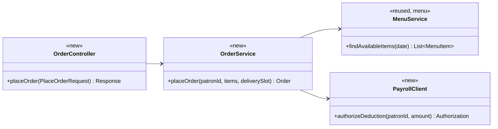
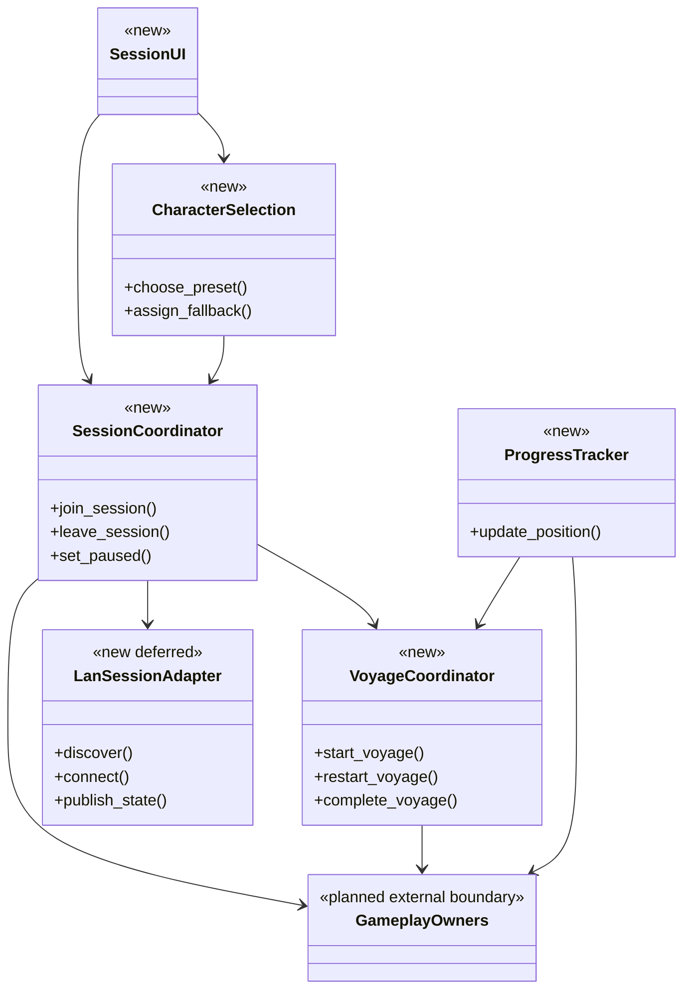
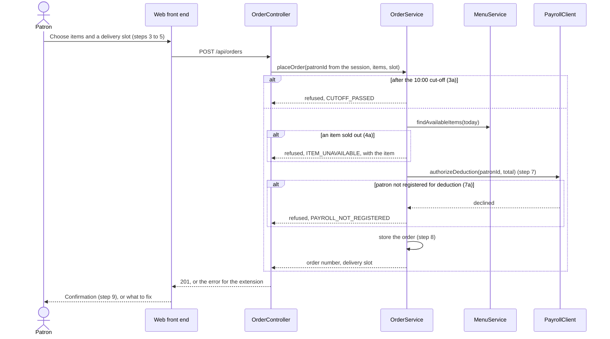
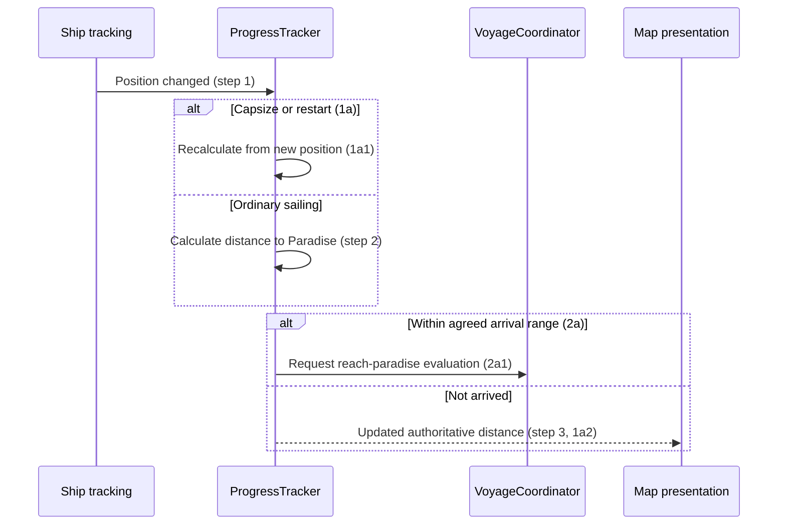
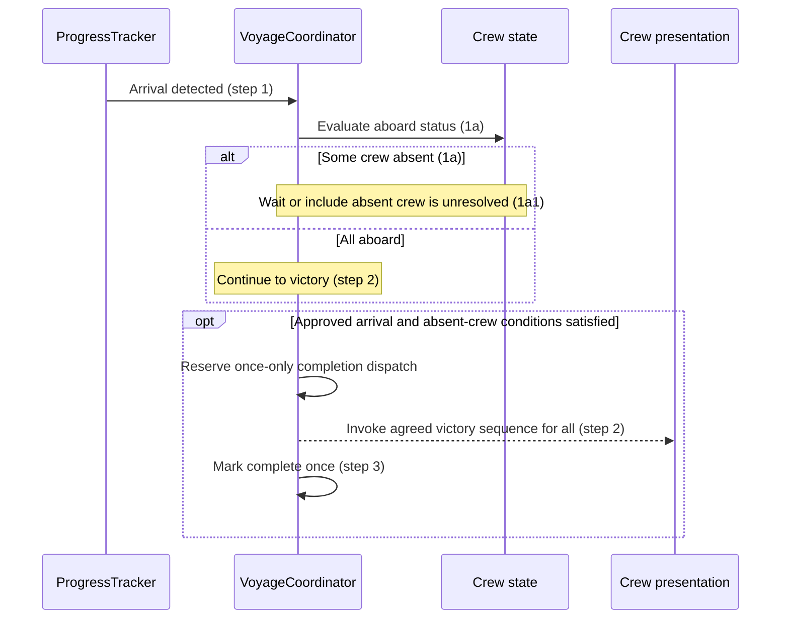
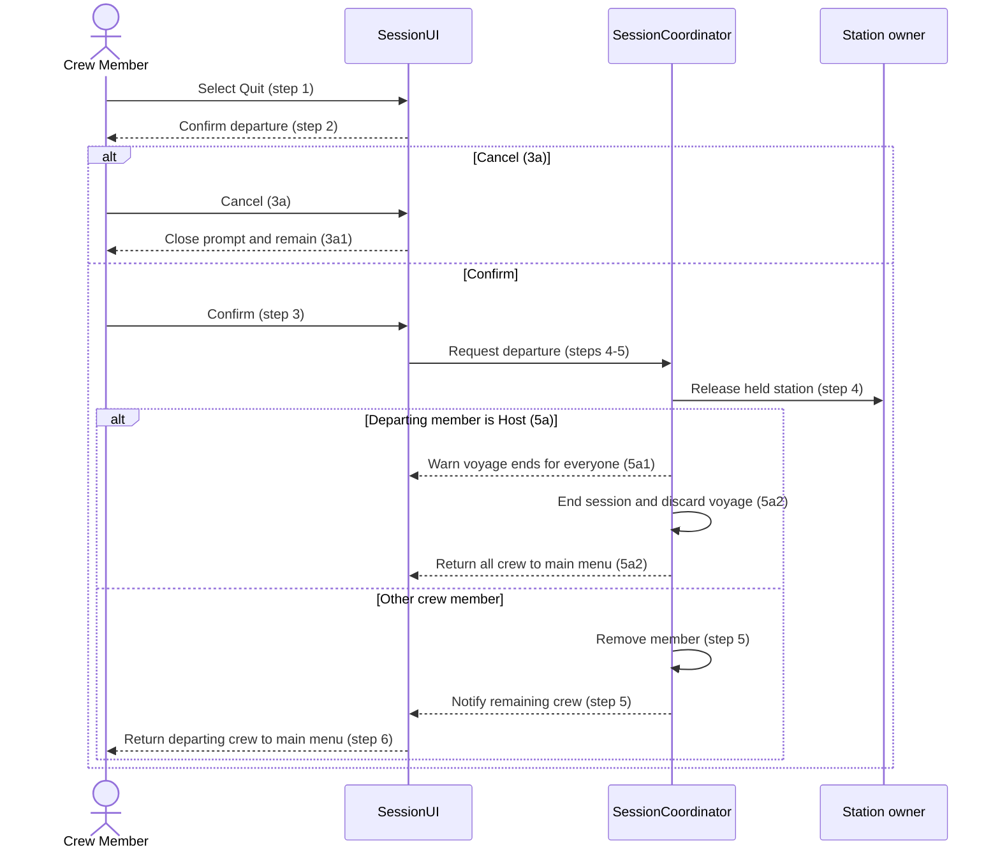
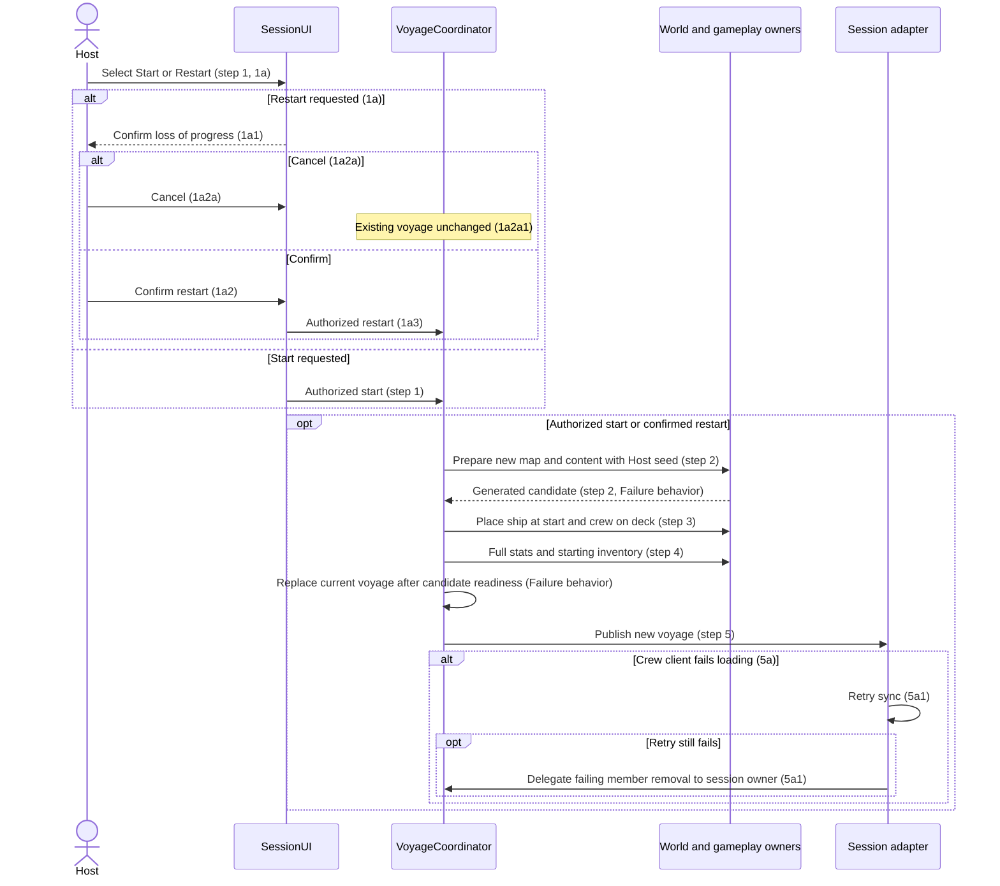
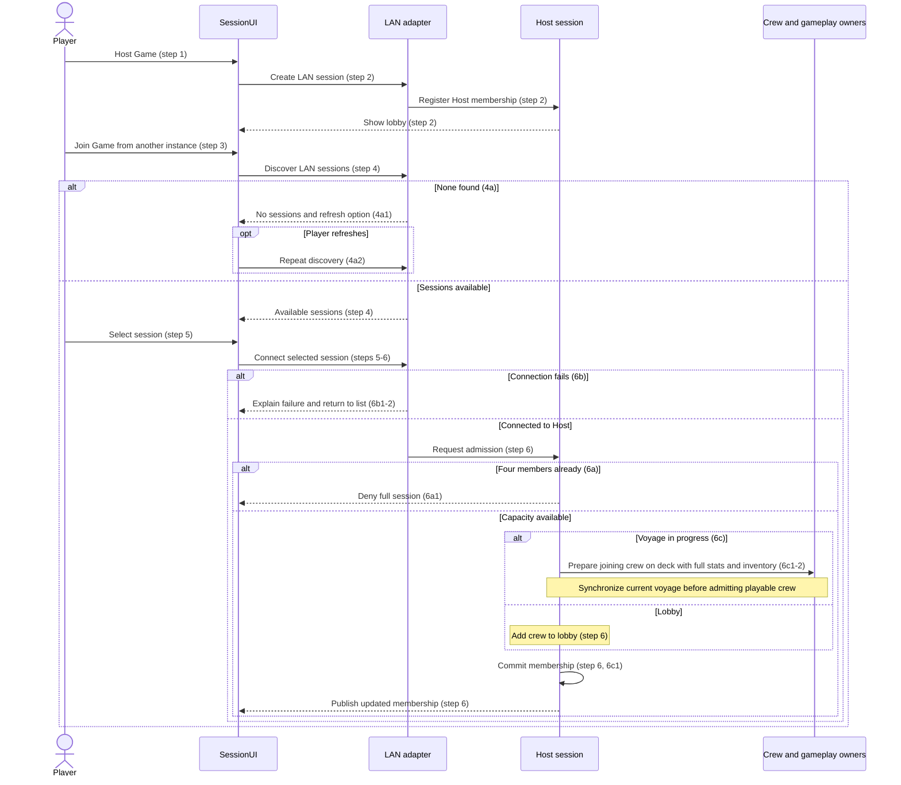
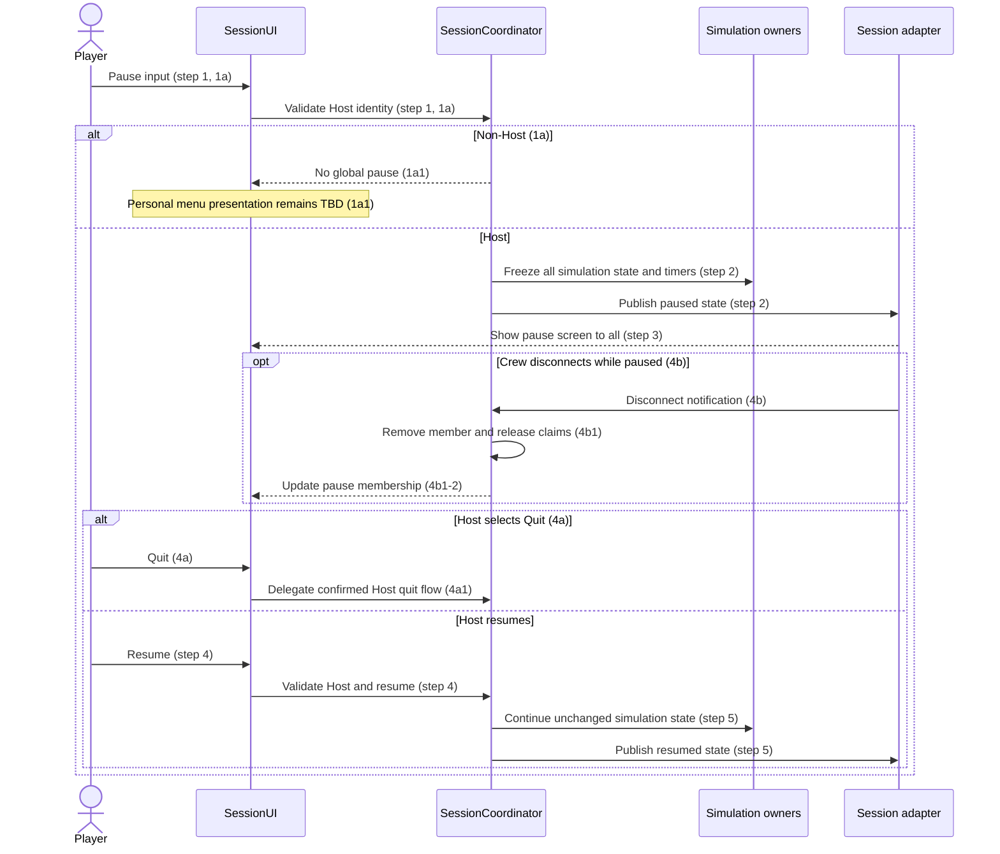
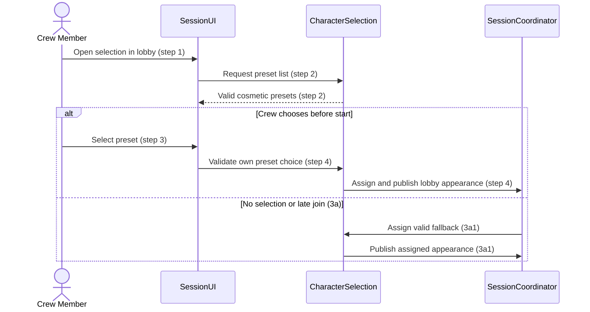

# Progress & Session Design

**Project:** Holy Ship!
**Team:** Team 13 (Gaming)
**Area:** `UC-PROG` (Progress & Session)
**Status:** Proposed future design; questions test answered; requirement decisions remain blocked; no PROG code exists.
**Draft date:** 2026-10-14

> **Realizes:** `UC-PROG-track-progress`, `UC-PROG-reach-paradise`, `UC-PROG-quit-voyage`, `UC-PROG-start-voyage`, `UC-PROG-host-join`, `UC-PROG-pause-game`, `UC-PROG-choose-character`. No supplied `FR-PROG-*` identifiers.
> **Depends on:** `BR-host-ends-session`, `BR-host-controls-session`, `BR-session-cap-4`; architecture `KD-deployment-shape`, `KD-local-first`, `KD-station-components`, `KD-world-chunks`; related use cases are cited below.
> **See:** [use cases](../requirements/use-cases.md), [business rules](../requirements/business-rules.md), [specification](../requirements/software-requirements-specification.md), [architecture-of-record](../architectural-design.md). Links target the intended repository location `docs/design/prog.md`; the specification was not supplied.
> **Designed against:** Supplied use-cases-draft(4).docx v0.2, business-rules (2)(2).md v0.2, and architectural-design(3).md v0.2. No source checkout or main commit supplied; no code inspection claimed.

---

_**How to use this template.** Copy it to `docs/design/<area>.md`, named for the lowercase area code (`ord.md` for `UC-ORD-*`). Instructions appear in italic square brackets; leave them in place until the document is stable, because the agent reads them on every later pass. The full worked example is Project Pulse's [`not.md`](https://github.com/Washingtonwei/project-pulse/blob/main/docs/design/not.md); read it for the shape, not for the answers._

_**What this document is.** The **design-of-record** for one use case area: how the code will realize its use cases, written **before** the code and approved before anyone builds from it. It is the last document your agent reads before it writes code, so anything it leaves out, the agent invents. Your [architecture-of-record](architectural-design.md) is the map of the whole system and stops at each component's responsibility; this document goes one level down, inside one area, against real code._

_**What it is not.** A copy of your use cases. It **cites** `UC-*`, `FR-*`, and `BR-*` by identifier and never restates what the system shall do; it says only how. It is also not a transcript of the code. Once code exists, link to the files rather than describing every class, column, or getter._

_**One document per area, not per use case.** Your area gains use cases over the term. The overview, the class diagram, and the data model are **revised in place** when it does. The sequence diagrams, the API contract rows, and the test rows are **appended**, one set per use case. Never add a `## UC-…` section that repeats the whole skeleton._

_**How much to write.** Pin down what a wrong guess would break: a requirement, a business rule, a quality attribute, or the contract between two parts of your team. Leave the rest for the agent to derive while it builds: variable names, field types, exact JSON, column lengths. When you are unsure, ask which side of that line a detail falls on, not whether it is interesting._

_**Write it in this order.** Each step is one person's or one pair's work, and the order is the point:_

1. _**Sketch it yourselves first.** Before you open the agent, draw the main success scenario's sequence diagram and write the API contract rows by hand, from the use case and your architecture-of-record. Twenty minutes, on paper or in this file._
2. _**Have the agent draft it.** Give the agent this template, the use case, the business rules it cites, your architecture-of-record's section 8 (Crosscutting Concepts), and the relevant existing code, and ask for a draft of this document. Use plan mode, so it proposes before it writes._
3. _**Compare the two.** Where the agent's draft differs from your sketch, decide which is right and why. What it found that you missed goes in; what you knew that it could not have known is the context your specification is missing, so fix the specification too._
4. _**Run the questions test** (the last section) and fix what it finds._
5. _**Open a pull request.** A teammate who did not write it reviews and approves it. Nobody starts an implementation branch from this design until it is merged._

---

## Overview

_[One paragraph: what this area does, which components of your [architecture-of-record](architectural-design.md) it lives in, and what it reads from or calls in other areas. Link the container diagram rather than redrawing it. If this design changes the architecture-of-record, say so here and list the change under "Changes to the architecture-of-record" below.]_

Progress & Session owns the voyage lifecycle and session coordination inside the [Game Application](../architectural-design.md#51-containers). It builds on the architecture's planned Session Setup component, reads authoritative ship positions from SYS/Ship State, asks World and Ocean to generate voyage content, and coordinates crew placement, survival initialization, inventory initialization, station release, and map distance presentation through their owners. The newer use-case draft groups these responsibilities under PROG rather than the architecture's older LOBBY label. Required reconciliation is listed below. All PROG code and interfaces are proposed for future implementation; no checkout or main commit was supplied. Networking remains a separate future integration stage under `KD-local-first`.

Sources: supplied Use Cases v0.2 in use-cases-draft(4).docx, business-rules (2)(2).md v0.2, and architectural-design(3).md v0.2. The newer use cases establish Host authority, LAN joining, unsaved voyages, and global pause; older architecture statements that these are unspecified need updating. No project-specific FR identifiers are supplied, so none are invented.

## Components & classes

_[One class diagram for the whole area, and one line per class or file saying what it does and whether it is **new** or **reused**. Show only what a reader needs to see how the parts relate: classes, their key methods, their dependencies. Fields and getters belong to the code._

_**If your repository has no code for this area yet**, which is the normal case for your proving slice, list the files you expect the agent to create, with the paths your architecture-of-record's conventions give them, and mark them all new. The agent then builds into the structure you chose rather than one it improvised._

_Example:_]

- _`ordering/OrderController` (new): the HTTP entry point; validates the request shape and nothing else._
- _`ordering/OrderService` (new): checks the cut-off, availability, and payroll authorization, then stores the order._
- _`ordering/PayrollClient` (new): the only class that talks to the Payroll System._
- _`menu/MenuService` (reused): called through its service, never its repository._

Proposed Godot components follow the architecture's existing `scripts/` and `scenes/` roots. The `progress/` subfolders are proposed conventions, not verified existing directories.

- `scripts/progress/session_coordinator.gd` (new): owns membership, Host identity, pause state, and termination; validates session actions.
- `scripts/progress/voyage_coordinator.gd` (new): prepares and replaces voyage state, tracks generation identity/completion, and coordinates initialization through other areas.
- `scripts/progress/progress_tracker.gd` (new): derives map distance from current ship/Paradise positions and delegates arrival detection to the voyage owner.
- `scripts/progress/character_selection.gd` (new): validates cosmetic presets, assigns per-member selection/fallback, and publishes changes.
- `scripts/progress/session_ui.gd`, `scenes/progress/session_ui.tscn` (new): lobby, discovery results, character selection, confirmation prompts, pause screen, and progress presentation bindings. Layout may be split into reusable scenes during implementation.
- `scripts/progress/lan_session_adapter.gd` (new, deferred until networking stage): LAN discovery/connection and translation between peer messages and session operations. Transport, peer identity mapping, serialization, and delivery guarantees remain undecided.
- World generation, crew placement, survival, inventories/item pool, stations, and map interfaces are planned external dependencies, not existing reused implementations.
- Existing `scenes/main.tscn`, `scenes/ship.tscn`, `scenes/player.tscn`, and Item Catalog are integration/reuse candidates recorded in architecture section 5.3. They were not inspected and do not establish working sessions or initialization APIs.

## Sequence

_[One sequence diagram per use case for its main success scenario, plus one for each extension that does not just return an error. **Label each interaction with the use case step it implements**, so a reviewer can check that every step is realized and nothing extra was invented. Use `alt` blocks for extensions that branch off the main flow. Give each use case its own `###` heading; that heading is the anchor your traceability matrix cites._

_Example:]_

### _UC-ORD-place-order: placing an order_

All labels cite steps in the supplied PROG use cases. State-owner messages are proposed in-process methods/signals; Adapter represents future synchronization rather than a chosen protocol.

### UC-PROG-track-progress: Track voyage progress

Distance metric and map-unit-to-meter conversion remain open. Position after capsize must come from the ship owner; no accumulated travel total or separate progress bar is introduced.

### UC-PROG-reach-paradise: Reach Paradise Island

The absent-crew branch and victory sequence cannot be implemented from this draft until Team 13 settles them. The diagram deliberately does not choose either outcome. Repeated position notifications must not replay completion.

### UC-PROG-quit-voyage: Quit the voyage

Proposed UI ordering also includes the Host consequence in the initial confirmation, so the Host sees it before irreversible termination; the 5a warning still identifies the Host branch. No extra confirmation is required by the source. Host disconnect uses the same termination cleanup under `BR-host-ends-session`, without a user confirmation.

### UC-PROG-start-voyage: Start or restart a voyage

Preparation must not mutate the running voyage. The replacement boundary includes the candidate's owner initialization, then exposes one new voyage identity. Retain old state if generation fails. Invalidate callbacks/messages for the retired identity. Retry count, deadlines, and load acknowledgments need the networking contract; no arbitrary values are introduced.

### UC-PROG-host-join: Host or join a multiplayer voyage

Membership admission is serialized on the Host. Failed joining must leave session membership unchanged. A late join receives the current voyage, not a regenerated one, and fallback character selection applies. Joining a completed voyage or a paused voyage needs the policies listed below.

### UC-PROG-pause-game: Pause the game

Pause must leave UI, Resume/Quit handling, and connection monitoring operational. Host disconnect ends the session even while paused; it is not merely ordinary crew removal. No timers catch up by wall-clock time on resume.

### UC-PROG-choose-character: Choose a character

Fallback may be a configured default or random valid preset, as the source allows. Proposed choice: one configured default, whose asset is TBD. Duplicate appearances are allowed and never affect stats.

## API contract

_[One row per endpoint, scheduled job, or message this area adds or changes, appended per use case. **This section is never dropped**: before the code exists it is the only thing the person (or agent session) building the front end and the one building the back end both read. Name the caller and who may call it, the request fields, the success response, and the error each extension returns. Leave field types and exact JSON to the agent unless a wrong guess would break something, such as a format another system depends on. Use the error shape your architecture-of-record's section 8.2 fixes; do not invent one here]_

Proposed typed Godot methods/signals follow architecture 8.2.3. They are not HTTP endpoints or an established RPC schema. Under 8.2.1, invalid requests return an explainable refusal without partial changes; the architecture provides no fixed error code/JSON shape. Future remote caller identity is bound by the session adapter, never trusted from an arbitrary request field.

| Operation / use case | Caller (who may) | Request | Success | Errors / extensions |
|---|---|---|---|---|
| `update_progress` / track-progress | Authoritative ship tracker | Voyage identity and current ship position; destination from current voyage | Derived distance for MAP | 1a recalculate after reset. 2a delegate arrival. Ignore retired voyage input. Metric/scale TBD. |
| `evaluate_arrival` / reach-paradise | Authoritative progress tracker | Current voyage identity and ship position | Once-only victory dispatch and completion | 1a absent-crew policy TBD; range/victory content TBD. No completion for stale/non-arrived input. |
| `request_quit`, `confirm_quit` / quit-voyage | Member for their own departure | Caller-bound crew identity and confirmation intent | Release claims, remove member, notify crew, return leaver to menu | 3a cancel preserves state. 5a Host warning/termination returns everyone and discards voyage. Disconnect has no confirmation. |
| `start_voyage` / start-voyage | Host with session open | Start intent; seed generated by Host | Candidate generation, placement, full stats, starting inventory, replacement, sync | Non-Host denied. Configuration/generation failure retains old voyage; detailed feedback policy TBD. |
| `confirm_restart` / start-voyage 1a | Host only | Confirmation for current voyage generation | Replace only after new candidate ready | 1a2a cancel leaves state unchanged. Prevent a stale confirmation from replacing a different voyage. |
| Voyage load/sync result / start-voyage 5a | Adapter for the associated connected crew | Voyage identity and load status | Mark synchronized; on failure retry then remove failing member | Retry policy TBD; stale result ignored. Host initialization failure cannot be treated as ordinary member removal. |
| `host_session` / host-join | Local player creating session | Host intent | LAN session, Host membership, lobby | LAN discovery/transport and host-creation failures need adapter definition. |
| `discover_sessions` / host-join | Joining player on LAN | Discovery or refresh intent | Current session choices | 4a empty result plus refresh; 6b connection failure returns to list. |
| `join_session` / host-join | Connecting LAN player through adapter | Selected session and connection-bound identity | Serialized admission and lobby update | 6a deny at four members. 6b failure leaves membership unchanged. 6c current voyage sync, full stats, inventory, deck placement. |
| `set_paused` / pause-game | Host only, valid running voyage | Pause or Resume intent | Whole-crew simulation freeze/resume and UI update | 1a non-Host does not pause, menu TBD. 4a delegates quit. 4b removes disconnected crew and updates screen; Host loss terminates. |
| `choose_preset` / choose-character | Lobby member for themselves | Preset ID from bundled valid list | Assign own cosmetic appearance and publish | 3a fallback on start/late join. Invalid preset/non-lobby selection rejected with no assignment. |
| `assign_fallback` / choose-character 3a | Session owner | Member with no chosen preset | Valid default appearance for voyage | Missing valid default/catalog: configuration failure, no invented appearance. |

Cross-area dependencies must agree candidate-generation/initialization, crew cleanup, and pause interfaces before implementation. Publication includes current voyage identity and membership/pause/completion/appearance state as applicable. Format, ordering, late-join acknowledgment, and retry deduplication remain transport-design work; no synchronization success is claimed here.

## Key decisions

_[Only the decisions a reader could not recover from the code: an invariant, who may do this and how it is enforced, a trade-off you chose, a reason you reused something rather than writing it. **Each one names what you chose, what you rejected, and why.** If you cannot name an alternative you considered, it probably was not a decision; leave it out._

_A decision that affects the whole system rather than this area is an architecture decision. It belongs in your architecture-of-record as a `KD-*` entry, not here.]_

**Prepare before replacing.** Generate and initialize a separate candidate, then replace the active voyage at one owner-controlled boundary (start-voyage Failure behavior). Rejected: clearing old state first, because generation failure would destroy an otherwise running voyage. Client load failure is handled after replacement through 5a, not by resurrecting the discarded voyage.

**Separate membership from voyage lifetime.** Keep Host/membership/appearance in session state, with map, inventory, timers, and completion in replaceable voyage state. Rejected: creating a new LAN session for every restart, because the Host is restarting the crew's voyage, not asking them to join again. Appearance is retained across restarts within the same session, as specified in the questions-test resolutions.

**Serialize admission and cleanup.** The Host owns one capacity check-and-admit operation and idempotent member cleanup. Rejected: UI slot counting or each peer adding itself, because concurrent joins could exceed `BR-session-cap-4` and disconnects could leave claims assigned to absent crew. Host-only checks enforce `BR-host-controls-session`; Host termination follows `BR-host-ends-session`.

**Freeze simulation, retain session controls.** Separate pausable simulation processing from always-available UI and connection processing. Rejected: stopping the entire application event loop, because Resume, Quit, and paused disconnect handling must work. Exact Godot process modes must be verified against implementation.

**Derive distance from current state.** Recalculate on authoritative position changes, including reset. Rejected: storing traveled distance as progress, because the use case asks distance to Paradise and resets can change it abruptly. Straight-line versus route distance remains a requirement decision, not an assumed formula.

**One completion transition.** Guard completion by current voyage identity and a once-only transition, then delegate the agreed victory sequence. Rejected: playing victory on every frame inside arrival range, because completion is set once. Absent-crew and end-screen policies remain unresolved.

**Use a configured cosmetic fallback.** Proposed default preset rather than random selection, both allowed by choose-character 3a. This simplifies predictable tests; the specific preset remains TBD. No uniqueness lock, stat variation, saved appearance, or customization editor is added.

## Data model

_[The **change** this area makes to the data: new tables or entities, new columns, the migration that adds them. Draw an ER diagram when there is more than one new table. Do not redraw the domain model; your [specification](../requirements/software-requirements-specification.md) owns it, so link it and show only the change. If the area changes nothing, say "No change" and give the reason in one line; that is a design decision too.]_

New in-memory state and bundled configuration only; no database tables or migrations. The [specification](../requirements/software-requirements-specification.md) owns the full domain model, but was not supplied.

| Addition | Data / relationships | Invariant / lifetime |
|---|---|---|
| Session state | Host identity, connection-to-crew mapping, members, pause state, selected cosmetics | One Host, total 1–4 committed members; no host migration. Discard on termination. |
| Voyage state | Generation identity, Host-generated seed, starting point, Paradise location, completion flag, references to owner state | Replaced on start/restart; completion once; never saved between sessions. Old callbacks cannot mutate replacement. |
| Pending generated candidate | Prepared world references and initialized crew/ship state | Not visible as the active voyage before readiness; generation failure does not discard old state. |
| Progress projection | Current voyage identity and derived distance in meters | Nonnegative; matches latest ship position; recalculated, not a durable progress counter. Metric/scale TBD. |
| Preset configuration | Allowed cosmetic preset IDs/assets and default ID | Default belongs to valid presets; several members may choose the same preset; no stat effects. |
| Voyage initialization configuration | Starting inventory definition and stat initialization references | Inventory policy TBD; full stats use SURV/FTG maxima from their owners rather than PROG constants. |
| Per-connection loading status | Current generation and synchronization result | Transient state for start-voyage 5a/late join; retries and deadlines TBD. |

World, crew stats, owned items, station occupants, and map discovery remain with their area owners. Restart clears/reinitializes all voyage-owned state, including EVT rolled flags and MAP discovery/pins, through owner lifecycle hooks. Capsize is a within-voyage reset owned by WAVE/SHIP and does not regenerate the session or destination.

## Reuse & cross-cutting

_[Which existing services, components, and conventions this area uses rather than rebuilding: authentication, the error handler, email, the clock, another area's service. Cite your architecture-of-record's section 8.2 for each convention by name rather than restating it.]_

| Architecture convention | PROG application |
|---|---|
| 8.1 Security and 8.2.5 Validation | Host validates member identity, session privileges, capacity, and preset IDs. LAN traffic is untrusted; choose peer mapping before multiplayer. No account provider is implied. |
| 8.2.1 Error handling | Refuse invalid lifecycle actions without partial membership/state changes; expose understandable UI feedback. |
| 8.2.2 Time and time zones | Pause simulation timers without wall-clock catch-up. Control/network retry timing is separate from gameplay timing and awaits adapter design. |
| 8.2.3 API and 8.2.4 Code conventions | Typed GDScript, Resources, reusable scenes, signals; keep transport separate from local simulation owners. |
| 8.2.6 Configuration | Inspector/Resource configuration for presets, starting inventory, generation inputs, and agreed arrival/range settings. |
| 8.2.7 Logging | Log actionable generation/join/sync failures and lifecycle transitions, not continuous position traffic. |
| 8.2.8 Persistence and concurrency | In-memory voyage state, serial authority-owned mutations, candidate-before-replacement; no saved voyage. |
| 8.2.10 Testing | Future Godot import/parser/startup checks, component integration tests, gameplay checks, and actual target exports. |

External owners: `UC-SYS-track-boat`, `UC-MAP-open-map`, `UC-DECK-claim-station`, `UC-SYS-item-pool`, `UC-SYS-player-inventory`, and SURV/FTG stat owners. World generation supplies map/islands/shipwrecks/merchants/Paradise; PROG does not implement island collection or merchant trading. `UC-WAVE-capsize-ship` supplies reset positions and uses the voyage's last-island/start reference; PROG observes resulting position for progress.

## Tests

_[One row per flow: the main success scenario and **every** extension of every use case this document realizes, appended per use case. Name the level (unit or integration) and what the test asserts. No code. This list is the definition of done that the reviewer approves; the agent writes these tests when it builds, and a reviewer can see at a glance whether an extension has no test.]_

Planned tests only; no code or executed runtime checks are claimed. Tests whose requirement choices remain TBD are blocked until those choices are resolved.

| Use case / flow | Level | Asserts |
|---|---|---|
| UC-PROG-track-progress main | Integration | Host position change updates MAP distance from current ship/Paradise positions in agreed meters/metric. |
| Track-progress 1a | Integration | Capsize and restart recalculate from new position and destination, never retain stale distance. |
| Track-progress 2a | Integration | Agreed arrival condition delegates reach-paradise for the current voyage. |
| UC-PROG-reach-paradise main | Integration, partly blocked | Valid arrival invokes agreed victory for all and sets completion once; repeated arrival does not replay it. |
| Reach-paradise 1a | Integration, blocked | Absent crew follows the approved wait-or-include policy; no guessed requirement. |
| UC-PROG-quit-voyage main | Integration | Confirmed non-Host departure releases claims, removes member, notifies remaining crew, returns leaver to menu, and preserves session. |
| Quit-voyage 3a | Unit | Cancel closes prompt without membership/station/voyage changes. |
| Quit-voyage 5a | Integration | Host sees warning, termination returns everyone to menu and discards voyage; no host migration. |
| UC-PROG-start-voyage main | Integration, inventory configuration blocked | Host seed generates required content; ship starts correctly, crew on deck with full stats and configured inventory; clients receive same voyage. |
| Start-voyage 1a | Integration | Confirmed restart prepares new state before retiring old and reinitializes all voyage owners. |
| Start-voyage 1a2a | Unit | Cancel restart retains voyage, inventories, positions, and timer state. |
| Start-voyage 5a | Integration, adapter policy blocked | Failed client load retries sync; continuing failure removes only that member and releases claims. |
| UC-PROG-host-join main | Integration, network stage | Host creates LAN lobby and successful join publishes membership to everyone. |
| Host-join 4a | Integration | Empty discovery shows explanation and refresh, which repeats discovery. |
| Host-join 6a | Unit | Four members deny join without state changes; concurrent admission cannot create a fifth. |
| Host-join 6b | Integration | Connection failure explains error, returns to discovery, and leaves membership unchanged. |
| Host-join 6c | Integration | Late join uses current voyage, deck placement, full stats, starting inventory, valid fallback appearance, and current synchronized world. |
| UC-PROG-pause-game main | Integration | Host freezes movement/stats/wind/waves/all simulation timers; Resume preserves frozen values and remaining durations. UI still responds. |
| Pause-game 1a | Unit, presentation blocked | Non-Host input never changes global pause; local presentation follows agreed menu policy. |
| Pause-game 4a | Integration | Host Quit delegates confirmation/termination and returns all crew to menu. |
| Pause-game 4b | Integration | Disconnect while paused removes member, releases claims, updates screen, and leaves remaining simulation paused. |
| UC-PROG-choose-character main | Integration | Valid lobby selection updates everyone and voyage appearance; duplicates allowed; stats unchanged. |
| Choose-character 3a | Unit | No choice or late join receives configured valid default with no stat changes. |
| Host authorization | Unit | Non-Host cannot start/restart/pause/resume; caller cannot alter another member's appearance/departure. |
| Host disconnect | Integration | Session ends with unsaved state discarded, including while paused. |
| Generation failure | Integration | Failed preparation preserves old voyage and does not publish partial replacement. |
| Retired generation / duplicate callbacks | Unit | Stale sync/position/confirmation messages cannot mutate current voyage; repeated cleanup/completion is safe. |
| Quit/relaunch | Integration | No old voyage or appearance is restored from persistent storage. |

## Changes to the architecture-of-record

_[Designing an area against real code is when the architecture's guesses meet reality. If this design needs a component the map does not have, moves a responsibility, or adds a dependency, **change [the architecture-of-record](architectural-design.md) in the same pull request** and list each change here in one line. If nothing changed, write "None". A design that silently disagrees with the architecture leaves two maps, and the agent will follow whichever it reads last.]_

Required companion updates are **proposed**, not edits made to architectural-design.md by this deliverable. Review and apply in the same design PR before implementation:

- Section 5.2: reconcile the older LOBBY area with PROG and record SessionCoordinator, VoyageCoordinator, ProgressTracker, and character selection responsibilities inside the existing Game Application.
- Section 5.2: add dependencies on world generation, SYS ship/inventory tracking, MAP presentation, DECK claims, and SURV/FTG initialization; retain domain state ownership.
- Sections 8.1 and 8.2.8: record use-case Host authority, serialized admission, `BR-session-cap-4`, Host termination/no migration, unsaved voyage lifecycle, and prepare-before-restart replacement.
- Section 8.2.2: replace the outdated pause-policy gap with global Host-controlled simulation freeze and operational UI/network controls.
- Identifiers/11.2: update the obsolete claim that only steering is specified and the save/authority gaps settled by the supplied Use Cases v0.2. Keep transport and recovery gaps open.
- Section 6: add PROG runtime views when implementation exists; current movement prototype remains distinct.

No external server, online matchmaking, account service, database, save format, or new deployment container is proposed.

## Questions-test design resolutions

These contracts refine the proposed design above. They do not approve unresolved product choices. **Open** items in the review record remain implementation blockers; a configurable TBD is not a resolved requirement. No changes to the supplied use cases, business rules, or architecture-of-record are claimed.

### Lifecycle and owner contracts

- SessionCoordinator serializes admission, departure, pause/resume, candidate commit, and termination. Once termination begins, reject every mutation except repeatable cleanup. Reject overlapping start/restart requests and bind confirmation to the active generation. Keep a private completion-dispatch guard distinct from the voyage-complete flag.
- Each gameplay owner must provide preparation, validation, commit, candidate disposal, member cleanup, and pause/resume participation as applicable. Preparation is isolated from live state. Validation reports readiness or an explainable failure. The exact owner implementations and integration bindings remain open; PROG must not claim readiness without them.
- Before replacement, validate the candidate against the current committed membership. Discard candidate records for departed members and prepare any newly admitted members. Revalidate at the serialized commit boundary. No candidate work may revive a departed member. A pending join cannot commit against a generation that has been retired.
- All owner preparation must succeed before the active generation is replaced. Before that boundary, failures dispose of candidate resources and retain the old voyage. The commit boundary may expose only fully prepared owner state; operations that can still fail must run before commit. Client loading failures after commit follow start-voyage 5a; they do not restore the retired voyage.
- Configuration, loading acknowledgments, callbacks, and owner updates identify their generation. SessionCoordinator rejects retired-generation updates and requests from invalid connection identities.

### Progress and completion contracts

- MAP/SYS and World must supply one agreed coordinate system, meters conversion, ship reference point, Paradise reference point, and arrival predicate. Metric, scale, range, and boundary remain blocked pending agreement; there is no silent default.
- Keep precise distance internally; round only for display. Never use display rounding to decide arrival. Initialize the current distance when a new voyage becomes active and refresh MAP from the current projection when opened.
- Reevaluate pending arrival on authoritative ship movement and relevant membership/aboard-state changes, including crew returning to a stationary ship. If waiting for crew is selected, recheck both arrival and crew conditions before dispatch.
- Reserve a once-only dispatch guard before calling victory presentation, preserving the use-case order of victory invocation followed by setting completion. Duplicate arrival callbacks cannot dispatch again. Presentation must acknowledge invocation without waiting for its animation to finish. Presentation errors are reported and cannot leave completion permanently pending. A retired generation cannot finish the replacement voyage.
- The reach-paradise sequence's absent-crew branch is a gate: it must never fall through to victory until the approved policy permits it. What victory shows, what follows it, and allowed post-arrival session actions remain open.

### Departure contracts

- A non-Host connection loss uses the same authoritative member-removal and station-release path as confirmed departure, without asking the disconnected client to confirm. Host loss always terminates under BR-host-ends-session.
- Mark a departing member unavailable for new actions, release all claims and cancel their in-flight requests through the owning components, then publish membership removal. Cleanup is idempotent. A failure must not publish successful cleanup while leaving a station assigned to the departed member; report the failure and retry owner cleanup. Never reapply an inventory transaction during retry.
- Avatar removal, disposition of personal possessions, and effects on domain-specific activities require an owner-approved cleanup contract. No policy to destroy or transfer possessions is selected here.

### Initialization, loading, and membership contracts

- Validate inventory configuration and all required spawn/owner configuration before candidate commit. Full hunger, thirst, and fatigue come from SURV/FTG maxima. Do not infer a loadout from the examples in the use case.
- After replacement, hold the new voyage's simulation until each committed client acknowledges loading the current generation or has been removed under the approved retry policy. Paused voyages must not advance during this barrier. The loading barrier does not decide whether restart clears an existing pause; that remains open.
- Host initialization failure before commit disposes of the candidate and retains the old voyage or lobby. A fatal Host failure after commit terminates the session rather than removing the Host and continuing. Recoverable presentation errors do not imply Host connection loss.
- Pending admission reserves one capacity slot under Host serialization. Count committed members plus reservations against four, including the Host. A reservation is not published membership and grants no gameplay authority. Release it on failure, cancellation, or connection loss. Its expiry policy belongs to the unresolved adapter contract.
- Prepare a late join in isolated temporary state. Synchronize a snapshot for the current generation plus subsequent authoritative changes, in order. Commit membership, deck placement, full stats, inventory, and appearance only at a validated admission boundary. A failed attempt discards pending state and leaves existing gameplay and membership unchanged. If the generation changes while loading, do not commit the stale snapshot.
- The network contract must define snapshot coverage for every mutable owner, identity binding, version compatibility, delivery/order guarantees, failure detection, retries, and deadlines. Seed-only synchronization is insufficient for a voyage already in progress. These remain prerequisites, not implemented properties.

### Pause and cosmetics contracts

- While paused, allow session controls and read-only presentation; reject gameplay mutations, including consumption, trading, collection, station claims, and movement. Departure cleanup remains allowed. All simulation owners freeze their timers and stats without wall-clock catch-up.
- The Host establishes the authoritative pause boundary. Clients reconcile to that state; ignore gameplay intents received while paused and do not queue them for replay on resume. Pause/resume ordering and acknowledgments must be part of the adapter contract. Always-running UI/connection processing must not advance gameplay timers.
- Retain selected cosmetics across restarts within the same session; clear them at session termination. Use one configured valid default when no selection exists. Both default and random fallbacks are allowed by the use case, so choosing a default adds no requirement.
- Serialize character selection with start: accept valid selections before the start boundary; assign fallback to members still unselected there. Reject later lobby-selection requests. Duplicate presets remain allowed and cosmetic only.

### Additional planned verification

| Flow / boundary | Level | Required assertion |
|---|---|---|
| Lifecycle contention | Integration | Termination rejects new mutations; overlapping starts and stale confirmations cannot replace a newer voyage. |
| Membership changes during preparation | Integration | Departed crew are not recreated; every committed member is initialized before candidate commit. |
| Owner readiness failure | Integration | Failure in any preparation/validation leaves active owner state intact and disposes of the candidate. |
| Stationary pending arrival | Integration, policy blocked | Returning crew or membership changes reevaluate approved arrival conditions without requiring ship movement. |
| Completion reentrancy/presentation failure | Integration | One victory dispatch per generation; duplicate callbacks do not replay it; presentation failure does not strand completion. |
| Non-Host disconnect and cleanup retry | Integration | Claims release once; repeated cleanup cannot duplicate item mutations; membership cannot report cleanup success prematurely. |
| Client load barrier | Integration, adapter blocked | No new-generation simulation before acknowledgment/removal; Host startup failure never causes Host migration. |
| Pending concurrent admissions | Integration | Members plus reservations never exceed four; failed reservations change no existing gameplay state. |
| Failed or stale late join | Integration | No visible crew/items before commit; failed sync has no effects; retired snapshots cannot admit a member. |
| Paused gameplay requests | Integration | Gameplay requests have no effects and are not replayed; UI, disconnect cleanup, and Host resume remain usable. |
| Cosmetic restart/start boundary | Integration | Restart retains session selection; start selects either accepted preset or valid fallback consistently for everyone. |
| Display rounding | Unit | Rounding cannot change arrival or authoritative distance; reopening MAP shows the current generation's projection. |

## Open questions & risks

_[What this design could not settle and who can, and what could go wrong that you are accepting. A question for the client also goes in [`OPEN-ISSUES.md`](../requirements/OPEN-ISSUES.md).]_

Team 13 owns product decisions. Area owners agree cross-component interfaces. Mirror client-facing decisions into `docs/requirements/OPEN-ISSUES.md` when integrating; that file was not supplied or edited.

| Gap / risk | Owner / needed decision | Consequence |
|---|---|---|
| Straight-line or route distance, units conversion | Team 13 + MAP/SYS | Blocks exact distance formula and progress acceptance. No route/pathfinding system is invented. |
| Arrival range and trigger evaluation | Team 13 + PROG/world | Define range, metric, and detection boundary before completion checks. |
| Victory sequence and absent crew | Team 13 | Source leaves end screen/stats/credits/lobby and wait-or-include open; blocks reach-paradise and post-victory transitions. |
| Starting inventory | Team 13 + SYS | Define items/quantities/pool categories before start and late-join acceptance. Do not turn examples into approved loadout. |
| Non-Host pause-input presentation | Team 13 + UI | Local menu is marked TBD in source; global pause remains Host-only regardless. |
| Preset assets/default | Team 13 + presentation | Configure a valid cosmetic default; session choices carry into restart and are not saved between sessions. |
| LAN discovery/transport, connection identity, snapshot acknowledgments and retries | PROG/network owner | Must specify adapter before network implementation; choose retry/deadline/error behavior without adding online services. |
| Late join while paused or completed, loading failure during join | Team 13 + PROG/network | Define eligibility and paused initialization ordering; failed joining must leave membership unchanged. |
| Generation failure feedback and readiness boundary | PROG + world/gameplay owners | Agree candidate validation/initialization so old voyage survives failures and new state is never half-published. |
| Resume, disconnect, join, and restart racing | PROG/network owner | Serialize state changes and reject retired generation messages; inspect actual Godot processing modes when coding. |
| World generation scale and recycling | World owner, architecture RISK-world-growth | Candidate generation must respect bounded active chunks; generating voyage content does not mean instantiating every tile at once. |
| No source checkout or main commit | Team 13 implementer | Verify integration paths/APIs and record main commit before implementation; documented prototype files are not inspected here. |

This is a reviewable draft, not an approved implementation plan for unresolved branches. No team sketch, independent questions-test session, code execution, teammate approval, or merge is claimed.

---

## Working this document with your agent

_[Delegate: drafting the diagrams from your sketch and the use case; listing the existing files a class should extend; filling the contract rows' request and response fields; proposing the test row for each extension; drafting the rejected alternative for a decision you have already made; checking that every identifier this document cites exists in the document that owns it._

_Keep human: which side of the "would a wrong guess break something" line each detail falls on; every key decision; and the approval, which is a teammate's review of the pull request, not the drafter's own reading._

_**The specific failure to watch for: scope that nobody asked for.** An agent drafting a design adds what designs it has read usually have: an admin override, a retry queue, a status field, a notification "while we are here". Each looks reasonable and none is in your use case, and once it is in the design the agent will build it, test it, and you will maintain it. Read the sequence labels: every interaction should name the use case step it implements. An interaction with no step is either a missing requirement, which goes to your specification and your client, or scope creep, which comes out.]_

The PROG material is proposed future design. Retained template examples illustrate structure only; their ordering APIs and rules are not Holy Ship scope. Keep Team 13 approval and unresolved product choices human-owned.

---

## The questions test (before you open the pull request)

_[Start a **fresh** agent session in plan mode, so it carries nothing from the session that drafted this document. Give it only the use case, the business rules it cites, your architecture-of-record's section 8, and this document, and ask:_

> _List every point you would still have to guess to implement `<UC-ID>`. For each, say what you would guess and whether a wrong guess could violate a requirement. Do not write code._

_For each item on its list, either fix this document or keep the guess and write one line saying why a wrong guess breaks no requirement. Paste the list, with your answer to each item, into the pull request description under How it was verified, inside a collapsed `

Questions test
 … 
` block so the description stays short. The design is ready when nothing on the list could break a requirement.]_

Draft traceability review: all seven PROG cases have sequence anchors and contract/test coverage. Extensions covered: track-progress 1a/2a; reach-paradise 1a; quit-voyage 3a/5a; start-voyage 1a/1a2a/5a; host-join 4a/6a/6b/6c; pause-game 1a/4a/4b; choose-character 3a. Business-rule identifiers are drawn from the supplied rules.

The read-only questions review in this conversation has been answered below. It was not a separately spawned agent session or a documented plan-mode run. This revision does not claim implementation, runtime verification, teammate approval, or a passing readiness gate. Resolve all **Open** items and apply companion architecture changes before implementation.

### Result

Reviewed on 2026-10-14 in the preceding read-only assistant turn against the supplied PROG design, the seven PROG use cases, business rules, and architecture-of-record. This was not a separately spawned fresh agent session. This revision answers every item from that review and adds design contracts and planned tests; no runtime tests were executed.

**The design is not ready for implementation.** Items marked **Open** still require Team 13 or another area owner. In particular: distance/arrival policy; absent crew/victory/post-victory actions; starting inventory and owner initialization; generation/placement and restart pause policy; LAN transport/identity/synchronization/reconnection; non-Host pause presentation; preset assets; concrete owner integration; and companion architecture updates. A deferred requirement-affecting decision is not classified as harmless merely because it is TBD.

Paste the following block into its description under **How it was verified**. 

Questions test

**Shared decisions**

- **Architecture reconciliation.** Could break: yes. **Answer:** Open — Team 13 must apply the listed companion changes to the architecture-of-record in the same PR. This file cannot silently override that record.
- **Cross-area owner interfaces.** Could break: yes. **Answer:** Partly fixed — lifecycle responsibilities and readiness/failure contracts are specified above. Open — owners must agree concrete bindings and guarantees before implementation.
- **Allowed lifecycle transitions.** Could break: yes. **Answer:** Fixed — serialized transitions, termination guards, overlapping-start rejection, and generation-bound confirmation are specified above. Victory-specific transitions remain open under reach-paradise.
- **Membership during candidate generation.** Could break: yes. **Answer:** Fixed — reconcile current committed membership and revalidate at commit; departed members cannot be recreated and stale joins cannot commit.
- **Uninspected scene integration.** Could break: yes, for integration. **Answer:** Open — verify actual scene ownership, coordinator lifetime, and owner APIs against the checkout before implementation; exact filenames may be derived without changing behavior.

**UC-PROG-track-progress**

- **Straight-line versus route distance.** Could break: yes. **Answer:** Open — Team 13 must select the metric; no straight-line default is approved.
- **Coordinate points and meters conversion.** Could break: yes. **Answer:** Open — MAP/SYS and World must agree reference points and a common scale. Configuration without approved values does not resolve this.
- **Arrival while stationary.** Could break: yes. **Answer:** Fixed — relevant crew/membership changes reevaluate pending arrival as well as ship movement; any wait policy also rechecks ship range.
- **Distance rounding.** Could break: no. **Answer:** Kept — preserve precision internally and round display only; different display rounding breaks no stated precision requirement and cannot affect arrival.

**UC-PROG-reach-paradise**

- **Arrival range and boundary.** Could break: yes. **Answer:** Open — Team 13 and World must approve the predicate, range, and inclusive/exclusive boundary.
- **Absent-crew policy.** Could break: yes. **Answer:** Open — Team 13 must choose wait-for-all or include-everyone. The sequence now gates victory rather than falling through the unresolved branch.
- **Meaning of aboard.** Could break: yes, if waiting is selected. **Answer:** Open — DECK/ISLE/SURV must define aboard status for swimmers, rowboat passengers, and passed-out members; current membership is the candidate crew set.
- **Victory presentation and destination.** Could break: yes. **Answer:** Open — Team 13 must choose the sequence and the post-victory destination; no end screen, credits, stats, or lobby transition is invented.
- **Completion timing and presentation failure.** Could break: yes. **Answer:** Fixed — a separate dispatch guard prevents reentry; invoke presentation once, then mark complete; presentation failure cannot strand completion.
- **Actions during and after victory.** Could break: yes. **Answer:** Open — Team 13 must define simulation behavior, joining, quitting, and restart eligibility during/after victory.

**UC-PROG-quit-voyage**

- **Avatar, possessions, unfinished activities.** Could break: yes, potentially. **Answer:** Open — DECK/SYS and affected owners must approve cleanup effects. PROG does not invent item destruction or transfer.
- **Unexpected non-Host disconnect outside pause.** Could break: yes, potentially. **Answer:** Fixed — use authoritative departure cleanup without confirmation; Host disconnect still ends the session.
- **Departure cleanup failure.** Could break: yes. **Answer:** Fixed — block departing-member actions, perform repeatable owner cleanup, and do not publish successful release while claims remain; failures are reported and cleanup retried.
- **Notification wording/style.** Could break: no. **Answer:** Kept — exact wording and style are implementation choices; the required departure notice and pre-termination Host warning remain mandatory.

**UC-PROG-start-voyage**

- **Starting inventory.** Could break: yes. **Answer:** Open — Team 13/SYS must specify personal and shared starting items and quantities; late joins use the approved personal policy.
- **Other initial owner state.** Could break: yes. **Answer:** Open — owners must define fresh illness/pass-out state, ship state, shared stock, gold/water, and other reset values; no unapproved defaults are selected.
- **Generated content and starting placement.** Could break: yes. **Answer:** Open — World/DECK must define content validity and safe ship/deck spawn criteria within bounded world generation.
- **Meaning of unique voyage.** Could break: potentially. **Answer:** Open — Team 13 must confirm whether fresh random generation is sufficient; no persistent seed history or absolute non-repetition guarantee is added.
- **Readiness and rollback.** Could break: yes. **Answer:** Fixed at the PROG boundary — validate every isolated owner candidate before commit; failed preparation preserves the old voyage. Concrete owner readiness implementations remain blocked.
- **Old voyage during preparation.** Could break: yes, potentially. **Answer:** Open — Team 13 must decide whether a previously running voyage continues or freezes while preparation occurs; cancellation/failure must not discard it.
- **Client barrier and Host initialization failure.** Could break: yes. **Answer:** Fixed — hold replacement simulation until load acknowledgment/removal; precommit Host failure retains old state, fatal postcommit Host failure ends the session. Adapter timing remains open.
- **Sync retries and deadlines.** Could break: yes. **Answer:** Open — network owner must approve retry count and deadlines; the earlier one-retry suggestion is not adopted as a requirement.
- **Pause state after restart.** Could break: yes, potentially. **Answer:** Open — Team 13 must choose pause retention or clearing; the load barrier must preserve the approved pause outcome.

**UC-PROG-host-join**

- **LAN discovery, transport, target exports.** Could break: yes. **Answer:** Open — network owner must select and verify a LAN mechanism for approved targets, consistent with architecture KD-local-first.
- **Peer identity and compatibility.** Could break: yes. **Answer:** Open — network owner must define trusted connection-to-crew mapping and protocol/content compatibility; no accounts are implied.
- **Snapshot coverage and ordering.** Could break: yes. **Answer:** Partly fixed — require current owner state plus ordered subsequent changes and generation checks; Open — owner payloads and delivery guarantees must be agreed.
- **Pending joins and capacity.** Could break: yes. **Answer:** Fixed — Host reservations count with committed membership toward four; reservations grant no membership or gameplay effects and are released on failed admission. Expiry timing remains adapter work.
- **Join while paused.** Could break: yes, potentially. **Answer:** Open — Team 13 must decide eligibility; if permitted, initialization and admission may not advance the paused simulation.
- **Join after completion.** Could break: yes, potentially. **Answer:** Open — Team 13 must decide eligibility with the victory policy; no rejection or lobby redirection is silently selected.
- **Failed late-join initialization.** Could break: yes. **Answer:** Fixed — isolated preparation and validated admission commit prevent partial crew/items; failure discards pending state and leaves existing gameplay unchanged.
- **Reconnection semantics.** Could break: yes, potentially. **Answer:** Open — Team 13/SYS/network must decide identity reuse, retained possessions, and treatment of a pending disconnect; no fresh-loadout reconnect policy is assumed.
- **Host creation and connection loss.** Could break: yes. **Answer:** Partly fixed — failed creation leaves no committed session; confirmed Host loss terminates. Open — adapter must define failure detection and timeout behavior.

**UC-PROG-pause-game**

- **Non-Host pause presentation.** Could break: yes. **Answer:** Open — Team 13/UI must choose the local presentation; non-Host input never changes global pause.
- **Menu actions while paused.** Could break: yes. **Answer:** Fixed — allow session/read-only controls and departure cleanup; reject gameplay mutations so frozen stats and simulation do not change.
- **Pause boundary and queued input.** Could break: yes. **Answer:** Partly fixed — Host boundary, client reconciliation, and no paused-input replay are required; Open — adapter must define ordered delivery and acknowledgments.
- **Timer ownership and process modes.** Could break: yes, for coverage. **Answer:** Partly fixed — all owners must freeze simulation timers with no catch-up while controls remain active; Open — inspect actual scenes/timers and verify owner participation. Exact process-mode choices can be derived from that contract.

**UC-PROG-choose-character**

- **Preset assets and default ID.** Could break: yes, potentially. **Answer:** Open — presentation owner must provide a valid catalog/default and consistent assets; startup validates them before commit.
- **Default versus random fallback.** Could break: no. **Answer:** Kept — use a configured default; the use case explicitly permits either, so choosing one breaks no requirement.
- **Appearance on restart.** Could break: no stated requirement. **Answer:** Kept — retain selections within the same session and clear at termination; this preserves voyage appearance without saving choices between sessions.
- **Selection racing with Start.** Could break: no, subject to consistent assignment. **Answer:** Kept and specified — serialize selection with the start boundary and apply fallback only to members without an accepted selection; this meets the existing selection/fallback flows.

