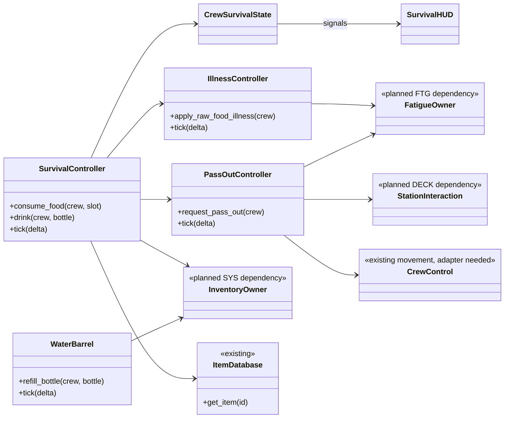
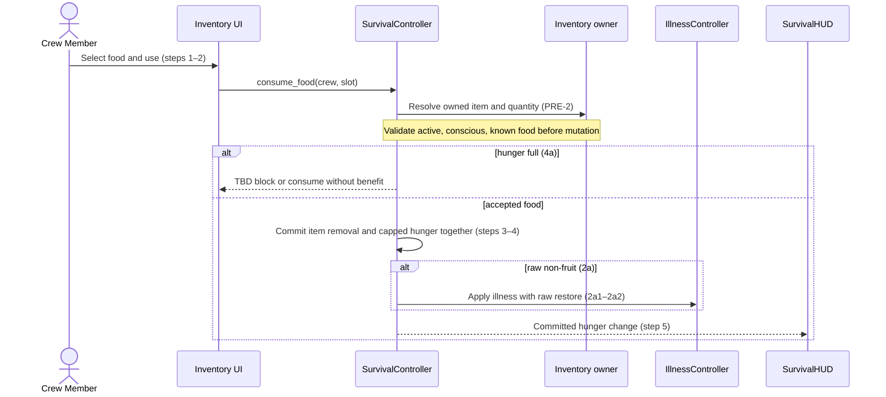
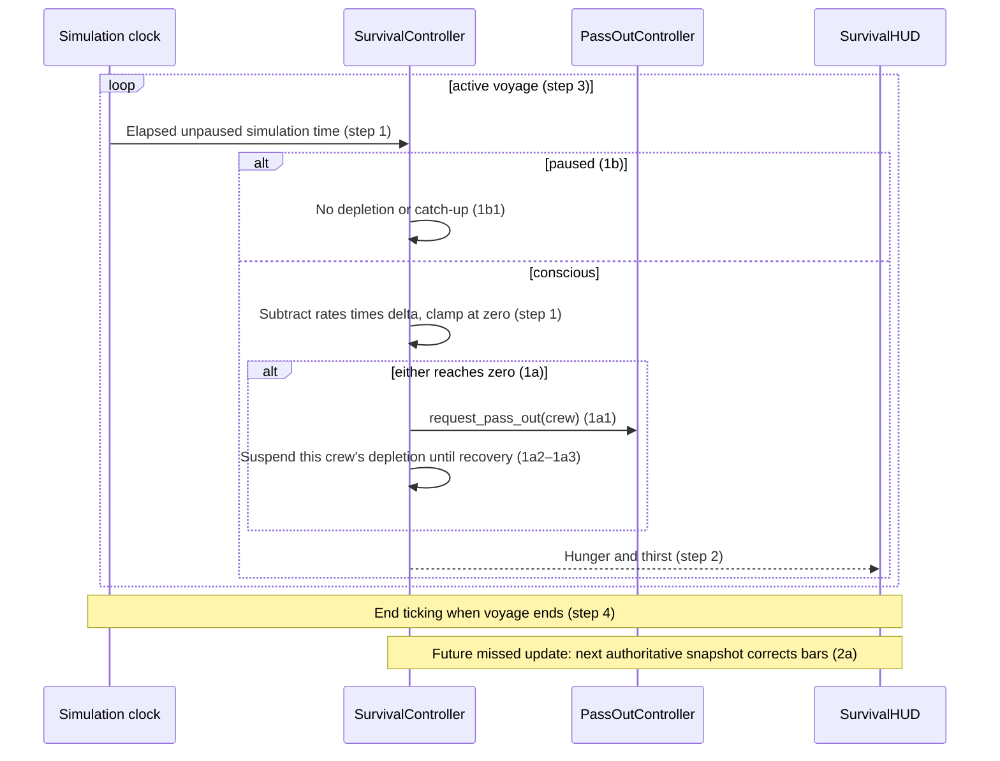
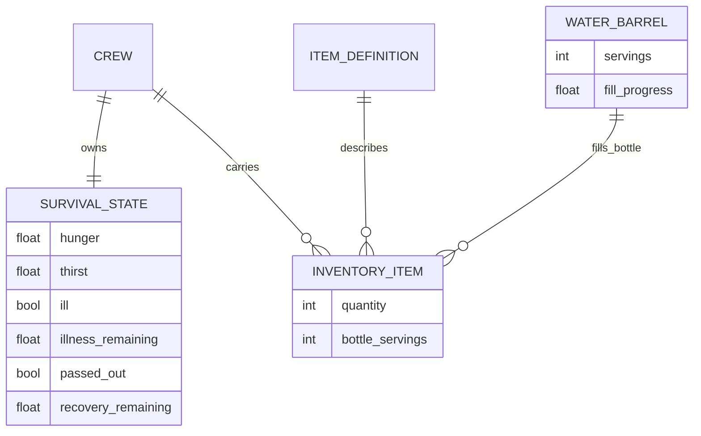

# Survival Design

**Project:** (architectural document title: Holy Ship!)  
**Team:** Team 13  
**Area:** `SURV` — Hunger, Thirst & Illness  
**Status:** Draft for team review; unresolved policies and the proposed sensory effects below prevent implementation approval.

> **Realizes:** `UC-SURV-consume-food`, `UC-SURV-consume-water`, `UC-SURV-deplete-hunger-thirst`, `UC-SURV-pass-out`, `UC-SURV-recover-from-illness`. No project-specific `FR-SURV-*` identifiers were supplied.
> **Depends on:** `BR-stat-max`, `BR-barrel-fill-rate`, `BR-stat-depletion-rate`, `BR-pass-out-recovery`, `BR-illness-fatigue-floor`, `BR-host-controls-session`, `BR-capsize-reset`; the inventory, station, fatigue, and session interfaces identified below.
> **See:** [supplied use cases](<C:/Users/Gusy/Downloads/use-cases-draft.md>), [supplied architecture](<C:/Users/Gusy/Downloads/architectural-design.md>), [replacement business rules v0.2](<C:/Users/Gusy/Downloads/business-rules (2).md>), [repository specification](../requirements/software-requirements-specification.md).
> **Designed against:** local checkout `bf4428af2f05e238dfca15df0983fde987b4de72`; not independently verified as the current `main` revision. Architecture source: version 0.2, October 2, 2026. Use-case source: version 0.2. Business rules source: version 0.2, October 14, 2026.

## Overview

The Survival (`SURV`) area belongs to the planned **Crew Survival** component within the Game Application ([architecture section 5.2](<C:/Users/Gusy/Downloads/architectural-design.md#52-use-case-areas-and-components>); see its [container view](<C:/Users/Gusy/Downloads/architectural-design.md#51-containers>)). It maintains per-crew hunger, thirst, illness, and pass-out recovery using reusable components and signals to the HUD. It reads food definitions from **Item Catalog**, coordinates consumption with the inventory owner, and uses **Crew Control** and **Station Interaction** to disable actions and release occupied stations during pass-out. Fatigue remains a separate design area in `FTG.md` within Crew Survival: SURV supplies illness effects and requests recovery, while FTG owns fatigue mutation. All gameplay state is voyage-local and in memory. Local ownership is established first; networking remains deferred under `KD-local-first`. The owner's October 14 direction additionally proposes Minecraft-inspired readable survival feedback, movement slowdown, and seasick screen wobble; these are recorded below as a requirements change, pending precise triggers and tuning.

## Components & classes

All new paths below are proposals using the repository's `scripts/` and `scenes/` layout. The architecture does not prescribe a more detailed directory convention.



| File or boundary | Status and responsibility |
|---|---|
| `scripts/survival/survival_controller.gd` | New: validates consumption and advances hunger/thirst; coordinates complete state changes without partial inventory updates. |
| `scripts/survival/crew_survival_state.gd` | New: per-crew mutable hunger, thirst, illness, and consciousness state; emits committed changes. |
| `scripts/survival/survival_settings.gd` | New Resource: Inspector-configurable maxima, rates, durations, and unresolved policy selections; no arbitrary production defaults for TBD requirements. |
| `scripts/survival/illness_controller.gd` | New: owns illness duration and supplies a bounded extra-drain request to FTG. |
| `scripts/survival/pass_out_controller.gd` | New: owns one cooldown per crew member and coordinates control, station release, and recovery. |
| `scenes/stations/water_barrel.tscn`, `scripts/survival/water_barrel.gd` | New: instant-use barrel, shared servings, fractional fill accumulation, and atomic bottle transfer. Does not claim a station. |
| `scenes/ui/survival_hud.tscn`, `scripts/ui/survival_hud.gd` | New: observes the local crew's state; displays bars, illness, cooldown, and action feedback. |
| `scripts/item-system/item_database.gd` | Reused: stable item-ID lookup; unknown IDs return null and must be rejected safely. |
| `scripts/item-system/item_data.gd` | Reused, extended: food classification, preparation state, and restore definition; currently contains descriptive fields only. Bottle servings belong to inventory instances, never the shared definition. |
| `scripts/player.gd` | Reused, adapter needed: current `using_station` flag stops movement but is not a general consciousness/action gate. Crew Control must gate movement, interactions, and item use. |
| Inventory owner, Fatigue owner, Station Interaction, session simulation clock | Planned integration dependencies; their final classes/paths belong to SYS, FTG, DECK, and session designs. Do not present them as implemented services. |

## Sequence

Labels refer to the supplied use-case steps. Validation calls enforce their preconditions. Proposed feedback is not inserted into these baseline flows until its requirements are updated.

### UC-SURV-consume-food: Consume food



### UC-SURV-consume-water: Consume water

```mermaid
sequenceDiagram
    actor C as Crew Member
    participant UI as Inventory UI
    participant S as SurvivalController
    participant B as WaterBarrel
    participant HUD as SurvivalHUD
    C->>UI: Select bottle and drink (step 1)
    UI->>S: drink(crew, bottle)
    S->>S: Check owned bottle and servings (step 2, PRE-2)
    alt empty bottle (2a)
        S-->>UI: Bottle empty (2a1)
        C->>B: Interact in range (2a2)
        alt empty barrel (2a3a)
            B-->>UI: Barrel empty; no transfer (2a3a1)
        else water available
            B->>B: Commit barrel-to-bottle transfer within capacity (2a3)
            C->>UI: Drink again (rejoin step 1)
            UI->>S: Re-enter drink flow (steps 1–2)
        end
    else thirst full (4a)
        S-->>UI: TBD block or consume without benefit
    else accepted serving
        S->>S: Commit serving removal and capped thirst together (steps 3–4)
        S-->>HUD: Thirst and bottle level (step 5)
    end
```

The refill branch loops into the complete drink operation; filling a bottle does not automatically drink. A simulation tick fills the barrel at `BR-barrel-fill-rate`, retaining fractional progress between whole servings and clamping at capacity.

### UC-SURV-deplete-hunger-thirst: Deplete hunger and thirst over time



### UC-SURV-pass-out: Pass out and recover

```mermaid
sequenceDiagram
    participant S as Survival or Fatigue owner
    participant P as PassOutController
    participant C as Crew Control
    participant ST as Station Interaction
    participant HUD as SurvivalHUD
    participant F as Fatigue owner
    S->>P: Zero stat detected (step 1)
    P->>C: Enter passed-out state; gate all actions (step 2)
    opt all crew passed out (2a)
        P->>P: Keep individual cooldowns; voyage continues (2a1)
    end
    P->>ST: Release any claim (step 3)
    P-->>HUD: Start remaining-time display (step 4)
    alt capsize during cooldown (4a)
        P->>P: Preserve passed-out state through external reset (4a1)
    else future non-host disconnect (4b)
        P->>P: Authority continues cooldown; reconnect reads current state (4b1–4b2)
    end
    P->>P: Cooldown expires in simulation time (step 5)
    P->>S: Restore hunger and thirst to 25% (step 6)
    P->>F: Restore fatigue to 25% in same recovery transition (step 6)
    P->>C: Restore control after stats commit (step 7)
```

Repeated zero-stat notifications while already passed out do not restart the cooldown or release a station twice. Host disconnect handling belongs to session management and ends the voyage; the reconnect extension applies to a non-host crew member.

### UC-SURV-recover-from-illness: Recover from illness

```mermaid
sequenceDiagram
    participant S as SurvivalController
    participant IL as IllnessController
    participant F as Fatigue owner
    participant HUD as SurvivalHUD
    S->>IL: Raw non-fruit consumed (trigger)
    alt already ill (1a)
        IL->>IL: TBD restart or extend timer (1a1)
    else newly ill
        IL-->>HUD: Illness indicator (step 1)
        IL->>IL: Start illness timer (step 2)
    end
    loop while illness time remains
        alt fatigue above illness floor
            IL->>F: Bounded extra drain for elapsed time (step 3)
            F->>F: Stop extra portion at floor; normal drain separate (steps 4–5)
        else already below floor (3a)
            IL->>F: No extra drain and no upward correction (3a1)
        end
        opt normal depletion reaches zero (5a)
            F->>F: Request SURV pass-out; illness timer continues (5a1)
        end
    end
    Note over IL,F: Early timer expiry also ends extra drain (3b)
    IL->>IL: Timer expires (step 6)
    IL-->>HUD: Clear illness indicator (step 7)
```

## API contract

No API contract.

## Key decisions

**Separate state ownership.** SURV owns hunger, thirst, illness, and pass-out timing; FTG owns fatigue mutation and accepts the illness contribution. Rejected: both systems writing fatigue independently, because update ordering could bypass the illness floor or apply drain twice.

**Atomic local consumption.** Validate first, then commit inventory and stat changes synchronously through the owners without yielding or exposing intermediate signals. Publish after the complete change. Rejected: removing the item and later restoring the stat in separate callbacks, because failure would lose an item without benefit. This is an in-memory operation, not a database transaction or disk save.

**Simulation time.** Use elapsed unpaused simulation time, including barrel, illness, and pass-out timers, following architecture 8.2.2 and `BR-host-controls-session`. Rejected: operating-system timestamps, because pause would otherwise consume cooldowns or drain resources offscreen. Cap illness integration to the active portion of a tick if its timer expires mid-tick.

**One recovery transition.** Pass-out requests are idempotent while unconscious; recovery sets all three stats before enabling actions. Rejected: independent hunger/thirst/fatigue recovery callbacks, because a crew member could regain control with a stat still at zero.

**Definitions versus instances.** Food metadata stays in Item Catalog; bottle servings and quantities stay with inventory instances. Rejected: putting current servings in shared ItemData, which would couple different crew members' bottles.

**Keep proposed sensory effects explicit.** The October 14 owner direction proposes slowdown and seasick shaking/wobble as survival/fatigue feedback. The existing `UC-FTG-warn-exhaustion` explicitly promises a display-only warning; its replacement must define the affected state and gameplay penalty before implementation. Rejected: silently adding penalties to the current diagrams, because their interactions would have no matching approved use-case step. Minecraft is a style reference, not authorization to import its complete health, saturation, sprinting, or difficulty systems.

## Data model

No database, save file, or migration is added. The changes are in-memory entities and an extension to the item-definition Resource. Voyage end discards all mutable state (architecture 8.2.8).



The diagram shows only SURV-related additions to crew/inventory boundaries, not a replacement domain model. Fatigue remains owned by FTG, not duplicated in SURVIVAL_STATE. Item definitions gain food/preparation classification and hunger restoration data. Settings contain respective maxima, depletion rates, serving restore, bottle/barrel capacities, fill rate, illness duration/rate/floor, pass-out duration, and unresolved policy choices. Quantities and rates require release-safe validation; exact TBD values remain unselected.

## Reuse & cross-cutting

- **Errors (architecture 8.2.1):** reject at the state owner with actionable UI feedback and no partial application; no invented HTTP status scheme.
- **Time (8.2.2):** use simulation delta and a common pause gate; all timers freeze on pause.
- **Interfaces and code (8.2.3–8.2.4):** typed GDScript methods, Resources, reusable scenes, and signals; retain Compatibility/Web support.
- **Validation (8.2.5):** resolve item IDs, ownership, quantity, consciousness, active voyage, and barrel interaction range at the decisive owner.
- **Configuration (8.2.6):** exported Resource settings, distinct from mutable voyage state.
- **Logging (8.2.7):** useful validation/transition diagnostics, without per-frame stat spam.
- **Persistence/concurrency (8.2.8):** one local mutation owner, atomic transfers, no saves; future host authority must preserve these boundaries.
- **Testing (8.2.10):** parser/startup and focused gameplay checks when implementing; networking scenarios remain deferred acceptance cases.

## Tests

These are design acceptance tests, not claims of implemented or executed tests. Every supplied main flow and extension has a row.

| Use case, flow | Level | Asserts |
|---|---|---|
| consume-food main | Integration | Valid food removes exactly one owned item, restores its amount with a maximum cap, and updates HUD after commit. |
| consume-food 2a | Integration | Raw non-fruit restores raw value and applies illness in the same successful consumption; fruit/cooked food do not apply this illness. |
| consume-food 4a | Unit | Full-hunger action follows selected policy with matching inventory outcome; blocked pending policy decision. |
| consume-water main | Integration | One serving becomes capped thirst restoration; HUD shows both new values. |
| consume-water 2a | Integration | Empty bottle consumes nothing; barrel interaction fills within availability/capacity; drinking requires another action. |
| consume-water 2a3a | Unit | Empty barrel changes neither container and reports empty. |
| consume-water 4a | Unit | Full-thirst action follows selected policy; blocked pending decision. |
| deplete-hunger-thirst main | Unit | Rates times elapsed simulation time drain each conscious crew independently and update display. |
| deplete-hunger-thirst 1a | Integration | Either zero stat triggers one pass-out and suspends depletion until recovery; values never become negative. |
| deplete-hunger-thirst 1b | Unit | Paused time causes no drain or later catch-up; resume advances from frozen values. |
| deplete-hunger-thirst 2a | Integration, deferred networking | A missed update is corrected by the next authority snapshot; no client-side gameplay mutation. |
| pass-out main | Integration | Zero hunger, thirst, or fatigue gates every action, releases claims, shows cooldown, restores all three to 25%, then restores control. |
| pass-out 2a | Integration | All crew unconscious leaves voyage running and individual cooldowns progressing. |
| pass-out 4a | Integration | Capsize applies external reset without waking crew or restarting their existing cooldown. |
| pass-out 4b | Integration, deferred networking | Non-host disconnect does not stop authority cooldown; reconnect receives current consciousness and values. |
| recover-from-illness main | Integration | Illness indicator/timer active; extra fatigue loss stops at configured floor; expiry clears illness without refund. |
| recover-from-illness 1a | Unit | Re-exposure follows selected restart/extend policy; blocked pending decision. |
| recover-from-illness 3a | Unit | At/below floor, extra loss is zero and fatigue is not raised to floor. |
| recover-from-illness 3b | Unit | Early expiry stops extra drain at the duration boundary, clears indicator, and does not refund fatigue. |
| recover-from-illness 5a | Integration | Normal fatigue drain below floor can cause pass-out while illness time continues. |
| Owner/precondition validation | Integration | Invalid IDs, wrong owner, missing quantities, paused/passed-out actions, or out-of-range refill produce no partial mutation. |
| Barrel collection and competing refills | Unit/integration | Fill is frame-step independent, caps at capacity, freezes on pause, and two serialized requests cannot spend the same serving. |
| Simultaneous zero stats | Unit | Several zero notifications establish one cooldown and one recovery transition. |
| Pause timers | Unit | Illness, pass-out, and barrel collection freeze and resume consistently with `BR-host-controls-session`. |
| Tick-boundary and cross-area integration | Integration | Illness expiry/floor, rest, and zero-stat transitions use a documented order; no doubled drain or recovery while still unconscious. Blocked on rest policy. |
| Proposed slowdown/wobble | Acceptance, pending requirements | Trigger, strength, clearing conditions, and optional visual-intensity control require defined requirements before executable assertions can be written. |

## Changes to the architecture-of-record

Required reconciliations are listed here; the supplied architecture file has not been edited, and this draft must not be treated as synchronized with it:

1. Revise section 5.2's area map to recognize separate SURV and FTG designs inside Crew Survival and identify inventory/session dependencies now specified by the newer use cases. Do not create separate deployed services.
2. Update 8.2.2 and 8.2.8 from unspecified pause/authority/save behavior to the newer use-case rules: pause freezes all timers, voyage state is unsaved, future cooperative authority is the Host. Preserve local-first implementation.
3. Update the stale claims that only steering is fully specified and that only six areas exist; the supplied use-case draft defines more areas and full SURV/FTG flows.
4. Keep kitchen/cooking ownership outside this document: cooking has no supplied SURV use case. Reconcile the architecture's kitchen mention without adding a cooking feature here.

## Open questions & risks

The team, acting as client, owns gameplay decisions; the respective area owners own interface details. These issues must also be mirrored into the requirements issue tracker when the source set is reconciled. No existing issue identifier is invented here.

| Question or risk | Owner / consequence |
|---|---|
| Exact stat maxima, depletion/restore rates, bottle/barrel capacity, barrel fill rate, pass-out duration, illness duration/rate/floor? | Team; tuning and numeric acceptance tests blocked. Approximate illness floor is not fixed to exactly 50%. |
| Eat/drink at full stat: refuse or consume without benefit? | Team; inventory outcomes cannot be finalized. |
| Raw food while already ill: restart or extend? | Team; illness lifecycle blocked. |
| Does illness drain resume after resting raises fatigue above the floor, or stop permanently once the floor is first reached? | Team; rule says extra drain only above floor while timer active, but use-case step 5 may imply a latched stop. Do not choose silently. |
| How do rest recovery and illness drain combine, including same-tick floor/zero boundaries? | SURV/FTG owners and team; one fatigue calculation must define ordering. |
| Capsize removes bottles with inventory: how are replacement bottles obtained, and does barrel water reset? | Team/SYS/WAVE; avoid making hydration impossible after reset. |
| What initial hunger/thirst values apply on new voyage/join? | Team/session owner; do not assume full stats from a recovery rule. |
| What precisely triggers the proposed slowdown/wobble: low fatigue, low hunger/thirst, food illness, or rough seas? | Team; October 14 direction establishes the idea, not a complete trigger model. Rough-sea-induced illness is not currently specified. |
| What slowdown multiplier, wobble intensity, threshold, and recovery behavior apply? | Team; revise `UC-FTG-warn-exhaustion` before implementing gameplay penalties. A reduced/disabled wobble setting is recommended for review, not an existing requirement. |
| Current repository and supplied architecture represent different snapshots. | Document owner; reconcile baseline and source paths before merge. Existing code must be rechecked at implementation time. |
| Host disconnect versus non-host reconnect. | Session owner; host loss ends voyage, so preserve cooldown only while authority/session remains active. |

## Working this document with your agent

Use this design as a draft, not implementation approval. The agent may refine diagrams, check real file reuse, enumerate contract fields and tests, and check identifier existence. The team retains gameplay choices, trade-offs, and independent review. Do not add cures, recipes, inventory expansion, networking, or other features through plausible implementation guesses. New interactions must cite a use-case step or be clearly tracked as a proposed requirements change.

The template's manual sketch/comparison and independent teammate review have not been performed in this drafting session. No PR or implementation branch was created. Keep unresolved source instructions in the original template available for later passes; the completed sections here replace its instructional placeholders rather than claiming those review steps were satisfied.

## The questions test (before you open the pull request)

Draft self-check only; a fresh, independent review session is still required by the template before approval. Give that reviewer the use cases, replacement rules, architecture section 8, and this design, and ask what it would still have to guess to implement each cited use case.

| Remaining implementation guess | Could a wrong guess violate requirements? | Disposition |
|---|---|---|
| TBD numeric settings and initial stats | Yes | Leave unresolved; obtain team values. |
| Full-stat consumption and repeat illness policy | Yes | Leave unresolved; update requirements and contract together. |
| Illness floor behavior after rest and tick ordering | Yes | Resolve jointly with FTG; add boundary tests. |
| Capsize bottle/barrel policy | Yes | Resolve with SYS/WAVE before implementation. |
| Sensory-effect triggers and gameplay slowdown | Yes | Owner proposal recorded; revise contradictory exhaustion use case before implementation. |
| Final internal method names and signal payload representation | No, if ownership and results above are preserved | Implementer may choose typed GDScript details consistent with architecture 8.2.3–8.2.4. |
| HUD layout and replaceable placeholder art | No, provided required values/feedback remain readable | Implementer may choose; verify visually. |
| Future replication and reconnect protocol | Yes for cooperative behavior | Deferred to networking design; not needed for local implementation. |

Paste the independent review's questions and resolutions into the eventual PR description in a collapsed `Questions test` block, as the supplied template requests. This draft is not ready for implementation while requirement-affecting questions remain unresolved.
