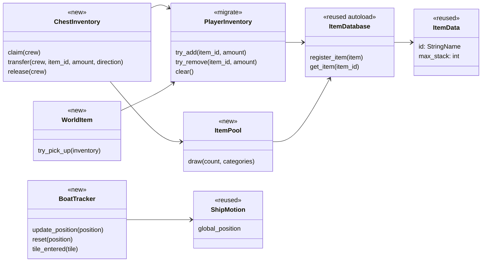
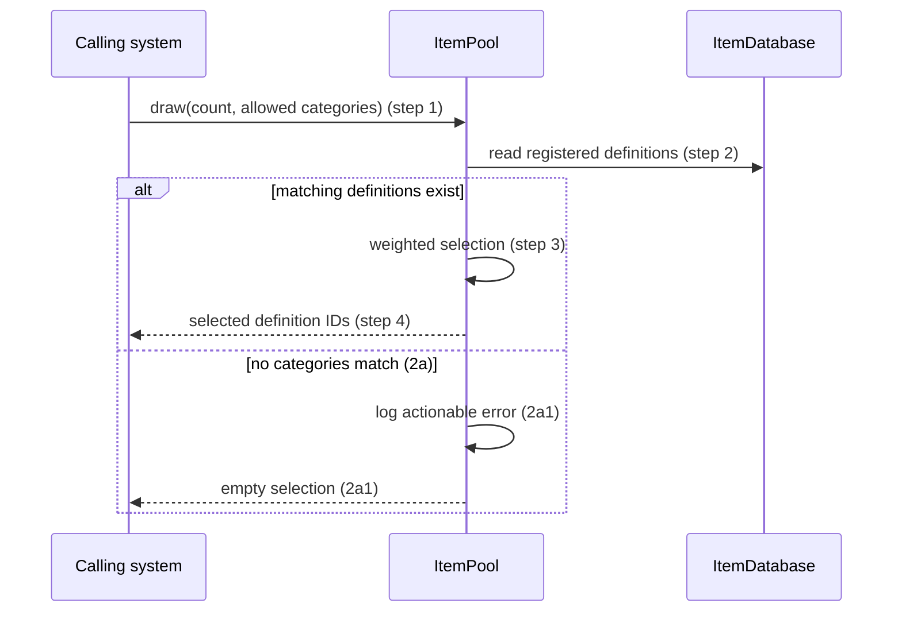
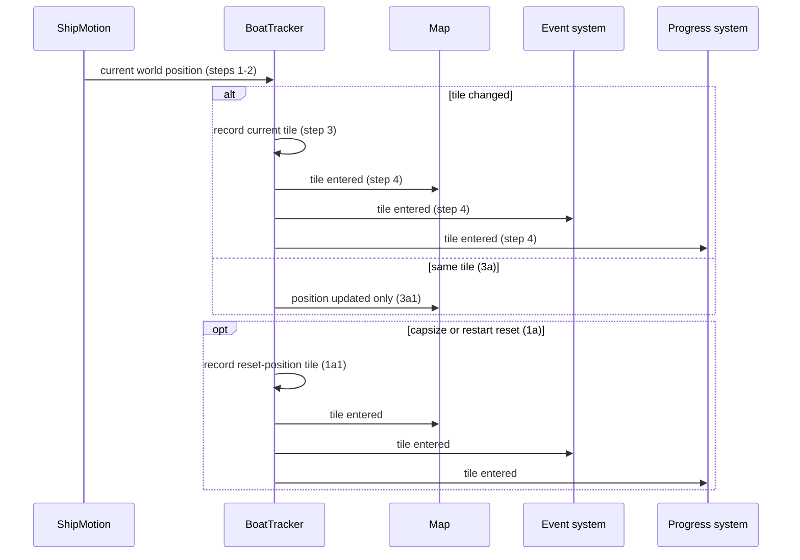
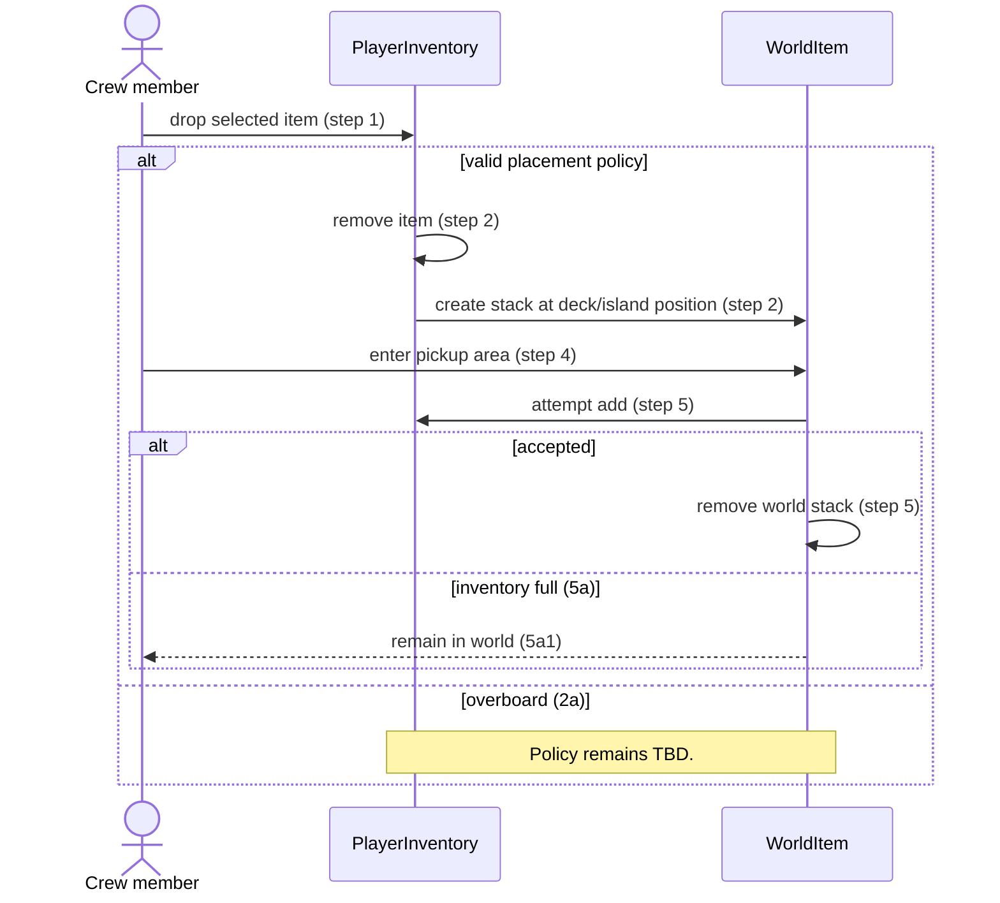

# System Behaviors (SYS) Design

**Project:** Man the Ship
**Team:** Whitney Akred, Leiton Peterson, Ivan Lopez, Liliana Matte, Gustavo Castillo, Shana Billiot
**Area:** `SYS`

> **Realizes:** `UC-SYS-item-pool`, `UC-SYS-player-inventory`, `UC-SYS-track-boat`, `UC-SYS-shared-inventory`, and `UC-SYS-item-drop`.
> **Depends on:** `BR-inventory-slots`, `BR-single-station-occupant`; `BR-capsize-reset`, `BR-event-roll-once-per-tile`, and `BR-merchant-pricing` consume SYS state across areas.
> **See:** [use cases](../requirements/use-cases.md#area-system-behaviors-sys), [business rules](../requirements/business-rules.md#27-inventory-map-and-island-travel), and the [architecture of record](architectural-design.md).
> **Designed against:** `a0a358a` on `design-of-record`.

---

## Overview

SYS supplies local gameplay state shared by item, map, and interaction features: item definitions, owned stacks, chest transfers, placed items, and the ship's map tile. It calls the Item Catalog for definitions, observes Ship State for position, and notifies map, event, progress, island, and station systems through typed methods or signals. SYS does not own item effects, merchant prices, event selection, capsize decisions, or UI layout.

The repository already has an item-definition catalog and a small per-player inventory. The remaining SYS components are proposed. Current code is a migration baseline, not evidence that all five use cases are implemented.

## Components & classes



- `scripts/item-system/item_data.gd` (reused): one stable item definition. Extend it with category, positive draw weight, and nonnegative sell value before building the item pool.
- `scripts/item-system/item_database.gd` and `items.gd` (reused): the startup catalog and sole source of item definitions.
- `scripts/inventory-system/player_inventory.gd` (migrate): replace its four-distinct-item capacity with the six quick slots, TBD expanded slots, and 30-item stack limit required by `BR-inventory-slots`; keep explicit mutation methods as the only write interface.
- `ItemPool` (new): filters registered definitions and returns a weighted selection without granting ownership.
- `ChestInventory` (new): owns one chest's stacks, capacity, claimant, and first-open state; coordinates transfers atomically.
- `WorldItem` (new reusable scene/component): holds a stack at deck-relative or island-world coordinates until inventory accepts it.
- `BoatTracker` (new): derives a tile from Ship State's world position and emits tile-entry notifications.

## Sequence

### UC-SYS-item-pool: drawing items



### UC-SYS-player-inventory: managing an inventory

```mermaid
sequenceDiagram
    actor C as Crew member
    participant I as PlayerInventory
    participant UI as Inventory view
    C->>I: attempt item add (step 1)
    alt matching stack has room (2a)
        I->>I: increment matching stack (2a1)
    else empty quick or expanded slot exists (step 2)
        I->>I: create stack in next eligible slot
    else no eligible slot (2b)
        I-->>C: refused; source item unchanged (2b1)
    end
    C->>UI: open inventory (step 3)
    UI->>I: read quick and expanded slots (step 4)
    C->>I: move stack or amount (step 5)
    C->>UI: close inventory (step 6)
```

### UC-SYS-track-boat: tracking a map tile



### UC-SYS-shared-inventory: using a chest

```mermaid
sequenceDiagram
    actor C as Crew member
    participant S as Station Interaction
    participant H as ChestInventory
    participant I as PlayerInventory
    participant P as ItemPool
    C->>S: request chest interaction (step 1)
    S->>H: claim chest for crew member (step 2)
    alt already claimed (2a)
        H-->>C: refused, chest in use (2a1)
    else first shipwreck open (2b)
        H->>P: draw loot (2b1)
        P-->>H: selected items
        H->>H: initialize contents once
    end
    C->>H: transfer item/amount (step 3)
    H->>I: validate destination capacity
    alt both source and destination valid
        H->>H: update source and destination together (step 4)
    else destination full (3a or 3b)
        H-->>C: refused; both stores unchanged
    end
    C->>H: close chest (step 5)
    H->>S: release claim (step 6)
```

### UC-SYS-item-drop: dropping and picking up items



## Local API contract

| Operation | Caller | Success | Refusal / no-change result |
|---|---|---|---|
| `ItemPool.draw(count, categories)` | Shipwreck, merchant, or voyage setup | Selected valid item IDs | Empty list plus actionable log when no category matches |
| `PlayerInventory.try_add/remove/move(...)` | Pickup, chest transfer, consumption, repair, UI | Updated slot state and a change signal | `false`; source state unchanged |
| `ChestInventory.claim/transfer/release(...)` | Station Interaction and chest UI | Claimed/released chest or atomically moved stack | Occupied/full/invalid result; neither side partially changes |
| `WorldItem.drop/try_pick_up(...)` | Player action and pickup overlap | Stack moves between inventory and world exactly once | Full inventory leaves item in place; overboard is TBD |
| `BoatTracker.update_position/reset(...)` | Ship State | Position update; tile-entry signal after changed/reset tile | Same tile updates map position only |

## Key decisions

**Local ownership before networking.** SYS state is mutated locally in this milestone. The use cases/rules contain Host/client language, but project instructions require single-player-first work and prohibit networking architecture. Host arbitration, client synchronization, and simultaneous-pickup ordering are deferred.

**Definitions are not owned items.** `ItemData` and `ItemDatabase` describe item kinds; inventories, chests, and world items own quantities. Constructing item definitions in feature code is rejected because duplicate definitions would make ID, stack, and future category/value behavior inconsistent.

**Transfers are atomic.** A rejected destination leaves the source unchanged. Remove-then-attempt-add is rejected because inventory-full failures could lose or duplicate an item.

**Tile notifications represent entry, not movement samples.** `BoatTracker` emits an entry only after its calculated tile changes or on reset. Event selection remains outside SYS; that system enforces `BR-event-roll-once-per-tile`.

**Deck drops are ship-relative.** Deck items use local deck coordinates and move with Ship State; island items use island/world coordinates. Global-only placement is rejected because deck items would be left behind when the ship moves.

## Data model

| State | Owner | Change required |
|---|---|---|
| Item definition | Item Catalog | Add category, positive weight, and nonnegative sell value beside stable ID and stack metadata. Values remain TBD where requirements leave them TBD. |
| Player inventory | PlayerInventory | Six quick slots, TBD expanded slots, and stacks of at most 30, per `BR-inventory-slots`. |
| Chest | ChestInventory | Type, stack slots/capacity, contents, claimant, and one-time loot-initialized state. Deck capacity/upgrades remain TBD. |
| World item | WorldItem | Item ID, amount, placement context, and position. |
| Boat map state | BoatTracker | World position, current tile ID, and tile size. Tile size remains TBD. |

There is no persistent save model. `BR-capsize-reset` calls player/deck-chest clear operations; SYS does not decide when a capsize occurs.

## Reuse & cross-cutting

- Resolve stored IDs through `ItemDatabase`; callers handle unknown IDs without mutating state.
- Reuse Station Interaction for chest range and exclusive claims; `ChestInventory` does not decide range.
- Reuse Ship State as the authoritative boat-position source; `BoatTracker` does not move the ship.
- Map, events, and progress consume tile-entry signals. Events retain the per-voyage record for `BR-event-roll-once-per-tile`.
- Merchant and repair systems request SYS transfers/definitions rather than editing inventory arrays or chest contents directly.

## Tests

| Use case, flow | Level | Asserts |
|---|---|---|
| `UC-SYS-item-pool` main | Unit | Category filtering and weighted selection return only registered matching definitions. |
| `UC-SYS-item-pool` 2a | Unit | No matching category returns an empty list and logs a diagnostic. |
| `UC-SYS-player-inventory` main / 2a | Unit | An item fills an eligible matching stack or next quick/expanded slot and emits one change. |
| `UC-SYS-player-inventory` 2b | Unit | A full inventory refuses an item without changing its source. |
| `UC-SYS-track-boat` main / 3a | Unit | New tile emits one notification set; same-tile movement does not emit another entry. |
| `UC-SYS-track-boat` 1a | Integration | Reset records and publishes the reset-position tile. |
| `UC-SYS-shared-inventory` main / 2a | Integration | One eligible crew member claims/releases a chest; an occupied chest is refused. |
| `UC-SYS-shared-inventory` 2b / 3a / 3b | Integration | First-open loot initializes once; full destination rejects transfer with both stores unchanged. |
| `UC-SYS-item-drop` main / 5a | Integration | Dropped stack changes owner once; full pickup inventory leaves it in the world. |
| `UC-SYS-item-drop` 2a | Pending decision | Implement only after the overboard-drop policy is approved. |
| `BR-capsize-reset` integration point | Integration | Capsize can clear each player inventory and the deck chest through SYS operations. |

## Changes to the architecture of record

Add SYS to the area/component map as a provisional area owning runtime item quantities, chest/world-item state, and tile tracking. Keep Item Catalog as the cross-cutting owner of definitions only. Update the existing `BR-single-helmsman` note: the current business-rules document marks it as superseded by `BR-single-station-occupant`.

## Open questions & risks

- Expanded-slot count, deck-chest base capacity, chest upgrade amount, and map tile size are TBD; implementation must not choose values silently.
- The overboard-drop outcome is TBD; its branch cannot be implemented or tested until approved.
- Current inventory code lacks slot placement and the 30-item rule, so dependent UI/chest/drop features wait for its migration.
- Co-op/Host wording conflicts with the project's single-player-first constraint. Reconcile requirements before adding synchronization behavior.
