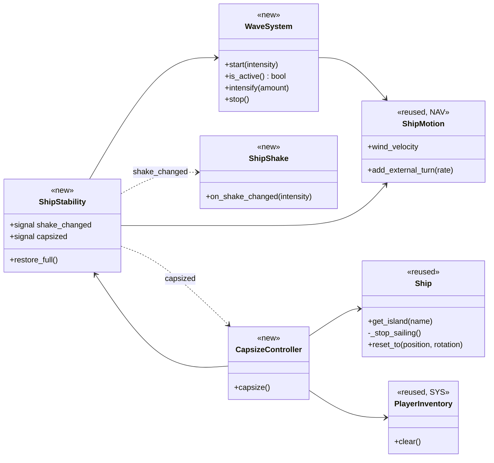
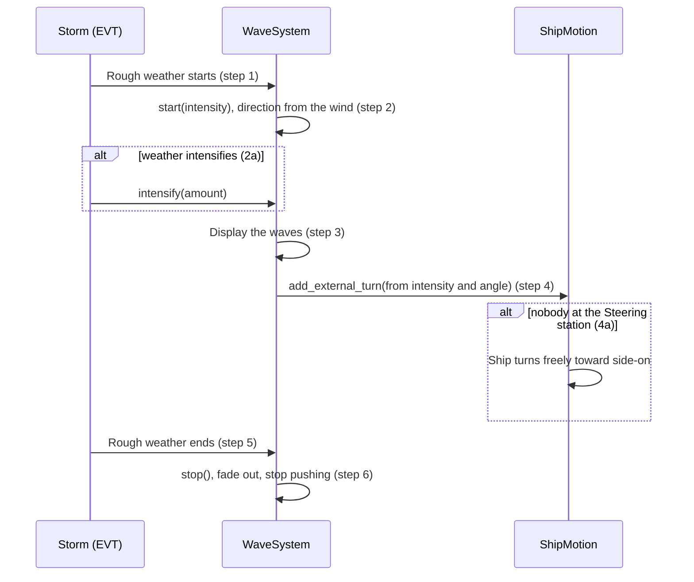
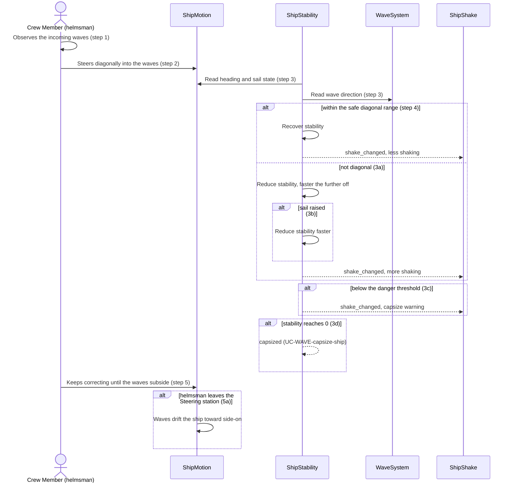
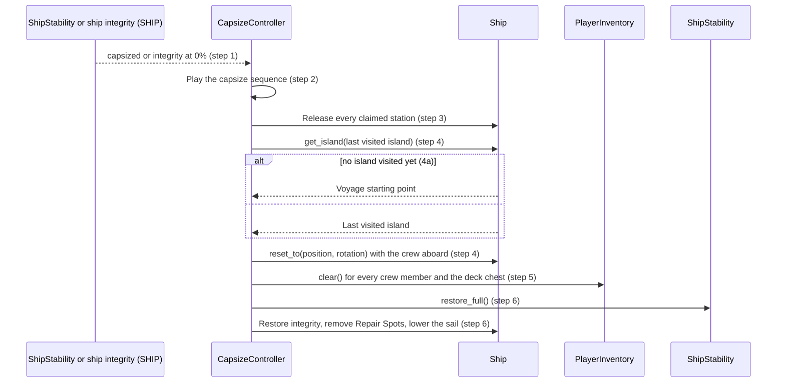

# Waves & Stability Design

> **Scope (2026-10-20):** The current milestone is single-player. Host/client synchronization, LAN sessions, joint actions, and multi-player capacity are retained only as deferred co-op design. Local gameplay uses the local simulation as authority. Planned behavior is not a claim of implementation; see [scope and status](../requirements/vision-and-scope.md#43-mvp-scope).

**Project:** Holy Ship
**Team:** Team 13
**Area:** `WAVE`

> **Realizes:** `UC-WAVE-generate-waves`, `UC-WAVE-balance-ship`, `UC-WAVE-capsize-ship`
> **Depends on:** `BR-waves-rough-weather-only`, `BR-capsize-conditions`, `BR-capsize-reset`, `BR-single-station-occupant`
> **See:** [use cases](../requirements/use-cases.md), [specification](../requirements/software-requirements-specification.md), [architecture-of-record](architectural-design.md)
> **Designed against:** `2bb509c`

---

_**How to use this template.** Copy it to `docs/design/<area>.md`, named for the lowercase area code (`ord.md` for `UC-ORD-*`). Instructions appear in italic square brackets; leave them in place until the document is stable, because the agent reads them on every later pass. The full worked example is Project Pulse's [`not.md`](https://github.com/Washingtonwei/project-pulse/blob/main/docs/design/not.md); read it for the shape, not for the answers._

_**What this document is.** The **design-of-record** for one use case area: how the code will realize its use cases, written **before** the code and approved before anyone builds from it. It is the last document your agent reads before it writes code, so anything it leaves out, the agent invents. Your [architecture-of-record](architectural-design.md) is the map of the whole system and stops at each component's responsibility; this document goes one level down, inside one area, against real code._

_**What it is not.** A copy of your use cases. It **cites** `UC-*`, `FR-*`, and `BR-*` by identifier and never restates what the system shall do; it says only how. It is also not a transcript of the code. Once code exists, link to the files rather than describing every class, column, or getter._

_**One document per area, not per use case.** Your area gains use cases over the term. The overview, the class diagram, and the data model are **revised in place** when it does. The sequence diagrams, the API contract rows, and the test rows are **appended**, one set per use case. Never add a `## UC-…` section that repeats the whole skeleton._

_**How much to write.** Pin down what a wrong guess would break: a requirement, a business rule, a quality attribute, or the contract between two parts of your team. Leave the rest for the agent to derive while it builds: variable names, field types, exact JSON, column lengths. When you are unsure, ask which side of that line a detail falls on, not whether it is interesting._

_**Write it in this order.** Each step is one person's or one pair's work, and the order is the point:_

1. _**Sketch it yourselves first.** Before you open the agent, draw the main success scenario's sequence diagram and write the API contract rows by hand, from the use case and your architecture-of-record. Twenty minutes, on paper or in this file._
2. _**Have the agent draft it.** Give the agent this template, the use case, the business rules it cites, your architecture-of-record's section 8 (Crosscutting Concepts), and the relevant existing code, and ask for a draft of this document. Use plan mode, so it proposes before it writes._
3. _**Compare the two.** Where the agent's draft differs from your sketch, decide which is right and why. What it found that you missed goes in; what you knew that it could not have known is the context your specification is missing, so fix the specification too._
4. _**Run the questions test** (the last section) and fix what it finds._
5. _**Open a pull request.** A teammate who did not write it reviews and approves it. Nobody starts an implementation branch from this design until it is merged._

---

## Overview

_[One paragraph: what this area does, which components of your [architecture-of-record](architectural-design.md) it lives in, and what it reads from or calls in other areas. Link the container diagram rather than redrawing it. If this design changes the architecture-of-record, say so here and list the change under "Changes to the architecture-of-record" below.]_

Waves & Stability makes rough weather dangerous: waves push the ship off its heading, a hidden stability value shows as shaking, and a capsize resets the crew to the last visited island. It runs inside the Game Application ([containers](architectural-design.md#51-containers)). It reads heading, speed, sail state, and wind from `ShipMotion` (NAV), reuses `Ship`'s visited-island tracking and `_stop_sailing()` (ISLE), clears `PlayerInventory` (SYS), is started by storms (EVT), and is also triggered when ship integrity reaches zero (SHIP). It is local and single-player (`KD-local-first`), so steps that sync to all clients are out of scope until networking exists. WAVE is listed in [section 5.2](architectural-design.md#52-use-case-areas-and-components); its proposed interfaces still require integration review.

## Components & classes

_[One class diagram for the whole area, and one line per class or file saying what it does and whether it is **new** or **reused**. Show only what a reader needs to see how the parts relate: classes, their key methods, their dependencies. Fields and getters belong to the code._

_**If your repository has no code for this area yet**, which is the normal case for your proving slice, list the files you expect the agent to create, with the paths your architecture-of-record's conventions give them, and mark them all new. The agent then builds into the structure you chose rather than one it improvised.]_

- `scripts/sailing/wave_system.gd` (new): holds wave intensity during rough weather and reads the wave direction from `ShipMotion.wind_velocity` every frame, keeping the last direction when there is no wind. Pushes the heading every physics frame using `ShipMotion`'s angle convention. `stop()` ends the push at once and fades only the visuals.
- `scripts/sailing/ship_stability.gd` (new): keeps the hidden stability value. It runs every frame and recovers when no waves are active. The safe range is measured from the bow toward where the waves come from, on either side. Loses stability faster whenever the sail is above stowed. Emits `capsized` once, then holds until `restore_full()`, which also emits `shake_changed` with 0.
- `scripts/sailing/ship_shake.gd` (new): shakes the ship's sprite only, never the ship's transform.
- `scripts/sailing/capsize_controller.gd` (new): performs the capsize reset. Ignores triggers while a capsize is in progress, resolves the target first, then applies the whole reset in one frame while input and updates are paused for the capsize sequence.
- [`scripts/sailing/ship_motion.gd`](../../scripts/sailing/ship_motion.gd) (reused, NAV): supplies the wind direction to the waves and gains `add_external_turn` so waves turn the ship through the heading owner.
- [`scripts/ship.gd`](../../scripts/ship.gd) (reused): supplies the last visited island. `_stop_sailing()` is split into a station-release helper and a sail-stow helper so the reset can use them without disabling stations. Gains `reset_to`, which places the ship at the island's dock position as docking does, with no scene change, and a recorded voyage start position.
- [`scripts/inventory-system/player_inventory.gd`](../../scripts/inventory-system/player_inventory.gd) (reused, SYS): gains `clear()`, which empties both its items and its quantities.

## Sequence

_[One sequence diagram per use case for its main success scenario, plus one for each extension that does not just return an error. **Label each interaction with the use case step it implements**, so a reviewer can check that every step is realized and nothing extra was invented. Use `alt` blocks for extensions that branch off the main flow. Give each use case its own `###` heading; that heading is the anchor your traceability matrix cites.]_

### UC-WAVE-generate-waves: generating ocean waves

### UC-WAVE-balance-ship: balancing the ship

### UC-WAVE-capsize-ship: capsizing the ship

## API contract

_[One row per endpoint, scheduled job, or message this area adds or changes, appended per use case. **This section is never dropped**: before the code exists it is the only thing the person (or agent session) building the front end and the one building the back end both read. Name the caller and who may call it, the request fields, the success response, and the error each extension returns. Leave field types and exact JSON to the agent unless a wrong guess would break something, such as a format another system depends on. Use the error shape your architecture-of-record's section 8.2 fixes; do not invent one here.]_

| Endpoint or job | Caller (who may) | Request | Success | Errors, by extension |
|---|---|---|---|---|
| `WaveSystem.start` | Storm (EVT) only | Intensity; direction comes from the wind | Waves active and shown | Already active: use `intensify` (`UC-WAVE-generate-waves` 2a) |
| `WaveSystem.intensify` | Storm (EVT) only | Amount | Higher intensity and heading push | None |
| `WaveSystem.stop` | Storm (EVT) only | None | Push ends at once; visuals fade; `start` works again | None |
| `WaveSystem.is_active` | `ShipStability` | None | Whether waves are active | None |
| `ShipMotion.add_external_turn` | `WaveSystem` only | Turn rate for this physics frame, applied once | Heading pushed off course | None |
| `ShipStability.shake_changed` | Emitted by `ShipStability` only | Shake intensity | `ShipShake` animates | None; stability itself is never exposed |
| `ShipStability.capsized` | Emitted by `ShipStability` only | None | `CapsizeController.capsize()` runs | Emitted once until `restore_full()` |
| `CapsizeController.capsize` | `ShipStability`; ship integrity (SHIP), when integrity is 0 or below | None | Ship and crew at the last visited island; inventories empty; stability and integrity full; sail lowered | `UC-WAVE-capsize-ship` 4a: voyage starting point |
| `Ship.reset_to` | `CapsizeController` only | Position, rotation | Ship placed with speed 0; crew on deck | None |
| `PlayerInventory.clear` | `CapsizeController` only | None | All items removed | None |

## Key decisions

_[Only the decisions a reader could not recover from the code: an invariant, who may do this and how it is enforced, a trade-off you chose, a reason you reused something rather than writing it. **Each one names what you chose, what you rejected, and why.** If you cannot name an alternative you considered, it probably was not a decision; leave it out._

_A decision that affects the whole system rather than this area is an architecture decision. It belongs in your architecture-of-record as a `KD-*` entry, not here.]_

**Empty helm.** With nobody at the helm, the wheel keeps its last angle and the waves push on top of it. Rejected: the ship turning freely toward side-on (`UC-WAVE-generate-waves` 4a, `UC-WAVE-balance-ship` 5a), because the wheel already holds its angle in the code.

**Sail and stability.** Stability drops faster whenever the sail is above stowed, at any of the four levels. Rejected: scaling the loss by sail level, because `UC-WAVE-balance-ship` 3b distinguishes only raised and lowered, and no stability code exists.

**Wave direction.** Waves travel in the wind's direction, read from `ShipMotion.wind_velocity`. Rejected: waves moving independently, because the use case assumes waves travel roughly with the wind.

**Safe diagonal range.** Centered on 45° between the bow and the direction the waves come from, on either side; stern angles are outside it. Rejected: any other center, because `UC-WAVE-balance-ship` says around 45°, angled into the oncoming waves.

**Capsizing with the sail lowered.** Possible. Stability still drops off the diagonal with the sail stowed, only more slowly. Rejected: a stowed sail preventing capsizes, because extension 3a applies whatever the sail state and only 3b makes it faster.

**After a capsize.** The sail is stowed, the ship is not anchored, and the stations stay usable. Rejected: calling `Ship._stop_sailing()` as it is, because it disables the stations, and the use case resets with the sail lowered so the crew can set off again.

## Data model

_[The **change** this area makes to the data: new tables or entities, new columns, the migration that adds them. Draw an ER diagram when there is more than one new table. Do not redraw the domain model; your [specification](../requirements/software-requirements-specification.md) owns it, so link it and show only the change. If the area changes nothing, say "No change" and give the reason in one line; that is a design decision too.]_

No change. Voyages are not saved, so waves, stability, and the reset live in memory only (architecture-of-record 7.3).

## Reuse & cross-cutting

_[Which existing services, components, and conventions this area uses rather than rebuilding: authentication, the error handler, email, the clock, another area's service. Cite your architecture-of-record's section 8.2 for each convention by name rather than restating it.]_

- The station release and sail stow in `Ship._stop_sailing()`, and `Ship.get_island()` with `visited_island_name`, for the reset.
- `ShipStation.release_control()` for releasing stations.
- Error handling (8.2.1) so the reset is never partly applied.
- Time and time zones (8.2.2) for stability change and wave timing.
- API conventions (8.2.3) and Code conventions (8.2.4) for calls and signals.
- Configuration and secrets (8.2.6) for tuning values as exported properties.
- Persistence and concurrency (8.2.8) for one owner per piece of state.

## Tests

_[One row per flow: the main success scenario and **every** extension of every use case this document realizes, appended per use case. Name the level (unit or integration) and what the test asserts. No code. This list is the definition of done that the reviewer approves; the agent writes these tests when it builds, and a reviewer can see at a glance whether an extension has no test.]_

| Use case, flow | Level | Asserts |
|---|---|---|
| UC-WAVE-generate-waves main | unit | `start` makes waves push the heading in the wind's direction; `stop` ends the push at once |
| UC-WAVE-generate-waves 2a | unit | `intensify` increases the heading push |
| UC-WAVE-generate-waves 4a | integration | With nobody at the helm, the wheel keeps its angle and the waves push the heading |
| UC-WAVE-balance-ship main | unit | Inside the safe diagonal range, stability rises and shaking falls |
| UC-WAVE-balance-ship 3a | unit | Outside the range, stability falls, faster the further off |
| UC-WAVE-balance-ship 3b | unit | At the same heading, a raised sail loses stability faster than a lowered one |
| UC-WAVE-balance-ship 3c | unit | Below the danger threshold, shaking increases |
| UC-WAVE-balance-ship 3d | unit | Stability at 0 emits `capsized` once |
| UC-WAVE-balance-ship 5a | integration | When the helmsman leaves, stability keeps updating and a capsize is still possible |
| UC-WAVE-balance-ship (calm) | unit | With no waves, stability recovers to full |
| UC-WAVE-capsize-ship main | integration | After a capsize, the ship is at the last visited island, every station is free, inventories are empty, stability and integrity are full, and the sail is lowered |
| UC-WAVE-capsize-ship 4a | integration | With no island visited, the ship returns to the voyage starting point |
| UC-WAVE-capsize-ship (repeat trigger) | unit | A second trigger during a capsize is ignored, and the next capsize after `restore_full()` works |

## Changes to the architecture-of-record

_[Designing an area against real code is when the architecture's guesses meet reality. If this design needs a component the map does not have, moves a responsibility, or adds a dependency, **change [the architecture-of-record](architectural-design.md) in the same pull request** and list each change here in one line. If nothing changed, write "None". A design that silently disagrees with the architecture leaves two maps, and the agent will follow whichever it reads last.]_

- Section 5.2: add a WAVE (Waves and Stability) row that owns waves, ship stability, and the capsize reset.
- Section 5.3: add `WaveSystem`, `ShipStability`, `ShipShake`, and `CapsizeController` once built.

## Open questions & risks

_[What this design could not settle and who can, and what could go wrong that you are accepting. A question for the client also goes in [`OPEN-ISSUES.md`](../requirements/OPEN-ISSUES.md).]_

- `UC-WAVE-generate-waves` 4a and `UC-WAVE-balance-ship` 5a still describe the rejected option in "Empty helm". They must be revised to match. Liliana and Leiton.
- How strongly the waves push the heading. The push must stay weaker than the helm's turning at every intensity (`UC-WAVE-generate-waves` step 4). Liliana and Leiton.
- How the waves are drawn so the helmsman can see their direction (`UC-WAVE-generate-waves` step 3). Liliana and Leiton.
- How the capsize-warning shake differs from ordinary off-diagonal shaking (`UC-WAVE-balance-ship` 3c). Liliana and Leiton.
- Whether waves keep pushing right after a capsize, when nobody is at the helm (`UC-WAVE-capsize-ship`). Liliana and Leiton.
- Whether the ship can capsize while docked (`UC-WAVE-capsize-ship` PRE-1). Liliana and Leiton.
- Is a storm the only rough weather? (`UC-WAVE-generate-waves`) The team, since it crosses into EVT.
- Waves and stability freeze while paused under `BR-host-controls-session`; the PROG pause must gate their updates.
- When the voyage starting point is recorded, and clearing the last visited island (a `static` value in `Ship`) at the start of each voyage (`UC-WAVE-capsize-ship` 4a). The team, since it crosses into PROG and ISLE.
- Whether a capsize changes voyage progress (`UC-PROG-track-progress`). The team, since it crosses into PROG.
- How wide is the tolerance around 45° for the safe diagonal range? (`UC-WAVE-balance-ship`) Liliana and Leiton.
- Ship integrity, Repair Spots, the deck chest, and storms now have proposed designs (SHIP, SYS, EVT), but their contracts and code remain incomplete. The capsize trigger from integrity and parts of steps 5 and 6 cannot be built until they are. The team.
- Cooking and fishing hold the player but are not `ShipStation`s, so step 3 needs a way to release them. The team, since it crosses into DECK and SURV.
- The island trip changes scenes and keeps state in `static` variables in `Ship`; a capsize while crew are ashore (`UC-ISLE-arrive-at-island` 3a) is not designed here. The team, since it crosses into ISLE.
- `UC-WAVE-capsize-ship` 6a (disconnect during the reset) has no local flow until networking exists (`KD-local-first`).

---

## Working this document with your agent

_[Delegate: drafting the diagrams from your sketch and the use case; listing the existing files a class should extend; filling the contract rows' request and response fields; proposing the test row for each extension; drafting the rejected alternative for a decision you have already made; checking that every identifier this document cites exists in the document that owns it._

_Keep human: which side of the "would a wrong guess break something" line each detail falls on; every key decision; and the approval, which is a teammate's review of the pull request, not the drafter's own reading._

_**The specific failure to watch for: scope that nobody asked for.** An agent drafting a design adds what designs it has read usually have: an admin override, a retry queue, a status field, a notification "while we are here". Each looks reasonable and none is in your use case, and once it is in the design the agent will build it, test it, and you will maintain it. Read the sequence labels: every interaction should name the use case step it implements. An interaction with no step is either a missing requirement, which goes to your specification and your client, or scope creep, which comes out.]_

---

## Implementation assumptions awaiting decisions

The following details are not resolved by this design. The tentative guesses document the assumptions an implementation would otherwise need to make; the final column proposes how each will be decided.

| Decision point | Tentative implementation guess | Wrong guess could violate a requirement? | Proposed solution |
|---|---|---|---|
| How hard waves push the heading (`UC-WAVE-generate-waves` step 4) | A turn rate that scales with intensity, strongest at 45° and settling the ship side-on. | Yes — if the push beats the helm, balancing becomes impossible and capsizes unavoidable. | The team picks a push that stays weaker than the helm's turning at every intensity. |
| How the waves are drawn (`UC-WAVE-generate-waves` step 3) | A scrolling wave layer moving in the wave direction, faster at higher intensity. | Yes — if the direction is not visible, the helmsman cannot read the incoming waves. | The team designs the wave visuals. |
| Waves while paused (`UC-WAVE-generate-waves`) | The push and fade freeze on pause. | Yes — pushing during a pause acts outside PRE-1. | Apply `BR-host-controls-session`; shared pause integration still needs implementation. |
| What counts as rough weather (`UC-WAVE-generate-waves` step 1) | Storms are the only rough weather. | Yes — milder rough weather without waves would break `BR-waves-rough-weather-only`. | The team decides in the EVT design. |
| Width of the safe diagonal range (`UC-WAVE-balance-ship`) | ±15° around 45°, as an exported property. | Yes — a tolerance of 45° or more would make straight-on or side-on count as safe. | The team picks a tolerance under 45°. |
| The capsize-warning shake (`UC-WAVE-balance-ship` 3c) | A jump in shake intensity below the danger threshold. | Yes — if it looks like ordinary shaking, players get no warning. | The team makes the warning clearly different. |
| A stale last visited island (`UC-WAVE-capsize-ship` 4a) | Clear it when a voyage starts. | Yes — a value from a previous voyage would skip 4a. | The team decides in the PROG and ISLE designs. |
| When the voyage starting point is recorded (`UC-WAVE-capsize-ship` 4a) | Record position and rotation once, when a new voyage starts. | Yes — recording it after an island trip sends 4a to the wrong place. | The team decides in the PROG design. |
| Emptying the deck chest (`UC-WAVE-capsize-ship` step 5) | The chest is a `PlayerInventory` with the same `clear()`. | Yes — otherwise step 5 is left half done. | The team designs the chest in SYS with a `clear()`. |
| Restoring integrity and removing Repair Spots (`UC-WAVE-capsize-ship` step 6) | Integrity is set to 100% and Repair Spot nodes are removed. | Yes — `BR-capsize-reset` requires both. | The team adds both to the SHIP design. |
| Waves right after a reset (`UC-WAVE-capsize-ship`) | The storm and waves carry on. | Yes — with nobody at the helm, the ship could capsize again at once. | The team decides whether the storm continues after a reset. |
| A capsize and voyage progress (`UC-WAVE-capsize-ship`) | Progress is unchanged. | Yes — `UC-PROG-track-progress` may expect a capsize to count. | The team decides in the PROG design. |
| Capsizing while docked (`UC-WAVE-capsize-ship` PRE-1) | Ignore capsize triggers while docked or anchored. | Yes — capsizing while docked breaks PRE-1. | The team confirms. |
