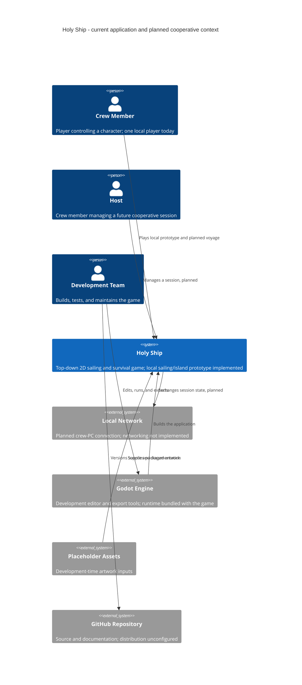
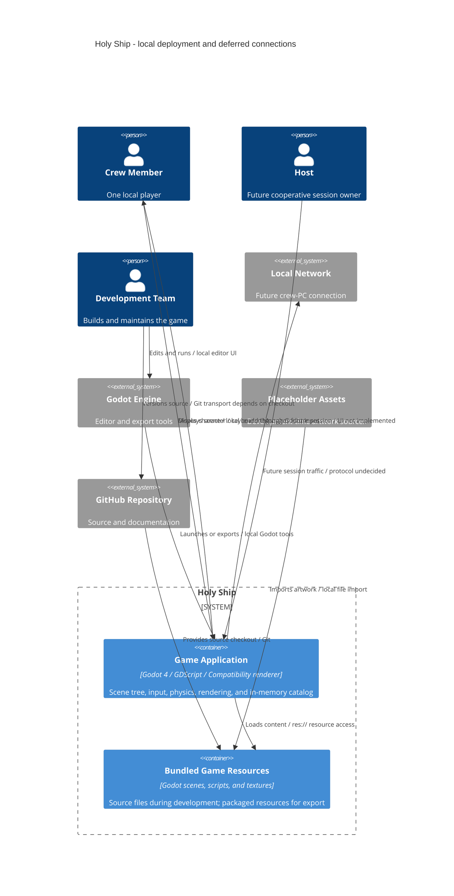
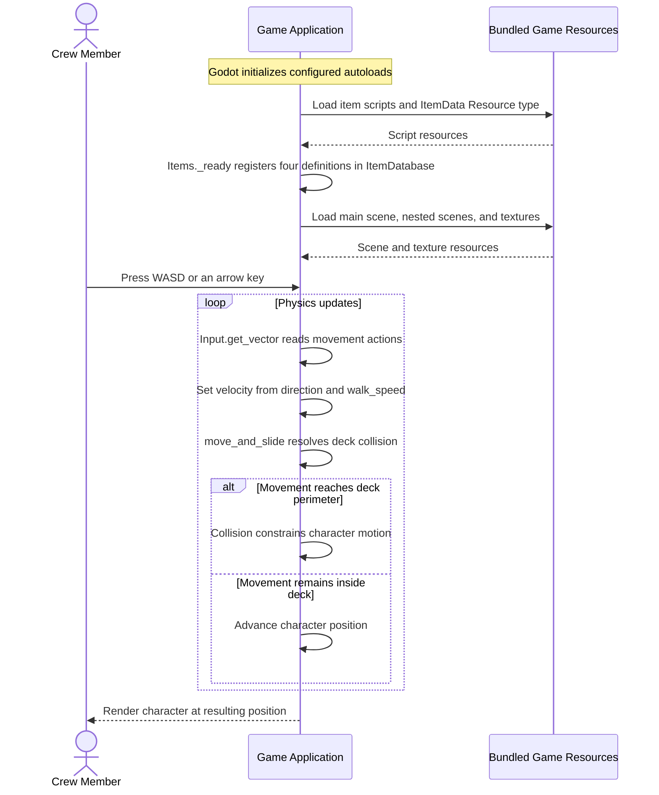
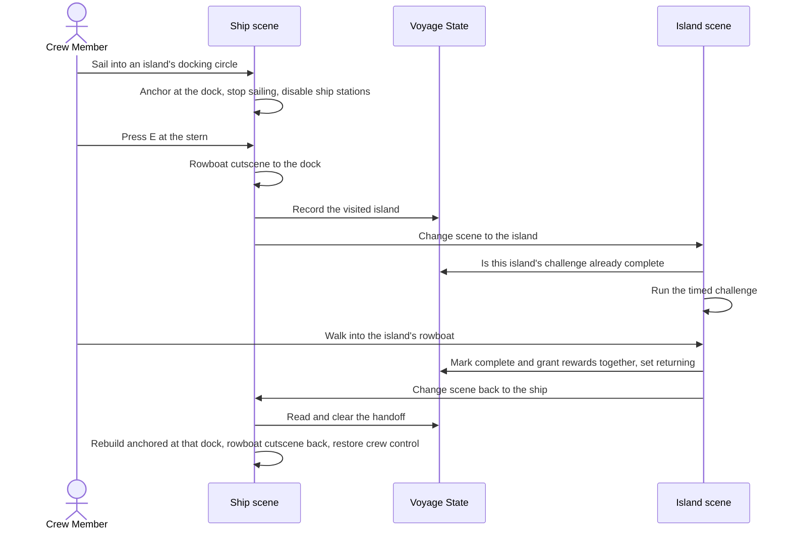

# Architectural Design

> **Scope (2026-10-20):** The current milestone is single-player. Host/client synchronization, LAN sessions, joint actions, and multi-player capacity are retained only as deferred co-op design. Local gameplay uses the local simulation as authority. Planned behavior is not a claim of implementation; see [scope and status](../requirements/vision-and-scope.md#43-mvp-scope).

**Project:** Holy Ship

**Team:** Team 13 (Gaming) — Whitney Akred, Shana Billiot, Liliana Matte, Gustavo Castillo, Leiton Peterson, Ivan Lopez

**Client:** Student-led project; the development team serves as the client

**Version:** 0.4

**Architecture baseline:** `main` at `2bb509c`, October 14, 2026, plus the area designs [deck.md](deck.md) and [isle.md](isle.md)

This document describes the system's boundaries, responsibilities, and architectural decisions. It distinguishes the **implemented prototype** from the **planned architecture** and covers all eleven use case areas without committing all of them to the next milestone.

The implementation contains a sailing ship (helm and sail stations driven by wind), one controllable character who walks the moving deck, cooking and fishing stations, an in-memory item catalog and a per-player inventory, two islands on the map, docking, a rowboat trip, and two timed island games (collect coconuts, dig for treasure) that load as their own scenes. Survival, procedural travel, trading, saving, and networking are not implemented. The Movement & Stations (`DECK`) and Island Interaction (`ISLE`) areas have designs-of-record in [deck.md](deck.md) and [isle.md](isle.md). Where this document and a design-of-record describe something not yet built, it is marked as designed, not implemented.

### Sources and interpretation

Runtime claims are grounded in [project.godot](../../project.godot), [scenes](../../scenes/), and [scripts](../../scripts/). Development constraints come from [AGENTS.md](../../AGENTS.md). Product intent comes from the [use cases](../requirements/use-cases.md), [project glossary](../requirements/project-glossary.md), [vision and scope](../requirements/vision-and-scope.md), and recorded answers in the [client interview](../requirements/client-interview-guide.md).

The software requirements specification contains project requirements alongside explicitly marked instructional examples; the examples are not Holy Ship requirements. This document cites actual sources rather than inventing requirement handles or performance targets. Missing requirements and conflicting older statements are recorded in section 11.2. Proposed conventions and decisions are labeled and do not claim prior team approval.

## Identifiers

| Space | Purpose | Example |
|---|---|---|
| `KD-<slug>` | Key architectural decisions | `KD-deployment-shape` |
| `QS-<slug>` | Quality scenarios | `QS-deck-boundary` |
| `RISK-<slug>` | Technical risks | `RISK-moving-deck` |
| `TD-<slug>` | Known technical debt | `TD-item-validation` |

Identifiers from other documents retain their original names. The use-case document defines 46 detailed cases in 11 areas. Its unresolved decisions and deferred flows remain explicit; design coverage is not implementation evidence.

## Revision History

| Version | Date | Author | Change |
|---|---|---|---|
| 0.1 | Not recorded in original draft | Original contributors | Architecture template and section 5.1 diagram |
| 0.2 | 2026-10-02 | AI-assisted draft for Team 13 review | Complete architectural sections from repository evidence, preserve the original diagram, and distinguish implementation from plans and unresolved requirements |
| 0.3 | 2026-10-14 | AI-assisted update for Team 13 review | Apply the changes required by the `DECK` and `ISLE` designs-of-record: Station Interaction and the new Voyage State component (5.2), the implementation map (5.3), the island trip runtime view (6), restart behavior (7.3), station authorization (8.1), reason codes (8.2.1), the island placement note on `KD-world-chunks` (9.2), and station quality scenarios (10.2) |

## 1. Introduction and Goals

### 1.1 Requirements overview

See the [software requirements specification](../requirements/software-requirements-specification.md) and [use cases](../requirements/use-cases.md).

### 1.2 Quality goals

This priority order is proposed from the single-player-first direction and project instructions. It is not a client-approved ranking or a substitute for measurable requirements in specification section 9.

| Priority | Quality goal | Existing source | Why it shapes the architecture |
|---|---|---|---|
| 1 | Reliable, understandable local gameplay | `FEAT-single-player-survival`; `UC-NAV-steer-ship`; AGENTS.md | Movement and shared-ship interactions need to work consistently before multiplayer makes failures harder to diagnose. |
| 2 | Maintainable separation of crew responsibilities | AGENTS.md; use case areas; team contract section 4 | Reusable scenes and station-oriented components let teammates develop different responsibilities without putting every mechanic in the player script. |
| 3 | Sustainable travel and compatible rendering | AGENTS.md; project.godot | Indefinite horizontal travel needs bounded active world content, while Compatibility rendering and Web compatibility constrain rendering choices. |

### 1.3 Stakeholders

See [vision and scope, section 3.1](../requirements/vision-and-scope.md#31-stakeholder-profiles); the [client interview, section 1](../requirements/client-interview-guide.md#1-get-to-know-your-client) confirms that the team itself is the client.

## 2. Architecture Constraints

Project constraints are defined in [specification section 2.4](../requirements/software-requirements-specification.md#24-design-and-implementation-constraints). The source mapping below explains their architectural consequences; hardware and tested-platform targets remain TBD.

| Source | Constraint and architectural consequence |
|---|---|
| AGENTS.md | Use Godot 4 and GDScript, retaining the Compatibility renderer and HTML5/Web compatibility; C# is outside the project's direction. |
| AGENTS.md; owner-confirmed milestone; use-case scope | Keep the current milestone single-player. Four-player LAN behavior is retained as deferred design, not an instruction to add multiplayer architecture. |
| AGENTS.md | Build indefinite travel with deterministic/recycled ocean chunks rather than one enormous water mesh. |
| AGENTS.md | Favor reusable scenes, signals, typed GDScript, Inspector-configurable properties, and replaceable placeholder artwork. |
| AGENTS.md; `OI-1`, `OI-2` | Preserve a narrow playable milestone; the backlog does not authorize large inventory, crafting, or progression systems. |
| Vision and scope sections 3.2 and 4.4 | PC is the initial target; operating systems, hardware limits, distribution, and long-term maintenance remain unresolved. Web compatibility is a constraint, not evidence of a published browser build. |

The project configuration declares Godot 4.7 features; the guide does not require an exact patch version. These are repository settings, not an independently established platform support matrix.

## 3. Context and Scope

The game is a self-contained local application today. Crew Member and Host are the actor names in the use cases; Host's session-management capabilities belong to later cooperative play. Development Team builds the application rather than representing a privileged in-game account.

This view retains the ecosystem in the original section 5.1 diagram while labeling development and future dependencies. Local Network is a transport environment, not a selected matchmaking or authentication service. Godot's runtime is inside the game; editor/export tools, asset sources, and GitHub are development dependencies. No runtime calls to external services appear in the code, consistent with client interview section 10.

The original drawing mentions itch.io packs and GitHub player downloads. Those labels express the intended workflow: the checkout does not establish artwork provenance or contain a release pipeline. These are verification items in section 11.2. No store, account provider, analytics service, cloud database, or dedicated multiplayer server has been selected.

## 4. Solution Strategy

- Run the local prototype as one Godot application with bundled resources and in-memory state (`KD-deployment-shape`), keeping initial gameplay independent of backend services.
- Divide gameplay into reusable scenes and components organized by use case area, separating stations from character movement (`KD-station-components`; section 5.2).
- Establish local gameplay and ownership rules before cooperative transport (`KD-local-first`), building on the existing helm/sail implementation and the DECK/NAV designs.
- Generate or recycle nearby ocean chunks deterministically when travel is implemented, retaining Compatibility rendering (`KD-world-chunks`).
- Keep the item catalog distinct from inventories and saved progress; keep voyages in memory under the current no-save requirement (`KD-deployment-shape`; section 8.2.8).

## 5. Building Block View

### 5.1 Containers

The original team diagram is retained below as historical evidence; its embedded “Holy Ship” label matches the project name. It shows the wider development and planned play environment; the container view that follows makes the execution boundary explicit.

There is one running application; Bundled Game Resources is a storage boundary shipped with it, not another process (`KD-deployment-shape`). Player, ship, stations, and item services are internal components. `ItemDatabase` is an autoloaded in-memory dictionary, not a database deployment or durable player storage.

### 5.2 Use case areas and components

The area list comes from use cases section 3; [traceability](../traceability.md) maps features, rules, and area designs. **Provisional** means a component has not completed an end-to-end specified use case. Existing code is identified separately rather than presented as proof of sailing or inventory behavior.

| Use case area | Component | Responsibility | Depends on | Status |
|---|---|---|---|---|
| `NAV` | Navigation and Sailing | Owns heading, propulsion, wind effects, and navigation actions in the steering case and backlog. | Ship State, Station Interaction, World and Ocean, Crew Control | Implemented: helm and sail stations, wind-driven speed (`ShipStation`, `ShipMotion`) |
| `SHIP` | Ship Damage and Repair | Owns open leaks, derived ship integrity, the damage scheduler, and repair completion. | Ship State, Station Interaction (DECK), Crew Control, Item Catalog, planned shared deck-chest inventory (SYS), storm state (EVT), capsize/risk interfaces (WAVE), Voyage State | Not implemented; proposed local design in [ship.md](ship.md). External contracts and tuning still need agreement. |
| `SURV` | Crew Survival | Owns hunger, thirst, illness, and pass-out recovery per crew member; FTG owns fatigue. Prototype cooking is a separate existing interaction. | Crew Control, Station Interaction, Item Catalog | Provisional; not implemented |
| `ISLE` | Island Exploration | Owns landing/exploration, treasure interactions, and visited-island state. | Ship State (docking, rowboat trip), Voyage State, World and Ocean, Crew Control, Item Catalog | Implemented: docking, rowboat trip, two timed island games. Designed in [isle.md](isle.md), not yet built: island progress and gathering through Voyage State. |
| `EVT` | Events and Encounters | Owns event rolls, storms, and merchant trades. | SYS tile state, WAVE, SHIP, inventory, PROG | Planned in [EVT.md](EVT.md); not implemented |
| `PROG` | Progress and Session | Owns voyage lifecycle, arrival, pause, character choice, and deferred LAN membership. | Ship State, Crew Control, SYS, MAP | Planned in [PROG.md](PROG.md); networking deferred |
| `FTG` | Fatigue | Owns energy depletion, rest, and warning display. | SURV pass-out and illness, DECK rest claims | Planned in [FTG.md](FTG.md); not implemented |
| `WAVE` | Waves and Stability | Owns rough-weather wave effects, stability, and capsize reset. | NAV, SHIP, EVT, SYS, Voyage State | Planned in [WAVE.md](WAVE.md); not implemented |
| `SYS` | System Behaviors | Owns runtime item quantities, chest/world-item state, and ship tile tracking; Item Catalog remains definition-only. | Item Catalog, Ship State, Station Interaction, World and Ocean, Crew Control | Provisional; catalog and a small per-player inventory exist, while chest, drop, and tile systems are unimplemented |
| `MAP` | Map Interaction and Discovery | Owns voyage chart state and map presentation: revealed tiles, island discovery/visits, pins, and distance labels. | SYS tile/position notifications, Station Interaction, Island Exploration, Progress | Provisional; sailing provides island positions and a distance scale, but no map state or UI exists |
| Cross-cutting (`DECK`) | Crew Control | Owns movement, the overboard state, and routes crew intent (the interact key) to the relevant gameplay owner. | Godot input/physics; Station Interaction (forced release); Voyage State (the player's inventory) | Deck movement on the moving ship exists. Overboard state and single interact-key routing designed in [deck.md](deck.md), not yet built. |
| Cross-cutting | Ship State | Owns shared vessel transform/state so stations do not keep conflicting copies. | Godot scene tree and physics | Implemented: moving ship, docking, anchoring (`ShipMotion`, `Ship`) |
| Cross-cutting (`DECK`) | Station Interaction | Owns range checks, exclusive occupancy, and release of station control. Realized by a `Station` base class and a `StationInteractor` on the player. | Crew identity/position supplied by callers | Partly implemented: helm and sail through `ShipStation`, cooking through the player's station lock. One `Station` contract for every station designed in [deck.md](deck.md), not yet built. |

| Cross-cutting | World and Ocean | Owns active chunks, deterministic placement, and spatial information. | Godot scene tree and bundled resources | Repeating ocean visual and fixed islands exist; world chunk generation remains planned |
| Cross-cutting | Item Catalog | Owns reusable item definitions and lookup by stable identifier. | Bundled Game Resources | Provisional as gameplay integration; registration exists |
| Cross-cutting | Voyage State | Owns in-memory voyage state that must survive a scene change: crew inventories, island progress, resource amounts, collected pickups, ship-side state such as cooking stock, the ship-to-island handoff, and the last visited island (`BR-capsize-reset`). Never written to disk. | Item Catalog | Designed in [isle.md](isle.md), not yet built. Today `Ship` holds the handoff in static variables. |

Dependencies describe intended boundaries, not implemented call chains. Stations manage occupancy and forward intent; the relevant area changes its own state. Mutable inventories must be separate from shared definitions. Backlog areas do not require separate services.

For SHIP, integrity and leak records belong to Ship Damage and Repair; Ship State continues to own vessel motion, docking, and anchoring. The planned EVT storm owner supplies frequency modifiers, SYS supplies deck-chest consumption, and WAVE owns capsize/reset. These dependencies are proposed in [ship.md](ship.md), [EVT.md](EVT.md), and [WAVE.md](WAVE.md); [SYS.md](SYS.md) proposes shared-inventory contracts that still require cross-area agreement. Damage data crosses scene changes through the planned Voyage State boundary, not a new save service.

Godot tools, Placeholder Assets, and GitHub support all areas through section 5.1's build/content workflow; they are not gameplay components. Local Network belongs to the deferred Session Setup/transport boundary.

### 5.3 Current implementation map

| File | Implemented responsibility |
|---|---|
| [project.godot](../../project.godot) | Main scene, input, viewport, renderer, and ItemDatabase/Items autoloads. |
| [main.tscn](../../scenes/main.tscn) | Ship instance and fixed Camera2D. |
| [ship.tscn](../../scenes/ship.tscn) | Ship art, perimeter collision, and player instance. |
| [player.tscn](../../scenes/player.tscn), [player.gd](../../scripts/player.gd) | Character sprite/collider, exported speed, and physics-frame movement. |
| [item_data.gd](../../scripts/item-system/item_data.gd) | ItemData Resource with exported descriptive fields. |
| [item_database.gd](../../scripts/item-system/item_database.gd) | Typed in-memory catalog, lookup, and ID assertions. |
| [items.gd](../../scripts/item-system/items.gd) | Registers Cod, Rope, Fishing Rod, and Coconut. |
| [player_inventory.gd](../../scripts/inventory-system/player_inventory.gd), [inventory_usage.gd](../../scripts/inventory-system/inventory_usage.gd) | Per-player inventory Resource (item types and quantities) and a helper for adding to it. |
| [ship_motion.gd](../../scripts/sailing/ship_motion.gd) | Ship movement from sail level, sail angle, wind, and wheel angle. Never reads input. |
| [ship.gd](../../scripts/ship.gd) | Extends `ShipMotion`: islands on the map, docking, anchoring, the rowboat trip in both directions, and the cross-scene handoff (static variables today). |
| [ship_station.gd](../../scripts/sailing/ship_station.gd), [helm_station.gd](../../scripts/sailing/helm_station.gd), [sail_station.gd](../../scripts/sailing/sail_station.gd) | Station base for ship controls (claim, auto-release by distance) and the helm and sail stations. |
| [Cook.gd](../../Cook.gd), [galley_cooking.gd](../../scripts/galley_cooking.gd) | Cooking station and its minigame. Uses the player's station lock. |
| [fishing_station.gd](../../scripts/stations/fishing_station.gd) | Hold-to-fish station. Does not use the station lock today. |
| [ocean.gd](../../scripts/ocean.gd), [sailing_demo.gd](../../scripts/sailing/sailing_demo.gd) | Recycled ocean pattern, camera follow, wind arrow, and helm indicator. |
| [world_island.gd](../../scripts/islands/world_island.gd) | An island on the sailing map: name, island scene, and dock point. |
| [island_game.gd](../../scripts/islands/island_game.gd), [collect_island.gd](../../scripts/islands/collect_island.gd), [treasure_island.gd](../../scripts/islands/treasure_island.gd), [island_hud.gd](../../scripts/islands/island_hud.gd) | Shared island challenge flow (timer, win, lose, rowboat exit), the two challenge types, and their HUD. |
| [rowboat.gd](../../scripts/rowboat.gd), [coconut.gd](../../scripts/coconut.gd) | The island's rowboat exit and the walk-over item pickup. |
| [tests/sailing_integration.gd](../../tests/sailing_integration.gd) | Headless integration test of stations, sailing, docking, and the island round trip. |

**Designed, not yet built** (paths from [deck.md](deck.md) and [isle.md](isle.md)): `scripts/stations/station.gd`, `scripts/stations/station_interactor.gd`, `scripts/stations/overboard_zone.gd`, `scripts/islands/resource_node.gd`, and `scripts/voyage_state.gd`, which is registered as the `VoyageState` autoload next to `ItemDatabase` and `Items` in project.godot. From [PROG.md](PROG.md): `scripts/pause_menu.gd` and `scenes/pause_menu.tscn`, registered as the `PauseMenu` autoload, with a `pause` input action on P.

## 6. Runtime View

The implemented slice is deck movement, a prerequisite for approaching the helm in `UC-NAV-steer-ship`, not completed steering. Participants use the container names from section 5.1; internal calls identify behavior without treating nodes as processes.

The diagram above isolates startup and deck movement. The player also queries the catalog to grant a starter fishing rod, and the ship supports local station claims and sailing. No external service, network exchange, or disk-save transaction is involved. Invalid built-in registration triggers an assertion in debug builds; missing lookup returns null. User-facing recovery for resource/data failures is not implemented.

For steering acquisition, heading/speed updates, and release, see [NAV](NAV.md) and [DECK](deck.md). The existing integration test covers prototype behavior; unimplemented use-case extensions and deferred synchronization remain separate.

### 6.1 The island trip

Going ashore swaps the whole scene: the ship scene is unloaded while the crew member is on the island and rebuilt from its scene file on return. Anything that must survive the trip is handed over through Voyage State (designed in [isle.md](isle.md); today `Ship` uses static variables for the handoff only).

## 7. Deployment View

### 7.1 Container placement

| Container or dependency | Development | Player release |
|---|---|---|
| Game Application | Local Godot editor/command-line execution. | Planned local export; production unconfigured. |
| Bundled Game Resources | Files under res:// in the checkout plus import caches. | Packaged with game; exact packaging unselected. |
| Godot Engine tools | Installed for editing, import, execution, and export. | Editor unnecessary; runtime accompanies export. |
| GitHub Repository | Shared source/docs under team review workflow. | Diagram's download channel unconfigured. |
| Placeholder Assets | Committed art and import metadata. | Included subject to verified permissions. |
| Local Network | Unused by current code. | Cooperative transport deferred. |

This follows [vision and scope section 4.4](../requirements/vision-and-scope.md#44-deployment-considerations). No production server, supported OS matrix, or browser hosting provider is established.

### 7.2 Delivery workflow

The [team contract, section 5](../team-contract.md#5-git-workflow-and-review) requires feature branches and two independent approvals before merging into main. An automated sailing integration test exists in `tests/sailing_integration.gd`; no CI workflow, export preset, or publishing configuration is established here. A merge updates source, not a published build.

To run source, open project.godot in Godot and select **Run Project (F5)**. The proposed release workflow is to import/validate the merged revision, check gameplay, configure a target under **Project > Export**, build with **Export Project**, and test that artifact before distribution. This is a proposed manual workflow, not an existing pipeline. Web compatibility still requires exported-build validation.

### 7.3 Restart behavior

Scenes, scripts, artwork, configuration, and built-in definitions survive restart as application content. Character position/runtime state are recreated; definitions are re-registered in memory. There is no saved voyage, inventory, profile, or transaction to restore. The generated .godot cache is development data, not player progress.

The proposed Voyage State component will retain inventories, island progress, and resource amounts across scene changes in memory. It is not implemented; today only limited handoff/completion data survives through static Ship fields. Neither mechanism saves a voyage between application runs.

## 8. Crosscutting Concepts

### 8.1 Security

**Trust boundary.** Game Application owns the local simulation; keyboard input enters through Godot Input. No application endpoints are exposed today. Future traffic from other PCs crosses a separate trust boundary and must be treated as untrusted, with gameplay requests validated by the session authority. Neither transport nor session admission is selected, so authenticated LAN traffic is not an implemented property.

**Authentication.** The prototype has no accounts, credentials, or sign-in. Crew Member and Host are gameplay actors rather than identity-provider roles. Before networking, define how a peer joins and how a connection maps to crew identity; an account service is not implied by the current scope.

**Authorization.** Future Station Interaction owns occupancy checks from `UC-NAV-steer-ship`; local presentation must not grant authority to take another crew member's station. Session Setup owns Host-only operations when implemented. `BR-single-helmsman` is superseded by `BR-single-station-occupant` in business-rules.md; the latter is the current behavioral source for exclusive stations and chests.

**Sensitive data.** The gameplay code neither collects nor persists personal data or account information. Team names in documents are not runtime player records. Specification section 7.4 has no project retention policy; define one if player identifiers, telemetry, or profiles are introduced. No runtime secrets are required today; future publishing credentials belong in the release environment's secret storage. Project-specific `SEC-*` requirements are still missing, not replaced by template web-application examples.

### 8.2 Other concepts

These rules combine existing conventions with labeled proposals for unbuilt systems. Examples name real files only where the behavior exists.

#### 8.2.1 Error handling

Proposed rule: reject invalid actions at the state-owning component and return a result the UI can explain without partially applying an action. Occupied-wheel denial in the steering use case motivates this rule. Currently item_database.gd asserts on invalid built-in IDs and returns null for unknown lookups; this is not a complete runtime recovery strategy.

Shape of a rejection: a `StringName` reason code, where `&""` means success and any other value names the reason (for example `&"occupied"`, `&"unavailable"`, `&"busy"`). The caller turns the code into a message. The owner checks everything before changing anything, so a rejected action changes nothing. First used by `Station.request_control` in [deck.md](deck.md).

#### 8.2.2 Time and time zones

Use simulation time for movement and future gameplay durations, keeping wall-clock time out of steering/survival rules. player.gd sets velocity in _physics_process; move_and_slide handles physics-step movement. Proposed timers should use elapsed simulation time for reproducibility. There are no civil-time deadlines or stored time zones; `BR-host-controls-session` freezes simulation timers while paused; multiplayer transport/timing details remain deferred. The shared pause gate is `SceneTree.paused`, set by the `PauseMenu` autoload ([PROG.md](PROG.md)); gameplay nodes stay on the default pausable process mode and get no pause hook of their own. Presentation that must keep animating during pause (`BR-pause-fatigue-presentation`) uses its own process mode and must not change gameplay state.

#### 8.2.3 API conventions

Keep gameplay interfaces inside Godot through typed methods, Resources, and signals; no HTTP or JSON API exists. ItemDatabase.register_item and get_item are local examples. Proposed station interfaces accept crew identity and intent while leaving mutation to state owners; a later adapter can translate network requests into those operations.

#### 8.2.4 Code conventions

Follow AGENTS.md: GDScript, reusable scenes, typed values, signals for decoupled notifications, and Inspector-exposed settings. player.gd demonstrates an exported speed and typed callback; ItemData demonstrates a Resource. Keep artwork replaceable without rewriting gameplay. A project-wide signal pattern has not yet been implemented.

#### 8.2.5 Validation

Proposed rule: the state owner performs decisive range, ownership, and value checks; a visual prompt alone never grants control. ItemDatabase currently asserts nonempty/unique IDs, but does not validate all fields or provide release-safe rejection. Consumers must handle unknown IDs and distinguish definitions from owned quantities.

#### 8.2.6 Configuration and secrets

Keep input/render/application settings in project.godot and gameplay tuning in exported properties or Resources, as shown by walk_speed and ItemData. No service configuration exists. Future export presets should express packaging, with credentials outside source control. Current speed and viewport values are settings, not requirement thresholds.

#### 8.2.7 Logging

Proposed rule: log actionable initialization/validation failures and state transitions, avoiding per-frame movement noise and future credentials/personal data. No structured logging subsystem exists; item-registration assertions are the explicit diagnostics in current gameplay scripts. Future network diagnostics should distinguish disconnects from invalid actions.

#### 8.2.8 Persistence and concurrency

Runtime state lives in one local process; the catalog is reconstructed at launch. Proposed ownership assigns each shared mutation to one component, including a station claim as one check-and-claim operation. There are no database transactions or saves. Saving remains outside the current scope. Local authority is the simulation; deferred co-op authority is the Host. Future transport, disconnect recovery, and crash handling need separate contracts.

#### 8.2.9 Auditing

Git history and reviews record development changes. No runtime account, financial, or regulated operations require an audit trail in the documented scope. Proposed multiplayer debugging may log ownership transitions locally; this is diagnostic output rather than a selected persistent audit service. Revisit retention if identifiable player events are stored.

#### 8.2.10 Testing

Use Godot command-line import/parser and startup checks when available, followed by focused gameplay checks, as directed in AGENTS.md. The prototype guide describes launch and gameplay checks; `tests/sailing_integration.gd` provides an existing automated integration check for sailing, stations, docking, and island travel. Future checks should exercise station contention/release, sailing, deterministic recycling, and actual desktop/Web exports; headless checks cannot establish visual or input usability.

## 9. Architectural Decisions

### 9.1 Architecturally significant requirements

The ranking is provisional and based on project evidence, not a quantified client assessment. Actual sources replace specification handles that have not yet been established.

| Rank | Driver | Source | Importance and difficulty | Drives |
|---|---|---|---|---|
| 1 | Consistent local movement and station loop | AGENTS.md; `UC-NAV-steer-ship`; `FEAT-single-player-survival` | Core behavior; moving-deck integration unproven | `KD-deployment-shape`, `KD-local-first` |
| 2 | Modular crew responsibilities | AGENTS.md; team contract section 4 | Affects all future areas; establish boundaries before networking | `KD-station-components` |
| 3 | Bounded content during indefinite travel | AGENTS.md | Architectural constraint; performance budget and state retention unresolved | `KD-world-chunks` |
| 4 | Compatibility rendering and Web compatibility | AGENTS.md; project.godot | Needs validation on actual exports | `KD-deployment-shape`, `KD-world-chunks` |
| 5 | Ownership validation at the future peer boundary | `UC-NAV-steer-ship`; `FEAT-cooperative-play` | Security-relevant before cooperative release; project security handle missing | `KD-local-first`; section 8.1 |

### 9.2 Key decisions

#### KD-deployment-shape: One local application with bundled content

**Status:** Implemented baseline; distribution packaging remains open.

- **Drivers:** Existing code, single-player-first direction, and no external runtime dependencies in client interview section 10.
- **Context:** The prototype needs local input, physics, rendering, and definitions; no backend or persistent player data exists.
- **Decision:** Keep gameplay in one Godot process, loading bundled content through res://. ItemDatabase remains an internal catalog.
- **Alternative not adopted:** Separate gameplay services or a remote inventory database add deployment/connectivity dependencies without a specified need. Database discussion in napkin-round-0.md is an early brainstorm, not an implemented dependency.
- **Trade-off:** Gameplay shares one process and its failures; progress does not survive restart without a future save design.

#### KD-local-first: Defer networking until the local boat/station loop is stable

**Status:** Required by AGENTS.md and consistent with the recorded single-player-first direction.

- **Drivers:** AGENTS.md; `FEAT-cooperative-play`; `UC-NAV-steer-ship`.
- **Context:** Local steering and sailing exist. Four-player LAN cooperation remains deferred design outside the current single-player milestone.
- **Decision:** Establish explicit local state ownership before adding session transport.
- **Alternative not adopted:** Adding synchronization to the initial prototype couples gameplay debugging to connection and replication problems prematurely.
- **Trade-off:** Current play remains single-player; authority, latency, and disconnect handling still require later work. LAN appears in the original diagram, but no protocol or networking API is selected here.

#### KD-station-components: Separate character control, stations, and ship state

**Status:** Required direction in AGENTS.md; sailing components exist, while a unified station contract remains proposed.

- **Drivers:** Station-oriented systems in AGENTS.md and exclusive wheel control in `UC-NAV-steer-ship`.
- **Context:** Movement lives in player.gd; ShipMotion and Ship own sailing and island travel, while station components submit player intent.
- **Decision:** Preserve character movement as a separate responsibility; stations manage participation and send intent to ship/survival state owners.
- **Alternative not adopted:** One player script for steering, repairs, survival, and inventory would couple unrelated features and complicate multiple crew members.
- **Trade-off:** Components need explicit references/signals and lifecycle handling. Class and interface details belong in later use-case designs grounded in code.

#### KD-world-chunks: Deterministic, recycled ocean content

**Status:** Required direction in AGENTS.md; not implemented.

- **Drivers:** Indefinite horizontal travel and lightweight Web-compatible rendering.
- **Context:** The ocean is currently a background color, not a world or water mesh.
- **Decision:** Generate/reuse nearby chunks from stable world coordinates and deterministic generation inputs, keeping an active neighborhood instantiated.
- **Alternative not adopted:** One enormous mesh or keeping all visited chunks allocated ties resource use to distance traveled.
- **Trade-off:** Seams, revisits, coordinate precision, and modified locations require further design. Deterministic layout alone does not preserve collected loot or changed island state.
- **Current deviation:** Islands are not chunk-generated. They are fixed `WorldIsland` nodes at map coordinates in ship.tscn, and each island's content is its own scene loaded only while the crew is ashore ([isle.md](isle.md)). This is a deliberate interim shortcut, recorded as `TD-fixed-islands`. Changed island state is kept in Voyage State, not in the layout.

## 10. Quality Requirements

### 10.1 Quality requirements overview

See [software requirements specification, section 9](../requirements/software-requirements-specification.md#9-quality-attributes); project-specific quality requirements remain to be established.

### 10.2 Quality scenarios

These scenarios define observable checks without inventing frame-rate, timing, availability, or retention commitments. Proposed checks remain unverified until components and tests exist.

| ID | Source and stimulus | Environment | Response | Measure and source | Verification method / status |
|---|---|---|---|---|---|
| `QS-deck-boundary` | Player holds movement toward a deck edge. | Current prototype | Collision constrains motion. | No crossing the perimeter; Minimal MVP and ship.tscn. | Manual: Run Project (F5), move against edges/corners with WASD/arrows; visual check required. |
| `QS-station-ownership` | Another crew member claims an occupied helm. | Future local test with two crew identities | Preserve owner and deny new claim with feedback. | Extension 2a of `UC-NAV-steer-ship`; `UC-DECK-use-station` 4a and `UC-DECK-claim-station` 2a. | Check defined in the [deck.md](deck.md) Tests table; the cooking/sail case is already asserted in tests/sailing_integration.gd. |
| `QS-station-release` | Helmsman releases or leaves permitted range. | Future local steering | Wheel becomes unclaimed. | Main flow and extension 6a of steering use case; `UC-DECK-claim-station` 4a. Range is an exported setting, not a requirement. | Check defined in the [deck.md](deck.md) Tests table; disconnect branch waits for networking. |
| `QS-station-isolation` | Developer adds a station responsibility. | Future station architecture | Existing movement and stations remain intact. | Separation required by AGENTS.md; inspect dependencies and regressions. | Proposed review/regression check; not implemented. |
| `QS-world-recycling` | Ship crosses chunks and revisits coordinates. | Future procedural world | Recycle distant chunks and reproduce unchanged layout. | Bounded active set and deterministic layout per AGENTS.md; numeric budget absent. | Proposed seeded travel check with node/memory observations. |
| `QS-compatible-export` | Player launches an exported build. | Selected PC and future Web targets | Scene, movement, and collision work. | Prototype behavior and Compatibility/Web direction in AGENTS.md. | Proposed export smoke check; presets/support matrix absent. |

## 11. Risks and Technical Debt

### 11.1 Technical risks and known debt

| ID | Type | Failure mechanism and consequence | Mitigation or fix | Source |
|---|---|---|---|---|
| `RISK-moving-deck` | Risk | Translating/rotating the ship may create drift, jitter, or incorrect collision despite the existing moving-deck integration. | Continue validating moving-deck behavior as stations are integrated; use the existing sailing integration checks. | ship.tscn; player.gd; steering use case |
| `RISK-peer-authority` | Risk | Peers accepting independent claims or updates could create conflicting state or permit invalid actions. | Select session authority and validate ownership before cooperative implementation. | `OI-coop`; steering extension 2a |
| `RISK-world-growth` | Risk | Retained visited nodes or excessive generation could grow memory use or stall play. | Recycle chunks, profile crossings, and define modified-state retention. | AGENTS.md; `OI-scale` |
| `RISK-travel-precision` | Risk | Large coordinates could reduce precision and disrupt collision or seams. | Evaluate rebasing/chunk-relative positions when implementing travel; test distant coordinates. | AGENTS.md indefinite-travel constraint |
| `RISK-export-gap` | Risk | Editor-only testing could miss incompatible resources, input, or performance on exports. | Establish targets and test actual artifacts. | Vision and scope section 4.4; AGENTS.md |
| `TD-item-validation` | Debt | Registration relies on debug assertions and does not reject invalid stack limits; unknown IDs return null. | Add release-safe validation and missing-item handling when gameplay consumes the catalog. | item_database.gd; item_data.gd |
| `TD-placeholder-ocean` | Debt | The repeating decorative ocean does not generate world chunks or hazards. | Replace the shortcut with chunked content during navigation work. | project.godot; `KD-world-chunks` |
| `TD-fixed-islands` | Debt | Islands are hand-placed nodes in ship.tscn rather than chunk-generated, so the map cannot grow with travel. | Move island placement into chunk generation during navigation work; keep island content as separate scenes. | ship.tscn; `KD-world-chunks`; isle.md |
| `TD-manual-verification` | Debt | The sailing integration test covers only part of the prototype; planned systems lack implementation tests and a documented automated pipeline. | Add focused checks as slices arrive and automate validation when targets are chosen. | Repository tree; section 7.2 |

Saving, survival, and networking are unimplemented features, not automatically technical debt; their absence fits the narrow milestone.

### 11.2 Source gaps and decisions still required

These findings mark evidence limits and decisions needed before affected release commitments. The development team owns them; existing issue identifiers refer to [OPEN-ISSUES.md](../requirements/OPEN-ISSUES.md).

| Gap or inconsistency | Architectural impact | Existing home / next action |
|---|---|---|
| Quality targets, platform matrix, and acceptance thresholds are incomplete. | Performance and release acceptance cannot be claimed. | Specification section 9; `OI-testing`. |
| The 46 detailed use cases exceed the current milestone. | Design coverage does not imply delivery scope. | Vision section 4.3; `OI-1`, `OI-2`. |
| Code uses prototype inventory and sail tuning. | Planned rule compliance remains unproven. | `OI-10`, `OI-11`; do not silently change code or rules. |
| LAN and four-player behavior are deferred. | No transport or multiplayer implementation is authorized. | Owner confirmation 2026-10-20; `OI-coop`. |
| Original diagram references external asset sources. | The retained image is historical evidence, not an asset provenance record. | Current project name is Holy Ship; verify assets before publishing. |
| In-memory state handoff and cross-area contracts remain incomplete. | Scene transitions can lose inventory/resource state; capsize/reset must have one owner. | `OI-7`, `OI-9`, `OI-15`; area designs. |
| Post-course support and ownership remain unresolved. | Long-term maintenance lacks a confirmed operator. | `OI-maintenance`. |

## 12. Glossary

Domain vocabulary lives in the [project glossary](../requirements/project-glossary.md). These terms clarify architectural usage:

| Term | Meaning here |
|---|---|
| Container | A running application or separately described storage boundary in C4; not a Docker container. |
| Component | An internal responsibility within Game Application, not a separately deployed service. |
| Autoload | A Godot node loaded at startup and accessible across scenes; used by ItemDatabase and Items. |
| Item Catalog | In-memory definitions shared by item ID, distinct from inventory/ownership and durable storage. |
| Station ownership | The crew member permitted to operate an exclusive station, distinct from code ownership. |
| Chunk | A bounded world portion generated, loaded, or recycled independently. |
| Provisional | A responsibility not yet exercised through a complete specified use case. |
| Session authority | The future simulation owner deciding valid shared-state changes; networking implementation unselected. |
