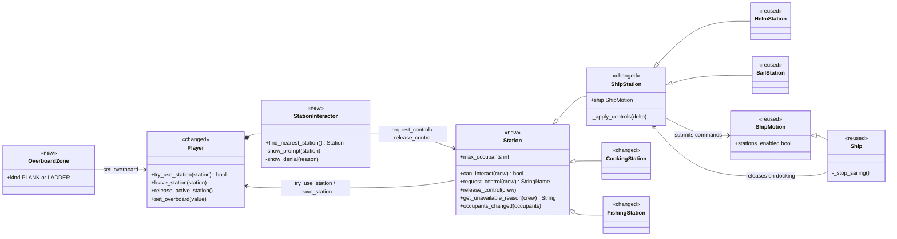
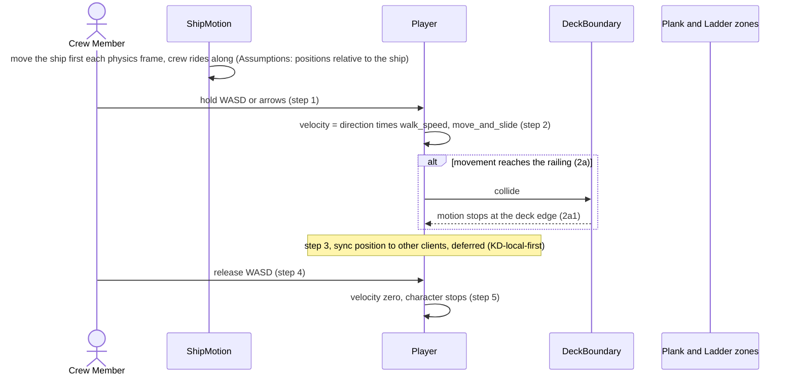
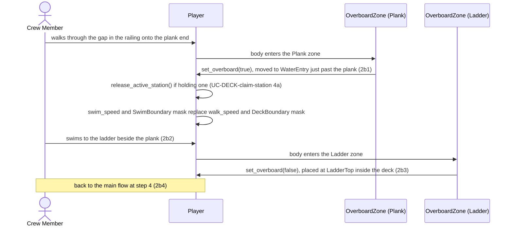
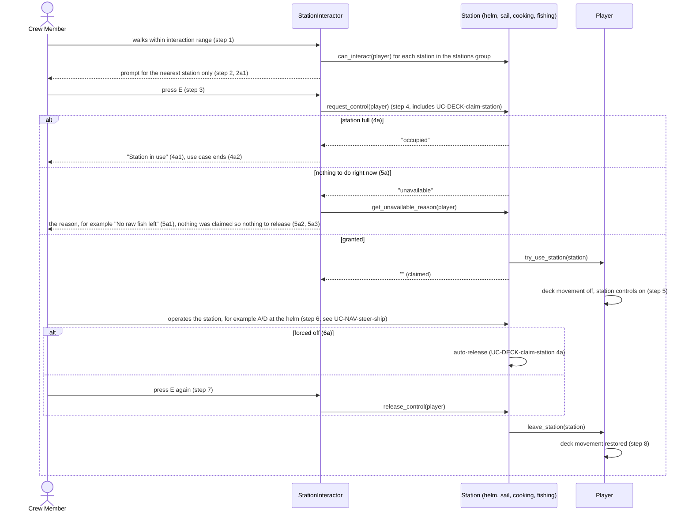
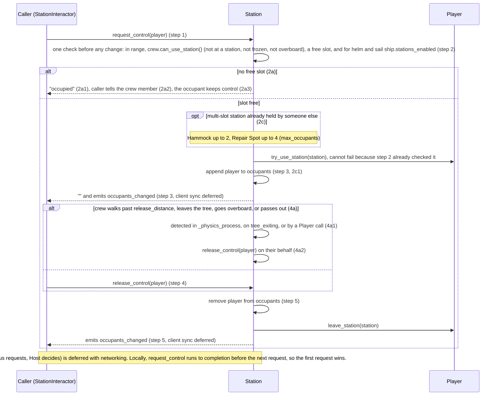

# Movement & Stations Design

**Project:** Holy Ship!
**Team:** Team 13 (Gaming): Whitney Akred, Shana Billiot, Liliana Matte, Gustavo Castillo, Leiton Peterson, Ivan Lopez
**Area:** `UC-DECK`

> **Realizes:** `UC-DECK-move-on-deck`, `UC-DECK-use-station`, `UC-DECK-claim-station`. No `FR-DECK-*` exists yet; specification section 5.2 is still the template.
> **Depends on:** `BR-deck-bounds`, `BR-single-station-occupant`, `BR-station-slots`, `BR-pass-out-recovery`, `BR-host-controls-session`, `BR-host-ends-session`; `KD-station-components`, `KD-local-first`, `KD-deployment-shape`; `QS-deck-boundary`, `QS-station-ownership`, `QS-station-release`, `QS-station-isolation`.
> **See:** [use cases, Movement & Stations](../requirements/use-cases.md#area-movement--stations-deck), [software requirements specification](../requirements/software-requirements-specification.md), [architecture-of-record](architectural-design.md), [sailing integration notes](../sailing-integration.md)
> **Designed against:** `2bb509c` (main, "Merge pull request #22 from whitneyakred/island-2-game")

---

_**How to use this template.** Copy it to `docs/design/<area>.md`, named for the lowercase area code (`ord.md` for `UC-ORD-*`). Instructions appear in italic square brackets; leave them in place until the document is stable, because the agent reads them on every later pass. The full worked example is Project Pulse's [`not.md`](https://github.com/Washingtonwei/project-pulse/blob/main/docs/design/not.md); read it for the shape, not for the answers._

_**What this document is.** The **design-of-record** for one use case area: how the code will realize its use cases, written **before** the code and approved before anyone builds from it. It is the last document your agent reads before it writes code, so anything it leaves out, the agent invents. Your [architecture-of-record](architectural-design.md) is the map of the whole system and stops at each component's responsibility; this document goes one level down, inside one area, against real code._

_**What it is not.** A copy of your use cases. It **cites** `UC-*`, `FR-*`, and `BR-*` by identifier and never restates what the system shall do; it says only how. It is also not a transcript of the code. Once code exists, link to the files rather than describing every class, column, or getter._

_**One document per area, not per use case.** Your area gains use cases over the term. The overview, the class diagram, and the data model are **revised in place** when it does. The sequence diagrams, the API contract rows, and the test rows are **appended**, one set per use case. Never add a `## UC-…` section that repeats the whole skeleton._

_**How much to write.** Pin down what a wrong guess would break: a requirement, a business rule, a quality attribute, or the contract between two parts of your team. Leave the rest for the agent to derive while it builds: variable names, field types, exact JSON, column lengths. When you are unsure, ask which side of that line a detail falls on, not whether it is interesting._

_**Write it in this order.** Each step is one person's or one pair's work, and the order is the point:_

1. _**Sketch it yourselves first.** Before you open the agent, draw the main success scenario's sequence diagram and write the API contract rows by hand, from the use case and your architecture-of-record. Twenty minutes, on paper or in this file._
2. _**Have the agent draft it.** Give the agent this template, the use case, the business rules it cites, your architecture-of-record's section 8 (Crosscutting Concepts), and the relevant existing code, and ask for a draft of this document. Use plan mode, so it proposes before it writes._
3. _**Compare the two.** Where the agent's draft differs from your sketch, decide which is right and why. What it found that you missed goes in; what you knew that it could not have known is the context your specification is missing, so fix the specification too._
4. _**Run the questions test** (the last section) and fix what it finds._
5. _**Open a pull request.** A teammate who did not write it reviews and approves it. Nobody starts an implementation branch from this design until it is merged._

---

## Overview

_[One paragraph: what this area does, which components of your [architecture-of-record](architectural-design.md) it lives in, and what it reads from or calls in other areas. Link the container diagram rather than redrawing it. If this design changes the architecture-of-record, say so here and list the change under "Changes to the architecture-of-record" below.]_

Movement & Stations is how a crew member walks the moving deck and takes, uses, and gives back a station. It lives inside the single Game Application container ([containers](architectural-design.md#51-containers)) and is split across two cross-cutting components from [use case areas and components](architectural-design.md#52-use-case-areas-and-components): **Crew Control** (walking, the overboard state, routing the interact key) and **Station Interaction** (range, occupancy, release). It reads the ship's transform and its `stations_enabled` flag from **Ship State** (`ShipMotion`, `Ship`), and it hands control to station owners in other areas: the helm and sail (`NAV`), cooking and fishing (no use case yet), and later the Hammock (`FTG`), Map (`MAP`), Lookout (`NAV`), and Repair Spots (`SHIP`). Much of this exists already: walking and deck collision in `player.gd`, and a station lock (`try_use_station` / `leave_station`) used by the helm, sail, cooking, and rowboat. But the code has three different station patterns, and the fishing station bypasses the lock entirely. The main job of this design is to put every station behind **one** claim/release contract with one place that reads the interact key. Following `KD-local-first`, every "sync to all clients" step in these use cases is **deferred** and marked as such below. This design changes the architecture-of-record (a `Station` base class and a `StationInteractor` become the concrete Station Interaction component); see the last sections.

## Components & classes

_[One class diagram for the whole area, and one line per class or file saying what it does and whether it is **new** or **reused**. Show only what a reader needs to see how the parts relate: classes, their key methods, their dependencies. Fields and getters belong to the code._

_**If your repository has no code for this area yet**, which is the normal case for your proving slice, list the files you expect the agent to create, with the paths your architecture-of-record's conventions give them, and mark them all new. The agent then builds into the structure you chose rather than one it improvised.]_

- [`scripts/player.gd`](../../scripts/player.gd) (changed): walking (`walk_speed`, `move_and_slide`) stays as is. WASD stays screen-relative (W is up on the screen, and the camera does not rotate), and `Input.get_vector` already keeps diagonal speed equal to straight speed. While the player is at a station, `_physics_process` skips walking, as it does today. Gains `can_use_station()`, which is false while at a station, frozen (physics off), or overboard. `try_use_station` refuses in the same cases. `active_station` is a mirror that only `Station` writes. Gains `set_overboard()` (swim speed and swim collision mask) and `release_active_station()` (used for the forced-release conditions). `play_fishing_animation()` currently assigns `using_station`, which only has a getter; it must go through the station lock instead.
- [`scenes/player.tscn`](../../scenes/player.tscn) (changed): adds a `StationInteractor` child node.
- `scripts/stations/station_interactor.gd` (new): the **only** reader of the `interact` action while on deck. Finds the nearest station in range from the `stations` group, shows its prompt, calls `request_control` / `release_control`, and shows the denial reason. "Nearest" is the distance from the player to each station node's origin, so each station's origin is placed at its interaction point. No prompt appears while the player is overboard or frozen. While the player is at a station, other prompts are hidden and E only means "leave". It forwards both the press and the release of E to the held station (fishing needs the release).
- `scripts/stations/station.gd` (new): `class_name Station`, base class for every deck station. Owns `occupants` and `max_occupants` (default 1), the range check, and the single check-and-claim method. Joins the `stations` group in `_ready`. Its auto-release logic (release distance, `tree_exiting`) moves up from today's `ShipStation`. It is checked for each occupant separately, so on a multi-slot station only the one who left is released. `occupants` is the authority on who holds the station. `request_control` checks everything before it changes anything. If the station itself leaves the tree (a repaired Repair Spot, a scene change), `_exit_tree` releases every occupant. It keeps a read-only `operator` (the first occupant) so existing callers and the integration test still work.
- [`scripts/sailing/ship_station.gd`](../../scripts/sailing/ship_station.gd) (changed): becomes `extends Station`. Keeps the `ship` reference, the per-frame `_apply_controls` for the occupant, and the `stations_enabled` check. That check applies only to ship stations (helm and sail). Cooking and fishing still work while docked. Stops reading `interact` itself.
- [`scripts/sailing/helm_station.gd`](../../scripts/sailing/helm_station.gd), [`scripts/sailing/sail_station.gd`](../../scripts/sailing/sail_station.gd) (reused): no change beyond what they inherit.
- [`Cook.gd`](../../Cook.gd) (changed; the cooking station): becomes `extends Station`. Drops its own `crew_nearby[0]` / `interact` handling and reports "No raw fish left" through `get_unavailable_reason` (5a). Moving the file under `scripts/stations/` is optional and not required by any use case.
- [`scripts/stations/fishing_station.gd`](../../scripts/stations/fishing_station.gd) (changed): root becomes a `Station` (Node2D) with its `Area2D` as a child. It claims through `request_control` and stops using the separate `fish` action, which is bound to the same E key as `interact`. "Fishing rod required" becomes its `get_unavailable_reason` (5a).
- `scripts/stations/overboard_zone.gd` (new): an `Area2D` with `kind` = `PLANK` or `LADDER`. The plank sets the player overboard and moves them to a `WaterEntry` marker just past the plank end, in the water (2b1). The ladder clears overboard and places the player at a `LadderTop` marker inside the deck polygon (2b3). The plank zone acts only on a player who is not overboard, and the ladder zone only on one who is.
- [`scenes/ship.tscn`](../../scenes/ship.tscn) (changed): opens a gap in the `DeckBoundary` railing only where the plank is, with railing collision along both sides of the plank, so the only way through the gap is along the plank. Adds the `Plank` zone at the plank's far end only, the `WaterEntry` marker, the `Ladder` zone in the water beside the hull, and the `LadderTop` marker. Also adds a `SwimBoundary` static body on its own collision layer, made of an outer ring plus the hull outline. A swimmer can't swim away, and can't get back onto the deck except by the ladder.
- [`scripts/sailing/ship_motion.gd`](../../scripts/sailing/ship_motion.gd), [`scripts/ship.gd`](../../scripts/ship.gd) (reused): the ship moves before the crew each physics frame (`process_physics_priority = -10`), which keeps crew positions relative to the deck. `Ship._stop_sailing()` already releases the helm and sail when docking (a 6a forced release).

## Sequence

_[One sequence diagram per use case for its main success scenario, plus one for each extension that does not just return an error. **Label each interaction with the use case step it implements**, so a reviewer can check that every step is realized and nothing extra was invented. Use `alt` blocks for extensions that branch off the main flow. Give each use case its own `###` heading; that heading is the anchor your traceability matrix cites.]_

### UC-DECK-move-on-deck: moving around the deck

#### Extension 2b: walking off the plank and climbing back

The island branch of 2b2 is **out of scope** by team decision: islands are reached only by rowboat (`UC-ISLE-arrive-at-island`). Extension 3a (lag or a dropped connection) is **deferred** with networking (`KD-local-first`); single-player has no remote position to correct.

### UC-DECK-use-station: interacting with a station

### UC-DECK-claim-station: taking over or releasing a station

## API contract

_[One row per endpoint, scheduled job, or message this area adds or changes, appended per use case. **This section is never dropped**: before the code exists it is the only thing the person (or agent session) building the front end and the one building the back end both read. Name the caller and who may call it, the request fields, the success response, and the error each extension returns. Leave field types and exact JSON to the agent unless a wrong guess would break something, such as a format another system depends on. Use the error shape your architecture-of-record's section 8.2 fixes; do not invent one here.]_

There is no HTTP API. Following [8.2.3 API conventions](architectural-design.md#823-api-conventions), the contract is typed GDScript methods and signals. [8.2.1 Error handling](architectural-design.md#821-error-handling) says to reject at the state owner and return a result the UI can explain, but it does not fix a shape. This design proposes a `StringName` reason code (`&""` means success) and adds that to 8.2.1 (see Changes).

| Method, signal, or input | Caller (who may) | Request | Success | Errors, by extension |
|---|---|---|---|---|
| `interact` input action (E) on deck | The local crew member. Read **only** by `StationInteractor`. Stations no longer read it. | None | Claims the nearest station, or releases the one held | See `request_control` |
| `Station.can_interact(crew) -> bool` | `StationInteractor` (prompt), `Station` itself | The crew member | `true` within `interaction_distance` | none |
| `Station.request_control(crew) -> StringName` | `StationInteractor` only, for its own player. A prompt never grants control by itself (8.2.5). | The crew member | `&""`: `Player.try_use_station` called, crew added to `occupants`, `occupants_changed` emitted | use-station 4a / claim 2a: `&"occupied"`. use-station 5a: `&"unavailable"` plus `get_unavailable_reason`. Out of range: `&"out_of_range"`. Crew at a station already (including the same multi-slot station), frozen, or overboard: `&"busy"`. Helm or sail while docked: `&"disabled"`. Checked in that order: occupied, then unavailable. Everything is checked before anything changes, so nothing changes on any error. |
| `Station.on_interact_released(crew)` | `StationInteractor`, for the station its player holds | The crew member | The fishing station finishes or cancels its attempt, then releases itself. Other stations ignore it. | none |
| `Station.try_take_control(crew) -> bool` | Existing callers and [`tests/sailing_integration.gd`](../../tests/sailing_integration.gd) | The crew member | `request_control(crew) == &""` | Kept as a thin wrapper so the existing test keeps passing |
| `Station.release_control(crew)` | `StationInteractor` (step 7), the station itself (claim 4a), `Ship._stop_sailing()` (use 6a), `Player.release_active_station()` | The crew member (all occupants when omitted) | Crew removed, `Player.leave_station` called, `occupants_changed` emitted | Idempotent: releasing someone who is not an occupant does nothing |
| `Station.get_unavailable_reason(crew) -> String` | `StationInteractor` | The crew member | `""` when usable, otherwise the text for 5a1 ("No raw fish left", "Fishing rod required") | none |
| `Station.occupants_changed(occupants)` signal | Emitted by `Station`. Heard by station HUDs such as the helm wheel indicator. Later this is the hook for client sync. | The occupant list | n/a | n/a |
| `Player.can_use_station() -> bool` | `Station` (step 2 check), `StationInteractor` (whether to show prompts) | None | `true` when on deck, not frozen, not at a station | none |
| `Player.try_use_station(station) -> bool` / `leave_station(station)` | `Station` only, never UI or other areas. Also the rowboat cutscene in `Ship`, which freezes the player outside the `Station` contract. | The station | Player's control mode switches | `false` in the same cases where `can_use_station()` is false. `Station` checks first, so this never fails in the middle of a claim. |
| `Player.set_overboard(value)` | `OverboardZone` (plank, ladder). Later `UC-WAVE-capsize-ship`. | `true` or `false` | Swim speed and mask on, or walk speed and mask on with the player at the ladder top | none |
| `Player.release_active_station()` | `Player.set_overboard(true)`. Later the pass-out flow (`UC-SURV-pass-out`, `BR-pass-out-recovery`). | None | Calls `release_control` on the held station | Does nothing when no station is held |

## Key decisions

_[Only the decisions a reader could not recover from the code: an invariant, who may do this and how it is enforced, a trade-off you chose, a reason you reused something rather than writing it. **Each one names what you chose, what you rejected, and why.** If you cannot name an alternative you considered, it probably was not a decision; leave it out._

_A decision that affects the whole system rather than this area is an architecture decision. It belongs in your architecture-of-record as a `KD-*` entry, not here.]_

**One reader of the interact key.** `StationInteractor` on the player picks the nearest station and is the only thing that reads `interact` on deck. Rejected: each station handles E in its own `_unhandled_input`, which is today's code. That cannot meet use-station 2a ("nearest station only"), because whichever station gets the input event first wins, regardless of distance. Today the fishing station's `fish` action and every other station's `interact` action are both bound to E, so one press can start fishing and claim the helm.

**One base class owns occupancy.** `Station` holds `occupants` and `max_occupants`, and `request_control` is a single check-and-claim on the station ([8.2.8](architectural-design.md#828-persistence-and-concurrency)). Rejected: a duck-typed contract (`has_method` plus groups), because AGENTS.md asks for typed GDScript and the drift between `ShipStation`, `Cook.gd`, and `FishingStation` shows what happens without one. Also rejected: keeping occupancy only on the player (`active_station`). That records one station per player but not several players per station, which `BR-station-slots` needs for the Hammock and Repair Spots.

**Check availability before claiming (use-station 5a).** `request_control` returns `&"unavailable"` without ever claiming. Rejected: following the use case literally (claim, notice there is nothing to do, release). The visible result is the same, and this way nothing else can see a brief false "claimed" state.

**Fishing is a single-shot station.** Pressing E claims the fishing station and starts the hold. Releasing E finishes or cancels the attempt, and the station then releases itself. Rejected: press E to enter, hold E to cast, then press E to leave. E would mean three things at one station. Also rejected: a separate fishing key, which changes controls the team already playtested. **Team to confirm** (the use case's open question "Is Fishing a minigame?" is still open).

**A swimmer stays a child of the ship.** Overboard, the player keeps the ship as parent (so they move with it). Their collision mask switches from the `DeckBoundary` layer to a `SwimBoundary` ring around the hull. Rejected: reparenting the swimmer into world space. That would need a second coordinate system for one character and would stack on `RISK-moving-deck`. The cost: a ship under sail tows its swimmers along, which nothing in the use cases forbids.

**Ranges stay as Inspector tuning, not requirements.** `interaction_distance` (46 px) and `release_distance` (72 px) on the station, `walk_speed` (145) and a new `swim_speed` on the player, stay exported values ([8.2.6](architectural-design.md#826-configuration-and-secrets)). The use cases mark all of them TBD. Rejected: hard-coding them as constants, because playtesting is how the use cases say they will be decided.

## Data model

_[The **change** this area makes to the data: new tables or entities, new columns, the migration that adds them. Draw an ER diagram when there is more than one new table. Do not redraw the domain model; your [specification](../requirements/software-requirements-specification.md) owns it, so link it and show only the change. If the area changes nothing, say "No change" and give the reason in one line; that is a design decision too.]_

**No change to stored data.** Voyages are never saved (use cases, networking convention; `KD-deployment-shape`), so this area keeps only runtime session state. Runtime changes:

- `Station.occupants` (list of crew members, 0 to `max_occupants`) replaces `ShipStation.operator` (one crew member).
- `Player.is_overboard` (bool) is new.
- [`project.godot`](../../project.godot) gets named 2D physics layers: one for `DeckBoundary` and a new one for `SwimBoundary`.

## Reuse & cross-cutting

_[Which existing services, components, and conventions this area uses rather than rebuilding: authentication, the error handler, email, the clock, another area's service. Cite your architecture-of-record's section 8.2 for each convention by name rather than restating it.]_

- **Player station lock** (`try_use_station` / `leave_station` in `player.gd`): kept as the player-side half of every claim. The rowboat cutscene in `Ship` already uses it to freeze the player.
- **Auto-release** (release distance, `tree_exiting`) from today's `ShipStation`: moved up into `Station`, not rewritten.
- **`ShipMotion.stations_enabled`** and **`Ship._stop_sailing()`**: reused as the forced-release path when the ship docks.
- **Input actions** in `project.godot` (`move_*`, `interact`): reused. The `fish` action is retired.
- **ItemDatabase / PlayerInventory**: the fishing station's rod check reads the player's inventory exactly as it does today.
- Conventions: 8.2.1 Error handling (reason codes), 8.2.3 API conventions (typed methods and signals), 8.2.4 Code conventions (exported tuning, signals for decoupling), 8.2.5 Validation (the station decides, a prompt never grants), 8.2.8 Persistence and concurrency (check-and-claim is one operation), 8.2.10 Testing (headless Godot scripts).

## Tests

_[One row per flow: the main success scenario and **every** extension of every use case this document realizes, appended per use case. Name the level (unit or integration) and what the test asserts. No code. This list is the definition of done that the reviewer approves; the agent writes these tests when it builds, and a reviewer can see at a glance whether an extension has no test.]_

"Unit" means a headless Godot script that instantiates one scene or node. "Integration" means a run of `main.tscn` like [`tests/sailing_integration.gd`](../../tests/sailing_integration.gd). Rows marked **(existing)** are already asserted there.

| Use case, flow | Level | Asserts |
|---|---|---|
| UC-DECK-move-on-deck main | integration | Holding a direction moves the player at `walk_speed` relative to the deck while the ship sails. Releasing it stops the player. |
| UC-DECK-move-on-deck 2a | integration | Holding toward each railing and corner never moves the player outside the `DeckBoundary` polygon (`QS-deck-boundary`) |
| UC-DECK-move-on-deck 2b | integration | Walking off the plank sets `is_overboard` and swim speed and puts the player at `WaterEntry`. Reaching the ladder puts the player at `LadderTop`, inside the deck polygon, with `is_overboard` false. The swimmer can pass neither the outer ring nor the hull outline. |
| UC-DECK-move-on-deck 3a | n/a | Deferred with networking (`KD-local-first`) |
| UC-DECK-use-station main | integration | E near the sail claims it and switches controls. E again releases it and restores walking. **(existing, sail and helm)** |
| UC-DECK-use-station 2a | unit | With two stations in range, the prompt names the nearer one, and E claims only that one |
| UC-DECK-use-station 4a | unit | A second crew identity requesting an occupied single-slot station gets `&"occupied"`, and the occupant keeps control (`QS-station-ownership`) |
| UC-DECK-use-station 5a | unit | Cooking with no raw fish, and fishing without a rod, return `&"unavailable"` with the right reason text, and neither station ends up claimed |
| UC-DECK-use-station 6a | integration | Docking (`_stop_sailing`) releases the helm and sail and restores walking |
| UC-DECK-claim-station main | unit | After claim and release the station is unclaimed, and `occupants_changed` fired twice |
| UC-DECK-claim-station 2a | integration | Cooking cannot claim a player who holds the sail, and the sail cannot take a player from cooking **(existing)** |
| UC-DECK-claim-station 2b | n/a | Deferred with networking (Host decides simultaneous claims) |
| UC-DECK-claim-station 2c | unit | A station with `max_occupants = 2` accepts a second crew member and refuses a third with `&"occupied"` |
| UC-DECK-claim-station 4a, distance | unit | Moving the occupant past `release_distance` releases the station on the next physics frame (`QS-station-release`) |
| UC-DECK-claim-station 4a, leaves tree | unit | Freeing the occupant releases the station |
| UC-DECK-claim-station 4a, overboard | unit | `set_overboard(true)` on an occupant releases its station |
| UC-DECK-claim-station 2a, overboard | unit | An overboard player in range of a station gets `&"busy"` and sees no prompt |
| UC-DECK-claim-station 2c, same crew twice | unit | A crew member already in a two-slot station cannot take its second slot |
| Station removed while occupied | unit | Freeing a station that has an occupant releases them and restores walking |
| Single reader of E | unit | One E press near both the fishing station and another station starts exactly one interaction |
| Fishing through the lock | integration | A completed fishing attempt plays the animation without a runtime error and leaves the player able to walk |

## Changes to the architecture-of-record

_[Designing an area against real code is when the architecture's guesses meet reality. If this design needs a component the map does not have, moves a responsibility, or adds a dependency, **change [the architecture-of-record](architectural-design.md) in the same pull request** and list each change here in one line. If nothing changed, write "None". A design that silently disagrees with the architecture leaves two maps, and the agent will follow whichever it reads last.]_

- **5.2:** Station Interaction is realized by `Station` plus `StationInteractor`. Change its status from "no interactive stations" to partly implemented, with the full `Station` contract designed here.
- **5.2:** Crew Control gains the overboard state and depends on Station Interaction (forced release).
- **5.3:** The implementation map is out of date (it says sailing and stations do not exist). Add the sailing, station, cooking, fishing, and new station files.
- **8.1 Authorization:** replace the reference to `BR-single-helmsman` with `BR-single-station-occupant`.
- **8.2.1 Error handling:** record `StringName` reason codes (`&""` means success) as the shape for rejected gameplay actions.
- **10.2:** `QS-station-ownership` and `QS-station-release` move from "not implemented" to checked by the test rows above.

## Open questions & risks

_[What this design could not settle and who can, and what could go wrong that you are accepting. A question for the client also goes in [`OPEN-ISSUES.md`](../requirements/OPEN-ISSUES.md).]_

- **Fishing controls** (single-shot station, decided above) depend on "Is Fishing a minigame?" from `UC-DECK-use-station`. Owner: the team.
- **Interaction range, auto-release distance, walk and swim speed** are TBD in the use cases. The code's current values are placeholders. Owner: playtesting (`OI-testing`).
- **Where the plank and ladder go on the hull art, and how large the swim ring is.** These are art and layout choices. A wrong guess breaks no requirement.
- **Cooking and Fishing have no use cases.** This design puts them behind the shared station contract only. Their own flows are unspecified (an open issue already recorded on `UC-DECK-use-station`).
- **Storage chests are out of scope here.** `UC-DECK-claim-station` and `BR-single-station-occupant` also cover storage chests (`UC-SYS-shared-inventory`), which have no design or code. When chests are built, each should be a `Station` with `max_occupants = 1`, so they share this lock. Owner: whoever designs `SYS`.
- **No pause yet.** PRE-3 ("session is active") is trivially true until `UC-PROG-pause-game` exists. When pause is built, `BR-host-controls-session` requires it to freeze movement and all timers, so it must stop walking, `StationInteractor`, and auto-release checks. Godot's pause does this for nodes left on the default process mode. Owner: whoever designs `PROG`.
- **Passing out does not exist yet.** `BR-pass-out-recovery` says a passed-out crew member loses any station claim. `release_active_station()` is the hook `UC-SURV-pass-out` will call. `BR-capsize-reset` also releases every station claim, through `release_control()` with no argument on each station.
- **Hammock, Map, Lookout, and Repair Spot stations do not exist yet.** `max_occupants` is the only hook this design adds for them.
- **Risk, refactor regression:** moving three stations onto a new base class can break the playable loop. Mitigation: `tests/sailing_integration.gd` must pass unchanged, which is why `try_take_control` is kept.
- **Risk, existing bug:** `player.gd` `play_fishing_animation()` assigns a property that only has a getter, so a successful catch can raise a runtime error today. This design fixes it as part of moving fishing onto the lock.
- **Accepted:** every sync step (move 3, 3a; claim 3, 5, 2b) waits for networking (`KD-local-first`, `RISK-peer-authority`).

---

## Working this document with your agent

_[Delegate: drafting the diagrams from your sketch and the use case; listing the existing files a class should extend; filling the contract rows' request and response fields; proposing the test row for each extension; drafting the rejected alternative for a decision you have already made; checking that every identifier this document cites exists in the document that owns it._

_Keep human: which side of the "would a wrong guess break something" line each detail falls on; every key decision; and the approval, which is a teammate's review of the pull request, not the drafter's own reading._

_**The specific failure to watch for: scope that nobody asked for.** An agent drafting a design adds what designs it has read usually have: an admin override, a retry queue, a status field, a notification "while we are here". Each looks reasonable and none is in your use case, and once it is in the design the agent will build it, test it, and you will maintain it. Read the sequence labels: every interaction should name the use case step it implements. An interaction with no step is either a missing requirement, which goes to your specification and your client, or scope creep, which comes out.]_

### How this document was worked

**Delegated to the agent (Claude):** reading the use cases, architecture section 8 and the code at `2bb509c`; drafting every diagram, contract row, test row, and rejected alternative; checking that each identifier this document cites exists where it should. That check found that architecture section 5.3 is out of date. The agent also ran the questions test below in a fresh session.

**Kept human (needs the team):**

- Fishing as a single-shot station (Key decisions, "Team to confirm")
- Whether the swim ring (`SwimBoundary`) is wanted at all (see the scope check below)
- Approval of the PR by a teammate who did not write it

### Scope check: interactions with no use case step

| Interaction or element | Use case step | Verdict |
|---|---|---|
| "Move the ship first each physics frame" | None. Existing plumbing behind the Assumption that positions are relative to the ship. | Keep. No new behavior. |
| `SwimBoundary` outer ring | None. The use case doesn't limit how far a swimmer can go. | Keep, flagged. Without it a swimmer can leave forever. **Team to confirm.** |
| Reason codes `&"out_of_range"`, `&"busy"`, `&"disabled"` | None directly. They come from checks the use cases do need (PRE-1, PRE-2, claim 4a). | Keep. Defensive results with nothing new for the player beyond a short message. |
| `try_take_control` wrapper, read-only `operator` | None | Keep. Compatibility only, so the existing integration test passes unchanged. |
| `on_interact_released` | None in a `DECK` use case. Fishing needs it, and fishing has no use case. | Keep, flagged. Exists only for fishing. |
| Test rows "Single reader of E" and "Fishing through the lock" | None | Keep. They check a design decision and a bug fix. |
| **Removed** | — | The island branch of move-on-deck 2b2 (team decision: islands by rowboat only) |

---

## The questions test (before you open the pull request)

_[Start a **fresh** agent session in plan mode, so it carries nothing from the session that drafted this document. Give it only the use case, the business rules it cites, your architecture-of-record's section 8, and this document, and ask:_

> _List every point you would still have to guess to implement `<UC-ID>`. For each, say what you would guess and whether a wrong guess could violate a requirement. Do not write code._

_For each item on its list, either fix this document or keep the guess and write one line saying why a wrong guess breaks no requirement. Paste the list, with your answer to each item, into the pull request description under How it was verified, inside a collapsed `

Questions test
 … 
` block so the description stays short. The design is ready when nothing on the list could break a requirement.]_

### Result

Run on 2026-10-14 by a fresh read-only agent session. It was given only `UC-DECK-*` from use-cases.md, the business rules they cite, architecture-of-record section 8, and this document. Every item that could break a requirement has been fixed in this document, except **one that is waiting on the team**: the fishing single-shot decision.

Paste the block below into the PR description under How it was verified.

Questions test

**UC-DECK-move-on-deck**

- **What `BR-deck-bounds` says.** Could break: yes. **Answered:** the design matches it (railing can't be crossed, the plank leads overboard, the ladder beside it is the way back), as written in Components.
- **The island branch of 2b2.** Could break: yes. **Fixed:** marked out of scope by team decision (islands by rowboat only).
- **Plank gap shape.** Could break: yes. **Fixed:** railing on both sides of the plank, `Plank` zone at the far end only.
- **Where an overboard player lands.** Could break: yes. **Fixed:** the `WaterEntry` marker just past the plank.
- **Shape of `SwimBoundary`.** Could break: yes. **Fixed:** outer ring plus hull outline, so the only way back is the ladder.
- **Where "top of the ladder" is.** Could break: yes. **Fixed:** the `LadderTop` marker inside the deck polygon.
- **Plank or ladder zone firing in the wrong state.** Could break: no. **Fixed anyway:** each zone acts only in its own state.
- **Which way WASD points when the ship turns.** Could break: yes. **Fixed:** screen-relative; the camera doesn't rotate.
- **Diagonal speed.** Could break: yes. **Fixed:** stated that `Input.get_vector` already keeps it equal.
- **WASD locked out at a station.** Could break: yes. **Fixed:** stated the existing `_physics_process` check.
- **Pause (PRE-3).** Could break: yes, once pause exists. **Kept:** no pause exists, so PRE-3 is trivially true. Added to Open questions for whoever designs `PROG`.
- **Crew-to-crew collision.** Could break: no. One crew body in single-player.
- **Stopping instantly.** Could break: no. No requirement on easing.
- **Swim speed value.** Could break: no. TBD tuning.

**UC-DECK-use-station**

- **What `BR-single-station-occupant` and `BR-station-slots` say.** Could break: yes. **Answered:** the design matches both rules through `max_occupants` (1 for most stations, Hammock 2, Repair Spot 4), and a claim never displaces an occupant (`&"occupied"`).
- **Claiming while overboard.** Could break: yes. **Fixed:** `can_use_station()` is part of the check, and an overboard player gets `&"busy"`. Test added.
- **Prompt shown to a swimmer or frozen player.** Could break: yes. **Fixed:** no prompts in those states.
- **How "nearest" is measured.** Could break: slightly. **Fixed:** distance to the station node's origin, which is placed at the interaction point.
- **Prompt range vs. claim range.** Could break: no. Both use `can_interact`.
- **Prompt for an occupied or unavailable station.** Could break: no. Matches 2a, 4a, and 5a.
- **What the extra reason codes show.** Could break: no. A short message. See the scope check.
- **Which stations `stations_enabled` applies to.** Could break: no. **Fixed anyway:** helm and sail only. The contradiction is removed.
- **Form of the denial message.** Could break: no.
- **Which reason wins.** Could break: no. **Fixed anyway:** occupied, then unavailable.
- **Fishing as single-shot.** Could break: yes, step 7. **Open (team to confirm):** a deliberate departure from step 7.
- **Who reads the E release for fishing.** Could break: no. **Fixed:** `StationInteractor` forwards it (`on_interact_released`).
- **Fishing finish vs. cancel.** Could break: no. Fishing has no use case.
- **Other 5a conditions.** Could break: no. TBD in the use case.
- **Station runs out mid-use.** Could break: no. It releases itself.
- **Where the player stands after release.** Could break: no.
- **Prompt while at a station.** Could break: no. **Fixed anyway:** other prompts hidden, E means leave.
- **Cooking's controls.** Could break: no. Cooking has no use case.
- **Repair Spot press-and-hold.** Could break: no for now. Repair Spots aren't built. `on_interact_released` gives the hold path.

**UC-DECK-claim-station**

- **Which record is authoritative.** Could break: yes, POST-1. **Fixed:** `Station.occupants` is the authority, and `active_station` mirrors it.
- **Claim order when `try_use_station` fails.** Could break: yes, POST-1. **Fixed:** everything is checked first, then `try_use_station`, then the append.
- **Same crew member taking two slots.** Could break: yes. **Fixed:** `&"busy"`. Test added.
- **Chests.** Could break: yes, later. **Fixed:** out of scope here, with how chests will join recorded in Open questions.
- **Station removed while occupied.** Could break: yes. **Fixed:** `_exit_tree` releases everyone. Test added.
- **Auto-release timeout.** Could break: no. TBD, distance only for now.
- **What auto-release distance is measured against.** Could break: no. **Fixed anyway:** checked for each occupant separately.
- **`leave_station` calling back into `release_control`.** Could break: no. The "fired twice" test row would catch it.
- **Signal on a release that does nothing.** Could break: no.
- **`release_control()` with no argument.** Could break: no.
- **Keeping `operator`.** Could break: no. **Fixed anyway:** kept read-only.
- **Rowboat.** Could break: no. **Fixed anyway:** the contract notes the rowboat uses the lock outside `Station`.
- **2a2 message text.** Could break: no.
- **2b in single-player.** Could break: no. First request wins.

