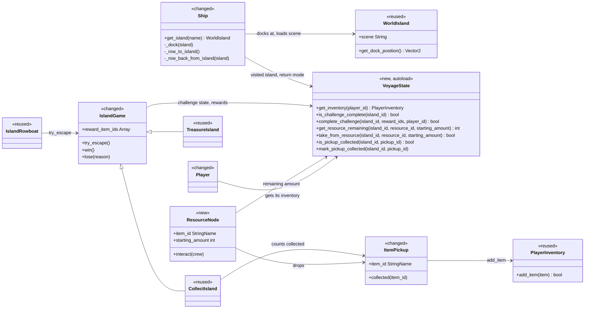
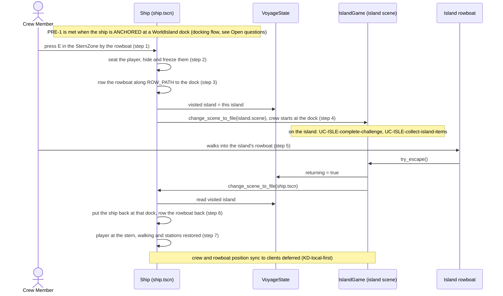
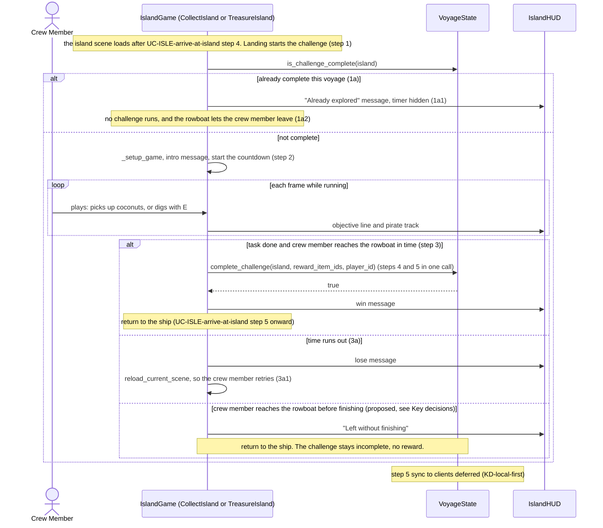
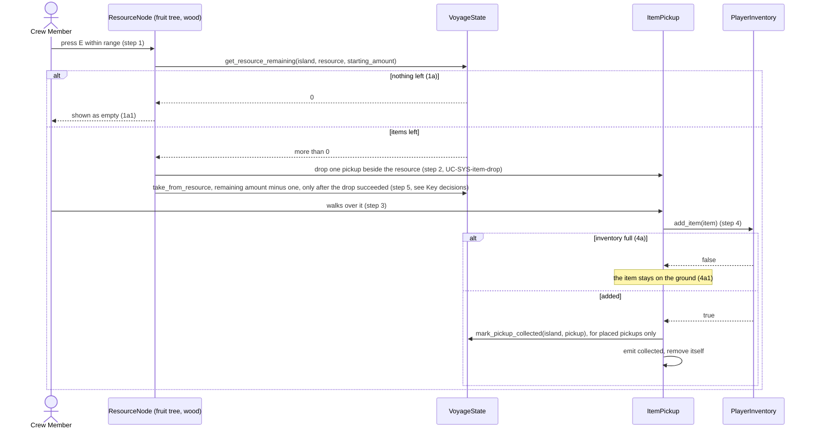
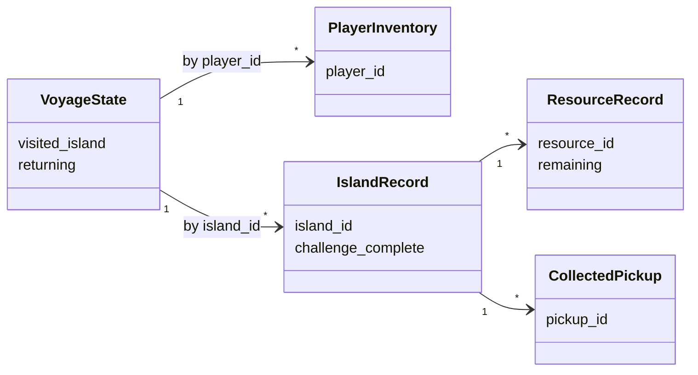

# Island Interaction Design

**Project:** Holy Ship!
**Team:** Team 13 (Gaming): Whitney Akred, Shana Billiot, Liliana Matte, Gustavo Castillo, Leiton Peterson, Ivan Lopez
**Area:** `UC-ISLE`

> **Realizes:** `UC-ISLE-arrive-at-island`, `UC-ISLE-complete-challenge`, `UC-ISLE-collect-island-items`. `UC-ISLE-salvage-shipwreck` is **not yet designed** (see Overview). No `FR-ISLE-*` exists yet; specification section 5.2 is still the template.
> **Depends on:** `BR-rowboat-capacity`, `BR-inventory-slots`, `BR-capsize-reset`, `BR-pass-out-recovery`, `BR-host-controls-session`; `UC-SYS-item-drop`, `UC-SYS-player-inventory`; `KD-deployment-shape`, `KD-local-first`, `KD-station-components`, `KD-world-chunks`.
> **See:** [use cases, Island Interaction](../requirements/use-cases.md#area-island-interaction-isle), [software requirements specification](../requirements/software-requirements-specification.md), [architecture-of-record](architectural-design.md), [sailing integration notes](../sailing-integration.md)
> **Designed against:** `2bb509c` (main, "Merge pull request #22 from whitneyakred/island-2-game")

---

_**How to use this template.** Copy it to `docs/design/<area>.md`, named for the lowercase area code (`ord.md` for `UC-ORD-*`). Instructions appear in italic square brackets; leave them in place until the document is stable, because the agent reads them on every later pass. The full worked example is Project Pulse's [`not.md`](https://github.com/Washingtonwei/project-pulse/blob/main/docs/design/not.md); read it for the shape, not for the answers._

_**What this document is.** The **design-of-record** for one use case area: how the code will realize its use cases, written **before** the code and approved before anyone builds from it. It is the last document your agent reads before it writes code, so anything it leaves out, the agent invents. Your [architecture-of-record](architectural-design.md) is the map of the whole system and stops at each component's responsibility; this document goes one level down, inside one area, against real code._

_**What it is not.** A copy of your use cases. It **cites** `UC-*`, `FR-*`, and `BR-*` by identifier and never restates what the system shall do; it says only how. It is also not a transcript of the code. Once code exists, link to the files rather than describing every class, column, or getter._

_**One document per area, not per use case.** Your area gains use cases over the term. The overview, the class diagram, and the data model are **revised in place** when it does. The sequence diagrams, the API contract rows, and the test rows are **appended**, one set per use case. Never add a `## UC-…` section that repeats the whole skeleton._

_**How much to write.** Pin down what a wrong guess would break: a requirement, a business rule, a quality attribute, or the contract between two parts of your team. Leave the rest for the agent to derive while it builds: variable names, field types, exact JSON, column lengths. When you are unsure, ask which side of that line a detail falls on, not whether it is interesting._

_**Write it in this order.** Each step is one person's or one pair's work, and the order is the point:_

1. _**Sketch it yourselves first.** Before you open the agent, draw the main success scenario's sequence diagram and write the API contract rows by hand, from the use case and your architecture-of-record. Twenty minutes, on paper or in this file._
2. _**Have the agent draft it.** Give the agent this template, the use case, the business rules it cites, your architecture-of-record's section 8 (Crosscutting Concepts), and the relevant existing code, and ask for a draft of this document. Use plan mode, so it proposes before it writes._
3. _**Compare the two.** Where the agent's draft differs from your sketch, decide which is right and why. What it found that you missed goes in; what you knew that it could not have known is the context your specification is missing, so fix the specification too._
4. _**Run the questions test** (the last section) and fix what it finds._
5. _**Open a pull request.** A teammate who did not write it reviews and approves it. Nobody starts an implementation branch from this design until it is merged._

---

## Overview

_[One paragraph: what this area does, which components of your [architecture-of-record](architectural-design.md) it lives in, and what it reads from or calls in other areas. Link the container diagram rather than redrawing it. If this design changes the architecture-of-record, say so here and list the change under "Changes to the architecture-of-record" below.]_

Island Interaction gets a crew member from an anchored ship onto an island and back, runs the island's challenge, and lets them gather items there. It is the **Island Exploration** component of the Game Application ([containers](architectural-design.md#51-containers), [use case areas](architectural-design.md#52-use-case-areas-and-components)). Most of the trip already works on `main`. `Ship` (Ship State) anchors at a `WorldIsland`'s dock, plays the rowboat cutscene, and loads that island as **its own scene**. The island scene's `IslandGame` runs a timed challenge (collect every coconut on Coconut Island, dig up the treasure on Treasure Island), and the island's rowboat sends the player back. This area reads the item catalog (Item Catalog) and writes into the crew member's `PlayerInventory` (`UC-SYS-player-inventory`). What is missing: island state and the crew's inventory do not survive the scene swaps, coconuts never reach an inventory, and there are no gatherable resources (trees, wood). This design adds one in-memory **`VoyageState`** autoload to carry that state across scenes, which is a change to the architecture-of-record (see the last sections). Every "sync to all clients" step waits for networking (`KD-local-first`). `UC-ISLE-salvage-shipwreck` is left for a later pass: it is built on `UC-SYS-shared-inventory` (the storage chest), which has neither a design nor code yet.

## Components & classes

_[One class diagram for the whole area, and one line per class or file saying what it does and whether it is **new** or **reused**. Show only what a reader needs to see how the parts relate: classes, their key methods, their dependencies. Fields and getters belong to the code._

_**If your repository has no code for this area yet**, which is the normal case for your proving slice, list the files you expect the agent to create, with the paths your architecture-of-record's conventions give them, and mark them all new. The agent then builds into the structure you chose rather than one it improvised.]_

- [`scripts/ship.gd`](../../scripts/ship.gd) (changed): docking, stern interaction, and both rowboat cutscenes stay as they are. The cross-scene statics (`returning_from_island`, `visited_island_name`, `completed_islands`) move into `VoyageState`.
- [`scripts/islands/world_island.gd`](../../scripts/islands/world_island.gd) (reused): placement, `scene`, and dock point. The node name is the island id.
- `scripts/voyage_state.gd` (new, autoload `VoyageState`): in-memory state for one voyage that must outlive a scene change. Holds the crew inventories by `player_id`, completed challenges, resource amounts left, collected pickups, the scene handoff (which island, and whether the crew is returning), and the last visited island, which `BR-capsize-reset` needs and which the handoff never clears. Never written to disk.
- [`scripts/islands/island_game.gd`](../../scripts/islands/island_game.gd) (changed): the shared challenge flow. Adds the "already complete" check (complete-challenge 1a), grants the reward and marks completion in one `VoyageState` call, and lets the crew member leave before finishing (see Key decisions). Losing still reloads the island (retry, complete-challenge 3a). The island id comes from `VoyageState.visited_island`, never from a value exported on the island scene. When it is empty (the scene was run on its own with F6), it falls back to the scene's file path. An island with no challenge keeps the base class defaults (`time_limit_seconds = 0`, objective always complete), so it shows no timer and lets the crew member leave at any time.
- [`scripts/islands/collect_island.gd`](../../scripts/islands/collect_island.gd) (changed): the total is every placed pickup in its group in the scene file. Placed pickups already collected earlier this voyage (in a failed run or before leaving early) count as collected when the run starts, so a retry continues the progress. Pickups dropped by a `ResourceNode` are not put in the group and never count.
-  [`scripts/islands/treasure_island.gd`](../../scripts/islands/treasure_island.gd), [`scripts/islands/island_hud.gd`](../../scripts/islands/island_hud.gd) (reused): the two challenge types and the HUD.
- [`scripts/rowboat.gd`](../../scripts/rowboat.gd) (reused, shown as `IslandRowboat`): walking into the island's rowboat calls `IslandGame.try_escape()`.
- [`scripts/coconut.gd`](../../scripts/coconut.gd) / [`scenes/coconut.tscn`](../../scenes/coconut.tscn) (changed, shown as `ItemPickup`): already generic through `item_id`. Reacts only to bodies in the `crew` group and adds the item to `VoyageState.get_inventory(body.player_id)`. Emits `collected` only when the add succeeds, and stays on the ground when the inventory is full (collect 4a). A placed pickup that is already collected frees itself in `_ready`. Renaming it to `item_pickup` is optional.
- `scripts/islands/resource_node.gd` + `scenes/islands/resource_node.tscn` (new): a fruit tree or wood pile. Pressing E in range drops one `ItemPickup` (collect step 2) at an exported offset on walkable ground, and shows itself as empty when used up (1a). It reads `get_resource_remaining` in `_ready` so a tree emptied on an earlier visit already looks empty. When several resource nodes are in range, only the nearest one acts on the press, and it marks the input handled.
- [`scripts/item-system/items.gd`](../../scripts/item-system/items.gd) (changed): registers a `wood` item. `coconut` is the fruit.
- [`scripts/player.gd`](../../scripts/player.gd) (changed): in `_ready`, takes its `PlayerInventory` from `VoyageState.get_inventory(player_id)` instead of a per-scene resource, so the ship's player and the island's player share one inventory. `player_id` defaults to `&"player_1"`. The fishing-rod starter grant stays: it adds the rod only if the voyage inventory doesn't have one, so it happens once per voyage.
- [`scenes/island.tscn`](../../scenes/island.tscn) (changed): Coconut Island gets its first `ResourceNode`s.
- Every island scene (changed if needed): the player's start position is on the dock beside the island's rowboat, outside the rowboat's `Area2D`, so landing never triggers the return trip.

## Sequence

_[One sequence diagram per use case for its main success scenario, plus one for each extension that does not just return an error. **Label each interaction with the use case step it implements**, so a reviewer can check that every step is realized and nothing extra was invented. Use `alt` blocks for extensions that branch off the main flow. Give each use case its own `###` heading; that heading is the anchor your traceability matrix cites.]_

### UC-ISLE-arrive-at-island: travelling between the ship and an island

Extensions:

- **1b (rowboat away)** is **deferred to co-op.** With one player, the rowboat is always wherever the player is.
- **3a (capsize while ashore)** is **deferred** until `UC-WAVE-capsize-ship` exists. The ship cannot move or capsize while the island scene is loaded. When capsizing is built, `BR-capsize-reset` returns everyone to the last visited island and empties every inventory; both live in `VoyageState`, so that design has one place to reset.
- **5b (ship moved out of range)** cannot happen in single-player. The ship stays anchored with its stations disabled until the player is back aboard (`stations_enabled = false` in `Ship._stop_sailing`).

### UC-ISLE-complete-challenge: completing an island challenge

### UC-ISLE-collect-island-items: collecting island items

Coconuts that are placed in the island scene (not dropped by a `ResourceNode`) start at step 3 of this flow. When they are collected they are also what `CollectIsland` counts toward its objective.

## API contract

_[One row per endpoint, scheduled job, or message this area adds or changes, appended per use case. **This section is never dropped**: before the code exists it is the only thing the person (or agent session) building the front end and the one building the back end both read. Name the caller and who may call it, the request fields, the success response, and the error each extension returns. Leave field types and exact JSON to the agent unless a wrong guess would break something, such as a format another system depends on. Use the error shape your architecture-of-record's section 8.2 fixes; do not invent one here.]_

There is no HTTP API. Following [8.2.3 API conventions](architectural-design.md#823-api-conventions), the contract is typed GDScript methods, signals, and scene changes. Following [8.2.1](architectural-design.md#821-error-handling), each rejection leaves state untouched and returns something the HUD can explain.

| Method, signal, or input | Caller (who may) | Request | Success | Errors, by extension |
|---|---|---|---|---|
| `interact` (E) in the ship's `SternZone` | The local crew member, only while the ship is `ANCHORED` and the player is not at a station. Once `UC-SURV-pass-out` exists, also not passed out (PRE-2). | None | Rowing cutscene, then the island scene loads (arrive steps 1 to 4) | Not anchored: no prompt and no effect (PRE-1). 1b: "The rowboat is away" (co-op only). |
| `IslandGame.try_escape()` | The island's rowboat `Area2D`, on the player's body entering | None | Objective complete: `complete_challenge`, then return. Not complete: return without completing (proposed). Already complete (1a): return. | Run already ended (won or lost): ignored |
| `VoyageState.get_inventory(player_id) -> PlayerInventory` | `Player._ready` on the ship and on every island | `player_id` | The same `PlayerInventory` instance for the whole voyage | Unknown id: a new empty inventory is created and kept |
| `VoyageState.is_challenge_complete(island_id) -> bool` | `IslandGame._ready`, `Ship` (nearest-island arrow) | The island id (the `WorldIsland` node name) | `true` once completed this voyage | none |
| `VoyageState.complete_challenge(island_id, reward_item_ids, player_id) -> bool` | `IslandGame` only, never the HUD or pickups. `player_id` is the crew member who reached the rowboat. | The island id, reward ids (empty until rewards are decided), the player | Every reward fits: all added and the island marked complete **together** (the use case's failure behavior) | Already complete: `false`, nothing granted twice. Some reward doesn't fit: `false`, nothing added and nothing marked, and the HUD says "Make room for the reward" (proposed, see Open questions). |
| `VoyageState.get_resource_remaining(island_id, resource_id, starting_amount) -> int` | `ResourceNode` (`_ready` and before each drop) | Same as below | The amount left, `starting_amount` on first touch | none |
| `VoyageState.take_from_resource(island_id, resource_id, starting_amount) -> bool` | `ResourceNode` only | The island id, the resource node's name, its starting amount (used on first touch) | `true` and the amount left drops by one | 1a: `false` when nothing is left |
| `VoyageState.is_pickup_collected` / `mark_pickup_collected(island_id, pickup_id)` | `ItemPickup` only (placed pickups only). It checks in `_ready` and frees itself if already collected. `CollectIsland` reads it to count earlier progress. | The island id, the pickup's node name | Collected placed pickups are removed when the island loads again | none |
| `ItemPickup.collected(item_id)` signal | Emitted by `ItemPickup` after a successful `add_item`. Heard by `CollectIsland`. | The item id | The objective counter goes up | 4a: not emitted, the item stays on the ground |
| `IslandGame.run_won`, `run_lost(reason)` signals | Emitted by `IslandGame` (existing) | n/a | n/a | n/a |
| Scene handoff (`VoyageState.visited_island`, `returning`) | Written by `Ship` before loading an island and by `IslandGame` before loading the ship. Read by the other side. | The island id | The ship comes back anchored at the right dock and plays the return rowing cutscene | `Ship` clears `returning` and `visited_island` in `_ready` as soon as it has read them, so a later reload of the ship scene never replays the return trip. Unknown island id on return: the ship starts in `SAILING` where it is. |

## Key decisions

_[Only the decisions a reader could not recover from the code: an invariant, who may do this and how it is enforced, a trade-off you chose, a reason you reused something rather than writing it. **Each one names what you chose, what you rejected, and why.** If you cannot name an alternative you considered, it probably was not a decision; leave it out._

_A decision that affects the whole system rather than this area is an architecture decision. It belongs in your architecture-of-record as a `KD-*` entry, not here.]_

**Islands stay separate scenes.** Rowing ashore loads the island's own scene, as `main` does today. Rejected: putting the islands into the ship's world as places the crew walks onto directly. That would need the island minigames, their HUD, and their timers to run alongside sailing, and every island's content would stay loaded, against `KD-world-chunks`. The cost is that nothing survives a scene change unless something holds it, which is the next decision.

**One `VoyageState` autoload holds everything that must cross a scene change.** That means inventories, completed challenges, resource amounts, collected pickups, and the handoff. Rejected: more `static var`s on `Ship`, which is the current pattern. `IslandGame` already reaches into `Ship` for `returning_from_island`, so island code depends on the ship class, and inventories and resources would make that worse. Also rejected: saving to disk, because voyages are never saved (use cases, networking convention). This is a system-level change, so it is listed under Changes for the architecture-of-record.

**Landing starts the challenge (complete-challenge step 1).** The challenge starts as soon as the island scene loads. Rejected: a separate "start challenge" prompt. Nothing in the use case asks for one, and the existing timed islands are built around starting at once.

**A challenge is done when its task is done *and* the crew member reaches the rowboat in time.** This keeps the existing game design ("collect them all, then get back to the rowboat"). Reward and completion are granted in one `complete_challenge` call at that moment. Rejected: completing as soon as the last coconut is picked up. That changes the timed game the team built, and the use case leaves challenge types to the team.

**Proposed: the rowboat always lets you leave.** Leaving before the task is done ends the run with the challenge still incomplete and no reward, and the crew member can come back later to retry. Rejected: today's gate ("Finish the island's task first!"), where the only way off is to win. With a full inventory, coconuts stay on the ground (collect 4a), so Coconut Island can't be finished. The crew member would then be stuck, reloading the island forever. **Team to confirm**; this changes how the islands feel.

**State on the ship that must survive a trip lives in `VoyageState`, not in the ship scene.** Going ashore unloads the ship scene and coming back rebuilds it from the scene file, so anything stored only in a ship-side node resets. The use case's failure behavior allows only crew and rowboat positions to change. Today this affects one thing, the cooking station's stock (`raw_fish`, `cooked_fish`), which resets to 3 raw fish on every trip and can be duplicated that way. Its state moves into `VoyageState` too. The `SHIP` and `SURV` designs (hull damage, hunger) must follow the same rule. Rejected: keeping the ship scene loaded and hiding it while ashore. That keeps sailing physics and stations running during the island minigame and contradicts "Islands stay separate scenes".

**The island rowboat is still walk-in, not E.** The use case says the crew member "interacts with" the rowboat at the dock (step 5). On islands, walking into the rowboat counts as that interaction. Rejected: pressing E, because E digs on Treasure Island and the two would clash. Because the player starts on the dock *outside* the rowboat's zone and the zone fires only on entering, landing never triggers it by accident.

**The resource amount drops when the item is dropped, not when it is picked up.** The use case decreases it at step 5, after the pickup, and 4a rejoins at step 5 even when the item stays on the ground. So the amount goes down either way, and doing it at the drop makes it impossible to farm a tree by pressing E repeatedly before picking anything up. Rejected: decrementing on pickup, which would let one tree drop more items than its amount. The drop happens first and the amount drops only if the drop worked, so a failed drop (for example a missing item id) never costs the tree an item.

## Data model

_[The **change** this area makes to the data: new tables or entities, new columns, the migration that adds them. Draw an ER diagram when there is more than one new table. Do not redraw the domain model; your [specification](../requirements/software-requirements-specification.md) owns it, so link it and show only the change. If the area changes nothing, say "No change" and give the reason in one line; that is a design decision too.]_

**No stored data.** Voyages are never saved, so nothing is written to disk and nothing needs migrating (`KD-deployment-shape`). What is new is an **in-memory** voyage model in `VoyageState`. It lives for one run of the game and is reset when a voyage starts (until `UC-PROG-start-voyage` exists, that means when the game launches):

The island id is the `WorldIsland` node name under `Ship/Islands` (`CoconutIsland`, `TreasureIsland`). The resource and pickup ids are node names inside the island scene. Renaming one of those nodes therefore loses its record for the rest of the voyage, and nothing worse. `PlayerInventory` is the existing resource, unchanged.

## Reuse & cross-cutting

_[Which existing services, components, and conventions this area uses rather than rebuilding: authentication, the error handler, email, the clock, another area's service. Cite your architecture-of-record's section 8.2 for each convention by name rather than restating it.]_

- **Docking and both rowboat cutscenes** in `Ship` (`_dock`, `_row_to_island`, `_row_back_from_island`, `_row_along`): reused as is.
- **`IslandGame` hooks** (`_setup_game`, `_get_objective_text`, `_is_objective_complete`, `_on_time_up`) and **`IslandHUD`**: reused. New challenge types keep extending `IslandGame`.
- **Player station lock** (`try_use_station` / `leave_station`): `Ship` already uses it to freeze the player during the cutscene. That stays, and it follows the contract in [deck.md](deck.md).
- **ItemDatabase / Items** for item definitions, and **`PlayerInventory.add_item`** for "is there room". Its stack and slot rules are `UC-SYS-player-inventory`'s, not this area's.
- Conventions: 8.2.1 Error handling (reject without partial change), 8.2.2 Time (the island countdown uses simulation time in `_process`, so pause will freeze it, as `BR-host-controls-session` requires), 8.2.3 API conventions, 8.2.4 Code conventions (exported tuning such as `time_limit_seconds`, `starting_amount`), 8.2.5 Validation (`VoyageState` and `IslandGame` decide, the HUD only shows), 8.2.8 Persistence and concurrency (in memory, one owner per mutation), 8.2.10 Testing.

## Tests

_[One row per flow: the main success scenario and **every** extension of every use case this document realizes, appended per use case. Name the level (unit or integration) and what the test asserts. No code. This list is the definition of done that the reviewer approves; the agent writes these tests when it builds, and a reviewer can see at a glance whether an extension has no test.]_

"Unit" means a headless Godot script that instantiates one scene or node. "Integration" means a run of `main.tscn` like [`tests/sailing_integration.gd`](../../tests/sailing_integration.gd). Rows marked **(existing)** are already asserted there.

| Use case, flow | Level | Asserts |
|---|---|---|
| UC-ISLE-arrive-at-island main | integration | Docking anchors the ship and stops sailing. E at the stern plays the rowboat and loads the island. Leaving through the rowboat comes back to the same dock with walking restored. **(existing)** |
| UC-ISLE-arrive-at-island 1b | n/a | Deferred to co-op: the rowboat cannot be away from a single player |
| UC-ISLE-arrive-at-island 3a | n/a | Deferred until `UC-WAVE-capsize-ship` exists |
| UC-ISLE-arrive-at-island 5b | n/a | Cannot happen in single-player: stations stay disabled while anchored and ashore |
| UC-ISLE-complete-challenge main, Coconut Island | integration | Collecting every coconut and reaching the rowboat in time marks the island complete in `VoyageState` and returns to the ship **(existing, without the `VoyageState` check)** |
| UC-ISLE-complete-challenge main, Treasure Island | unit | Digging within `dig_radius` of the treasure, then reaching the rowboat, marks the island complete. A wrong dig costs `miss_penalty_seconds`. |
| UC-ISLE-complete-challenge 1a | integration | Revisiting a completed island shows the "already explored" message, runs no timer, and lets the player leave |
| UC-ISLE-complete-challenge 3a | unit | When the timer reaches zero before the task is done, the island reloads with a fresh timer and the challenge is still incomplete |
| UC-ISLE-complete-challenge, reward together | unit | `complete_challenge` with a reward list adds every reward and sets complete in one call. A second call returns `false` and grants nothing. |
| UC-ISLE-complete-challenge, leave early (proposed) | unit | Reaching the rowboat before finishing returns to the ship with the challenge incomplete and no reward |
| UC-ISLE-collect-island-items main | unit | E at a resource drops one pickup and lowers its amount by one. Walking over the pickup adds it to the player's inventory and removes it. |
| UC-ISLE-collect-island-items 1a | unit | E at a resource whose amount is zero drops nothing and shows it as empty |
| UC-ISLE-collect-island-items 4a | unit | With a full inventory the pickup stays on the ground, the amount is still lower, and `collected` is not emitted |
| Inventory survives the trip | integration | A coconut collected on the island is in the same player's inventory back on the ship (POST-1) |
| No regrowth | integration | Leaving and revisiting an island keeps collected placed coconuts gone and resource amounts unchanged (use case assumption "Resources don't regrow") |
| UC-ISLE-arrive-at-island step 4 | integration | Landing places the player on the dock beside the rowboat, and the return trip does not start until the player walks into the rowboat |
| Handoff cleared | integration | After a round trip, reloading `ship.tscn` starts sailing normally and does not replay the return cutscene |
| Ship state survives the trip | integration | Cooking stock after a round trip is what it was before going ashore |
| UC-ISLE-complete-challenge 3a, progress kept | unit | Coconuts collected in a failed run stay in the inventory, stay gone on reload, and count toward the total, so the island is still winnable |
| UC-ISLE-complete-challenge, reward doesn't fit | unit | With a full inventory, `complete_challenge` returns `false`, adds nothing, and leaves the island incomplete |
| UC-ISLE-collect-island-items 1a, on load | unit | A resource emptied on an earlier visit looks empty as soon as the island loads |
| UC-ISLE-collect-island-items, two in range | unit | One E press with two resource nodes in range drops exactly one item, from the nearer one |

## Changes to the architecture-of-record

_[Designing an area against real code is when the architecture's guesses meet reality. If this design needs a component the map does not have, moves a responsibility, or adds a dependency, **change [the architecture-of-record](architectural-design.md) in the same pull request** and list each change here in one line. If nothing changed, write "None". A design that silently disagrees with the architecture leaves two maps, and the agent will follow whichever it reads last.]_

- **5.2:** add a cross-cutting **Voyage State** component (`VoyageState` autoload) that owns in-memory voyage state crossing scene changes. Island Exploration and Crew Control depend on it.
- **5.2:** Island Exploration also depends on **Ship State** (docking, the rowboat cutscene). Change its status from "not implemented" to "implemented: docking, rowboat, two timed islands".
- **5.3:** the implementation map is out of date. Add `ship.gd`, `world_island.gd`, `island_game.gd`, `collect_island.gd`, `treasure_island.gd`, `island_hud.gd`, `rowboat.gd`, `coconut.gd`, the inventory scripts, and the new files. Add `VoyageState` next to the `ItemDatabase` and `Items` autoloads.
- **6:** the runtime view should show the ship-to-island scene change and the `VoyageState` handoff.
- **7.3 Restart behavior:** voyage state (inventories, island progress) is held in memory and lost on restart. That is consistent with "no saved voyage", but now it is real state, not just positions.
- **9.2 `KD-world-chunks`:** note that islands are fixed `WorldIsland` nodes at map coordinates in `ship.tscn`, not chunk-generated. Record this as a deliberate interim shortcut (or as `TD-*` debt).

## Open questions & risks

_[What this design could not settle and who can, and what could go wrong that you are accepting. A question for the client also goes in [`OPEN-ISSUES.md`](../requirements/OPEN-ISSUES.md).]_

- **Docking is not in any use case.** Sailing into the yellow circle to anchor, the island arrow, and the "nearest island" status line all exist in code. This design uses docking as the meaning of PRE-1 ("within range"). It is either a missing step in `UC-ISLE-arrive-at-island` or a missing `NAV` use case. Owner: the team. Fix the specification.
- **The use case's open questions are answered by the code but not yet in the use case:** the rowboat moves on its own (a cutscene), and the ship must be anchored (sail stowed) to launch it. Owner: the team. Update `UC-ISLE-arrive-at-island` and resolve them.
- **Rowboat capacity is TBD** in `BR-rowboat-capacity`. With one player it changes nothing. It matters in co-op. Owner: the team.
- **Inventory limits in code don't match `BR-inventory-slots` yet.** The rule says six quick slots plus expanded slots, with at most 30 per stack. Today `PlayerInventory` has 4 slots and coconuts stack to 20. When the inventory is full, collect 4a depends on those numbers, but changing them belongs to `UC-SYS-player-inventory`. Owner: whoever designs `SYS`.
- **Leave-early (proposed above)** changes the islands' feel. Owner: the team.
- **The time limit and pirate track are not in `UC-ISLE-complete-challenge`.** They are the team's challenge-type design, which the use case leaves open ("What are the challenge types?"). Record the two types (collect-all, hot/cold dig) and their time limits in the use case so they are not mistaken for scope creep.
- **Rewards are TBD.** `reward_item_ids` is empty until decided. When a reward doesn't fit, this design blocks completion ("Make room for the reward") rather than granting part of it. That's safe only together with leave-early, so the player can go make room. Owner: the team.
- **Passing out does not exist yet.** PRE-2 is trivially true until `UC-SURV-pass-out` exists. A passed-out crew member can't act (`BR-pass-out-recovery`), and the stern E check is where that will be enforced for the rowboat.
- **Cooking stock moves into `VoyageState`** (decided above), though cooking has no use case. Owner: whoever owns cooking.
- **Items left on the ground are lost when you leave the island.** The resource amount has already dropped (decided above), and ground items belong to `UC-SYS-item-drop`, which has no design yet. Owner: whoever designs `SYS`.
- **The inventory home is shared with `SYS`.** `VoyageState.get_inventory` is placed here because ISLE's POST-1 needs it first. The `SYS` design should adopt it or move it, not build a second one.
- **"Interact to drop, walk over to pick up"** is still an open question on the use case ("Is the collection method right?"). This design builds it as written.
- **Risk, E means two things on Treasure Island:** E digs there. If a `ResourceNode` is ever placed on Treasure Island, one press would both dig and gather. Mitigation: `ResourceNode` marks the input handled, and no resource nodes go on Treasure Island until the deck's single-reader approach ([deck.md](deck.md)) is extended to islands.
- **`UC-ISLE-salvage-shipwreck` is not designed** and waits for `UC-SYS-shared-inventory`.

---

## Working this document with your agent

_[Delegate: drafting the diagrams from your sketch and the use case; listing the existing files a class should extend; filling the contract rows' request and response fields; proposing the test row for each extension; drafting the rejected alternative for a decision you have already made; checking that every identifier this document cites exists in the document that owns it._

_Keep human: which side of the "would a wrong guess break something" line each detail falls on; every key decision; and the approval, which is a teammate's review of the pull request, not the drafter's own reading._

_**The specific failure to watch for: scope that nobody asked for.** An agent drafting a design adds what designs it has read usually have: an admin override, a retry queue, a status field, a notification "while we are here". Each looks reasonable and none is in your use case, and once it is in the design the agent will build it, test it, and you will maintain it. Read the sequence labels: every interaction should name the use case step it implements. An interaction with no step is either a missing requirement, which goes to your specification and your client, or scope creep, which comes out.]_

### How this document was worked

**Delegated to the agent (Claude):** reading the use cases, architecture section 8 and the code at `2bb509c`; drafting every diagram, contract row, test row, and rejected alternative; checking that each identifier this document cites exists where it should. That check found that docking has no use case. The agent also ran the questions test below in a fresh session.

**Kept human (needs the team):**

- Leave-early (Key decisions, "Team to confirm")
- What the rewards are, and whether blocking completion when a reward doesn't fit is right
- Removing swimming from `UC-ISLE-arrive-at-island` itself (see the questions test)
- Approval of the PR by a teammate who did not write it

### Scope check: interactions with no use case step

| Interaction or element | Use case step | Verdict |
|---|---|---|
| `VoyageState.visited_island` / `returning` handoff | Step 6 (the ship must know which dock to return to) | Keep |
| `IslandHUD` countdown and pirate track | None. The time limit isn't in `UC-ISLE-complete-challenge`. | Keep, flagged. Existing challenge-type design: add it to the use case. |
| "Left without finishing" branch | None | Proposed, **team to confirm**. A missing requirement for the specification, not a feature to add quietly. |
| `mark_pickup_collected` | The Assumption "Resources don't regrow" | Keep |
| Nearest-island arrow reading `is_challenge_complete` | None in `ISLE`. Existing status-line feature. | Keep, flagged. No use case owns it. |
| Cooking stock in `VoyageState` | The use case's failure behavior (only positions change) | Keep |
| "Make room for the reward" | Step 4 and the failure behavior | Keep, proposed |
| **Removed** | — | `rowboat_location` in `VoyageState` (kept only for future co-op, which is speculative scope). Swimming ashore and back (1a, 5a), by team decision. |

---

## The questions test (before you open the pull request)

_[Start a **fresh** agent session in plan mode, so it carries nothing from the session that drafted this document. Give it only the use case, the business rules it cites, your architecture-of-record's section 8, and this document, and ask:_

> _List every point you would still have to guess to implement `<UC-ID>`. For each, say what you would guess and whether a wrong guess could violate a requirement. Do not write code._

_For each item on its list, either fix this document or keep the guess and write one line saying why a wrong guess breaks no requirement. Paste the list, with your answer to each item, into the pull request description under How it was verified, inside a collapsed `

Questions test
 … 
` block so the description stays short. The design is ready when nothing on the list could break a requirement.]_

### Result

Run on 2026-10-14 by a fresh read-only agent session. It was given only `UC-ISLE-*` from use-cases.md, the business rules they cite, architecture-of-record section 8, and this document. The agent read a copy made before `rowboat_location` was removed, so that item is answered as removed. Every item that could break a requirement has been fixed in this document, except **three that are waiting on others**:

- Leave-early
- Rewards
- Items left on the ground being lost when you leave (owned by `SYS`)

Paste the block below into the PR description under How it was verified.

Questions test

**UC-ISLE-arrive-at-island**

- **Passed-out check (PRE-2).** Could break: yes, once the state exists. **Fixed:** the contract says the stern E check enforces it once `UC-SURV-pass-out` exists. Added to Open questions.
- **What "within range" means and how docking works (PRE-1).** Could break: no. The range is TBD, and docking is already flagged as a specification gap.
- **Where the crew member appears on the island (step 4).** Could break: yes. **Fixed:** every island's player start is on the dock beside the rowboat. Test added.
- **Starting the return: walk-in vs. E, and triggering it by accident (step 5).** Could break: yes. **Fixed:** decision to keep walk-in (E digs on Treasure Island). The start position is outside the rowboat zone. Test added.
- **Whether leave-early is built.** Could break: yes. **Open (team to confirm).**
- **Other ship-scene state when the ship scene is rebuilt.** Could break: yes. **Fixed:** new decision that state which must survive a trip lives in `VoyageState`. Cooking stock is today's case. Test added.
- **Exact ship pose on return.** Could break: no. It comes back anchored.
- **Who clears the handoff flags.** Could break: yes. **Fixed:** `Ship` clears them in `_ready`. Test added.
- **Unknown island id on return.** Could break: no.
- **`rowboat_location`.** Could break: no. **Removed** as speculative scope.
- **Capsize during the rowing cutscene.** Could break: no. 3a is deferred.
- **Stern prompt.** Could break: no.

**UC-ISLE-complete-challenge**

- **How the island scene learns its id.** Could break: yes. **Fixed:** from `VoyageState.visited_island`, falling back to the scene path.
- **Placed coconuts after a failed run or leaving early.** Could break: yes. **Fixed:** earlier progress counts toward the fixed total. Test added.
- **Whether tree coconuts count.** Could break: no requirement, but it would break the challenge. **Fixed:** dropped pickups aren't in the group.
- **All-or-nothing rewards.** Could break: yes. **Fixed (proposed):** grant nothing and don't complete until everything fits. Test added. **Open (team)** together with the rewards themselves.
- **Who gets the reward.** Could break: no. **Fixed anyway:** whoever reached the rowboat.
- **Task done but time runs out before the rowboat.** Could break: no. It counts as a loss. Challenge rules are the team's.
- **Islands without a challenge.** Could break: no. **Fixed anyway:** base-class defaults mean no timer and free exit.
- **Gathering on a completed island.** Could break: no. It works.
- **Leave-early marking the island complete.** Could break: yes, but only if built wrong. The design says it never calls `complete_challenge`. A test row covers it.
- **Input during the lose delay.** Could break: no.
- **Nearest-island arrow.** Could break: no.

**UC-ISLE-collect-island-items**

- **Where the island id comes from.** Could break: yes. **Fixed:** same as for challenges.
- **Showing empty without a press (1a1).** Could break: yes. **Fixed:** added `get_resource_remaining`, read in `_ready`. Test added.
- **Several resources in range.** Could break: yes. **Fixed:** only the nearest acts. Test added.
- **Interaction range and drop position.** Could break: no. **Fixed anyway:** an exported offset on walkable ground. The range is TBD.
- **Starting amounts.** Could break: no. TBD.
- **Amount drops but the drop fails.** Could break: yes, unlikely. **Fixed:** drop first, then decrement.
- **How a pickup finds the inventory.** Could break: no. **Fixed anyway:** `VoyageState.get_inventory(body.player_id)` for `crew` bodies.
- **Re-check after making room while standing on an item.** Could break: no.
- **Who removes collected placed pickups.** Could break: no. **Fixed anyway:** the pickup itself, in `_ready`.
- **`wood` stack size.** Could break: no. `BR-inventory-slots` caps every stack at 30, and `UC-SYS-player-inventory` owns stacking.
- **Starting inventory.** Could break: possibly. **Fixed:** the fishing-rod grant happens once per voyage.
- **Items on the ground lost when leaving.** Could break: yes, over time. **Open (`SYS`):** a documented, accepted risk.

