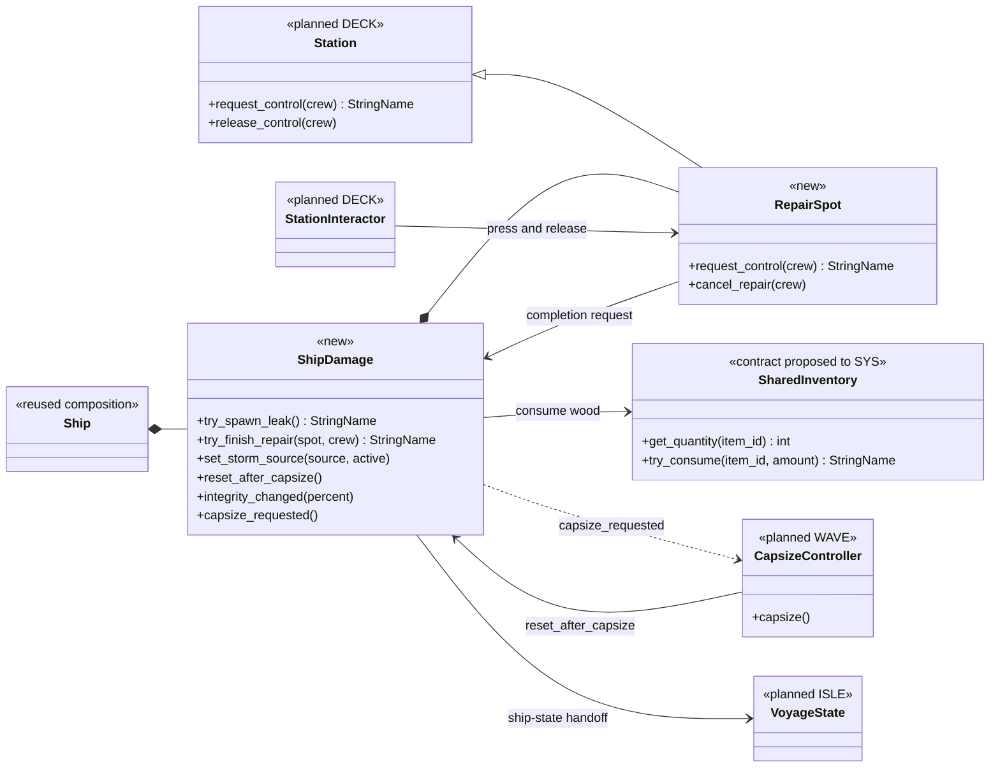
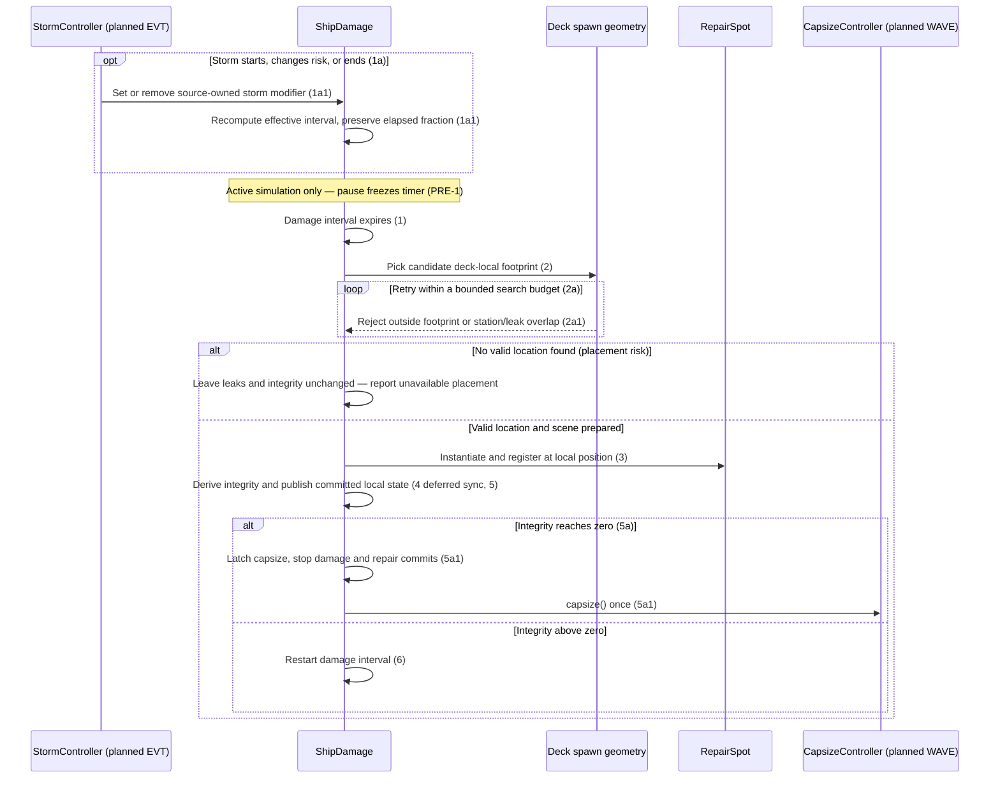
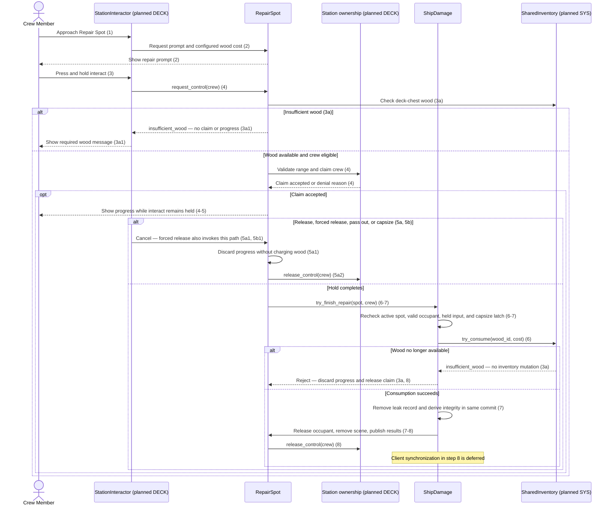

# Ship Damage & Repair Design

> **Scope (2026-10-20):** The current milestone is single-player. Host/client synchronization, LAN sessions, joint actions, and multi-player capacity are retained only as deferred co-op design. Local gameplay uses the local simulation as authority. Planned behavior is not a claim of implementation; see [scope and status](../requirements/vision-and-scope.md#43-mvp-scope).

**Project:** Holy Ship
**Team:** Team 13 (Gaming)
**Area:** `SHIP`
**Status:** Proposed design for review; damage and repair are not implemented.
**Draft date:** 2026-10-14

> **Realizes:** `UC-SHIP-take-damage`, `UC-SHIP-repair-damage`, for the current single-player scope; multiplayer-only steps are explicitly deferred below.
> **Depends on:** `BR-damage-interval`, `BR-capsize-conditions`, `BR-capsize-reset`, `BR-repair-cost`, `BR-station-slots`, `BR-single-station-occupant`; architecture decisions `KD-local-first`, `KD-station-components`, `KD-deployment-shape`.
> **See:** [use cases](../requirements/use-cases.md#area-ship-damage--repair-ship), [business rules](../requirements/business-rules.md), [specification](../requirements/software-requirements-specification.md), [architecture-of-record](architectural-design.md), [DECK](deck.md), [WAVE](WAVE.md), [EVT](EVT.md), [SYS](SYS.md), [ISLE](isle.md).
> **Designed against:** `1647a26` (`origin/main`, Merge pull request #27); the scripts/scenes on the inspected design branch match that baseline. Neighboring designs were read at `a74b0dc` and describe proposed interfaces, not implemented APIs.

_This is one design-of-record for the SHIP area. It describes how the use cases will fit the existing game before implementation. New components and proposed changes are identified separately from reused code. Team review is required before building from this design._

## Overview

_[Describe this area's responsibility, its component boundary, and the other areas it calls. Cite requirements instead of duplicating them.]_

SHIP owns the active leaks and the integrity derived from them inside the [Game Application](architectural-design.md#51-containers). A ship-local damage controller schedules leaks and creates repair stations on the moving deck. Repairs use DECK's planned station claim/release interface and ask SYS's planned shared-inventory owner to spend wood. SHIP sends an integrity-based capsize request to WAVE; it does not implement a second capsize/reset system. EVT supplies storm state and WAVE/NAV supply the conditions that affect damage frequency. Existing `Ship`, `ShipMotion`, player station ownership, and inventory methods are foundations only: no current code spawns leaks or repairs them. The architecture component row is updated with this design's boundaries.

The use cases describe Host/client synchronization and joint repair, but [AGENTS.md](../../AGENTS.md) establishes single-player scope. Damage step 4 and the synchronization portion of repair step 8 have no network implementation here. Repair extension 4a is recorded as deferred, not claimed as completed or silently removed. The owner confirmed this scope on 2026-10-20; `OI-8` now tracks only deferred joint-repair details.

## Components & classes

_[One diagram for the area; identify new, reused, and proposed external components. Method names below define intended contracts, not existing code.]_

- `scripts/ship/ship_damage.gd` (new): `ShipDamage`, the sole owner of the leak registry, damage scheduler, completion commit, and integrity notifications. Added as a child of the ship. Uses Inspector-configurable durations, wood cost, repair scene, and cross-area references. Integrity is computed from registered open leaks rather than maintained by each spot.
- `scripts/stations/repair_spot.gd` and `scenes/stations/repair_spot.tscn` (new): one lightweight leak marker, prompt, and progress indicator. Extends the **planned** `Station` in [deck.md](deck.md); the current `ShipStation` is a single-operator sailing adapter and is not a completed replacement for that dependency. The spot advances hold progress only while its occupant remains valid and interact stays held.
- [scenes/ship.tscn](../../scenes/ship.tscn) (changed in future implementation): adds `ShipDamage`, a child container for repair spots, and explicit spawn-clearance geometry for stations/obstacles. Existing `DeckBoundary/CollisionPolygon2D` supplies the deck outline; a spot's entire footprint must fit inside it, not just its origin.
- [scripts/ship.gd](../../scripts/ship.gd) (reused composition, future change): wires dependencies and performs SHIP state handoff through ISLE's planned Voyage State when changing scenes. It does not gain a second integrity counter or repair timer.
- [scripts/sailing/ship_motion.gd](../../scripts/sailing/ship_motion.gd) (reused): supplies ship orientation and sail state for storm risk. Damage logic does not change propulsion or steering.
- DECK's `Station` / `StationInteractor` (planned dependency): retain their ownership and input responsibilities. Extend the existing design's forwarded press/release contract for Repair Spots; do not add a competing global E-key reader. Releasing E cancels a repair; the player does not need a second E press to leave it.
- SYS's `SharedInventory` (proposed dependency contract, filename not assigned here): exposes quantity and atomic consumption from the **deck chest**, without claiming the chest UI station. [PlayerInventory](../../scripts/inventory-system/player_inventory.gd) demonstrates quantity/removal operations, but a player's personal inventory is not the required wood source. SYS.md is still a template; this interface needs its owner's agreement.
- WAVE's `CapsizeController` and EVT's `StormController` (planned dependencies): reuse the contracts proposed in their designs. SHIP reports zero integrity; WAVE performs the reset. EVT activates/removes its own storm source and never edits leak records directly.
- ISLE's `VoyageState` (planned dependency): retains ship-side leak records and scheduler state across scene changes. This is session memory, not saved-game storage. Scene nodes are reconstructed from data, not stored as stale references.

## Sequence

_[Label interactions with use case steps. Alternatives cover implemented-scope extensions; deferred flows are identified explicitly.]_

### UC-SHIP-take-damage: Spring a leak or take damage

For extension **1b**, collision damage remains conditional on the team's unanswered use case question. If approved, NAV submits a collision-triggered call to the same `try_spawn_leak()` path (steps 2–5); it does not create another integrity mutation or restart the periodic interval. Collision detection and contact debouncing belong to NAV. No collision behavior is enabled by this document alone.

Spawn selection uses ship-local geometry so leaks move with the deck. A rejected candidate never reduces integrity. The implementation must avoid an unbounded retry loop on a crowded deck: fail without mutation and retry on a later scheduled interval, logging a placement warning. The layout must be validated to accommodate the rule's 20 leaks; inability to do so blocks acceptance (`OI-9`), rather than justifying overlapping leaks or silently changing the capsize threshold.

### UC-SHIP-repair-damage: Repair ship damage

Extension **4a (joint repair)** is deferred under the current single-player instruction. DECK's proposed multi-slot API can be reused if that scope is later approved, but this design does not add networking, additional players, or a joint-repair multiplier. Its eventual acceptance must retain one wood charge per completed leak. The bonus and behavior when one contributor releases remain questions in `OI-8`.

Station removal, crew removal, range exit, pass-out notification, and capsize all cancel progress and release ownership. Pausing freezes progress; if interact is no longer held when simulation resumes, cancel before advancing or committing. A missing SURV pass-out implementation is an external dependency, not a reason to invent a second health state in SHIP.

## API contract

_[Local GDScript methods, scheduled updates, and signals replace web endpoints. These contracts are proposed until implementation and cross-area review.]_

Use the [architecture's error convention](architectural-design.md#821-error-handling): a `StringName`, `&""` on success, otherwise a reason code displayed by the caller. Rejected mutations leave inventory, leak registry, and integrity unchanged. Release/cancellation can still clear transient progress and ownership.

| Method, job, or signal | Caller (who may) | Request | Success | Rejection / extension behavior |
|---|---|---|---|---|
| Damage scheduler update | ShipDamage, active unpaused simulation | Elapsed simulation time; effective interval | At most one leak creation attempt per update; restart interval after attempt | Invalid/nonpositive configuration: `invalid_configuration`, disable scheduler with diagnostic; no catch-up burst after a stall |
| `ShipDamage.try_spawn_leak()` | Damage scheduler; NAV only if collision extension approved | Trigger context; placement is selected by SHIP | Register one prepared spot and derive integrity; notify after commit | `unavailable` during reset/inactive session, `no_valid_location` (2a exhausted), `invalid_configuration` for missing scene/geometry; no partial leak |
| `ShipDamage.set_storm_source(source, active)` | EVT StormController | Stable source identity and enabled state | Idempotently add/remove that source; intervals follow risk state | An old source's removal cannot remove another source; overlap gameplay policy remains EVT-owned |
| Effective storm risk input | WAVE/NAV owners | Agreed diagonal-to-wave predicate and current sail deployment | SHIP selects configured normal/safe-storm/unsafe interval | No separate angle formula in SHIP; missing storm inputs/configuration block integration (`OI-5`) |
| `RepairSpot.request_control(crew)` | DECK StationInteractor | Candidate crew | Check funds/configuration then delegate to Station claim; begin hold only after acceptance | `insufficient_wood` (3a), `unavailable`, or DECK's range/busy/occupancy reason; no failed claim starts progress |
| `RepairSpot.cancel_repair(crew)` | Input release or Station/crew lifecycle | Current occupant | Clear elapsed progress and release crew; safe to repeat | No wood charge; unrelated callers cannot release another occupant (5a/5b) |
| `ShipDamage.try_finish_repair(spot, crew)` | Registered RepairSpot whose hold completed | Spot identity and current crew | Validate, consume once, remove one leak, notify and release | `unavailable` for removed spot/reset, `busy` for invalid claimant, `insufficient_wood` for failed final funds check; duplicate completion never charges twice |
| `SharedInventory.try_consume(item_id, amount)` (SYS proposal) | ShipDamage through SYS's API | Registered wood ID and positive configured amount | Exact amount removed, returns success | Insufficient stock or invalid ID/amount: reason code, unchanged inventory; must not emit callbacks midway through SHIP's commit (`OI-7`) |
| `ShipDamage.integrity_changed(percent)` | ShipDamage after a committed change | Derived integrity | Observers update presentation without writing integrity | No continuous drain; one coherent notification per committed change |
| `ShipDamage.capsize_requested()` | ShipDamage on first zero-integrity transition | None | Calls WAVE's proposed `CapsizeController.capsize()` | Latched until reset; stop further damage/completions immediately (5a) |
| `ShipDamage.reset_after_capsize()` | WAVE CapsizeController | None | Cancel repairs, release claims, clear spots, restore derived full integrity, reset damage clock/latch | Safe to repeat; do not spend wood or reset EVT's source ownership |
| SHIP snapshot/restore through Voyage State | Ship scene handoff only | Plain leak records and scheduler state | Rebuild same leak layout and integrity on return | No stored Node references; malformed/duplicate/out-of-deck records rejected before applying a snapshot |

## Key decisions

_[Proposed choices and rejected alternatives; team approval remains separate from this draft.]_

**Derive integrity from open leaks.** Use the registry and `BR-capsize-conditions` as the sole source. Reject an independently decremented health variable: failed spawns, repeated repairs, or capsize cleanup could otherwise make the health value disagree with visible damage. Leak records are retired synchronously even if scene deletion is deferred.

**Use DECK's station contract.** Implement repair as a hold-based station extension. Reject a standalone E-key listener and direct writes to the player's `using_station`: those bypass the existing single-station rule and compete with sailing/cooking input. DECK must route releases and forced cancellations through the spot even when normal prompts disappear.

**Charge on completion, with a final funds check.** Reject charging on press because releasing interact must cancel without spending wood. No reservation is required for this local design. Prevalidate spot, crew, cost, and references; prepare the scene cleanup; then perform the inventory decrement and leak retirement synchronously with no `await`, signals, or fallible resource loads between them. Notify observers only afterward. SYS must support this transaction boundary; using an API that emits synchronous callbacks midway is not sufficient. This supplies the use case's all-or-nothing behavior without adding a database.

**Keep one pause-aware damage clock.** Use an elapsed fraction of the effective interval so entering a storm shortens the remaining real time without resetting accumulated progress or instantly spawning a backlog. Require normal interval > safe storm interval > unsafe storm interval, and combined unsafe conditions no safer than either alone. Reject another storm-owned timer or resetting on every risk change, which could duplicate damage or let repeated changes postpone it forever. Numeric intervals and WAVE's diagonal predicate remain open.

**Latch capsize before allowing repairs to rescue a zero-integrity ship.** Damage creation checks its threshold in the same commit, immediately blocks further completions, and delegates reset to WAVE. Reject repairing the twentieth leak after the threshold has already fired. Proposed physics ordering is risk-state update, due damage, then repair completions; a pause/forced cancellation takes precedence over progressing work. WAVE must apply the same latch when stability triggers capsize (`OI-7`).

**Preserve session state across island scene changes.** Use ISLE's proposed Voyage State rather than silently clearing leaks when the ship scene is freed. Cancel active holds at handoff and reconstruct only durable-in-session records, never occupants/progress. Disk saving and crash recovery are outside this design. Whether damage time advances while the ship is unloaded/crew are ashore is a gameplay question (`OI-9`), not an implicit choice made by scene destruction.

## Data model

_[Describe the new in-memory data and ownership; there is no database migration.]_

| State | Owner | Invariant / lifetime |
|---|---|---|
| Open leak records: identity and ship-local position | ShipDamage; retained through Voyage State handoff | One unique record per active spot; valid footprint; registry is authoritative even before queued scene deletion completes |
| Integrity | Derived by ShipDamage | `max(0, 100 - 5 * open_leak_count)` from `BR-capsize-conditions`; no separate per-frame drain |
| Elapsed damage fraction and configured intervals | ShipDamage | Pause-aware; one scheduler; reset after capsize, retained on scene handoff subject to ashore policy |
| Active storm source identities | EVT supplies, SHIP tracks its modifiers | Removing a source changes future frequency only; it does not repair existing leaks |
| Hold elapsed time and current occupant | RepairSpot / DECK Station | Transient; discard on cancellation, removal, handoff, or capsize; do not serialize player Node references |
| Capsize pending latch | ShipDamage coordinated with WAVE | Once set, no new damage/repair commits until reset completes |
| Wood quantity | SYS shared deck-chest inventory | SHIP never edits a parallel quantity dictionary; actual item ID and positive cost need agreement |

Only a leak has persistent-in-session identity; no new inventory or crafting system is introduced. The wood definition must be added by the item-catalog owner: the current catalog contains Cod, Rope, Fishing Rod, and Coconut, not Wood. A description saying Rope is useful for repairs is not permission to substitute Rope for the required wood.

## Reuse & cross-cutting

- [Error handling](architectural-design.md#821-error-handling) and [validation](architectural-design.md#825-validation): owners return reason codes; prompts are advisory and completion rechecks state.
- [Time](architectural-design.md#822-time-and-time-zones): simulation time only; pause freezes damage and holds. Do not use wall-clock deadlines.
- [API conventions](architectural-design.md#823-api-conventions) and [code conventions](architectural-design.md#824-code-conventions): typed GDScript, signals after coherent commits, exported configuration, and reusable placeholder scenes.
- [Configuration](architectural-design.md#826-configuration-and-secrets): tune intervals, hold duration, and wood cost in the Inspector after approval; do not invent numerical commitments in scripts or this document.
- [Persistence and concurrency](architectural-design.md#828-persistence-and-concurrency): one local mutation owner and an explicit shared-inventory transaction boundary; no database, network service, or save format.
- [Testing](architectural-design.md#8210-testing): control the clock and random seed in tests. Run existing sailing integration after implementation to check that station and ship changes preserve existing gameplay.
- DECK supplies eligibility/ownership; SURV supplies pass-out notifications; WAVE supplies capsize/reset and the agreed storm-risk predicate; EVT supplies source-owned storm activation; SYS supplies chest consumption; ISLE supplies scene handoff. These are dependencies to implement/agree, not working integrations today.

## Tests

_[Planned acceptance tests, not results from existing SHIP code. Every use case extension is accounted for, including explicitly deferred scope.]_

| Use case, flow | Level | Asserts |
|---|---|---|
| `UC-SHIP-take-damage` main | Integration | One expiry creates exactly one valid deck-local spot; derived integrity changes once; timer restarts; rotating/moving ship carries the spot with it. Step 4 network sync is deferred. |
| `UC-SHIP-take-damage` 1a | Unit + integration | Approved normal/storm/unsafe intervals obey the ordering; changing conditions preserves elapsed fraction; source removal restores appropriate frequency without removing leaks. |
| `UC-SHIP-take-damage` 1b | Integration, conditional | If collision damage is approved, one accepted NAV collision event uses the same spawn/threshold path without restarting the periodic clock; no collision behavior is claimed before that decision. |
| `UC-SHIP-take-damage` 2a | Unit + scene integration | Reject station/spot overlap and footprints crossing deck edges; retry valid candidates; exhausted bounded search causes no partial mutation or hang; actual layout supports 20 spots. |
| `UC-SHIP-take-damage` 5a | Integration | Twentieth leak triggers capsize once; further timer/repair callbacks cannot change state until reset; WAVE invokes cleanup and full integrity returns. |
| `UC-SHIP-repair-damage` main | Integration | Valid claim shows cost/progress; holding for configured duration charges deck chest once, removes one spot, restores integrity once, and releases crew. Personal inventory unchanged; sync portion of step 8 deferred. |
| `UC-SHIP-repair-damage` 3a | Unit + integration | Insufficient wood rejects before claim; wood removed elsewhere during the hold also causes completion failure, leaves leak/integrity unchanged, and releases crew without charging. |
| `UC-SHIP-repair-damage` 4a | Deferred multiplayer acceptance | Not implemented in this single-player design. If approved later: extra valid contributors increase speed, one charge per leak, and occupancy respects `BR-station-slots`; multiplier/release semantics require agreement. |
| `UC-SHIP-repair-damage` 5a | Integration | Releasing before completion discards progress, releases movement, and spends no wood; restarting begins at zero. |
| `UC-SHIP-repair-damage` 5b | Integration with SURV/WAVE adapters | Pass-out or either capsize trigger cancels repair without charging, clears progress, and releases crew; duplicate callbacks are harmless. |
| Pause and input lifetime | Integration | Timer/progress freeze while paused; released input during pause cancels on resume; range exit, scene exit, and station removal cannot leave a stuck claim. |
| Atomic completion and replay | Integration with SYS adapter | Invalid configuration/failed consumption leave all durable state unchanged; repeated completion charges once; observers see only the completed combined state. |
| Simultaneous expiry/completion | Integration | Approved update ordering gives capsize precedence once either threshold is reached; an old timeout cannot recreate leaks during reset. |
| Scene handoff/reset | Integration with Voyage State | Ship-to-island-to-ship preserves leak identities/positions and integrity; interrupted holds do not resume; reset clears stored as well as visible damage. Ashore clock behavior waits for `OI-9`. |

## Changes to the architecture-of-record

- Update section 5.2's SHIP row from the obsolete rescue/floating-chest scope to damage and repair, link this design, and name planned shared-inventory, weather, capsize, and Voyage State dependencies.
- Clarify that SHIP owns integrity/leaks while Ship State continues to own movement, docking, and anchoring. No new process, container, networking architecture, or persistence service is added.

## Open questions & risks

_[Questions requiring a team decision are mirrored in OPEN-ISSUES.md. A complete draft is not approval to guess unresolved gameplay or dependency contracts.]_

| Issue | Decision needed | Owner / implementation consequence |
|---|---|---|
| `OI-5` | Normal/storm/unsafe intervals, combined penalties, and WAVE's diagonal predicate | SHIP + EVT + WAVE/NAV owners; preserve rate ordering without inventing numbers. Proposed elapsed-fraction transition needs review. |
| `OI-6` | Whether collisions cause damage; wood cost and item ID; exact solo duration within the use case's approximate 3–5 seconds | Team + NAV/SYS owners; do not enable collisions or substitute another material without agreement. |
| `OI-7` | SYS chest-consumption transaction, DECK hold/cancel hooks, WAVE capsize latch/reset ordering | SHIP + dependency owners; interfaces here are proposals. SYS is still a template; no atomic shared-inventory implementation exists. |
| `OI-8` | Single-player scope versus Host/client and joint-repair requirements | Team; current draft defers synchronization and extension 4a. If joint repair returns, decide bonus and partial contributor departure behavior first. |
| `OI-9` | Damage while docked/ashore, island state handoff, and valid-placement behavior when space is exhausted | Team + ISLE/WAVE/DECK owners; do not let scene unload erase damage or silently choose whether the voyage keeps taking damage. Validate deck footprint capacity before implementation acceptance. |

Risk: neighboring designs propose methods that do not yet exist. Use adapters/fakes for unit tests, but do not label end-to-end integration complete until the real owners implement the agreed contracts. Repair geometry can also become invalid when stations are moved; scene validation must run with the actual deck layout.

## Working this document with your agent

_Use this document with the SHIP use cases, cited business rules, architecture section 8, and the current code. Review proposed choices with the team before implementation. Do not expand scope into crafting, networking, or saving; implement the approved local behavior through the named ownership boundaries._

## The questions test (before you open the pull request)

The following is the drafting pass's self-check, not a claim that the template's independent fresh-session questions test or teammate approval has happened. Before implementation, perform that separate review and include its answers in the PR description as the template directs.

| Question an implementer could otherwise guess | Answer / review status |
|---|---|
| Which source owns integrity? | Fixed in this draft: derive it from SHIP's open-leak registry; other areas request changes rather than edit it. |
| Is a spawn valid if only its center is inside the deck? | No; validate the full footprint and station/leak clearance in ship-local coordinates. Bounded failure has no damage side effects. |
| Can repairs consume the player's Rope instead of chest Wood? | No; shared-chest wood is required. Catalog ID/cost and SYS interface remain `OI-6`/`OI-7`. |
| What if wood disappears or completion fires twice? | Recheck at commit, reject without mutation on insufficient stock, and retire spot identity before notifications; a duplicate cannot charge again. |
| Can a repair undo an already-triggered capsize? | No; capsize is latched before further completions. Cross-owner update/reset order still needs `OI-7` agreement. |
| Does a storm reset the damage clock or clear leaks? | No; proposed elapsed-fraction preservation and source-owned removal affect frequency only. Tuning/predicate remain `OI-5`. |
| Can an island scene change repair the ship for free? | No; retain plain damage records via Voyage State. Whether damage continues while ashore remains `OI-9`. |
| Should client sync or joint repair be implemented now? | No under current project instructions; explicit requirements reconciliation remains `OI-8`. |
| Are numerical tuning and collision damage already approved? | No; `OI-5` and `OI-6` require team answers before implementation can satisfy those flows. |

The document covers both use cases and all their extensions as a reviewable design. The open decisions above prevent claiming the full design is implementation-ready; they are not filled with arbitrary defaults.
