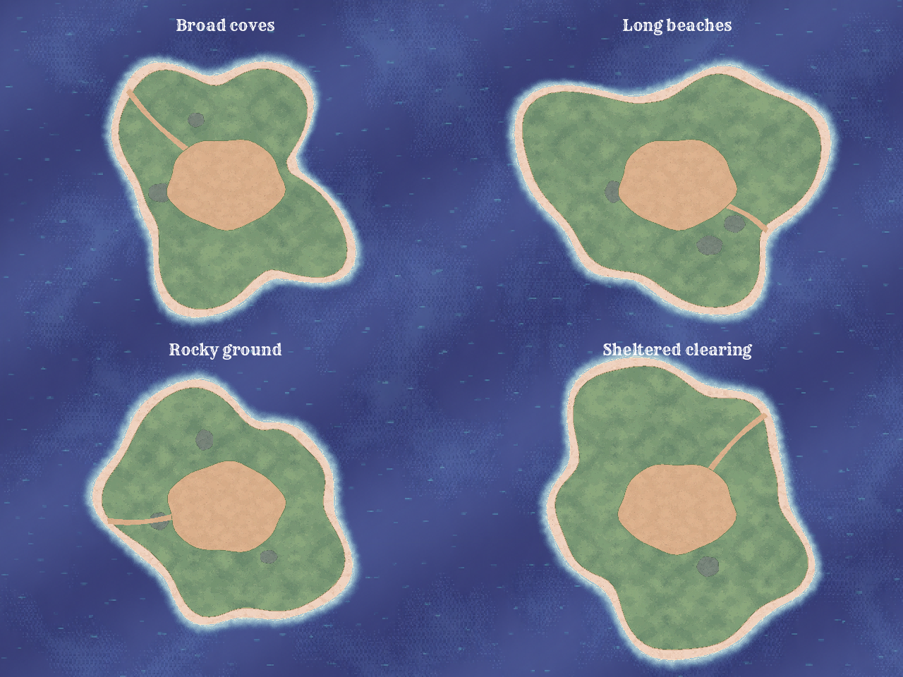

# Generated islands

Implemented on `codex/procedural-islands`, without merging into `systems-revamp`. The forestry follow-up uses protocol 22 and its matching relay. See [forestry](island-forestry.md) for the current playtest behavior and [release/rollback](networking-release-rollback.md) for deployment IDs.

## Art and world

- New voyages use layout version 2: 30 seeded ordinary islands, three key sanctuaries and Paradise in a 48,000 × 48,000 world (four times the previous map area).
- Ordinary coastlines use 96 vertices and varied lobes, orientation and dimensions. Beach, grass, shallow water, flat rocky patches surround an open clearing. Paths were removed in the forestry follow-up, which adds animated trees and bushes. Ore remains separate future work.
- Each ordinary island reserves a 1,120 × 760 clear rectangle inside the larger visible dirt clearing. The existing totem sits inside it. Minigames still open their existing private viewport; converting them into activities played directly on the island is separate work.
- Land collision, swimming access and map outlines use the same generated coastline. Placement enforces water gaps, navigable starting ocean and safe map boundaries.

## Performance and multiplayer

Terrain is built once from the world seed and layout version. No terrain vertices or textures are sent in ongoing snapshots. Both host and guest generate the same coastlines. Layout versions outside 1–2 are rejected by snapshot validation.

Terrain uses static Polygon2D layers sharing one atlas, nearest sampling and a narrow shoreline strip. There are no terrain process callbacks or full-world water meshes. Land queries reject points outside cached bounds; shark navigation caches static island outlines. A loading overlay is shown before world creation and stays through a guest's first valid snapshot. Generation is synchronous and short in the measured desktop case; the overlay is not a background loading thread.

Legacy saves without a layout version load the original generator and retain original islands, positions and dropped items. Resaving preserves version 1. Start a **new voyage** to see generated islands; resuming an old save intentionally shows the old terrain.

## Validation and preview

Godot 4.7.2 Compatibility renderer:

- Generated-island suite: 4,218 checks, including six seeds, spacing, safe bounds, deterministic shapes, clearings and legacy switching.
- Save compatibility: 10 checks, including protocol-20 save restoration, dropped key coordinates and identical generated coastline after resume.
- Responsiveness: 86 checks; survival: 84; island totems: 218; world interactions: 32. Smoothing suite passed.
- Three-player local relay: 84 checks, including matching guest terrain. Exported browser host/join, direct WebRTC and relay fallback passed.
- Native world generation measured approximately 19–20 ms; 284 terrain polygons across the 30 ordinary islands in the captured seed.
- Browser sample at 1280 × 720 on Intel UHD integrated graphics: median frame interval 12.1 ms in ocean / 12.2 ms beside an island; island p95 18.2 ms. These are local measurements, not a phone performance guarantee. Physical phone/Safari and longer cross-network playtests remain necessary.

Run **Project → Run Project (F5)**, then **Play → Sail Offline** for a new world. The developer teleport to the nearest island makes art inspection faster. For multiplayer use this branch's matching protocol-22 relay and web export.

## Artwork provenance

`assets/terrain/island_materials.png` was generated with the built-in image-generation tool, using `assets/island_large.png` and `assets/island_pixel.png` as style references. No new package, hosted service or runtime AI dependency was added. The actual output is 1,254 × 1,254 pixels; each quadrant is 627 pixels square. Quadrants are grass (top left), beach sand (top right), rocky ground (bottom left), and clearing dirt (bottom right). Mirrored sampling and a second offset sample reduce visible source seams/repetition. Preserve the quadrant arrangement when replacing the artwork.

Generation prompt (the requested dimensions differ from the actual tool output; shader UVs handle the actual dimensions):

> Create a production game TERRAIN MATERIAL ATLAS, using the two provided Holy Ship island pictures as STYLE AND PALETTE REFERENCES ONLY. This is a new reusable terrain texture asset, NOT a full island illustration. Square 1024x1024 image, exactly four equal square quadrants, no gutters, no frames, no words. Top-left quadrant: muted sage/olive green grass ground, sparse tiny grass blade marks and clustered pixel dithering, subtle broad variation, matching the reference island interior. Top-right quadrant: pale warm peach cream beach sand, sparse tiny darker grains and gentle sand ripple clusters, matching the reference beach. Bottom-left quadrant: flat weathered gray-green rocky GROUND, small interlocking angular stone texture and shallow cracks, low contrast, no raised boulders or ore. Bottom-right quadrant: slightly darker warm tan compact sandy earth with subtle tiny flecks, for an open minigame clearing. Every quadrant must fill its entire square with its own material and be independently seamless/tileable on all four edges. Consistent exact top-down orthographic 2D pixel art, restrained hand-placed crisp pixel clusters, no antialiasing, no gradients, no blur. Pixel density like a 128x128 logical tile enlarged to each 512x512 quadrant with nearest-neighbor scaling. Keep details small and understated so these will look good across large ground areas without distracting repetitions. Match the quiet blue-green and pale peach palette and dither technique of the original island. Absolutely NO trees, bushes, flowers, ore, scattered objects, buildings, characters, water, shorelines, cliffs, shadows of objects, UI, text, grid lines, or big identifiable motifs. Polished cohesive game art, low contrast readable walkable surfaces.
