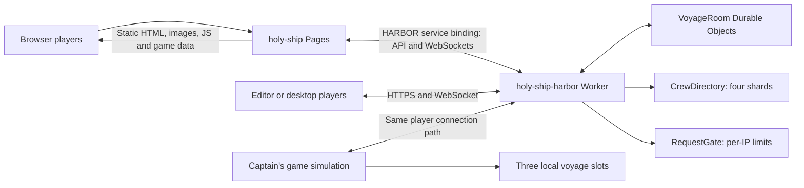

# Holy Ship multiplayer system and operations guide

Implementation reference as of November 15, 2026. Start here to understand the
system; use [release setup](online-services-setup.md) for setup and
[multiplayer testing](multiplayer-testing.md) for the play-test checklist.

For implementation and testing details of the latest client prediction and
browser departure changes, see [Networking responsiveness](networking-responsiveness.md).

## 1. What runs where

Holy Ship is a Godot 4.7.2 game using GDScript and the Compatibility renderer.
The browser build uses the non-threaded Web export templates. Up to four
players share one voyage, including its captain.

| Component | Cloudflare name/location | Responsibility |
| --- | --- | --- |
| Website and browser game | Pages project **holy-ship**, https://holy-ship.pages.dev | Landing page and downloadable browser game files |
| Multiplayer backend | Worker **holy-ship-harbor** | Crew discovery, admission and WebSocket relay |
| Live gameplay server | Captain's browser, editor, or desktop game | Simulates the boat, players and shared gameplay |
| Guest client | Each joining player's game | Sends input/actions and displays the captain's state |
| Hosted voyage save | Captain's local device/browser storage | Remembers supported voyage state between sessions |

**Keep both Cloudflare projects.** Pages is the front door; the harbor is the
multiplayer service behind it. Deleting the harbor breaks joining and hosting.
It also breaks the browser engine download because the compressed WebAssembly
response currently comes through the harbor.

In Cloudflare, select the account containing the existing game projects, open
**Workers & Pages**, and search `holy-ship`. Refresh the dashboard if a newly
deployed project is missing. Both names should appear. No paid custom domain is
configured. The `pages.dev` address is the public address to share.



The captain is one of the browser/desktop players in this diagram, not a third
Cloudflare service. The relay forwards messages; it does not run Godot physics.

## 2. Why players do not need IP addresses or ports

Every player opens an outbound encrypted WebSocket connection to Cloudflare.
The relay routes messages between the captain and guests. Players do not need
to share Wi-Fi, configure router port forwarding, or install EOS. Their network
must still permit HTTPS/WebSockets and they need a working internet connection.

Browser code derives the backend address from `window.location.origin`, keeping
requests on `holy-ship.pages.dev`. `web-site/_worker.js` forwards `/api/*` and
`/play/index.wasm` through the `HARBOR` service binding. Other files are served
directly by Pages without running that function. The forwarding code checks
browser Origin before adapting it to the backend URL.

Editor and native builds use `network/harbor_url` in `project.godot`, currently
the harbor's `workers.dev` URL. Both paths reach the same crews and protocol.
The old EOS and LAN code remains for history/legacy uses, but it is not the
current player-facing online flow. Native EOS imports are disabled with
`.gdignore`, and its libraries/credentials are excluded from exports.

## 3. Hosting a voyage

1. The player enters a sailor name on the title screen and opens **Sail with a
   crew**. The menu starts on **Browse crews**.
2. On **Host a voyage**, they enter a voyage name and choose Public or Private.
   Public is the default. Private reveals an empty password field; the player must enter a password. Private voyages are still listed, but joining
   requires the password. This is password protection, not an invite-only list.
3. `HarborService` sends `POST /api/crews` with the title, password, protocol and
   locally stored sailor token. The backend validates input and rate limits.
4. The backend creates a room with a random ID and issues a short-lived,
   single-use connection ticket. The captain connects to `/api/socket/{id}`.
5. `HarborPeer` receives the welcome message and peer ID **1**. Godot's
   `NetworkSession` assigns this peer as the server and loads the sailing world.
6. The captain's supported saved voyage state is restored automatically when
   available. The room publishes its name, occupancy, privacy and protocol into
   the directory so other players can find it.

The captain must keep the device awake and the browser game in the foreground.
Browsers may throttle background tabs. Closing or losing the captain ends the
session; there is no automatic captain migration or always-running cloud world.

## 4. Browsing and joining

1. `GET /api/crews` gathers current listings from four directory shards. The
   menu refreshes every 15 seconds while browsing, and supports manual refresh.
2. Selecting a voyage sends `POST /api/crews/{id}/join`. Private voyages ask for
   their password first.
3. The room checks protocol, password, duplicate sailor identity and capacity.
   Pending tickets count toward the four-player limit. Reservations happen in
   a transaction so simultaneous joins cannot take the same last slot.
4. A successful reservation returns a one-use ticket valid for 30 seconds.
   `HarborPeer` connects and receives a unique peer ID and room membership.
5. Godot's hello/welcome exchange checks the game protocol and initializes the
   guest's world. Subsequent snapshots bring the client up to date.

The current protocol is `holy-ship-coop-6`. The Worker configuration and
`NetworkSession.PROTOCOL` must agree. A protocol mismatch requires a refreshed
browser game or matching desktop build; do not silently accept incompatible
packet layouts.

For grill controls, fuel rules and implementation details, see [the shared grill guide](shared-grill.md).

## 5. How gameplay stays synchronized

The captain is authoritative: guests request actions rather than independently
deciding shared results. This prevents ordinary races such as two players both
taking the same chest item. It does not make the captain untrusted or provide a
competitive anti-cheat system: a modified host still controls its simulation.

| Shared state | Handling |
| --- | --- |
| Boat position, rotation, wind and sailing stations | Captain simulates; guests display snapshots |
| Crew movement and station use | Guests send input/actions; captain resolves ownership and motion |
| Inventory and chest transfers | Captain processes requests and distributes resulting inventory state |
| Dropped items and pickups | Captain owns shared drops and pickup results |
| Fishing line, bobber, fishing state and catches | Replicated by the gameplay session |
| Shared grill, fuel and cooking progress | Captain simulates one grill; requests validate range, inventory revision and unique fish ID |
| Swimming and land movement | Part of the shared player/world state |
| Camera, spyglass view and UI | Local to each player |

Input updates and world snapshots run at 20 Hz. The host compresses each
snapshot once before distributing it. Guests interpolate received movement;
local movement is predicted immediately and reconciled against acknowledged inputs. Opening pause does not pause
the shared simulation.

Clients keep up to 120 physics frames of predicted positions and station angles.
Host snapshots include the last accepted input sequence. Small position errors
are eased out; boarding/station transitions and large corrections reset the local
prediction. Sail trim and helm respond locally, while observers interpolate them.
Input direction changes are sent immediately between the regular 20 Hz updates.
Prediction does not move inventory/catch authority to the client or eliminate
WebSocket latency and corrections on poor connections.

`HarborPeer` adapts Godot's multiplayer API to WebSockets with a 12-byte packet
header (source, destination, channel, transfer mode and reserved bytes). The
relay overwrites the claimed source using the connection's assigned identity.
Guests can address only captain peer 1; they cannot impersonate the captain or
send arbitrary packets directly to other guests.

WebSocket transport is ordered and reliable underneath Godot's transfer modes.
Marking a snapshot unreliable does not turn this into UDP. The adapter discards
stale outgoing unreliable traffic when congested, uses bounded queues, and
disconnects clients that fall too far behind. This limits queue growth but does
not eliminate latency on a slow connection. Shared floor stacks are capped at
256; refused drops leave the item in inventory.

## 6. Identity, saves and storage

No Epic login, email account or cloud-save account is required. The game creates
a random persistent sailor token, separate from the editable display name. The
backend derives an identity from that token. Treat the token as a credential;
it is sent in HTTPS request bodies, not placed in public crew listings.

| Data | Location and lifetime |
| --- | --- |
| Sailor identity | Desktop `user://crew_identity.cfg`; browser token `localStorage[holyShip.identity]` |
| Hosted voyage | Desktop `user://voyage-slot-0.save` through `voyage-slot-2.save`; browser `holyShip.voyage.v1.0` through `.2` |
| Preferences | Local game/browser storage |
| Voyage name, room membership, password hash and connection tickets | Temporary room/directory data in Cloudflare Durable Objects |
| Abuse-prevention counters | Temporary per-IP hashed identifiers in Cloudflare |
| Gameplay packets | Relayed live; not stored as a gameplay history database |

The host saves every 20 seconds and on graceful leaving, and remembers guest
inventories on departure. Saves contain boat position/rotation, shared chest,
ship drops and remembered crew inventories. They are not a complete snapshot
of every transient system: an active fishing minigame, for example, is not a
durable cloud activity. Save files use a temporary file and rename for replacement.
The loader accepts save protocols 1 through 6.

In browser builds, world snapshots and identity use localStorage; other Godot preferences use browser storage. Clearing site
data, using a different browser/profile, or changing website origin changes the
available identity/save. Moving from the old `workers.dev` site to `pages.dev`
does not automatically transfer those files. Two tabs in the same browser
profile share identity and cannot join the same voyage as two separate sailors.

Removing local saves would not reduce Cloudflare database reads or writes.
There is no cross-device save recovery, login recovery, or host save migration.
Use Godot's **Project > Open User Data Folder** to inspect native local data;
back up saves before manually changing or removing them.

## 7. Temporary server state and limits

The three Durable Object classes in `online-service/src/index.ts` are:

- **VoyageRoom:** one per voyage; handles admission, tickets, live sockets,
  packet routing, and room cleanup.
- **CrewDirectory:** four shards containing expiring listings, with a bounded
  result set per shard. Listings expire after 75 seconds unless refreshed.
- **RequestGate:** per-IP request limits for discovery, hosting and joining.
  Counters are temporary and cleaned up by an alarm.

Rooms refresh listings on membership changes and roughly every 30 seconds.
Disconnected hosts cause room closure and directory removal; expiry handles
stale listings. Client heartbeats occur every five seconds, with a 20-second
client silence timeout. Server alarms check for sockets silent for 60 seconds.
These are different safeguards, not a guarantee of immediate failure detection.

Normal exits additionally send a WebSocket `leave` message. Browser Back, reload
and tab closing send a one-time `pagehide` beacon to
`POST /api/crews/{id}/leave`. Its original connection ticket authorizes only that
connection's departure (the server retains its hash); delayed/repeated beacons
cannot close a later rejoin. Departed sockets are excluded from membership
immediately and their directory entry is updated. This adds no periodic polling.
Switching tabs does not send a departure. Crashes, lost internet and browser
shutdowns that suppress the beacon still rely on socket closure/timeouts.

Current application limits include eight host attempts per hour, 20 join
attempts per minute, and 30 browse requests per minute per IP. Players behind
the same public IP share these limits. API JSON is bounded to 2 KB. Socket
traffic is limited to 180 packets/second with separate host/guest byte budgets.
These checks reduce abuse; they are not a guarantee against all attacks.

Private passwords are chosen by the host, salted with the room ID and hashed. Tickets are
single-use and stored by hash. Browser-origin checks are defense in depth,
not authentication for arbitrary native clients. Never log connection tickets,
full identity tokens, Cloudflare OAuth tokens, or local credentials.

## 8. Free hosting and what usage means

The deployment uses a free Pages address and does not require a custom domain.
Confirm the account's Workers plan in Cloudflare billing before public rollout;
the service's deployment credentials are not proof of billing-plan status.

- A **database read** retrieves stored data, such as room metadata.
- A **database write** changes stored data, such as a listing or ticket.
- A **request/message** uses the network service even if it does not save data.
- **Compute duration** measures service execution/activity under Cloudflare's
  metering rules. It is separate from stored bytes.

Static files bypass Pages Functions except for the compressed engine route.
Gameplay packets use the room relay rather than writing a world save on every
frame. Nevertheless, active multiplayer consumes messages and processing time,
and browsing/admission/cleanup consume storage operations. Other projects on
the account may share account-level allowances. Free is not unlimited capacity.

Review current [Durable Objects pricing](https://developers.cloudflare.com/durable-objects/platform/pricing/)
and [Workers limits](https://developers.cloudflare.com/workers/platform/limits/)
before changing scale or advertising broadly. Do not estimate capacity solely
from website visits. On the Free plan, exhausted quotas can interrupt service;
do not enable a paid plan as an automatic troubleshooting step.

## 9. Source-file map

| File | Purpose |
| --- | --- |
| `scripts/network/crew_menu.gd` | Browse/host UI, refresh, private-password dialog |
| `scripts/network/harbor_service.gd` | HTTP calls, endpoint selection, connecting and leaving |
| `scripts/network/harbor_peer.gd` | Godot multiplayer/WebSocket adapter |
| `scripts/network/network_session.gd` | Gameplay authority, RPCs, snapshots, crew and saves |
| `online-service/src/index.ts` | Relay API and three Durable Object classes |
| `online-service/wrangler.jsonc` | Backend name, bindings, migrations, static assets and protocol |
| `web-site/index.html`, `style.css` | Landing-page content and appearance |
| `web-site/_worker.js` | Pages forwarding and Origin checks |
| `web-site/wrangler.jsonc` | Pages project and HARBOR service binding |
| `tools/build-web-site.mjs` | Assembles exported game/assets; gzip-compresses WebAssembly |
| `tools/build-pages-site.mjs` | Builds Pages output and function route restrictions |
| `tools/release-harbor.ps1` | Validates and prepares Web/Windows releases; does not publish |
| `export_presets.cfg` | Godot export settings and exclusions |

Generated outputs (`builds/`, `online-service/public/`, `web-site/dist/`),
dependencies, caches and `.local/` credentials are ignored by Git. Edit source
files, not generated output. The public URL and project names are configuration,
not secrets. Cloudflare deployment access stays with authorized team accounts.

## 10. Updating and publishing

This is a **direct-upload deployment**, not a Git-connected auto-build. Saving
in Godot or pushing a commit does not publish anything by itself.

### Full game release (PowerShell)

From the repository root, install dependencies once (or after lockfile changes):

```powershell
Push-Location online-service
npm.cmd ci
Pop-Location
```

Install matching Godot 4.7.2 export templates. The Web preset expects the
official non-threaded `web_nothreads_debug.zip` and `web_nothreads_release.zip`
in `export_templates/`. Keep engine and templates matched.

```powershell
powershell -File tools/release-harbor.ps1 -GodotPath "C:\path\to\Godot_console.exe"
```

This exports **Web Multiplayer** and **Windows Desktop**, assembles both site
outputs, type-checks the backend, and performs a deployment dry run. Inspect
`.godot/release-*.log` on failure. It does not update the live site.

Authenticate with Wrangler if needed, then deploy the prepared backend first
and the Pages frontend second:

```powershell
Push-Location online-service
./node_modules/.bin/wrangler.cmd login
npm.cmd run deploy
Pop-Location
Push-Location web-site
../online-service/node_modules/.bin/wrangler.cmd pages deploy dist --project-name holy-ship --branch systems-revamp --commit-dirty=true --force
Pop-Location
```

Login is only needed when credentials are absent/expired. `--force` selects the
Pages deployment path in the currently pinned Wrangler version, avoiding its
automatic migration to Workers. It does not mean resetting or deleting rooms.
The explicit production branch is `systems-revamp`; update deployment settings
and instructions together if that branch changes.

Backend deployment is necessary when backend code/configuration changes or when
the Godot engine/WebAssembly changes. Ordinary game `.pck`/scene changes can be
published to Pages alone after rebuilding. The full procedure above refreshes
both to avoid a mismatched engine. Keep protocol-breaking releases coordinated;
existing open tabs do not automatically become the new build. Ask testers to
end their voyages and reload. Backend updates may disrupt active sessions.

### Landing-page-only changes

Edit `web-site/index.html` or `style.css`. With an existing valid Web export:

```powershell
node tools/build-web-site.mjs
node tools/build-pages-site.mjs
Push-Location web-site
../online-service/node_modules/.bin/wrangler.cmd pages deploy dist --project-name holy-ship --branch systems-revamp --commit-dirty=true --force
Pop-Location
```

No Godot export is needed for text/CSS alone. This updates the canonical Pages
site. The old backend address may still serve its previous static assets; it is
not the public website to distribute. Never delete the backend to hide that URL.

### After publishing

Open `https://holy-ship.pages.dev/api/health` and check the expected protocol.
Load `/play/` in a fresh tab, host, join from another browser profile/device,
check shared gameplay, then check host departure. See the detailed testing guide.
Browser refresh updates the application files; clearing site data is a separate,
destructive action that also removes local identity/saves and is not a routine
update step.

## 11. Troubleshooting

| Symptom | Checks |
| --- | --- |
| Project missing in dashboard | Correct account, Workers & Pages, refresh, search `holy-ship`; look for both Pages and Worker |
| Site works but crews do not | `/api/health`, HARBOR binding, backend availability, protocol, account usage limits |
| Crew not visible | Host actually connected, same protocol/backend, refresh listing, host still awake |
| Duplicate sailor / same computer test fails | Separate browser profiles or devices; two tabs share identity |
| Too many attempts | Wait for the applicable rate-limit window; shared-IP tests count together |
| Old art or behavior | Confirm Web export and Pages deployment completed, then reload/close old game tabs |
| WebAssembly loading/decompression error | Matching templates, gzip asset assembly, `/play/index.wasm` backend route and `encodeBody: manual` |
| SharedArrayBuffer error | Verify non-threaded Web templates; do not substitute threaded templates |
| Host tab background causes lag | Keep host foreground and awake; no cloud simulation or host migration exists |
| Save seems missing | Same captain device/profile/origin, same native user-data folder, storage not cleared |
| Native Mac says damaged | Native signing/notarization is a separate release issue; use the browser distribution |

Local service development: `npm run dev` from `online-service/`, then `npm test`
in another terminal. Local game test overrides require `--settings-test
--harbor-url http://127.0.0.1:8787` after Godot's `--` user-argument separator.
Do not connect automated destructive gameplay tests to real players' voyages.

## 12. Validation and known gaps

The existing suites cover menu flow, relay admission/routing, concurrent joins,
three-player shared gameplay, and two isolated browser clients. Windows release
hosting was also checked. See [multiplayer-testing.md](multiplayer-testing.md)
for commands and actual-device checks. A successful health endpoint alone does
not prove the game or cross-internet multiplayer works.

Actual Mac/Safari hotspot verification still needs the real devices. Current
limitations include no host migration, cloud saves, mobile touch controls,
competitive anti-cheat, moderation console or dedicated public Godot server.
Treat this as early access rather than a guarantee of arbitrary public load.

The `pre-multiplayer` checkpoint is commit `38ca32e`. Use a separate checkout or
worktree to inspect it; do not reset ongoing work. A code rollback does not
automatically roll back deployed Pages/Worker versions or data migrations.
Coordinate frontend/backend versions and preserve local saves when rolling back.


## November 15 update: protocol 6

Guest fishing runs locally at 60 Hz. Reliable batches of six hold/release inputs
are sent at 10 Hz; the host replays the seeded fight and alone awards catches.
Snapshots do not overwrite the local tension bar. Stale, duplicate and excessively
fast input is rejected. Bite timing includes 750 ms transport grace.

Host departure marks the room ended before closing guest sockets. The directory
keeps a three-minute hidden tombstone so late guest disconnects cannot republish
the listing. Normal departure is immediate; crashes still rely on timeout cleanup.

Hosts now select one of three dated local saves. Browser storage is synchronous
localStorage; desktop saves use atomic files. Autosave runs every 20 seconds and
on normal exit/page navigation. Old native single saves migrate once. Protocols
1–6 load. See [save slots](save-slots.md) for persistence and capacity details.


## World survival update (protocol 8)

The bounded seeded world, shared sharks, health, death and sinking rules are
implemented in [world survival](world-survival.md). Protocol 8 is current; both
game and harbor must match. Saves from protocols 1–7 remain loadable.
