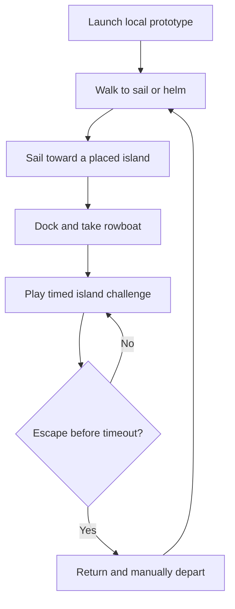
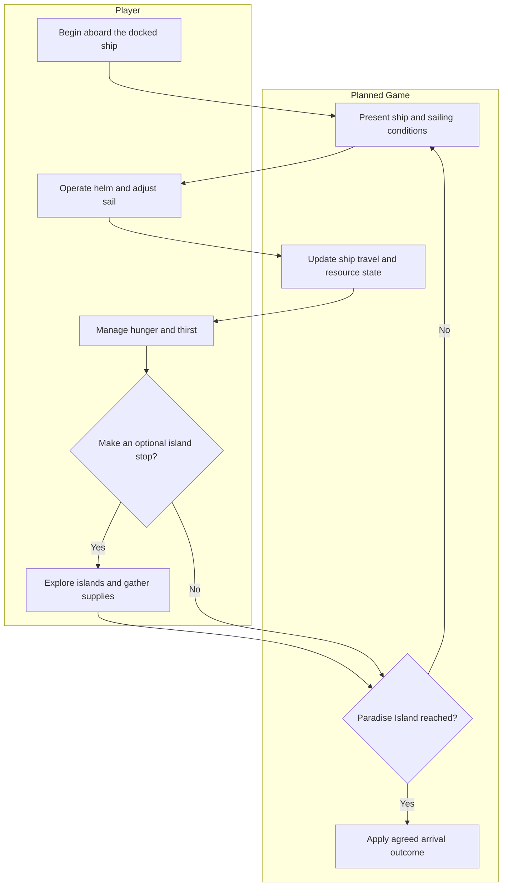
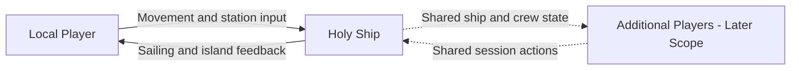

# Vision and Scope

**Project:** Holy Ship
**Team:** Team 13 (Gaming) — Whitney Akred, Shana Billiot, Liliana Matte, Leiton Peterson, Ivan Lopez, Gustavo Castillo  
**Client:** None — student-led TCU Senior Design project; the development team owns product decisions  
**Version:** 0.3
**Reviewed:** October 20, 2026

This document distinguishes the documented current prototype, the planned game, and ideas that still require a team decision. The current prototype supports one player sailing, operating stations, docking, and taking rowboat trips to timed island games. It is not yet the full survival voyage.

This revision uses the repository's minimal-MVP guide and glossary for current scope, the use cases for specified player behavior, and the team contract for decision ownership. Earlier meeting records provide background. Instructions and worked examples in unfinished templates are not project requirements. Where documents disagree, this draft records the conflict rather than assuming approval.

## Revision History

| Date | Version | Description | Author |
|---|---|---|---|
| 2026-09-11 | 0.1 | Initial draft based on September 10 meeting notes | Original author/reviewer not recorded |
| 2026-09-25 | 0.2 | Align name, student ownership, current prototype, planned game loop, feature status, and unresolved decisions with repository documentation | AI-assisted revision requested by Gustavo Castillo; pending team review |

## 1. Introduction

Holy Ship is a top-down 2D sailing and survival game for PC. Its intended experience centers on a shared ship: crew members operate stations, manage supplies, and travel toward Paradise Island, with optional island stops for treasure and resources. Development begins locally with one player; cooperative play is a later goal.

This document defines the product's purpose, intended benefits, stakeholders, and boundaries. It does not make every brainstormed feature a release commitment.

### 1.1 Background

Team 13 consists of six TCU Senior Design students who collectively define, develop, and evaluate the game. There is no external client to identify or obtain requirements from. Intended players provide feedback, and course instructors evaluate the project.

The September 10 meeting established the ship-survival concept, PC target, and single-player-first direction. Subsequent documentation identifies Godot, a top-down 2D presentation, and a planned loop of sailing, hunger/thirst management, and optional island visits.

The [prototype guide](../minimal-mvp.md) and [sailing guide](../sailing-integration.md) describe current code. The earlier deck-only prototype has grown into a local sailing/island loop. Survival, capsize/repair, full voyage progression, procedural world chunks, and networking remain planned.

### 1.2 Current Process Flows (As-Is Process Flows)

The current experience is a local sailing prototype. Use WASD or arrow keys to walk, E to operate a station, the sail to generate propulsion, and the helm to steer. Sail into an island's docking range, use the stern rowboat, complete the island challenge, and return to the ship. See [play instructions](../sailing-integration.md).

Cooking, fishing, item definitions, and a small per-player inventory also exist. They do not establish the planned survival stats, shared chests, or full inventory contract. The current gap is integrating the broader planned systems into a tested, manageable solo voyage.

The use cases contain 46 detailed entries across 11 areas. Their TBDs and deferred co-op flows prevent treating the entire document as completed or as the next milestone's scope. The glossary defines domain terms; [traceability](../traceability.md) links the requirements and designs.

### 1.3 References

Repository paths below are relative to the repository root.

| Reference | Date/version | Location |
|---|---|---|
| Minimal game starting point | Undated; reviewed 2026-09-25 | `docs/minimal-mvp.md` |
| Project glossary | Version 0.3, 2026-10-20 | `docs/requirements/project-glossary.md` |
| Use cases | Version 0.3, 2026-10-20 | `docs/requirements/use-cases.md` |
| Team contract | Signed 2026-09-04 | `docs/team-contract.md` |
| Initial interview and meeting record | Group meeting 1; records September 10 discussion | `docs/requirements/client-interview-guide.md` |
| Open issues | Entries raised 2026-09-13 | `docs/requirements/OPEN-ISSUES.md` |
| Software requirements specification | Version 0.2; project requirements and remaining TBDs | `docs/requirements/software-requirements-specification.md` |
| Business rules | Version 0.3; gameplay rules | `docs/requirements/business-rules.md` |
| Rough project assessment | Undated | `docs/napkin-round-0.md` |
| Project development constraints | Undated | `AGENTS.md` |
| Original vision-and-scope template | Previously supplied | https://github.com/tcu-cosc-40943/course-templates |
| Research candidates | Comparative findings not recorded | Don't Sleep With the Fishes; Raft, identified in the interview record |

## 2. Business Requirements

For this student-led project, business requirements describe intended player value and outcomes the development team can evaluate. No revenue or market-share objective has been established.

### 2.1 Business Opportunity or Problem Statement

Holy Ship explores whether moving between ship duties, responding to wind, and managing supplies can create an engaging survival journey. Optional island visits are intended to offer choices about collecting resources before continuing toward Paradise Island.

The immediate opportunity is to extend the local sailing prototype into a coherent survival experience and test its appeal. The larger cooperative vision adds shared responsibilities, but networking should not begin before the local boat-and-station loop is stable. The team's earlier single-player-first agreement remains relevant; the exact readiness gate for multiplayer is still undefined.

Player demand and differentiation from existing games have not been validated. The current prototype alone cannot establish those claims.

### 2.2 Business Objectives

The existing objectives and identifiers are retained. Their numerical targets are proposals from the earlier draft, not approved team commitments.

- **BO-independent-play:** Proposed target: at least 80% of first-time playtesters complete one agreed survival cycle without direct developer assistance.
- **BO-player-engagement:** Proposed target: at least 70% of playtesters say they would voluntarily play another session.

The planned cycle combines sailing toward Paradise Island, managing hunger and thirst, and optional island stops. The team must define the smaller cycle used for acceptance testing and decide when these objectives become applicable. Neither objective can be evaluated using deck movement alone.

### 2.3 Success Metrics

| Metric | Objective | Indicator and source | Baseline | Target and deadline status |
|---|---|---|---|---|
| **SM-independent-completion** | BO-independent-play | Observed proportion of first-time testers completing the agreed survival cycle without developer help | Not measured | Earlier proposed threshold: 80%; final MVP playtest date and scope require approval |
| **SM-repeat-interest** | BO-player-engagement | Proportion answering yes to whether they would voluntarily play another session | Not measured | Earlier proposed threshold: 70%; evaluation date requires approval |

The team must approve sample size, participant selection, standard instructions, measurement dates, and thresholds. Record actual baselines at the first relevant playtest. No existing measurement is inferred from the presence of a prototype.

### 2.4 Vision Statement

| Element | Statement |
|---|---|
| **For** | PC players interested in sailing, survival, and shared ship responsibilities |
| **Who** | Want to make decisions about operating a ship and obtaining supplies during a voyage |
| **The Holy Ship** | Is a top-down 2D sailing and survival game |
| **That** | Centers play on navigating a ship toward Paradise Island, managing hunger and thirst, and choosing optional island stops |
| **Unlike** | A concept expressed only through documents or disconnected mechanic demonstrations |
| **Our product** | Aims to connect physical ship duties and voyage decisions into a complete playable experience, developed locally before cooperative expansion |

This is intended positioning, not a demonstrated competitive advantage. Competitor research and player feedback must establish the latter.

### 2.5 Proposed Process Flows (To-Be Process Flows)

The planned loop adds survival and destination progression to the existing sailing/island prototype. Arrival, capsize, and restart have use cases; their remaining TBDs are not all approved mechanics. The older docked-start concept and extraction idea do not describe current launch behavior.

### 2.6 Risks

Probability is unmeasured unless stated otherwise; these are mechanisms to investigate, not numerical forecasts.

| Risk | Probability | Impact | Mitigation |
|---|---|---|---|
| **RI-unclear-differentiation:** Players may find no compelling reason to choose this experience over existing survival games | Unknown pending research | High | Compare player experiences and test the appeal of ship duties |
| **RI-unengaging-survival:** Repeated supply and station tasks may feel like chores | Unknown pending playtesting | High | Evaluate a small integrated loop before expanding content |
| **RI-solo-role-overload:** Simultaneous duties designed for a crew may overwhelm one player | Unknown pending integration | High | Tune solo timing and ensure essential actions remain achievable |
| **RI-style-expectation-mismatch:** Art may imply gameplay or polish the prototype cannot deliver | Unknown | Medium | Present the prototype's status clearly and keep replacement art inexpensive |
| **RI-unvalidated-concept:** Remaining at deck movement or adding disconnected features may leave the core experience unevaluated | Present exposure; likelihood unknown | High | Prioritize an integrated local boat-and-station milestone |
| **RI-unreachable-playtesters:** Testing only with developers may hide confusing controls and assumptions | Unknown; recruitment not established | High | Recruit intended players and define repeatable playtest tasks |

### 2.7 Business Assumptions and Dependencies

| Identifier | Assumption or dependency | Consequence if false |
|---|---|---|
| **AS-target-audience** | Players interested in ship-based survival are an appropriate audience | Revise positioning and priorities |
| **AS-solo-viability** | Ship duties can produce a satisfying solo experience | Revise task demands or consider assistance after testing |
| **AS-playtester-access** | Representative players can be recruited | Understanding and engagement metrics cannot be validated as planned |
| **AS-pc-access** | Intended players have suitable PCs | Reconsider hardware targets and access plans |
| **AS-course-scope** | The eventual agreed release scope fits course requirements and available time | Replan deliverables with course evaluators |

## 3. Stakeholder Profiles and User Descriptions

### 3.1 Stakeholder Profiles

| Stakeholder | Value or benefit | Attitude | Features of interest | Constraints | End user? |
|---|---|---|---|---|---|
| Team 13 development team | Deliver and evaluate a coherent game; develop engineering skills | Supportive based on project selection | Local gameplay, maintainable features, later cooperation | Course schedule, experience, and integration effort | Also internal testers |
| Intended solo players | Enjoyable and understandable sailing-survival experience | Not assessed | Ship operation, survival, voyage decisions | Hardware, available time, genre experience | Yes |
| Intended cooperative players | Shared ship responsibilities and coordinated play | Not assessed | Shared stations and sessions | Future networking and crew-size decisions | In later scope |
| Course instructors and evaluators | Assessable software and project evidence | Not documented | Demonstrable outcomes and requirements traceability | Course milestones and evaluation criteria | Not primarily |
| External playtesters | Evaluate and influence usability and enjoyment | Recruitment not established | Clear controls and a playable loop | Availability and prior experience | During testing |

The team contract assigns routine decisions to the use-case owner and team-wide decisions to the weekly meeting, with majority decisions and ties going to the project lead. It specifies feature branches, pull requests, and two independent approvals. The project lead's identity is not established here.

### 3.2 User Environment

The current prototype supports one local player using WASD or arrow keys. The intended product is a top-down 2D PC game. Minimum hardware, supported operating systems, voyage duration, accessibility requirements, and final control bindings have not been agreed.

The repository calls for Godot 4, GDScript, the Compatibility renderer, and preservation of Web-export compatibility. `project.godot` declares Godot 4.7 features; this does not establish an exact required patch version or a tested platform matrix. Browser delivery is not a committed release platform.

The current milestone is single-player. The retained deferred LAN design caps sessions at four players including the Host; neither AGENTS.md nor this documentation update authorizes networking implementation.

### 3.3 Alternatives and Competition

| Alternative | Known strengths from available records | Weaknesses or gaps to investigate |
|---|---|---|
| Don't Sleep With the Fishes | Team-selected research reference | Comparative findings not recorded |
| Raft | Team-selected research reference | Comparative findings not recorded |
| Status quo: players continue with existing games | No need to learn or adopt this product | An unmet need for this game has not yet been established |
| Keep only the movement prototype | Provides a small environment for learning and testing movement | Cannot deliver or validate the proposed survival voyage |

## 4. Scope and Limitations

### 4.1 Product Perspective

Holy Ship is a real-time game, with inventory and supplies as potential gameplay state. The rough assessment mentions a database, but no reviewed requirement establishes a database, account service, or external integration. Those are not current scope commitments.

The ship is the primary environment. Development guidance calls for reusable station systems and eventual indefinite ocean travel through deterministic or recycled sections. The current repeating ocean visual and hand-placed islands do not implement deterministic world-chunk generation.

### 4.2 Major Features and Scope

Existing identifiers are retained; status does not imply implementation.

| Identifier | Capability | Status |
|---|---|---|
| **FEAT-deck-movement** | Move one character around the ship within its deck boundary | Implemented prototype |
| **FEAT-single-player-survival** | Manage a local sailing/survival experience | Single-player is current scope; survival stats remain planned |
| **FEAT-ship-stations** | Operate ship duties at interactive locations | Helm, sail, cooking, and fishing exist; common station lifecycle and other stations are planned |
| **FEAT-sailing-control** | Steer and trim sails in relation to wind | Prototype implemented; planned NAV extensions and tuning remain open |
| **FEAT-ocean-travel** | Travel through a continuing ocean | Moving ship and repeating ocean exist; deterministic/recycled world chunks remain planned |
| **FEAT-food-water-management** | Gather/catch food, experiment with recipes and replenish hunger/health | Connected cooking/SURV/FTG use cases are planned, with tuning open; water/thirst deferred from this slice |
| **FEAT-island-exploration** | Visit islands and gather supplies or complete challenges | Rowboat trips and two timed island games exist; persistent voyage resources and wreck salvage remain planned |
| **FEAT-stamina-movement** | Earlier proposal for sprinting/swimming stamina | Historical feature ID retained; no separate stamina system approved. FTG specifies fatigue; DECK/ISLE describe planned overboard alternatives |
| **FEAT-ship-repair** | Repair open hull leaks | SHIP rules and design exist; code and tuning remain pending |
| **FEAT-floating-chests** | Collect floating ocean chests | Earlier idea without a dedicated active use case; not current scope |
| **FEAT-voyage-progress** | Progress toward Paradise Island | PROG use cases and design exist; full voyage management not implemented |
| **FEAT-cooperative-play** | Share a ship among multiple players | Deferred LAN design for 1–4 players; no current networking |
| **FEAT-session-setup** | Start a voyage, choose appearance, and manage sessions | PROG specified; LAN host/join and readiness are deferred |
| **FEAT-trading-encounters** | Trade items for shared voyage gold | Merchant behavior specified in EVT with TBD prices; pirate combat is not implied |
| **FEAT-ocean-encounters** | Select events per visited tile and weather storms | EVT/WAVE specified with TBD event tables and tuning; not implemented |
| **FEAT-npc-assistance** | Receive help from game-controlled crew | Earlier idea; no current use case or implementation commitment |
| **FEAT-overboard-rescue** | Help a crew member return to safety | Earlier rescue idea; planned plank/ladder movement is not a rescue subsystem |
| **FEAT-role-attributes** | Give roles distinct gameplay attributes | Earlier idea; not approved current scope |

The connected cooking/survival slice uses food from islands/fishing, recipe experimentation, separate hunger/health and progressive fatigue affecting cooking. Hunger below 40% and low health at the 10% threshold cause fatigue; zero hunger damages health and zero health ends the voyage in game over. Horrible recipes damage rather than heal, even at three preparation stars. Ship motion continues during cooking/rest unless anchored. Thirst/raw-food illness are deferred; automatic pass-out recovery is retired for this slice. Exact rates, boundary comparisons, recipe values and rest benefits remain open. Other feature scope is unchanged.

### 4.3 MVP Scope

**Current milestone: single-player.** The owner confirmed on 2026-10-20 that co-op remains deferred. Existing code supports deck movement, helm/sail propulsion, cooking/fishing interactions, item metadata and a small inventory, docking at two hand-placed islands, rowboat scene transitions, and timed coconut/treasure challenges. See [minimal MVP](../minimal-mvp.md) for the source map and known limits.

**Planned, not delivered:** SURV/FTG stats, WAVE capsize, SHIP repairs, SYS shared chests and slot inventory, MAP charts, EVT events/trading, and PROG voyage lifecycle. The current tests do not prove those use cases. Large inventory, crafting, and progression expansions still require an explicit milestone decision.

**Deferred co-op:** Host/join, LAN replication, disconnect recovery, joint repair, and multi-crew occupancy/competition. The retained design cap is four including the Host. The local player owns applicable session controls; local state authority does not require a networking abstraction.

**Source ownership:** Use this section for milestone status; [business rules](business-rules.md) for domain constraints; [use cases](use-cases.md) for planned flows; [glossary](project-glossary.md) for terms; [specification](software-requirements-specification.md) for cross-cutting constraints/quality; area designs for implementation proposals. Historical interviews, brainstorming, and template examples do not override these. If two designs make incompatible choices, record the issue instead of treating either as automatically approved.

**Next milestone:** The team still needs to choose a narrow subset of the remaining planned behaviors and its acceptance criteria. The entire backlog and a delivery date have not been approved.

### 4.4 Deployment Considerations

Open `project.godot` in Godot and use **Run Project (F5)**. Windows is the initial desktop target in the specification; minimum hardware, tested OS versions, distribution, and a browser support matrix remain undecided.

Preserve Web-export compatibility without describing a browser release as delivered: the minimal-MVP guide says the optional export preset was removed and may be added later. No hosting deployment or external service is currently required by the documented local prototype.

Before distribution, decide how players obtain builds, learn controls, report problems, and identify versions. Voyages are not saved between sessions. Scene-to-scene retention, intended session length, future networking details, and post-course maintenance still require work. No existing user-data migration is identified.

## Review Questions and Documentation Conflicts

See [OPEN-ISSUES.md](OPEN-ISSUES.md) for owners and unresolved decisions, including inventory acceptance, sail rotation, swimming alternatives, cross-area state contracts, fatigue effects, testing targets, and communication-channel conflicts. The individual use cases retain detailed tuning questions; the issue register indexes those sections.

The project has 23 active gameplay-rule definitions and 46 detailed use cases. Their presence is evidence of documentation, not client approval, implementation, or test completion. Template examples remain explicitly instructional and must not be treated as project requirements.
